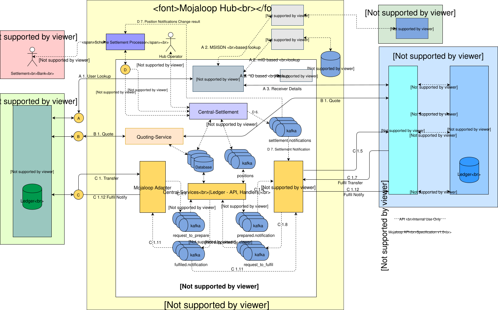

# Mojaloop. Descripción general técnica

## Mojaloop Servicios

La idea fundamental en la que se basa «Mojaloop» es que debemos conectar a múltiples proveedores de servicios financieros digitales (DFSP) en una red competitiva y con interoperabilidad, con el fin de maximizar las oportunidades de que las personas en situación de pobreza puedan acceder a servicios financieros con tarifas bajas o sin ellas. No deseamos que un único poder monopolístico controle todos los pagos de un país, ni un sistema que excluya a nuevos participantes. Tampoco resulta beneficioso que existan demasiadas subredes aisladas. Los siguientes diagramas muestran las Mojaloop interconexiones entre los DFSP y el Mojaloop Hub (ejemplo de implementación del esquema) para una Transferencia P2P:

Mojaloop aborda estas cuestiones de varias formas clave:
* Un conjunto de servicios centrales proporciona un Hub a través del cual el dinero puede fluir de un DFSP a otro. Esto es similar a cómo se mueve el dinero a través de un banco central o una Cámara de compensación en los países desarrollados. Además de un Libro mayor central, los servicios centrales pueden proporcionar la verificación de identidad, la gestión del fraude y hacer cumplir las reglas del Esquema de pagos.
* Un conjunto estándar de interfaces que un «DFSP» puede implementar para conectarse al Sistema, así como código de ejemplo que muestra cómo utilizarlo. Un «DFSP» que desee conectarse puede adaptar nuestro código de ejemplo o implementar las interfaces estándar en su propio software. El objetivo es que resulte lo más sencillo posible para un «DFSP» conectarse a la red de Interoperabilidad.
* Implementaciones completas y funcionales de código abierto de ambos lados de las interfaces: un ejemplo de «DFSP» capaz de enviar y recibir pagos, y el cliente que un «DFSP» ya existente podría alojar para conectarse a la red.

El Hub «Mojaloop» es el contenedor principal y la referencia que utilizamos para describir el ecosistema «Mojaloop», que se divide en los siguientes ámbitos:
* Mojaloop Servicios de Código abierto: software de Código abierto (OSS) básico «Mojaloop» que ha contado con el apoyo de la Fundación Bill y Melinda Gates en colaboración con la comunidad de Código abierto.
* Mojaloop Hub: la implementación general de referencia (y personalizable) Mojaloop para los Operadores del Hub se basa en la solución de OSS mencionada anteriormente.