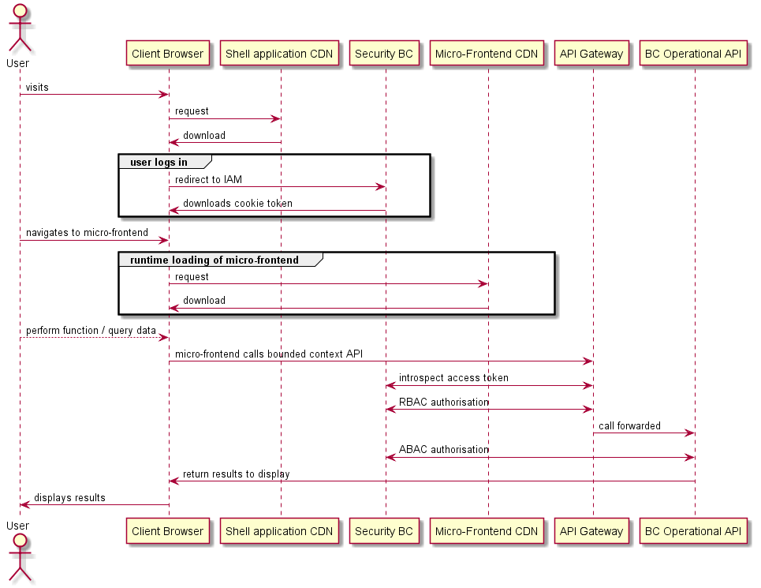
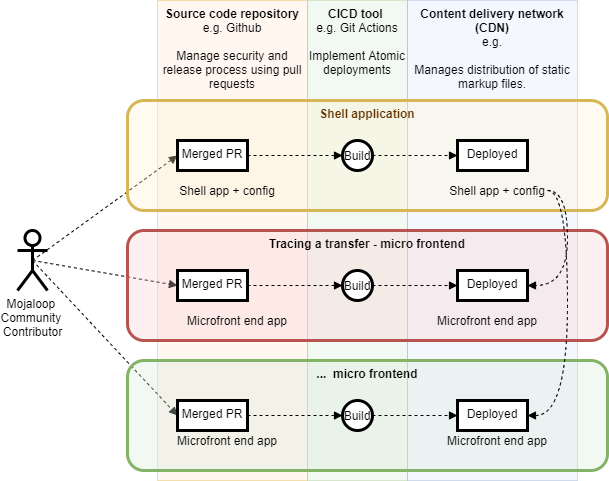

# Microfrontend: diseño de JAMStack
## Descripción general
El objetivo del diseño de microfrontend (JAMStack) es crear un marco de trabajo que:

- permite a la comunidad colaborar con facilidad (al facilitar el desarrollo independiente de componentes)
- facilita la creación de extensiones o personalizaciones
- permite a los miembros de la comunidad contribuir al software libre sin necesidad de crear una rama de todo el código fuente

### Microfrontends
El marco utiliza microfrontends como medio para desacoplar partes de la interfaz de usuario, con el fin de facilitar la mantenibilidad del código, el funcionamiento de equipos autónomos, la realización de lanzamientos independientes y las actualizaciones incrementales de partes de la interfaz de usuario. 

### JAMStack
La implementación [JAMStack](https://jamstack.org/) reduce el rol del servidor web a la distribución de archivos de marcado estáticos, manteniendo la funcionalidad en JavaScript (que se ejecuta en el navegador del cliente) y en el backend API. 
:::warning JAMStack son las siglas de:
 **J** - JavaScript
 **A** - API 
 **M** - Marcado estático
 :::
Esta implementación de la pila se considera una buena práctica, ya que:
- es mucho más sencillo de mantener seguro
- ofrece una buena experiencia al cliente, ya que cuenta con tiempos de respuesta web rápidos
- su alojamiento resulta económico

Además, también se han desarrollado los siguientes elementos, que suelen formar parte de una implementación de JAMStack:
- despliegue en una red de distribución de contenidos (CDN)
- despliegues atómicos
- utiliza microfrontends cargados dinámicamente, por lo que la actualización a la última versión es automática

## Pila tecnológica

1. **React** 
El marco se basa en la biblioteca React.
Se trata de la biblioteca de aplicaciones de página única (SPA) más utilizada, y, además, esta elección nos permite aprovechar los esfuerzos de la comunidad, lo que facilita una conversión sencilla a esta biblioteca.
Se puede mejorar utilizando bibliotecas de contenedores de estado (Redux, Flux, MobX); no obstante, no existe ninguna restricción en cuanto al uso de una en concreto.
Los microfrontends incluyen almacenes Redux preconfigurados y aislados.

2. **Webpack 5** 
Webpack 5 es, en la actualidad, el único empaquetador de JavaScript que admite la separación remota de compilaciones. Esto se consigue mediante el plugin Module Federation.
Permite la composición en tiempo de ejecución para ofrecer a los usuarios una experiencia fluida y totalmente transparente, lo que da como resultado una aplicación de página única tradicional.
Existen ventajas adicionales con respecto a otras tecnologías, lo que se traduce en un tamaño reducido y, en general, en una mejor experiencia para los usuarios.
Webpack 5 implementará la integración de microfrontends «host» y «child» en tiempo de ejecución.

3. **CI/CD y despliegues atómicos** (por ejemplo, GitHub Actions) 
Cada implementación del Marco de Operaciones Empresariales deberá implementar su propia solución de despliegue atómico.
El proyecto estándar de Operaciones Empresariales utilizará GitHub Actions para llevar a cabo la tarea de ejecutar un proceso de integración continua, realizar las pruebas pertinentes, compilar cada microfrontend y desplegar los archivos estáticos resultantes a través de una CDN y/o crear una imagen de «Docker».
Cada microfrontend se lanza con total autonomía: la aplicación resultante puede utilizar automáticamente las versiones actualizadas de cada microfrontend individual, sin que sea necesaria ninguna coordinación adicional.

4. **Ejecución en una CDN**
Los microfrontends pueden ejecutarse en una CDN. Las compilaciones individuales se componen únicamente de archivos estáticos (HTML, CSS, JavaScript) y pueden realizarse en diferentes ubicaciones o en diferentes URL.
Siempre que estén disponibles a través de una conexión segura (HTTPS), los microfrontends pueden servirse desde cualquier ubicación y también desde diferentes CDN.

5. **Kubernetes en marcha** 
Los microfrontends pueden ejecutarse en un entorno «Kubernetes». En este sentido, existen dos enfoques posibles:
   - Los distintos microfrontends y la aplicación shell se ejecutan en contenedores (utilizando, por ejemplo, Docker) y, a continuación, se alojan en Kubernetes.
Las aplicaciones del servidor y de los niños pueden implementarse en el mismo clúster o en clústeres diferentes, siempre y cuando sean accesibles públicamente.
   - Implemente una CDN privada en el clúster «Kubernetes» y aloje los archivos de marcado estáticos en la CDN.
Existen varias redes de distribución de contenidos (CDN) disponibles que son compatibles con la versión Kubernetes.

## Compilación con Webpack

Las aplicaciones del servidor y de los niños incluyen scripts para compilar los artefactos de distribución. La compilación puede realizarse en el equipo del desarrollador, en el entorno de integración continua (CI) y en «Docker».

## Carga de microfrontends 

El host se encarga de cargar las aplicaciones secundarias en tiempo de ejecución. Recopila información sobre las aplicaciones secundarias disponibles en tiempo de ejecución, ya sea a partir de un API o del registro.

El host incluye un motor interno encargado de cargar únicamente los elementos secundarios necesarios en el momento en que deban mostrarse.

Los microfrontends individuales no se cargarán cuando no sea necesario (por ejemplo, cuando el usuario no acceda a una página concreta).

**Diagrama de secuencia de alto nivel que ilustra cómo se cargan los microservicios**


### Repositorio de microfrontends
Con el fin de contar con una autoridad centralizada encargada de supervisar que cada uno de los microfrontends cumpla los requisitos necesarios, se sugiere desarrollar una solución que funcione como un registro.

El registro tendría las siguientes finalidades:

1. permitir a la comunidad registrar los microfrontends y especificar algunos detalles
2. exponer un API utilizado por el host para obtener información sobre los microfrontends disponibles
3. proporcionar información sobre las versiones de los microfrontends disponibles

El registro aún no existe, ni tiene sentido crearlo en este momento. 

## Despliegues

El siguiente diagrama de descripción general muestra el despliegue de los microfrontends en una CDN.
::: consejo NOTA
En este diagrama no se incluye el despliegue del contexto delimitado API.
:::


Los microfrontends utilizan despliegues atómicos y nunca es necesario realizar una compilación completa.

Cada microfrontend se despliega de forma independiente respecto a los demás.

### Integración continua / Entrega continua (CI/CD)

Cada microfrontend cuenta con su propia configuración de CI/CD; no es necesario compartir la misma configuración ni utilizar la misma herramienta de CI.

El CI/CD se puede configurar para que admita varios entornos, por ejemplo, DEV, QA y PROD.

A continuación se muestra un archivo de ejemplo que ilustra un flujo de trabajo de Git Actions.

```yml
# This is a basic workflow to help you get started with Actions

name: CI

# Controls when the action will run. Triggers the workflow on push or pull request
# events but only for the master branch
on:
  push:
    branches: [ master ]
  pull_request:
    branches: [ master ]

# A workflow run is made up of one or more jobs that can run sequentially or in parallel
jobs:
  # This workflow contains a single job called "build"
  build:
    # The type of runner that the job will run on
    runs-on: ubuntu-latest

    strategy:
      matrix:
        node-version: [16.x]


    # Steps represent a sequence of tasks that will be executed as part of the job
    steps:
    # Checks-out your repository under $GITHUB_WORKSPACE, so your job can access it
    - uses: actions/checkout@v2

    # Runs a single command using the runners shell
    - name: Use NodeJS ${{ matrix.node-version }}
      uses: actions/setup-node@v1
      with:
        node-version: ${{ matrix.node-version }}
    - name: Cache node modules
      uses: actions/cache@v2
      env:
        cache-name: cache-node-modules
      with:
        # npm cache files are stored in `~/.npm` on Linux/macOS
        path: '**/node_modules'
        key: ${{ runner.os }}-build-${{ env.cache-name }}-${{ hashFiles('**/yarn.lock') }}
        restore-keys: |
          ${{ runner.os }}-build-${{ env.cache-name }}-
          ${{ runner.os }}-build-
          ${{ runner.os }}-
    - run: yarn install --frozen-lockfile
    - run: yarn lint
    - run: yarn test
    - run: yarn build
#    - name: Slack Notification
#      uses: rtCamp/action-slack-notify@v2.0.2
#      env:
#        SLACK_WEBHOOK: ${{ secrets.SLACK_WEBHOOK }}
```

### CDN

La SPA resultante se aloja en una CDN o en varias CDN. Los microfrontends individuales pueden alojarse en diferentes CDN.

### Kubernetes

La aplicación SPA resultante puede ejecutarse y prestarse en uno o más entornos de tipo «Kubernetes».

### Aplicación anfitriona

La aplicación anfitriona se entrega con una configuración predeterminada lista para usar. No requiere ninguna configuración específica distinta de la de una SPA tradicional, salvo la configuración de «Module Federation» de Webpack 5.
Actuará como orquestador, cargando los microfrontends remotos y proporcionándoles funcionalidades para toda la aplicación, como, por ejemplo, la autenticación, el RBAC y el enrutamiento del lado del cliente.

Prácticamente no hay ningún límite en cuanto al crecimiento del host ni a su capacidad de ampliación.
No obstante, se recomienda centralizar toda la comunicación entre el host y los procesos hijos, así como los componentes compartidos, en una biblioteca externa, de modo que tanto el host como los procesos hijos dispongan de la misma información y no se vea afectada la integración.

### Control de versiones de los microfrontends
​El enfoque que se propone consiste en crear un registro en el que se inscriban las aplicaciones individuales. Dicho registro permitiría establecer determinados parámetros de configuración para cada aplicación y realizar un seguimiento de todas las versiones disponibles.
​
A continuación, el registro mostraría un «API» consumido por el host, proporcionando información sobre los microfrontends disponibles, sus versiones y la ubicación de los artefactos.
​
El registro sería gestionado por un operador de confianza a través de una interfaz de usuario; correspondería al operador de confianza decidir qué versión de cada aplicación concreta se haría pública y estaría disponible para que el servidor la cargara.
Además, permitiría probar fácilmente las versiones y deshacer la reserva de los cambios cuando fuera necesario, todo ello sin necesidad de volver a compilar ni a implementar las aplicaciones.
​
::: tip NOTA
Los archivos de compilación de JS generados por Webpack no incluyen la versión en el nombre del archivo. Podría ser necesario actualizar la compilación para poder diferenciar las versiones. Una forma más sencilla, que no requiere actualizar la configuración de la compilación, consistiría en alojar las versiones en diferentes URL.
:::
​
### Actualización del servidor
​El servidor está prácticamente aislado y lo único que hay que hacer para gestionar correctamente las versiones es utilizar el comando integrado «`yarn version`». Este creará una nueva etiqueta de Git e incrementará la versión «`package.json`» según cómo se utilice el comando (interactivo «CLI»).
​
### Actualización de los mandos a distancia
Los mandos a distancia están aislados y lo único que hay que hacer para gestionar correctamente las versiones es utilizar el comando integrado «`yarn version`». Este creará una nueva etiqueta de Git e incrementará la versión «`package.json`» según cómo se utilice el comando (interactivo «CLI»).

### Menú / Estructura de la aplicación
El host está configurado para generar dinámicamente la estructura de _Menu_ y _Pages_ (con react-router). Actualmente, los componentes _Menu_ se importan desde la biblioteca `@modusbox/react-components`.
​
No es estrictamente necesario utilizar dichos componentes, y tanto el host como los dispositivos remotos podrían emplear componentes personalizados, siempre y cuando permitan la composición dinámica y sean compatibles con el Enrutamiento.
​​
## La motivación detrás de los microfrontends con más detalle

​La creación de interfaces de usuario escalables y distribuidas resulta complicada; la complejidad de la lógica, las configuraciones de pruebas y los costes de compilación y Despliegue aumentan con el tiempo. ​Las decisiones arquitectónicas tomadas en la fase inicial pueden generar una complejidad innecesaria y afectar considerablemente a los costes de desarrollo en etapas posteriores.​ Además, un único proyecto no se adapta bien a equipos distribuidos que colaboran en la misma base de código.​ El cambio a una configuración de microfrontend puede resolver todos los problemas mencionados anteriormente; se adapta bien a la escalabilidad, los despliegues atómicos no requieren una compilación completa y los equipos independientes pueden utilizar diferentes bases de código.​​

### ¿Qué caracteriza a un microfrontend?

​Las principales reglas que definen una configuración de microfrontends pueden resumirse de la siguiente manera:​

**Responsabilidad única**
Límites definidos y cerrados
Orquestación centralizada​
Responsabilidad única
​Cada aplicación de microfront-end debe limitarse a proporcionar funcionalidades empresariales específicas. Una aplicación de microfront-end no necesita conocer otros aspectos de la Empresa y puede escalar de forma independiente.​

**Límites definidos y cerrados**
​Cada microfrontend debe estar aislado, disponer de sus propios datos, y no debe ser posible la comunicación directa entre microfrontends.​

**Orquestación centralizada**
​Cada microfrontend debe ser cargado, gestionado y controlado por un host. El host proporciona las funcionalidades comunes a toda la aplicación (Autenticación, Enrutamiento, etc.).​​

### Tipos de configuraciones de microfrontends

​Existen varias formas de implementar microfrontends; por citar algunas:​
- Composición mediante iframes
- Composición en tiempo de ejecución
- Composición mediante federación de módulos (en un único marco de trabajo)​

**Composición con iframes**
​La composición con iframes es, posiblemente, la forma más antigua y sencilla de implementar microfrontends, debido a la compatibilidad que el HTML antiguo ofrece con los iframes y al aislamiento de contexto nativo que estos proporcionan. La comunicación entre el host y los microfrontends suele ser difícil de lograr y, además, no encaja bien en la web moderna.​

**Composición en tiempo de ejecución**
​La composición en tiempo de ejecución consiste en cargar dinámicamente scripts de JavaScript ubicados en direcciones URL http/https y componer el resultado de forma local. ​Aunque, en teoría, permite utilizar tecnologías independientes para cada microfrontend, también resulta muy difícil de mantener debido a las diferencias entre los marcos de trabajo utilizados en los microfrontends.​​

**Composición de SPA**
​La federación de módulos es una tecnología implementada en Webpack 5 que permite cargar dinámicamente módulos remotos en tiempo de ejecución. Cuando se combina con un único marco de trabajo de aplicaciones (por ejemplo, React), permite dividir las aplicaciones compiladas en múltiples microfrontends sin renunciar a las ventajas que ofrece una SPA. Además, presenta la ventaja de reducir el tamaño de las compilaciones.​​

### La configuración elegida

Hemos optado por utilizar la composición de una aplicación de página única (SPA) mediante Webpack 5 y React. Cabe mencionar que, para desarrollar una SPA con múltiples microfrontends, es necesario implementar y respetar un contrato específico y riguroso entre el host y los frontends.​ A partir de ahora nos referiremos a los microfrontends utilizando el término técnico empleado por Webpack 5: «remotes». ​El contrato se define mediante las siguientes reglas:​

- El servidor recupera la lista de mandos a distancia de forma dinámica y asíncrona
- El anfitrión es responsable de cargar los mandos a distancia
- El servidor comparte cierta información contextual con los clientes remotos (Enrutamiento, Autenticación)
- Los mandos a distancia tienen nombres únicos
- El despliegue de los controles remotos se ha realizado en diferentes direcciones URL
- Los controles remotos no utilizan reglas CSS globales
- Los controles remotos se exportan según lo establecido en las reglas de federación de módulos.
- Los mandos a distancia comparten la misma versión de React (y de algunas bibliotecas)​

Cuando se respetan estas reglas, el crecimiento de la SPA no tiene prácticamente ningún límite. La mayor parte de las dependencias básicas utilizadas en cada frontend las proporciona el host. Esto facilita su actualización cuando sea necesario. Cada aplicación se desarrolla de forma independiente de las demás; el proceso de CI/CD sigue siendo rápido, los despliegues atómicos no requieren configuraciones complejas y cada entorno remoto se lanza a su propio ritmo, sin necesidad de modificar el host en modo alguno.

### Ejemplo en vivo alojado en una CDN

Eche un vistazo al siguiente ejemplo en tiempo real: [https://microfrontend-shell-boilerplate.vercel.app/](https://microfrontend-shell-boilerplate.vercel.app/)

## Repositorios de Git

A continuación se incluye una lista de los repositorios de Git que forman parte de esta implementación:

 - [Plantilla de microfrontend-shell-](https://github.com/mojaloop/microfrontend-shell-boilerplate)
 - [Plantilla de microfrontend](https://github.com/mojaloop/microfrontend-boilerplate)
 - [Micro frontend-utils](https://github.com/modusintegration/microfrontend-utils)
Biblioteca compartida tanto por la aplicación shell como por el microfrontend.
 - [Informes - Asignación de roles de BizOps en el Micro-frontend](https://github.com/mojaloop/reporting-hub-bop-role-ui)
 - [Informes - Hub BizOps - Seguimiento de transacciones - Micro-frontend](https://github.com/mojaloop/reporting-hub-bop-trx-ui)]

