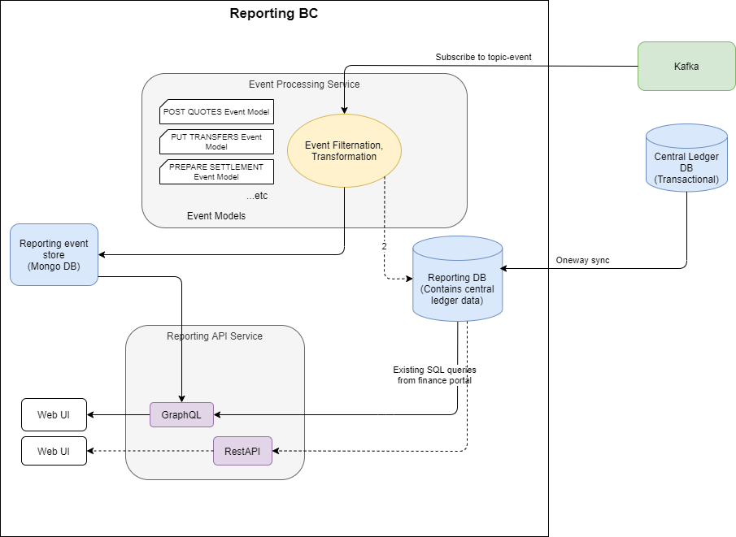
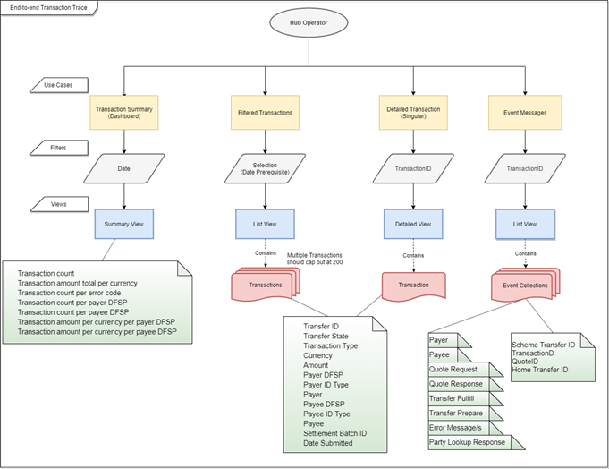

# Informe sobre la implementación del contexto delimitado

Uno de los objetivos de este proyecto de Workstream es ofrecer la posibilidad de realizar un seguimiento de una transferencia de extremo a extremo. Para alcanzar este objetivo, se desarrollará parte del contexto delimitado (BC) de generación de informes de acuerdo con la arquitectura de referencia.


## Descripción general del diseño

A continuación se presenta el diseño arquitectónico general.



En la versión Mojaloop, todos los servicios principales ya envían eventos a la versión Kafka en un tema (denominado «topic-event»).

Existen dos bases de datos fundamentales para la generación de informes:
1. **Base de datos de informes** 
La base de datos de informes es una base de datos relacional que registra el estado más reciente de los objetos «Mojaloop» y los pone a disposición a través de una interfaz de consulta eficiente. \
\
En la implementación de esta Workstream, se utilizará una réplica específica de la base de datos del Libro mayor central para la generación de informes. Esto no se ajusta del todo al modelo arquitectónico, ya que una base de datos perteneciente al contexto delimitado de generación de informes no debería tener dependencias externas. Una base de datos réplica del Libro mayor central depende del esquema del Libro mayor central y, por lo tanto, presenta una dependencia externa. 
::: advertencia: Deuda técnica
Esto debe considerarse como **deuda técnica** que deberá saldarse a medida que se vaya completando la arquitectura de referencia. 
:::
Existen dos enfoques que pueden adoptarse a la hora de saldar esta deuda técnica:
  - Cambiar la llamada a la réplica por una función de **sincronización de datos unidireccional**, lo que desacoplaría los esquemas de las dos bases de datos.
  - Reconstruir una **base de datos relacional** de nuevo diseño, que se actualice en función de los temas a los que se esté suscritoKafka.

El mejor enfoque dependerá del estado de la versión actual Mojaloop en el momento en que se salde esta deuda. \
\
2. **Base de datos de eventos** 
La base de datos de eventos recoge los detalles de los eventos y puede ofrecer una visión más detallada de lo ocurrido a través de los informes. 

**Limitaciones del proyecto relativo al almacén de eventos en esta Workstream**
Este diseño se implementará en la versión actual Mojaloop. 

En la actualidad, solo se recopilarán y pondrán a disposición a través del informe API los datos necesarios para realizar un seguimiento de extremo a extremo de una transferencia. Se pueden añadir fácilmente ampliaciones a esta oferta ampliando el Procesador de eventos para que procese mensajes de nuevos casos de uso y los almacene en la base de datos MongoDB, y, a continuación, configurando la consulta genérica de recursos GraphQL con el fin de consultar adecuadamente los nuevos almacenes de datos.

## Adecuación a la arquitectura de referencia

Aunque el contexto delimitado se refiere a la presentación de informes y la auditoría, este proyecto apenas empieza a abordar la parte de la presentación de informes de dicha definición. El diseño actual es independiente de otros contextos delimitados, lo cual se ajusta a la arquitectura de referencia. 

(No existe una separación total, ya que el diseño actual utiliza una base de datos réplica como base de datos de informes. La deuda técnica y los próximos pasos para resolver esta situación se describen más arriba.)


Es importante tener en cuenta cómo irá cambiando este contexto delimitado a medida que se vaya implementando una mayor parte del diseño de la arquitectura de referencia.

Los contextos delimitados dejarán de almacenar datos en las bases de datos del Libro mayor central durante la implementación de la arquitectura de referencia.

Existen tres enfoques que pueden adoptarse para adaptarse a este cambio. La forma en que se construya la arquitectura de referencia determinará cuál es el mejor enfoque:
1. Modificar la funcionalidad de sincronización para adaptarla al nuevo almacén de datos del contexto delimitado.
2. Ampliar el Procesador de eventos de mensajes para capturar la información necesaria en la base de datos de informes.
3. Invocar las API del contexto delimitado recién definidas para recuperar los datos necesarios.

## Casos de uso que facilitan el seguimiento de una transferencia


Con el fin de realizar un seguimiento eficaz de una transferencia de extremo a extremo, se definieron cuatro casos de uso.

### Caso de uso 1: Vista del tablero


**En mi calidad de** especialista en operaciones empresariales del Hub,
**deseo** disponer de un resumen en un tablero de control de alto nivel sobre las transferencias que pasan por el Hub, basado en un intervalo de fecha y hora, 
**para poder** realizar el monitoreo proactivo del estado del ecosistema.

:::::: col-wrapper

| Datos devueltos |

| --- |
| Número de transferencias |

| Monto de la transferencia total por divisa |

| Número de transferencias por código de error  |

| Número de transferencias por Pagador DFSP |

| Número de transferencias por Beneficiario DFSP |

| Monto de la transferencia por divisa y por pagador DFSP |

| Monto de la transferencia por divisa y por Beneficiario DFSP |

:::::::::

### Caso de uso 2: Vista de lista de transferencias


**En mi calidad de** especialista en operaciones empresariales del Hub,
**deseo** consultar una lista de transferencias que se pueda filtrar en función de uno o varios de los siguientes criterios: 
- Siempre obligatorio (debe indicarse en todas las llamadas)
   - Intervalo de fecha y hora

- Filtros opcionales 

   - Un beneficiario concreto DFSP

   - Un tipo específico de identificador de beneficiario 

   - Un beneficiario concreto

   - Un pagador concretoDFSP

   - Un tipo específico de identificador de pagador

   - Un pagador concreto

   - Estado de la transferencia de dinero

   - Moneda


- Sería conveniente disponer de filtros (no es un requisito imprescindible, pero deberían incluirse si el diseño lo permite)

   - Un código de error concreto

   - Ventana de liquidación

   - ID del lote de liquidación: El identificador único del lote de liquidación en el que se ha liquidado la transferencia. Si la transferencia aún no se ha liquidado, este campo aparece en blanco.

   - Cadena de búsqueda en los mensajes


**De este modo**, podré realizar el monitoreo proactivo del estado del ecosistema al disponer de una visión más detallada de los datos de transferencia que circulan por el Hub.

:::::: col-wrapper

| Datos devueltos | |

| --- | --- |
| ID de la transferencia | El identificador único de la transferencia |

| Estado de la transferencia | Indica si la transferencia se ha realizado correctamente, está pendiente o se ha producido un error |

| Tipo de transferencia | (Por ejemplo: P2P) |

| Divisa | La divisa de la transferencia |

| Importe | Monto de la transferencia |

| Pagador DFSP  | |

| Tipo de identificador del pagador  | |

| Pagador | |

| Beneficiario DFSP | |

| Tipo de identificación del beneficiario | |

| Beneficiario | |

| ID del lote de liquidación | El identificador único del lote de liquidación en el que se ha liquidado la transferencia. settled.<br> Si la transferencia aún no se ha liquidado, este campo queda en blanco. |

| Fecha de envío | La fecha y la hora en que se inició la transferencia. |

:::::::::

### Caso de uso 3: Vista detallada de la transferencia


**En mi calidad de** especialista en operaciones empresariales del Operador del Hub, 
**deseo** rastrear una transferencia concreta a partir de su ID de transferencia,
**para poder** identificar:

- El momento y la situación actual de la transferencia

- Cualquier información sobre errores relacionada con dicha transferencia

- La información relativa a la cotización y los plazos correspondientes a dicha transferencia

- El estado y los identificadores del proceso de liquidación correspondiente


:::::: col-wrapper

| Datos devueltos | |

| --- | --- |
| ID de la transferencia | El identificador único de la transferencia |

| Estado de la transferencia | Indica si la transferencia se ha realizado correctamente, está pendiente o se ha producido un error |

| Tipo de transferencia | (Por ejemplo: P2P) |

| Divisa | La divisa de la transferencia |

| Importe | Monto de la transferencia |

| ID del lote de liquidación | El identificador único del lote de liquidación en el que se ha liquidado la transferencia. settled.<br> Si la transferencia aún no se ha liquidado, este campo queda en blanco. |

| Pagador |  |

| Datos del pagador | El identificador único del pagador (normalmente, un MSISDN, es decir, un número de móvil) |

| Pagador DFSP | |

| Beneficiario DFSP | |

| Beneficiario | |

| Datos del beneficiario | El identificador único del beneficiario (normalmente, un MSISDN, es decir, un número de móvil) |

| Estado de la transferencia | Indica si la transferencia se ha realizado correctamente, está pendiente o se ha producido un error |

| Fecha de envío | La fecha y la hora en que se inició la transferencia |

:::::::::

### Caso de uso 4: Vista de mensajes de transferencia de transferencia


**En mi calidad de** especialista en operaciones empresariales del Operador del Hub, 
**deseo** consultar los mensajes detallados correspondientes a su ID de transferencia,
**para poder** investigar cualquier problema inesperado relacionado con dicha transferencia.

:::::: col-wrapper

| Datos devueltos | |

| --- | --- |
| Número de identificación de la transferencia del esquema de pagos | |

| ID de transferencia | |

| ID de la cita | |

| Página de inicio: ID de transferencia | |

| Información del pagador y del beneficiario | Tipo de identificación, valor de identificación, nombre de visualización, nombre, segundo nombre,<br> apellido, fecha de nacimiento, código de clasificación del comerciante,<br> FSP identificación, lista de extensiones |

| Respuesta a la consulta de datos de una parte | |

| Solicitud de cotización | |

| Respuesta a la solicitud de cotización | |

| Preparación de la transferencia | |

| Fulfilment de transferencias | |

| Mensaje(s) de error | |

:::::::::

## Flujo de trabajo de la empresa

A continuación se presenta un flujo de trabajo empresarial que describe cómo se invocan los casos de uso.



## Herramientas seleccionadas

### Almacén de datos de eventos: MongoDB

Se optó por la base de datos MongoDB por los siguientes motivos:

   - MongoDB se utiliza y se despliega actualmente en Mojaloop, y es una herramienta de Código abierto muy valorada que, opcionalmente, cuenta con empresas especializadas que pueden ofrecer asistencia empresarial en caso de que sea necesario.

   - MongoDB cumplirá con nuestros requisitos para este proyecto.

   - Se barajaron otras herramientas, pero se comprobó que no cumplían todos los requisitos para ser consideradas herramientas de código abierto (OSS) en la versión Mojaloop.


### API: GraphQL

Además del sistema de informes API ya existente, también se implementará un sistema GraphQL API. Este nuevo sistema API contará con la funcionalidad adicional de poder acceder a la base de datos de informes de eventos, ya sea como datos complementarios o como datos de consulta independientes. 


La implementación de GraphQL API se incorporó por los siguientes motivos:
   - Una implementación más natural del modelo RBAC
   - Mayor facilidad para combinar datos de diferentes fuentes en un único recurso
   - La implementación de la solución de generación de informes existente daba lugar a sentencias SQL muy complejas que requerían conocimientos especializados para su creación y mantenimiento. La división de los datos en un recurso más natural y la consiguiente instrucción SQL simplifican tanto la instrucción SQL como el uso de dicho recurso.
   - En el equipo contábamos con un experto en GraphQL que conocía las mejores bibliotecas y herramientas que se podían utilizar.
   - Se creó una implementación genérica para que no se requirieran conocimientos específicos de GraphQL a la hora de ampliar la funcionalidad. 

**Ventajas adicionales del uso de GraphQL**
   - Recursos reutilizables y permisos RBAC asociados entre informes
   - Las consultas complejas resultan más sencillas de crear, ya que los recursos están modelados 
   - Posibilidad de combinar fuentes de datos en una sola consulta (por ejemplo, MySQL con MongoDB)
   - No se requieren recuperaciones anidadas
   - No se requieren recuperaciones múltiples
   - No se requiere una versión API. La versión API admite de forma natural la compatibilidad con versiones anteriores. 
   - Autodocumentado API

**Introducción de una nueva tecnología**
La introducción de una nueva tecnología en la comunidad conlleva ciertos riesgos y la necesidad de aprender a utilizarla y mantenerla. Se ha intentado reducir el impacto de esta situación mediante la implementación del API utilizando un enfoque genérico o basado en plantillas, lo que minimiza los conocimientos de GraphQL necesarios para su implementación. Además, se ha facilitado un ejemplo de consulta GraphQL.

La implementación actual de GraphQL resulta fácil de utilizar para los desarrolladores.

**Implementación de la función de generación de informes REST**
Existe una REST implementación de la función de generación de informes API que se ha cedido a la Mojaloop comunidad. Es posible implementar esta funcionalidad junto con la implementación de GraphQL API, en caso de que sea necesario hacerlo.

### GraphQL API: explicación de la implementación de recursos genéricos

El núcleo de la implementación de este contexto delimitado lo constituye una implementación genérica que vincula un almacén de datos de informes y una consulta a un recurso de datos GraphQL que cuenta con su propio sistema de autorización RBAC. Es decir, se puede añadir un nuevo recurso personalizado a este «API» siguiendo estos pasos:


1. Defina el tipo de almacén de datos

2. Defina la consulta

3. Defina los nombres de los recursos y los campos de GraphQL

3. Defina el permiso de usuario asociado a este recurso


### Ejemplos de consultas GraphQL


**Consultas de transferencias filtradas por un pagador específico (DFSP)**
```GraphQL
query GetTransfers {
  transfers(filter: {
    payer: "payerfsp"
  }) {
    transferId
    createdAt
    payee {
      name
    }
  }
}
```

**Consultar un resumen de las transferencias**
```GraphQL
query TransferSumary2021Q1 {
  transferSummary(
    filter: {
        currency: "USD"
        startDate: "2021-01-01"
        endDate: "2021-03-31"
    }) {
        count
        payer
  }
}
```


## Creación del almacén de datos de eventos

El objetivo del almacén de datos de eventos es proporcionar un almacenamiento persistente de los eventos de interés, de modo que puedan localizarse y consultarse de forma fácil y eficaz para la elaboración de informes.


Para lograrlo con cambios mínimos en la estructura del mensaje original, se decidió clasificar el mensaje en categorías y almacenar dichas categorías como metadatos adicionales dentro del mensaje, de modo que puedan consultarse posteriormente. Los mensajes que no encajan en estas categorías no se almacenan y, por lo tanto, se descartan.

A continuación se muestra un ejemplo de los metadatos que se añaden al mensaje «JSON»:

```json{7-12}
{
    "event": {
        "id" : {},
        "content" : {},
        "type" : {},
        "metadata" : {}
    },
    "metadata" : {
        "reporting" : {
            "transactionId" : "...",
            "quoteId": "...",
            "eventType" : "Quote"
        }
    }
}
```
Donde «`"eventType"`» puede ser uno de los siguientes:
:::::: col-wrapper
::: col-third
:::

::: col-third

| tipo de evento    |

| ------- |
|Cotización |

|Transferencia |

|Liquidación	|

:::
:::::::::

El Procesador de flujos de eventos se suscribirá al tema `'topic-event'` de Kafka. Esta cola de mensajes contiene todos los mensajes de eventos. Por lo tanto, es necesario aplicar un filtrado considerable.

:::consejo NOTA

El código que proporciona esta funcionalidad se ha estructurado de tal forma que estos filtros puedan modificarse o ampliarse fácilmente.

Los mensajes suscritos y clasificados se almacenan en archivos «const», de modo que se pueden añadir o modificar fácilmente sin necesidad de tener un conocimiento detallado del código.

:::

### Almacenamiento exclusivo de mensajes de «auditoría»


Solo se tendrán en cuenta para su almacenamiento los Kafka mensajes de tipo `'audit'`, es decir, únicamente si:
:::::: col-wrapper
::: col-third
:::
::: col-third
| metadata.event.type |
| ---- |
| audit |
:::
:::::::::

## Mensajes de «Transferencia» que se almacenan

**ml-api-adapter**

:::::: col-wrapper

| metadata.trace.service |

| ---- |
| ml_transfer_prepare |

| ml_transfer_fulfil |

| ml_transfer_abort |

| ml_transfer_getById |

| ml_notification_event |

:::::::::

## Mensajes «de cotización» que se almacenan

**quoting-service**
:::::: col-wrapper

::: col-third

| metadata.trace.service |

| ---- |
| qs_quote_handleQuoteRequest |

| qs_quote_forwardQuoteRequest |

| qs_quote_forwardQuoteRequestResend |

| qs_quote_handleQuoteUpdate |

| qs_quote_forwardQuoteUpdate |

| qs_quote_forwardQuoteUpdateResend |

| qs_quote_handleQuoteError |

| qs_quote_forwardQuoteGet |

| qs_quote_sendErrorCallback |

:::

::: col-third

| metadata.trace.service |

| ---- |
| qs_bulkquote_forwardBulkQuoteRequest |

| qs_quote_forwardBulkQuoteUpdate |

| qs_quote_forwardBulkQuoteGet |

| qs_quote_forwardBulkQuoteError |

| qs_bulkQuote_sendErrorCallback |

:::

::: col-third

| metadata.trace.service |

| ---- |
| QuotesErrorByIDPut |

| QuotesByIdGet |

| QuotesByIdPut |

| QuotesPost |

| BulkQuotesErrorByIdPut |

| BulkQuotesByIdGet |

| BulkQuotesByIdPut |

| BulkQuotesPost |

:::
:::::::::

## Mensajes de «Liquidación» que se almacenan

**central-settlement**
:::::: col-wrapper

::: col-third

| metadata.trace.service |

| ---- |
| cs_process_transfer_settlement_window |

| cs_close_settlement_window |

| ... |
:::

::: col-third

| metadata.trace.service |

| ---- |
| getSettlementWindowsByParams |

| getSettlementWindowById |

| updateSettlementById |

| getSettlementById |

| createSettlement |

| cerrarVentanaDeLiquidación |

| ... |
:::
:::::::::

## Mensajes que actualmente siguen sin clasificar y que se descartan 

**account-lookup-service (no figura en el PI; se incluye a modo de referencia)**

:::::: col-wrapper

::: col-third

| metadata.trace.service |

| ---- | 
| ParticipantsErrorByIDPut |

| ParticipantsByIDPut |

| ParticipantsErrorByTypeAndIDPut |

| ParticipantsErrorBySubIdTypeAndIDPut |

| ParticipantsSubIdByTypeAndIDGet |

| ParticipantsSubIdByTypeAndIDPut |

| ParticipantsSubIdByTypeAndIDPost |

| ParticipantsSubIdByTypeAndIDDelete |

| ParticipantsByTypeAndIDGet |

| ParticipantesPorTipoEID |

| Participantes por ID y tipo de publicación |

| Participantes por tipo e ID: eliminar |

| Participantes |

| PartiesByTypeAndIDGet |

| PartesPorTipoEID |

| PartesErrorPorTipoEID |

| PartiesBySubIdTypeAndIDGet |

| PartiesSubIdByTypeAndIDPut |

| PartesErrorPorTipoDeSubIDeIDPut |

:::

::: col-third

| metadata.trace.service |

| ---- |
| OraclesGet |

| OraclesPost |

| OraclesByIdPut |

| OraclesByIdDelete |

:::

::: col-third

| metadata.trace.service |

| ---- |
| participantes en la publicación |

| getPartiesByTypeAndID |

| ... |
:::
:::::::::

**transaction-requests-service (no forma parte de PI; se incluye a modo de referencia)**
:::::: col-wrapper
::: col-third
| metadata.trace.service |
| ----- |
| TransactionRequestsErrorByID |
| TransactionRequestsByID |
| TransactionRequestsByIDPut |
| TransactionRequests |
| AuthorizationsIDResponse |
| AuthorizationsIDPutResponse |
| AuthorizationsErrorByID |
:::

::: col-third

| metadata.trace.service |

| ----- |
| forwardAuthorizationMessage |

| error de autorización de reenvío |

| ... |
:::
:::::::::

### Herramientas útiles


#### Explorador Kafka

El software [«kowl»](https://github.com/cloudhut/kowl) de cloudhut es una herramienta útil para explorar los Kafka mensajes de un Mojaloop Clúster. Podemos implementarlo en el mismo espacio de nombres que los Mojaloop Servicios principales.


El archivo de valores personalizados para el despliegue de OSS se encuentra en este [repository](https://github.com/mojaloop/deploy-config/tree/deploy/PI15.2/mojaloop/kowl-kafka-ui).
(Se trata de un repositorio privado; es posible que necesite permiso para acceder a este enlace.)

**Pasos para la instalación**
```
helm repo add cloudhut https://raw.githubusercontent.com/cloudhut/charts/master/archives
helm repo update
helm install kowl cloudhut/kowl -f values-moja2-kowl-values.yaml
```
**Interfaz de usuario web**
Abra el archivo URL, tal y como se ha configurado en la sección `ingress` del archivo `values`.

**Personalización adicional**
Para obtener información sobre cómo añadir más opciones de personalización, consulte la [configuración de referencia configuration](https://github.com/cloudhut/kowl/blob/master/docs/config/kowl.yaml)] proporcionada por cloudhut.

#### Ruta óptima de TTK

Los casos de prueba de la ruta óptima de TTK se han diseñado para explorar todos los resultados posibles de las pruebas al realizar transferencias. Por lo tanto, se trata de una herramienta importante que puede utilizarse para comprobar que la funcionalidad da respuesta a todas las eventualidades. Es decir, podemos utilizar el TTK integrado para ejecutar diferentes casos de prueba, tales como la ruta normal P2P, escenarios negativos, casos de uso relacionados con la Liquidación, etc.


## Servicio de procesamiento de eventos


El servicio de procesamiento de eventos se encarga de suscribirse a Kafka temas y de filtrar los eventos según su tipo. El tipo de evento se subdivide a su vez en varias partes, en función del servicio del que procedan los eventos. A continuación, los eventos filtrados se procesarán según el contexto de la estructura del evento y se crearán metadatos de informe.

Ejemplo:

```json
{
    "event": {
        "id" : {},
        "content" : {},
        "type" : {},
        "metadata" : {}
    },
    "metadata" : {
        "reporting" : {
            "transactionId" : "...",
            "quoteId": "...",
            "eventType" : "Quote"
        }
    }
}
```

| tipo de evento	| Origen del evento |
| ------- | ------- |
| Cotización | quoting-service |
| Transferencia | ml-api-adapter |
| Liquidación	| central-settlement |

El servicio de procesamiento de eventos se suscribe al flujo de eventos «Kafka» para crear un almacén relacionado con la transferencia de eventos que se pueda consultar a través del flujo operativo «API». Esto se ajusta a la arquitectura de referencia.
