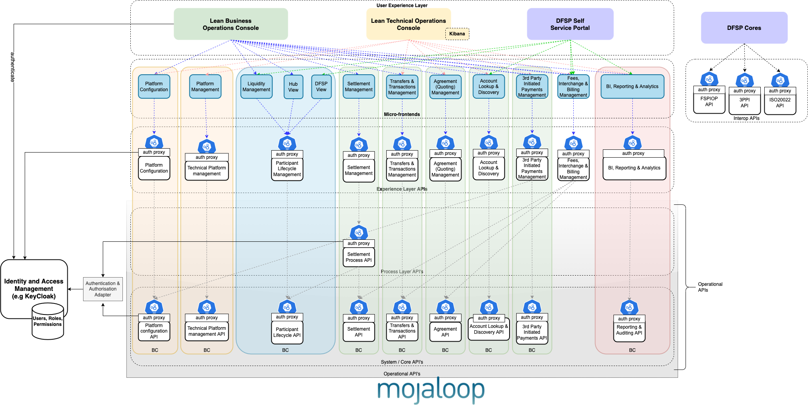
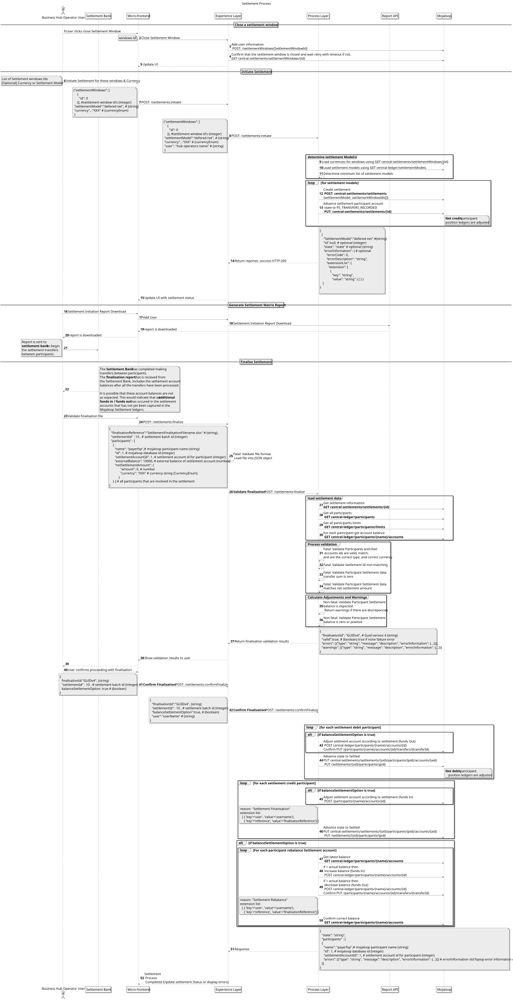
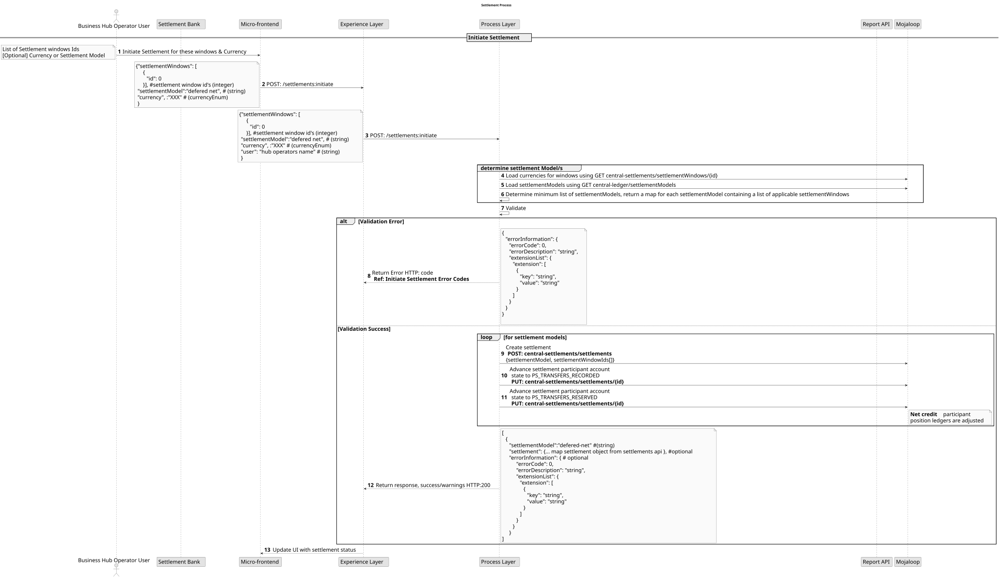
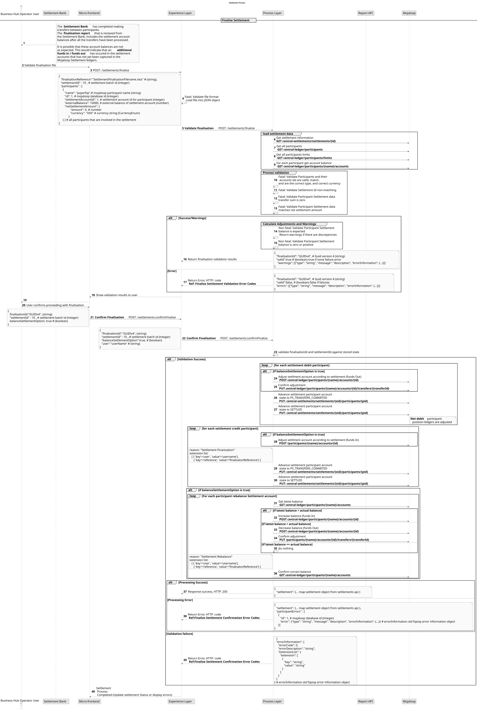

# Aplicación operativa de la liquidación

## Introducción

El objetivo de este diseño es ofrecer una solución que vincule las funciones de los procesos de negocio con las operaciones básicas de liquidación en el Switch.

Este diseño constituye un ejemplo de implementación de una liquidación Mojaloop
para un caso de uso específico y no pretende ser exhaustivo ni abarcar todos los escenarios. Esta guía describe el diseño a alto nivel y explica el razonamiento que ha sustentado el diseño para el caso de uso concreto elegido. ```
Aunque ya se ha desarrollado y está en funcionamiento una versión de este diseño, no se ha implementado todo lo que figura en este documento de diseño. 
Se trata de un ejemplo de diseño de implementación de liquidación. Por lo tanto, la utilidad de este diseño y del presente documento de diseño es:
- servir como demostración;
- servir como versión inicial para facilitar una «puesta en marcha rápida»;
- servir como diseño inicial sobre el que se puedan introducir mejoras antes de su adopción;
- servir como punto de partida para profundizar en los conceptos que se tratan en este diseño y que podrían tener que abordarse en otro diseño.

## Operaciones de liquidación de operaciones principales

Esta es la funcionalidad de liquidación existente que ofrece el componente central de apoyo [Central-Settlement](https://github.com/mojaloop/central-settlement) Mojaloop. Puede encontrar información detallada en la [Mojaloop Documentación de descripción general](https://github.com/mojaloop/documentation/tree/master/legacy/mojaloop-technical-overview/central-settlements).

Las operaciones de Core-Liquidación admiten las siguientes funciones:

- Cree un informe de matriz de liquidación basado en una lista de ventanas de liquidación
- Tramitar los acuses de recibo de liquidación correspondientes a un informe de matriz de liquidación ya existente
- Gestionar las ventanas de liquidación (es decir, crear, cerrar, etc.)
- Consultas sobre informes de la matriz de liquidación, ventanas de liquidación, etc.

La definición de «OpenAPI» está disponible en el [repositorio de especificaciones de Mojaloop](https://github.com/mojaloop/mojaloop-specification/tree/master/settlement-api)].


## Arquitectura de alto nivel



### Capa de experiencia

La capa de experiencia de liquidación es un componente «API» sin estado que expone los datos para que los utilice su público objetivo. Actualmente, su función principal consiste en añadir la información del usuario consultada al componente «API», que el proxy ORY Oathkeeper inserta en los encabezados de la solicitud. Se prevé que esta función adquiera mayor importancia a medida que el producto se desarrolle.

### Capa de proceso

Las API de procesos permiten combinar datos y coordinar varias API del Sistema con un fin empresarial específico. Este proceso API utiliza las API mojaloop central-settlement y central-ledger API.

El proceso de liquidación API deberá ajustarse a las [Mojaloop normas de denominación](https://docs.google.com/document/d/1AZbX0UjraytFty0IWOHpyR6z35bh0-MCFG1vGKId_5M/edit?usp=sharing), por lo que se utilizará el siguiente nombre: `settlement-process-svc`.

## Proceso empresarial de liquidación de alto nivel

Se trata de un proceso que se basa en las operaciones de liquidación centrales existentes para coordinar las siguientes funciones:

1. **Cerrar una ventana de liquidación**
La ventana de liquidación actual puede cerrarse manualmente, como si se hubieran realizado transferencias vinculadas a dicha ventana. El Operador del Hub puede seleccionar la ventana abierta actualmente y, a continuación, optar por cerrarla.
1. **Inicio de la liquidación**
El Operador del Hub utiliza la «Iniciación de la liquidación» para crear un lote de liquidación que controla y gestiona el proceso de liquidación.
Para iniciar el proceso de liquidación, el Operador del Hub selecciona:
   - un conjunto de ventanillas de liquidación
   - y, opcionalmente, una moneda de liquidación o un Modelo de liquidación. (Si se indica una moneda de liquidación, esta se utiliza para determinar el Modelo de liquidación.)
Los libros mayores de posiciones de los participantes con saldo acreedor se ajustan durante la fase de inicio de la liquidación.
**Nota:** Es importante crear el objeto de liquidación por lotes de tal forma que la liquidación se pueda llevar a cabo y finalizar.
1. Se genera un **informe de inicio de liquidación**, que se utiliza para comunicar al Banco liquidador los requisitos de la liquidación.
1. **Finalización de la liquidación y reequilibrio de la cuenta de liquidación**
Este proceso debe llevarse a cabo una vez que el Banco liquidador haya aplicado los cambios en la liquidación. En este paso:
   - El proceso de liquidación ha concluido y se ha recibido un informe de finalización de la liquidación por parte del Banco liquidador.
   - A los participantes con saldo deudor neto en la liquidación se les ajustan sus libros mayores de posiciones.
   - Los libros mayores de liquidación se ajustan para todos los participantes, de modo que coincidan con el monto de la transferencia para la liquidación.
   - Los libros mayores de liquidación se comparan con los saldos reales de las cuentas de liquidación y se realizan los ajustes necesarios para garantizar que coincidan.

### Función de reequilibrio: no se considera una buena práctica
Cabe señalar que la función de reequilibrio definida en el proceso de finalización de la liquidación mencionado anteriormente no constituye el enfoque preferido ni la mejor práctica. 
Se optó por este enfoque debido a los requisitos normativos y a las limitaciones de los mecanismos disponibles para llevar a cabo la liquidación entre los participantes; es decir, se diseñó para funcionar con las soluciones financieras ya existentes. El reequilibrio presenta bastantes inconvenientes, no se considera una buena práctica y debe evitarse en la medida de lo posible. 
Estos inconvenientes son:
1. Un reequilibrio fuera de secuencia da lugar a resultados incorrectos. Por lo tanto, esta vulnerabilidad requiere un proceso empresarial y el apoyo de la dirección para su aplicación.
1. La conciliación de la cuenta de liquidación «Mojaloop» y la cuenta en el banco liquidador resulta difícil y complicada. Esto se debe a que es posible que el reajuste no refleje directamente el movimiento de la cuenta en el banco liquidador. Los montos de las transferencias dependen del momento en que se aplica la operación de reajuste y de cuándo se generan los informes y los extractos.

**Soluciones recomendadas**
Existen muchos otros enfoques para implementar la liquidación que sí siguen las mejores prácticas. Le rogamos que consulte a uno de los expertos de la comunidad «Mojaloop» si desea profundizar en este tema. Si sus requisitos presentan limitaciones similares y la creación de un nuevo mecanismo no es una opción, existe un ajuste relativamente menor que puede realizarse para mejorar esta solución y que debería tenerse en cuenta.
Sustituir el mecanismo de reequilibrio por la importación de un extracto de las transacciones de la cuenta en el banco liquidador eliminaría los problemas de sincronización y conciliación mencionados anteriormente.

## Diagrama de secuencia detallado


Hay un par de procesos en el diagrama de secuencia que merece la pena explicar con más detalle.

### Modelo de liquidación

Para ello, es necesario determinar en primer lugar qué divisas intervienen en la liquidación y, a continuación, establecer la lista correspondiente de modelos de liquidación que deben aplicarse. Se creará una liquidación para cada uno de estos modelos de liquidación.

### Validación de los datos relativos a la finalización de la liquidación

Los datos que se presentan como parte de la finalización de la liquidación requieren un número considerable de comprobaciones de validez.
Algunas comprobaciones verifican la integridad de los datos, y si no se superan, el proceso se detendrá. Otras comprobaciones no impiden que el proceso continúe, pero mostrarán advertencias que deberán ser revisadas por el Operador.
La continuación del proceso solo es posible una vez que el operador haya aceptado las advertencias confirmadas, con sus consecuencias, y haya seleccionado las opciones relativas a cómo debe aplicarse el proceso.
Por este motivo, la validación de los datos constituye un paso necesario y debe tenerse en cuenta a la hora de aceptar y continuar con el proceso.

### Casos de uso de la liquidación definitiva
**Escenarios de validación**

| Descripción de la validación                                                                            | Comportamiento esperado                                                                             |
|---------------------------------------------------------------------------------------------------|------------------------------------------------------------------------------------------------|
| El ID de liquidación seleccionado no coincide con el ID de liquidación del informe                                        | Cancelar la finalización debido a un error                                                                  |
| La suma de las transferencias que figuran en el informe no es cero                                                        | Cancelar la finalización debido a un error                                                                  |
| El monto de la transferencia no coincide con el monto de la liquidación neta                                              | Cancelar la finalización debido a un error                                                                  |
| El saldo correspondiente al monto de la transferencia no se ha modificado                                             | Continuar --> Ajustar el saldo de la cuenta de liquidación para que coincida                                        |
| El saldo que figura en el informe no es un valor positivo                                            | Continuar --> Poner a cero el saldo de liquidación; establecer NCD = 0; desactivar la cuenta POSITION del Participante |
| Cuentas en liquidación que no figuran en el informe                                                      | Cancelar la finalización debido a un error                                                                  |
| Cuentas que figuran en el informe pero que no están presentes en la Liquidación                                                      | Cancelar la finalización debido a un error                                                                  |
| Los identificadores de los participantes no coinciden: el ID del participante, el ID de cuenta y el nombre del participante deben coincidir | Cancelar la finalización debido a un error                                                                  |
| El tipo de cuenta debe ser «POSICIÓN»                                                                   | Cancelar la finalización debido a un error                                                                  |
| El nuevo importe del saldo no es válido para esta divisa                                                         | Cancelar la finalización debido a un error                                                                  |
| El monto de la transferencia no es válido para esta divisa                                                            | Cancelar la finalización debido a un error                                                                  |
| El ID de cuenta no existe en el Switch                                                               | Cancelar la finalización debido a un error                                                                  |
| Se intentó cerrar una liquidación que se había interrumpido                                                       | Cancelar la finalización debido a un error                                                                  |
| Se ha producido un error al procesar el ajuste correspondiente al participante                                                       | Continuar con los demás participantes: notificar al usuario el error                                        |
| Se ha producido un error al intentar establecer el estado de liquidación en PS_TRANSFERS_RECORDED                                 | Continuar con los demás participantes: notificar al usuario el error                                        |
| Se ha producido un error al intentar establecer el estado de liquidación en PS_TRANSFERS_RESERVED                                 | Continuar con los demás participantes: notificar al usuario el error                                        |
| Se ha producido un error al intentar establecer el estado de liquidación en PS_TRANSFERS_COMMITTED                                | Continuar con los demás participantes: notificar al usuario el error                                        |
| Errores al intentar liquidar cuentas                                                              | Continuar con los demás participantes: notificar al usuario el error                                        |
| Se ha producido un error al intentar configurar el NDC                                                                       | Continuar con los demás participantes: notificar al usuario el error                                        |
| Se ha producido un error al intentar procesar las entradas y salidas de fondos                                                          | Continuar con los demás participantes: notificar al usuario el error                                        |
| Saldo sin cambios tras procesar las entradas y salidas de fondos                                                   | Continuar con los demás participantes: notificar al usuario el error                                        |
| Saldo resultante incorrecto tras procesar las entradas y salidas de fondos                                         | Continuar con los demás participantes: notificar al usuario el error                                        |
| No se ha podido registrar el estado de la cuenta del participante en la liquidación                                             | Continuar con los demás participantes: notificar al usuario el error                                        |

### Información sobre auditorías en la versión actual Mojaloop

El proceso que se está llevando a cabo se registra en el campo «motivo de la liquidación» y, por lo tanto, está disponible en los informes de auditoría.
Además, el usuario y las referencias se registran en las listas de extensión. Estos datos también pueden consultarse en los informes de auditoría.

### RBAC

Con el fin de aprovechar al máximo los controles RBAC, los cuatro procesos mencionados se implementarán como combinaciones independientes de Endpoint API y método HTTP. El objetivo es permitir que se asocien permisos diferentes a cada proceso.

## Compatibilidad con múltiples divisas

La ejecución de la liquidación multidivisa viene determinada por dos factores:

1. ¿Cómo se elaboran los modelos de liquidación?
  Los modelos de liquidación pueden vincularse a una divisa o no vincularse a ninguna y ser aplicables a todas las divisas.
1. ¿Cómo se inician los procesos de liquidación?
  La liquidación puede iniciarse, opcionalmente, con una divisa o, opcionalmente, con un Modelo de liquidación.

Dado que no resulta fácil separar una liquidación una vez que se ha iniciado, es preferible decidir cómo debe aplicarse dicha liquidación y, a continuación, diseñar el sistema en consecuencia.

---
**NOTA**
Se está utilizando un modelo de liquidación neta diferida multilateral con una única moneda y se emplean monedas de prueba para realizar comprobaciones periódicas del estado de la plataforma. Se preferiría que todas las liquidaciones de las monedas de prueba se crearan por separado de la moneda real. Se preferiría no tener que seleccionar una moneda o un modelo de liquidación al iniciar una liquidación.
Esto puede lograrse creando modelos de liquidación independientes, es decir, uno para cada moneda de prueba y otro para la moneda real.
La acción predeterminada al iniciar la liquidación con una Transacción en ambas monedas consistiría en que se iniciaran liquidaciones independientes. (La función de determinación del modelo de liquidación encontraría ambos modelos de liquidación.)
___


## Casos de error 
### Iniciar la liquidación

**Diagrama detallado de la secuencia de inicio de la liquidación**



**Códigos de error de inicio de la liquidación**

| Descripción del error                                                      | Código de error  |  Código HTTP       | Categoría                                                  |
|------------------------------------------------------------------------|-------------|------------------|-----------------------------------------------------------|
| No se ha encontrado el identificador de la liquidación                                                | 3100        | 400              |  Error de validación de la solicitud                                 |
| La moneda no es válida                                                     | 3100        | 400              |  Error de validación de la solicitud                                 |
| No se ha encontrado «SettlementModel»                                              | 3100        | 400              |  Error de validación de la solicitud                                 |
| No se puede crear una liquidación                                          | 2000        | 500              |  Error interno del servidor                                    |
| No se puede actualizar el estado de liquidación                                    | 2000        | 500              |  Error interno del servidor                                    |
| Se ha producido un error técnico al comunicarse con Mojaloop Servicios             | 1000        | 500              |  Error técnico                                          |


### Finalizar la liquidación

**Diagrama de secuencia detallado del proceso de liquidación**



**Códigos de error en la validación de la liquidación final**

| Descripción del error                                                      | Código de error  |  Código HTTP       | Categoría                                                  |
|------------------------------------------------------------------------|-------------|------------------|-----------------------------------------------------------|
| No se ha encontrado el identificador de la liquidación                                                | 3100        | 400              |  Error de validación de la solicitud                                 |
| No se han encontrado los números de identificación de los participantes                                              | 3000        | 400              |  Error de validación de la solicitud                                 |
| No se han encontrado los ID de cuenta de los participantes                                      | 3000        | 400              |  Error de validación de la solicitud                                 |
| Se ha producido un error técnico al comunicarse con Mojaloop Servicios             | 1000        | 500              |  Error técnico                                          |
| El ID de liquidación seleccionado no coincide con el ID de liquidación del informe             | 3100        | 500              |  Error en la validación del proceso                                 |
| Los identificadores de los participantes que figuran en el informe no coinciden con los identificadores de los participantes que figuran en la Liquidación   | 3000        | 500              |  Error en la validación del proceso                                 |
| Las cuentas que figuran en el informe no coinciden con las cuentas de la Liquidación    | 3000        | 500              |  Error en la validación del proceso                                 |
| La suma de las transferencias que figuran en el informe no es cero                             | 3100        | 500              |  Error en la validación del proceso                                 |
| El monto de la transferencia no coincide con el monto de la liquidación neta                   | 3100        | 500              |  Error en la validación del proceso                                 |
| El nuevo importe del saldo no es válido para esta divisa                              | 3100        | 500              |  Error en la validación del proceso                                 |
| El monto de la transferencia no es válido para esta divisa                                 | 3100        | 500              |  Error en la validación del proceso                                 |
| La liquidación se encuentra en estado «ABORTADA» o «no válida»                              | 3100        | 500              |  Error en la validación del proceso                                 |
| El monto de la transferencia no es válido para esta divisa                                 | 3100        | 500              |  Error en la validación del proceso                                 |

**Códigos de error en la confirmación de la liquidación definitiva**

| Descripción del error                                                      | Código de error  |  Código HTTP       | Categoría                                                  |
|------------------------------------------------------------------------|-------------|------------------|-----------------------------------------------------------|
| No se ha encontrado el ID de finalización                                              | 3100        | 400              |  Error de validación de la solicitud                                 |
| No se ha encontrado el identificador de la liquidación                                                | 3100        | 400              |  Error de validación de la solicitud                                 |
| Se ha producido un error técnico al comunicarse con Mojaloop Servicios             | 1000        | 500              |  Error técnico                                          |
| Error al realizar una entrada o salida de fondos                                               | 2001        | 500              |  Error interno del servidor                                    |
| No se puede actualizar el estado de liquidación                                    | 2001        | 500              |  Error interno del servidor                                    |
| Los saldos no coinciden tras la liquidación                                 | 2001        | 500              |  Error interno del servidor                                    |
| Los saldos no coinciden tras el reequilibrio                               | 2001        | 500              |  Error interno del servidor                                    |
