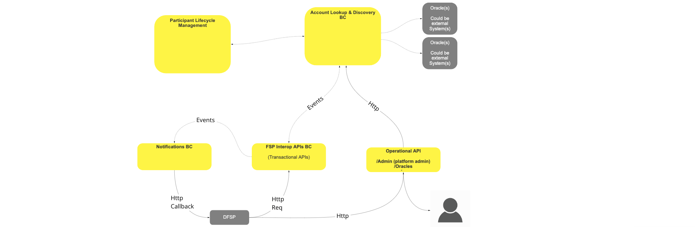
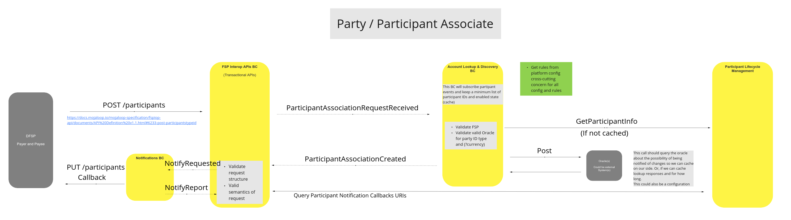
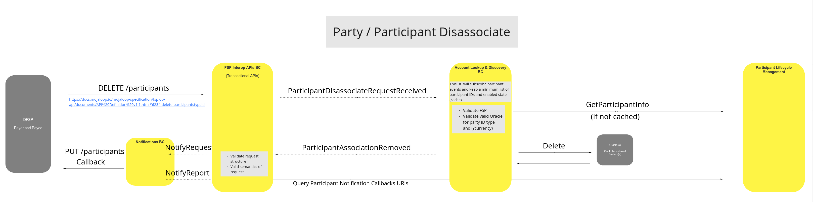
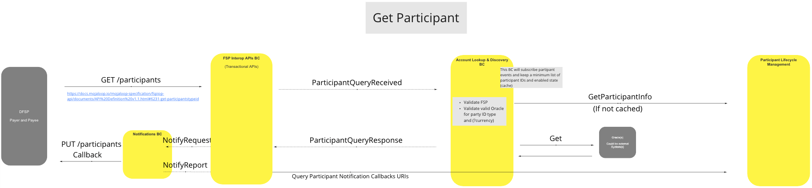
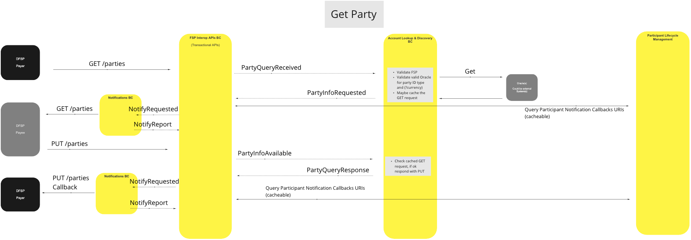

# Búsqueda de cuenta y localización de cuentas BC

El módulo «Búsqueda de cuenta y Discovery BC» se encarga de localizar y asociar a los participantes y las partes con las transacciones iniciadas por una de dichas partes o participantes.

## Términos

En este BC, también conocido como dominio, se utilizan los siguientes términos.

| Término | Descripción |
|---|---|
| **Participante** | Proveedor de servicios financieros |
| **Parte** | FSP Clientes |

## Descripción general de las funciones

>Diagrama funcional de BC: Descripción general de la búsqueda de cuenta y la identificación de cuentas

## Caso de uso

#### Colaborador de la parte/participante

#### Descripción

Cuando un participante DFSP solicita que un identificador de parte determinado se asocie a un participante (él mismo).

***Nota:*** *Las comprobaciones y validaciones de los datos de Conocimiento del cliente (KYC) no se tratan aquí y se dejan en manos de procesos ajenos a las llamadas Mojaloop API; deben ser objeto del Esquema de pagos, con el fin de garantizar que las solicitudes de asociación (o desasociación) sean válidas.*

#### Diagrama de flujo

>Diagrama de flujo de UC: Asociado de parte/participante

### Exclusión de una parte o de un participante

#### Descripción

Cuando un participante DFSP solicita que se elimine una asociación existente entre un identificador de parte determinado y un participante (él mismo).

#### Diagrama de flujo

>Diagrama de flujo de UC: Exclusión de una parte o participante

### Obtener participante

#### Descripción

Cuando un participante DFSP solicita información sobre la asociación de un participante basándose en un Identificador de parte, el Switch utiliza esta UC para validar la solicitud y facilitar los datos de asociación solicitados al solicitante DFSP.

#### Diagrama de flujo

>Diagrama de flujo de UC: Obtener Participante

### Disfrute de la parte

#### Descripción

Cuando un participante DFSP solicita a otro participante DFSP los datos de una parte que este último DFSP tiene en su poder, esta UC se utiliza para validar la solicitud y facilitar los datos solicitados sobre dicha parte al solicitante DFSP.

#### Diagrama de flujo

>Diagrama de flujo de UC: Get Parte

<!--## Notes -->
<!-- Footnotes themselves at the bottom. -->

[^1]: Interfaces comunes: [Mojaloop Lista de interfaces comunes](../../commonInterfaces.md)
