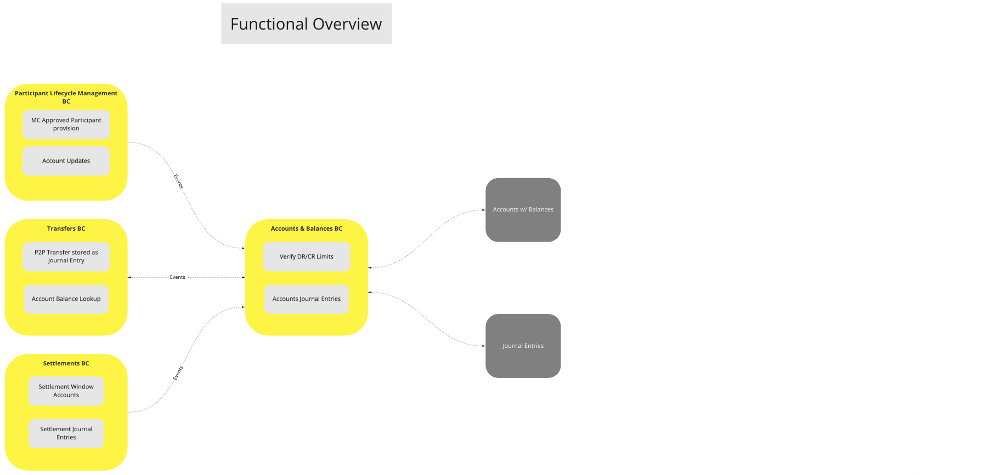
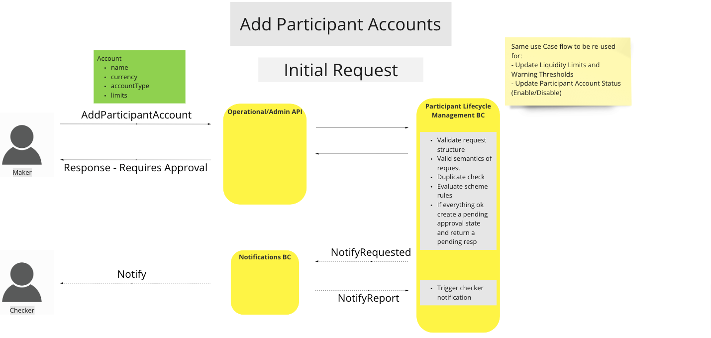
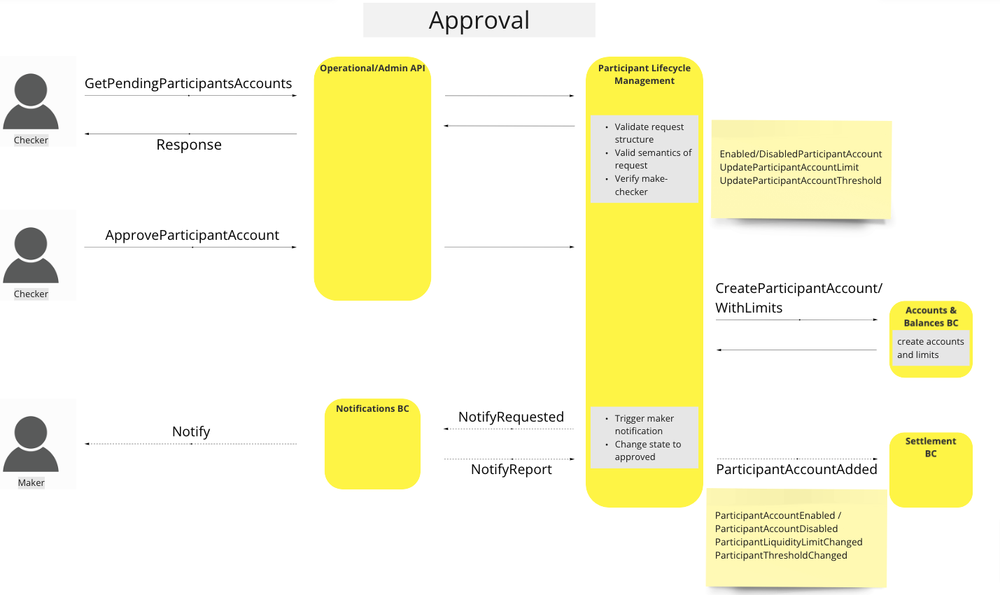
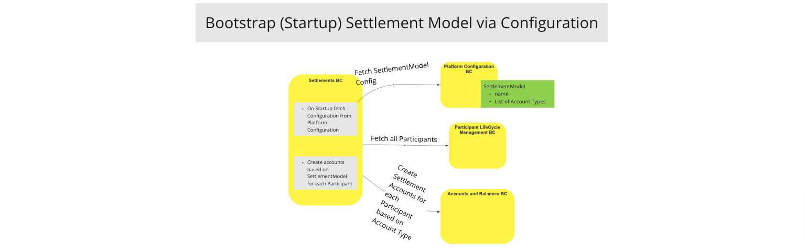
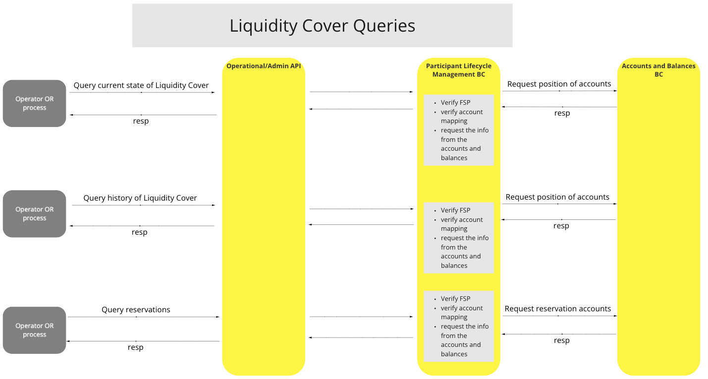
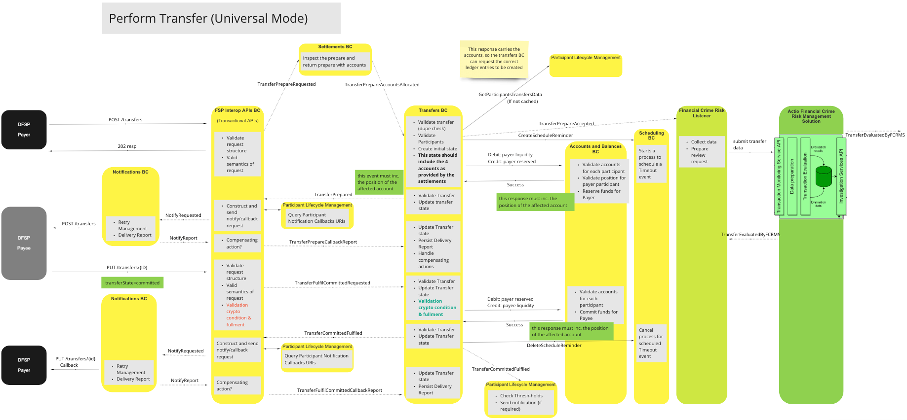
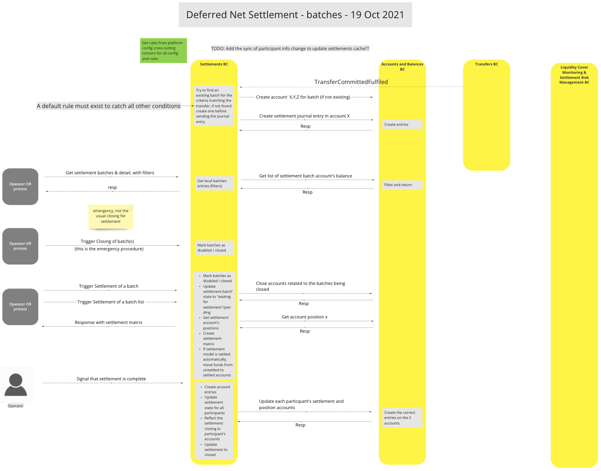

# Cuentas y saldos BC

El BC de Cuentas y Saldos actúa como el «Libro mayor central» del Sistema. Interactúa principalmente con los BC de Liquidaciones, de Ciclo de Vida de los Participantes y de Transferencias, y es un subsistema dirigido, lo que significa que depende de los BC que lo utilizan como «sistema financiero de referencia» para la contabilidad financiera.

**Nota:**

El BC de Cuentas y Saldos contiene una cantidad limitada de lógica para garantizar que **(a)** se creen y mantengan las relaciones correctas entre entidades cuando un BC externo cree, actualice, consulte o cierre cuentas y **(b)** se apliquen los límites de cuenta correctos (es decir, que se establezcan y no se superen) cuando un BC externo intente crear asientos del libro mayor y **\(c\)** se eviten los asientos del libro mayor duplicados mediante el uso de *Identificadores Únicos Universales (UUID)* como identificadores únicos de los asientos del libro mayor.

## Términos

Términos con un significado específico y comúnmente aceptado dentro del contexto delimitado en el que se utilizan.

| Término              | Descripción                                                                                                                                           |
|-------------------|-------------------------------------------------------------------------------------------------------------------------------------------------------|
| **Cuenta**       | Se refiere a una cuenta del libro mayor, un registro en un sistema contable en el que se anotan los asientos de débito o crédito que representan una transacción financiera. |
| **Entrada del diario** | Contabilice los movimientos de crédito y débito en la cuenta.                                                                                                       | 
| **Saldo**       | El importe disponible en una cuenta, una vez que se han tenido en cuenta los cargos y los abonos.                                                                |

## Descripción general de las funciones: cuentas y saldos

>Diagrama funcional de BC: Descripción general de cuentas y saldos

## Caso de uso

### Crear cuenta

#### Descripción

El flujo de trabajo que ofrece esta UC permite a la plataforma Switch crear nuevas cuentas de participante, de transferencia y de liquidación en el Libro mayor del sistema. (La creación de cuentas de participante se lleva a cabo tanto desde la gestión del ciclo de vida de los participantes como desde los componentes de negocio de transferencia y de liquidación. En los diagramas de flujo que figuran a continuación se ofrecen ejemplos de ambos).

Además, el flujo de trabajo permite especificar los límites de los asientos contables de crédito y débito, así como garantizar que la cuenta sea única en el Libro mayor del Sistema.

#### Diagrama de flujo

Creación de cuentas desde [Gestión del ciclo de vida de los participantes BC](../participantLifecycleManagement/index.md)

<!-- Warning Note to Developers & Editors!!: The following two images are being rendered from the Participant Lifecycle BC. -->

>Diagrama de flujo de trabajo de la UC: Añadir cuentas de participantes

Creación de cuentas desde [Liquidaciones BC](../settlements/index.md)

>Diagrama de flujo de trabajo de la UC: Modelo de liquidación de arranque (puesta en marcha) mediante configuración

### Cerrar cuenta

#### Descripción

Cerrar una cuenta de participante en el libro mayor del sistema e impedir que los nuevos asientos contables afecten a dicha cuenta.   (¿Queda por determinar: transferir automáticamente los saldos de la cuenta de garantía a otra cuenta?)

### Consultar cuenta

#### Descripción

Consultar el estado y el saldo de la cuenta de un participante.

#### Diagrama de flujo

Consultar los límites de liquidez CR/DR desde [Gestión del ciclo de vida de los participantes BC](../participantLifecycleManagement/index.md)

<!-- Warning Note to Developers & Editors!!: The following two images are being rendered from the Participant Lifecycle BC. -->

>Diagrama de flujo de UC: Consultas sobre la cobertura de liquidez

### Consultar asientos contables

#### Descripción

Consultar los asientos de débito y crédito del libro mayor de una cuenta.

### Introducir asiento contable

#### Descripción

Introduzca un asiento contable de participante en el Libro mayor del Sistema, especificando las cuentas de débito y crédito (Existen tres formas de realizar asientos contables de participante. Consulte los diagramas de flujo que figuran a continuación para obtener una descripción de cada una de ellas).
Indique el saldo actualizado de la cuenta.

#### Diagrama de flujo

Inserción de un asiento contable procedente de [Transferencias BC](../transfers/index.md)

>Diagrama de flujo de UC: Realizar una transferencia (modo universal)

Inserción de un asiento contable procedente de [Liquidaciones BC](../settlements/index.md)] utilizando el modelo `Deferred Net Settlement` (DNS)

>Diagrama de flujo de UC: Liquidación neta diferida - 19/10/2021

Inserción de un asiento contable a partir de [Liquidación BC](../settlements/index.md)] utilizando el modelo `Immediate Gross Settlement` (IGS)

>Diagrama de flujo de UC: Liquidación bruta inmediata

## Modelo canónico

- Cuenta
  - accountId
  - tipo de cuenta contable
  - estadoDeCuentaDeContabilidad
  - límite de débito
  - límite de crédito
  - saldo deudor
  - saldo acreedor
- Anotación en el diario
  - identificadorDeasiento
  - IdDeCuentaDeDébito
  - creditAccountId
  - tipo de asiento contable
  - importeDeLaTransferencia
  - fecha y hora de la transferencia

<!-- Footnotes themselves at the bottom. -->
<!-- ## Notes -->

[^1]: Interfaces comunes: [Mojaloop Lista de interfaces comunes](../../commonInterfaces.md)
