# FSP Interoperability API BC

El contexto delimitado de la FSP Interoperability API proporciona acceso a las operaciones y los recursos internos que el ecosistema Mojaloop pone a disposición de un participante determinado. Este contexto delimitado se encarga de proporcionar al participante las interfaces con las que este puede realizar y ejecutar tareas en Mojaloop. También se encarga de devolver al participante las comunicaciones relativas a las distintas notificaciones y mensajes del sistema que un participante debe esperar recibir.

## Descripción general de las funciones

La FSP IOP API interactúa con muchos contextos delimitados distintos, por lo que aquí se ofrece una vista simplificada. Para más información sobre los eventos y las conexiones que la FSP IOP API proporciona y consume, consulte la Mojaloop Common Interface List [^1]. Los contextos delimitados integrados con la FSP IOP API son:

-   Contexto delimitado Account Lookup & Discovery [^14]
-   Contexto delimitado Notifications and Alerts [^27]
-   Contexto delimitado Participant Lifecycle Management [^26]
-   Contexto delimitado Quoting\Agreement [^19]
-   Contexto delimitado Transfers [^22]
-   Contexto delimitado Settlement [^21]

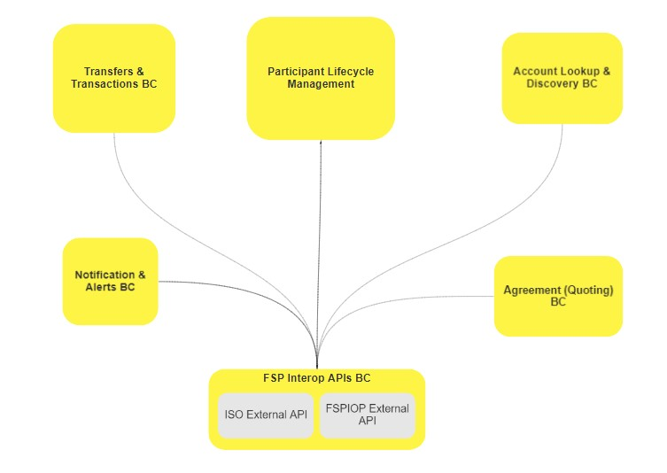

> FSP Interoperability API Functional Overview

## Términos

Términos con un significado específico y comúnmente aceptado dentro del contexto delimitado en el que se utilizan.

| Término        | Descripción                                                                                                                                                      |
| ----------- | ---------------------------------------------------------------------------------------------------------------------------------------------------------------- |
| **(D)FSP**      | (Digital) Financial Service Provider                                                                                                                             |
| **Participante** | Financial Service Provider (FSP) registrado en el ecosistema Mojaloop, lo que le permite operar con otros participantes                 |
| **FSP IOP API** | Financial Service Provider Interoperability Application Programming Interface: la API que proporciona acceso a las funciones y las prestaciones del ecosistema Mojaloop. |
| **Pagador**       | El pagador de fondos electrónicos en una transacción de pago.                                                                                                          |
| **Payer FSP**   | Proveedor de servicios financieros del pagador.                                                                                                                              |
| **Beneficiario**       | El receptor de fondos electrónicos en una transacción de pago.                                                                                                          |
| **Payee FSP**   | Proveedor de servicios financieros del beneficiario.                                                                                                                              |

## Casos de uso

### Nota

Las definiciones de los casos de uso estipuladas en la Open API for FSP Interoperability Specification [^2] no se han modificado, por lo que la arquitectura de referencia se ha diseñado para cambiar únicamente la orquestación interna de los servicios y los contextos delimitados de Mojaloop.

### Notifications BC - Send Notification

#### Descripción

Las notificaciones afectan a TODOS los casos de uso que figuran a continuación, como respuesta a las solicitudes recibidas en diversas formas. Mientras la FSP IOP API procesa una solicitud recibida, puede que necesite enviar una solicitud al DFSP solicitante o a cualquier otro DFSP pertinente. La FSP IOP API consultará entonces al contexto delimitado Participant Lifecycle Management [^26] las URI de callback del participante al que se debe enviar la notificación. A continuación, la FSP IOP API enviará la solicitud de notificación al contexto delimitado Notification and Alerts [^27].

#### Diagrama de flujo

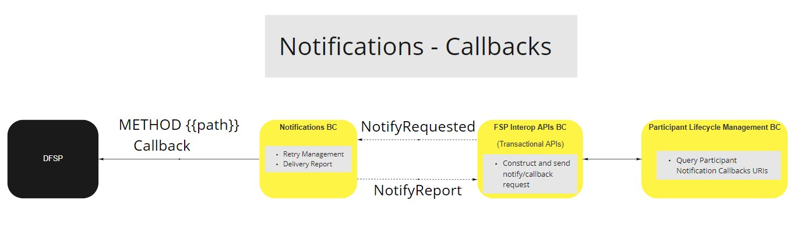

>

## Account Lookup & Discovery BCs

### Asociación de parte/participante

#### Descripción

Asocia los participantes o las partes de una o varias transferencias a partir de la solicitud POST Participant [^5] (POST /participants/{Type}/{ID}). La FSP IOP API envía entonces una solicitud al Account Lookup & Discovery BC [^14], que la procesa y responde con un evento de éxito. A continuación, la FSP IOP API envía una notificación de respuesta PUT Participant [^15] (PUT /participants/{Type}/{ID}).

#### Diagrama de flujo

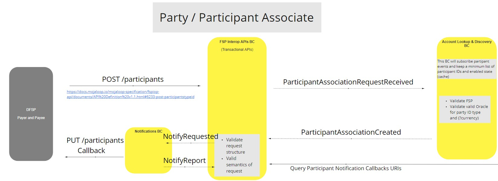

>

### Desasociación de parte/participante

#### Descripción

Desasocia los participantes o las partes a partir de la solicitud DELETE Participant [^6] (DELETE /participants/{Type}/{ID}). La FSP IOP API envía la solicitud al Account Lookup & Discovery BC [^14] para desasociar la parte. La FSP IOP API recibe entonces la respuesta de éxito y responde al solicitante enviando una notificación de respuesta PUT Participant [^15] (PUT /participants/{Type}/{ID}).

#### Diagrama de flujo

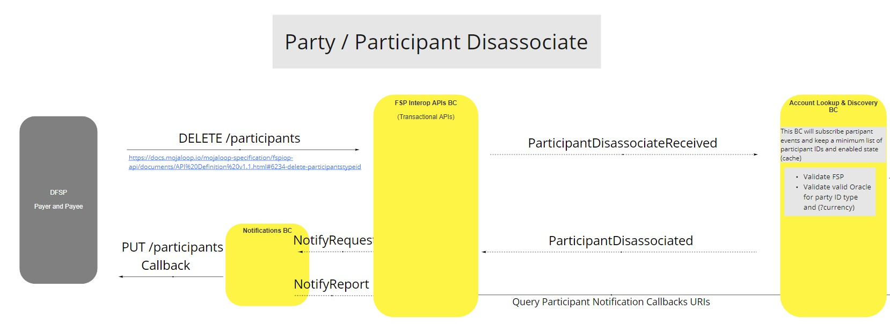

>

### Obtener participante

#### Descripción

Recupera la información del participante a partir de la solicitud GET Participant [^7] (GET /participants/{Type}/{ID}), que proporciona el ID y la estructura. La FSP IOP API envía la solicitud al Account Lookup & Discovery BC [^14] para determinar si el participante buscado existe. A continuación, la FSP IOP API responde al solicitante con una respuesta PUT Participant [^15] (PUT /participants/{Type}/{ID}).

#### Diagrama de flujo

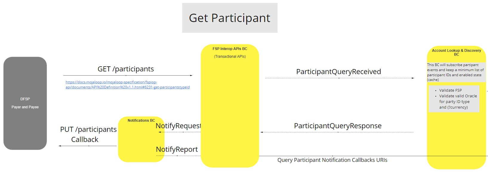

>

### Obtener parte

#### Descripción

Recupera la información de la parte a partir del ID facilitado con la solicitud GET Party [^8] (GET /parties/{Type}/{ID}). La FSP IOP API envía entonces una solicitud al Account Lookup & Discovery BC [^14] para determinar a qué FSP de destino debe reenviar la solicitud GET. El FSP de destino responde entonces con una solicitud PUT parties. La información se envía después al Account Lookup & Discovery BC para almacenarla en caché antes de enviar la respuesta PUT Party [^17] (PUT /parties/{Type}/{ID}) al remitente original de la solicitud GET.

#### Diagrama de flujo

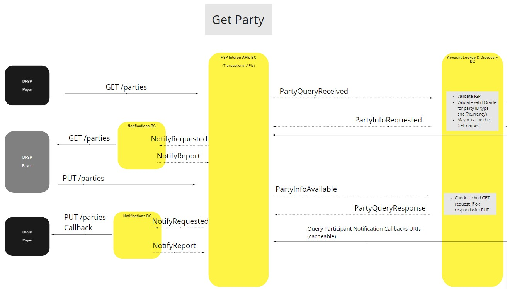

>

## Agreement (Quoting) BC

### Calcular cotización - Happy Path

#### Descripción

Cuando se envía una cotización mediante la solicitud POST Quote [^3] (POST /quotes), la FSP IOP API envía la solicitud al Quoting/Agreement BC [^19] para validar la cotización. A continuación, la FSP IOP API envía el POST Quote al Payee FSP, que a su vez responde con una respuesta PUT Quote [^18] (PUT /quotes/{ID}) y la información pertinente actualizada. La FSP IOP API envía la cotización aceptada al Quoting/Agreement BC [^19] para que conserve la información de la cotización. Después, la FSP IOP API reenvía la solicitud PUT quote al Payer FSP y da la cotización por satisfactoria.

#### Diagrama de flujo

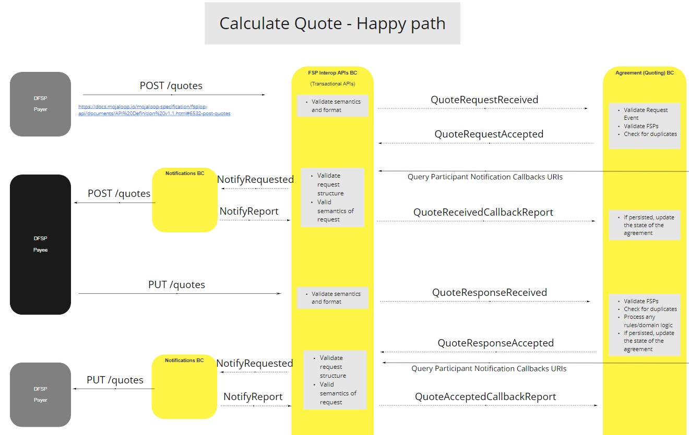

>

### Obtener cotización - Happy Path

#### Descripción

Permite a un FSP obtener la información de una cotización existente. La solicitud GET Quote [^4] (GET /quotes/{ID}) se envía a la FSP IOP API, que consulta al Quoting/Agreement BC [^19] las cotizaciones existentes. Cuando se recupera la cotización, la información se devuelve al FSP solicitante enviando la respuesta PUT Quote [^18] (PUT /quotes/{ID}).

#### Diagrama de flujo

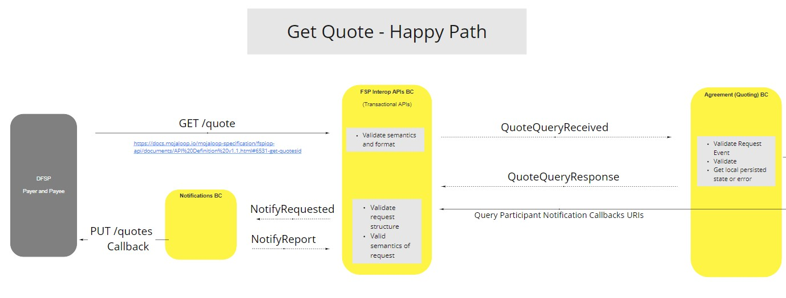

>

### Calcular cotización - Solicitud de cotización no válida

#### Descripción

Cuando se recibe una solicitud POST Quote [^3] (POST /quotes), la FSP IOP API envía la solicitud al Quoting/Agreement BC [^19] para su procesamiento. Si la cotización no supera la validación, el Quoting/Agreement BC [^19] responde con una respuesta de error y la FSP IOP API lo notifica al FSP solicitante mediante la respuesta PUT Quote Error [^20] (PUT /quotes/{ID}/error).

#### Diagrama de flujo

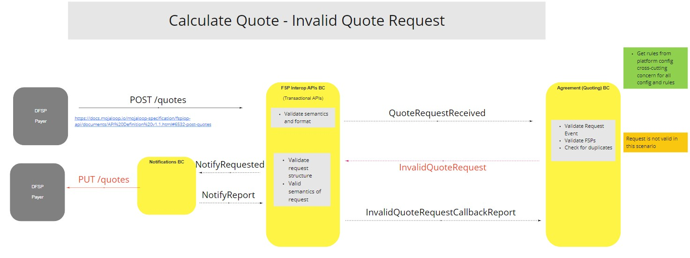

>

### Calcular cotización - FSP no válidos

#### Descripción

Cuando se envía una solicitud POST Quote [^3] (POST /quotes), la FSP IOP API envía la solicitud al Quoting/Agreement BC [^19] para su procesamiento y este no puede determinar que ambos participantes sean FSP válidos, se envía una respuesta de error a la FSP IOP API. La FSP IOP API lo notifica entonces al FSP solicitante mediante la respuesta PUT Quote Error [^20] (PUT /quotes/{ID}/error).

#### Diagrama de flujo

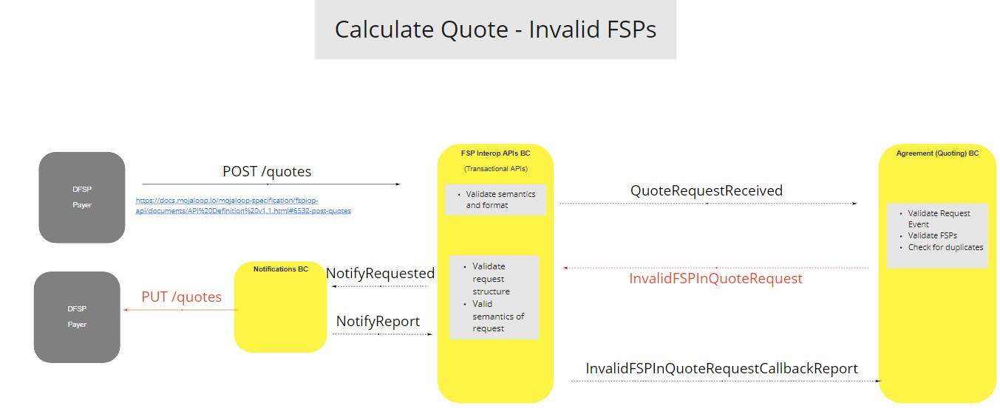

>

### Calcular cotización - Reglas del esquema de pagos no válidas detectadas en la solicitud

#### Descripción

Cuando el Payer FSP envía una solicitud POST Quote [^3] (POST /quotes), la FSP IOP API envía la solicitud al Quoting/Agreement BC [^19] para su procesamiento y la cotización no se ajusta a las reglas definidas del esquema de pagos, se envía una respuesta de error a la FSP IOP API. La FSP IOP API lo notifica entonces al Payer FSP mediante la respuesta PUT Quote Error [^20] (PUT /quotes/{ID}/error)

#### Diagrama de flujo

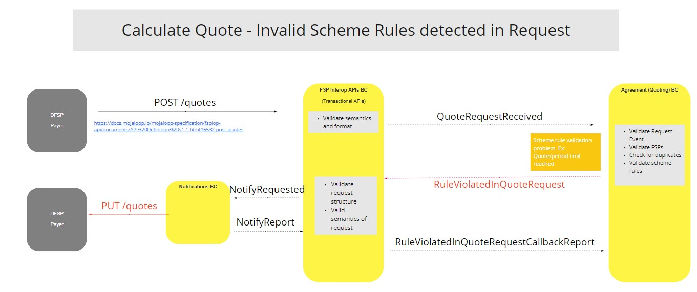

>

### Calcular cotización - Reglas del esquema de pagos no válidas detectadas en la respuesta

#### Descripción

Cuando el Payer FSP envía una solicitud POST Quote [^3] (POST /quotes), la FSP IOP API envía la solicitud al Quoting/Agreement BC [^19] para su procesamiento y este supera el procesamiento inicial. La FSP IOP API envía la solicitud POST quote al Payee FSP. El Payee FSP debe reaccionar con una cotización aceptada enviando una solicitud PUT Quote [^18] (PUT /quotes/{ID}). La respuesta se envía al Quoting/Agreement BC [^19] para su posterior procesamiento y validación. Cuando el contexto delimitado detecta que la cotización no se ajusta a las reglas definidas del esquema de pagos, se envía una respuesta de error a la FSP IOP API. La FSP IOP API lo notifica entonces tanto al Payer FSP como al Payee FSP mediante la respuesta PUT Quote Error [^20] (PUT /quotes/{ID}/error).

#### Diagrama de flujo

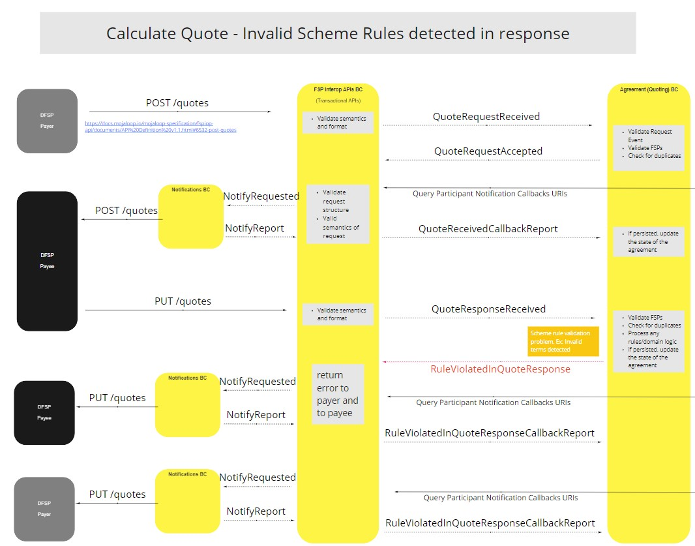

> Agreement BC - Calculate Quote - Invalid Scheme Rules detected in Response

## Transfers BC

### Realizar transferencia (modo universal)

#### Descripción

El Payer FSP envía una solicitud POST Transfers [^9] (POST /transfers) a la FSP IOP API. La FSP IOP API envía entonces un evento al contexto delimitado Settlements [^21]. La FSP IOP API espera un evento del contexto delimitado Transfers [^22] que indique que la transferencia se ha preparado, para enviar una solicitud POST al Payee FSP. El Payee FSP responde entonces con una solicitud PUT Transfers [^23] (PUT /transfers/{ID}) (transferState = committed) a la FSP IOP API, que a su vez confirma el Fulfilment de la transferencia. La solicitud PUT transfer se envía después al Payer FSP.

#### Diagrama de flujo

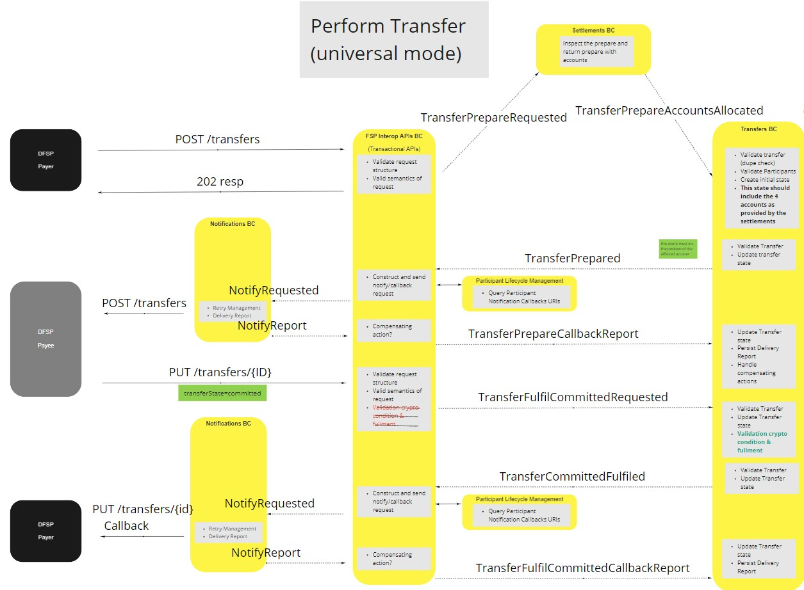

>

### Realizar transferencia con confirmación del beneficiario

#### Descripción

El Payer FSP envía una solicitud POST Transfers [^9] (POST /transfers) a la FSP IOP API. La FSP IOP API envía entonces un evento al contexto delimitado Settlements [^21]. La FSP IOP API espera un evento del contexto delimitado Transfers [^22] que indique que la transferencia se ha preparado, para enviar una solicitud POST al Payee FSP. El Payee FSP responde entonces con una solicitud PUT Transfers [^23] (PUT /transfers/{ID}) (transferState = reserved) a la FSP IOP API, que a su vez reserva el Fulfilment de la transferencia. La solicitud PUT transfer se envía después al Payer FSP. El Payee FSP recibe a continuación una solicitud PATCH Transfers [^24] (PATCH /transfers/{ID}) para notificar el cambio de estado de la transferencia.

#### Diagrama de flujo

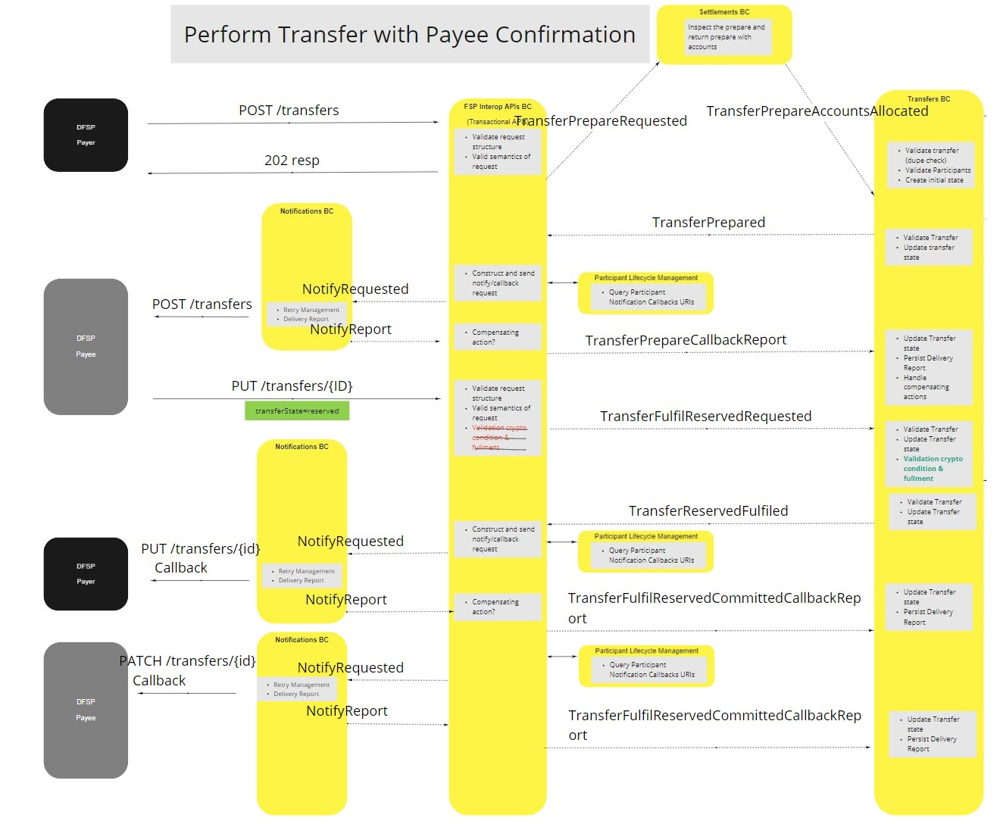

>

### Consultar obtención de transferencia

#### Descripción

Obtiene la información de la transferencia a partir del ID de transferencia utilizado en la solicitud GET Transfer [^11] (GET /transfers/{ID}) y recibe una solicitud PUT Transfers [^23] (PUT /transfers/{ID}) para obtener la información pertinente sobre la transferencia.

#### Diagrama de flujo

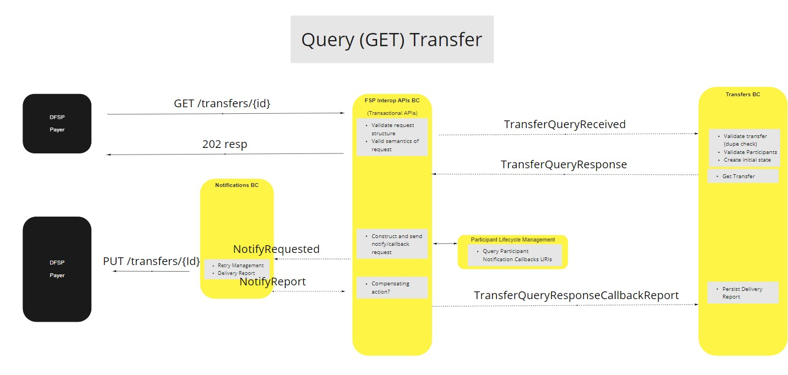

>

### Realizar transferencia - POST duplicado (reenvío)

#### Descripción

La solicitud POST Transfers [^9] (POST /transfers) ya se ha procesado y se devuelve un informe de estado al Payer FSP mediante la recepción de una solicitud PUT Transfers [^23] (PUT /transfers/{ID}).

#### Diagrama de flujo

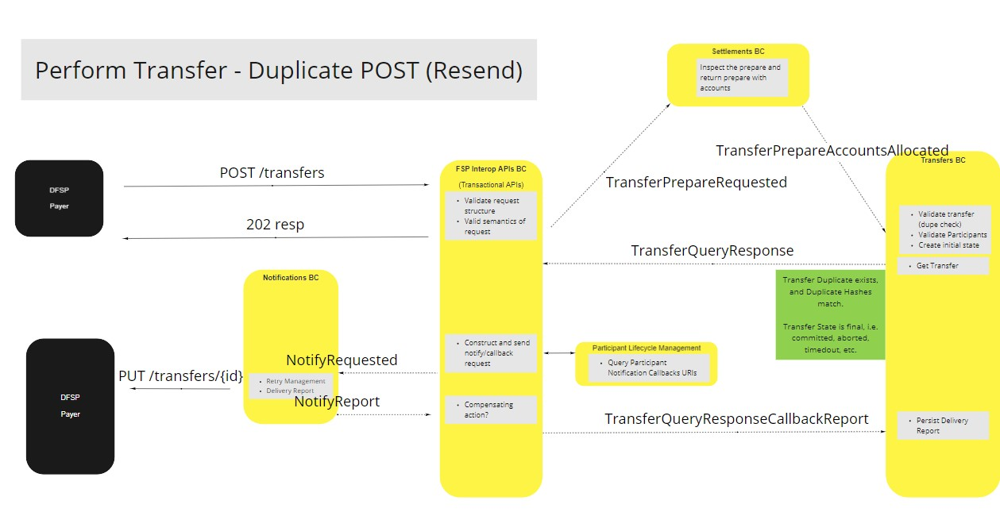

> Transfers BC - Perform Transfer - Duplicate Post (Resend)

### Realizar transferencia - POST duplicado (omisión)

#### Descripción

La solicitud POST Transfers [^9] (POST /transfers) ya se ha procesado, pero no se necesita ni se solicita respuesta alguna.

#### Diagrama de flujo

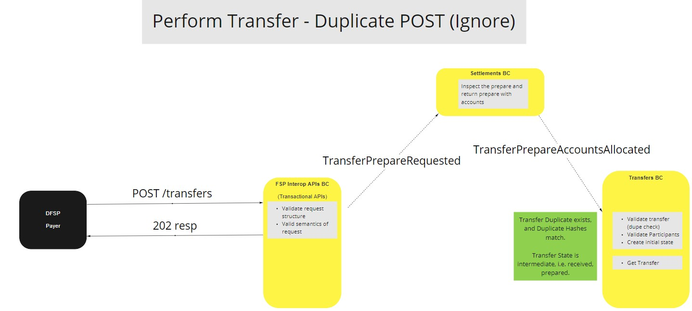

>

### Realizar transferencia - El DFSP beneficiario rechaza la transferencia

#### Descripción

El Payer FSP envía una solicitud POST Transfers [^9] (POST /transfers) a la FSP IOP API. La API prepara entonces la transferencia y envía la solicitud POST al Payee FSP. El Payee FSP rechaza entonces la transferencia enviando una solicitud PUT Transfer error [^25] (PUT /transfers/{ID}/error) a la FSP IOP API. La FSP IOP API notifica entonces al contexto delimitado Transfers [^22] que la transferencia se ha rechazado y envía una solicitud PUT Transfer error [^25] (PUT /transfers/{ID}/error) al Payer FSP.

#### Diagrama de flujo

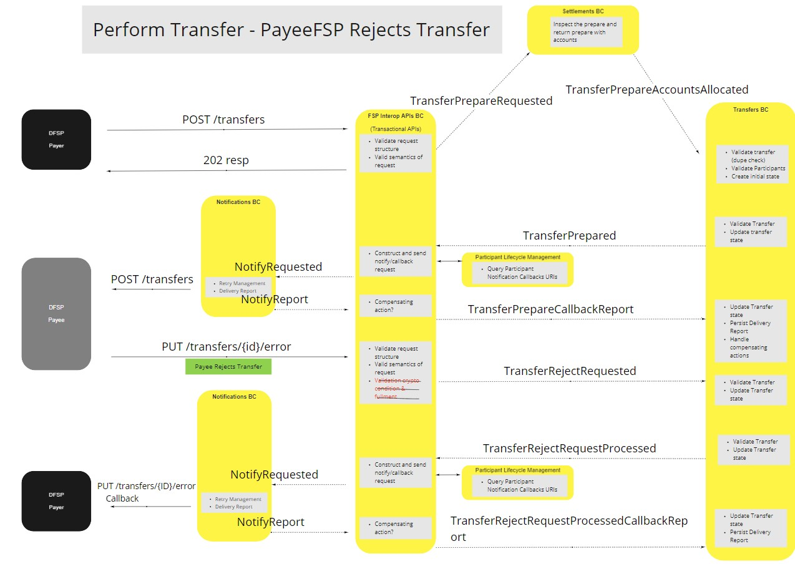

>

### Realizar transferencia - Timeout (preparación)

#### Descripción

La solicitud POST Transfers [^9] (POST /transfers) se rechaza porque la transferencia ha agotado el tiempo de espera [^13] mientras se preparaban los fondos. La FSP IOP API envía una solicitud PUT Transfer error [^25] (PUT /transfers/{ID}/error) al Payer FSP para notificar el error.

#### Diagrama de flujo

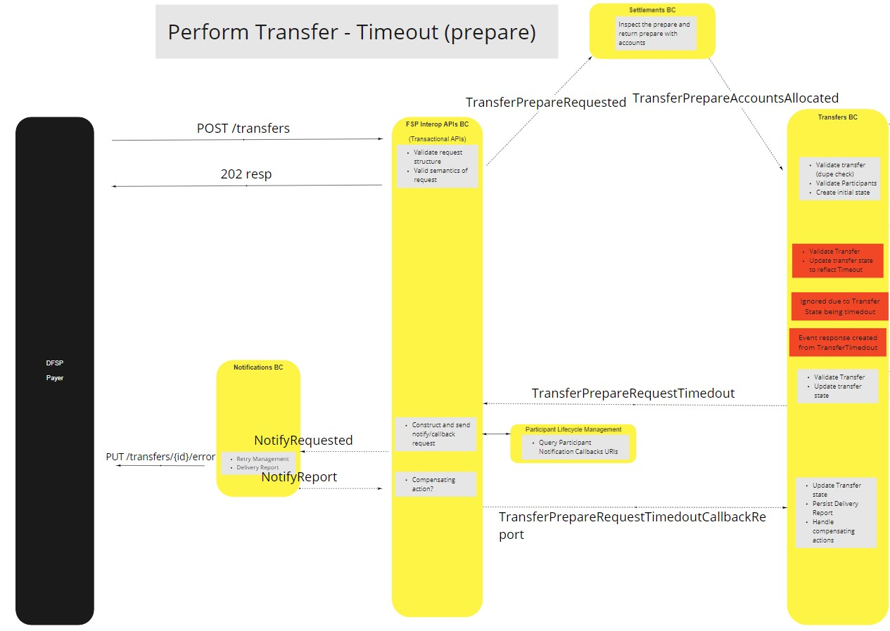

>

### Realizar transferencia - Timeout (antes de la confirmación)

#### Descripción

El Payer FSP envía una solicitud POST Transfers [^9] (POST /transfers) a la FSP IOP API. La FSP IOP API envía entonces un evento al contexto delimitado Settlements [^21]. La FSP IOP API espera un evento del contexto delimitado Transfers [^22] que indique que la transferencia se ha preparado, para enviar una solicitud POST al Payee FSP. El Payee FSP responde entonces con una solicitud PUT Transfers [^23] (PUT /transfers/{ID}) (transferState = committed) a la FSP IOP API, que a su vez confirma el Fulfilment de la transferencia. La transferencia agota el tiempo de espera [^13] mientras se confirman los fondos, o antes de ello, lo que provoca el rechazo de la transferencia. La FSP IOP API lo notifica entonces tanto al Payer FSP como al Payee FSP con una solicitud PUT Transfer error [^25] (PUT /transfers/{ID}/error).

#### Diagrama de flujo

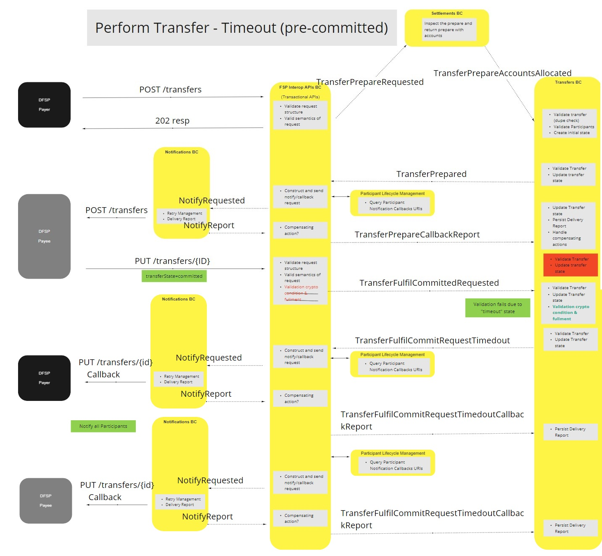

>

### Realizar transferencia - Timeout (después de la confirmación)

#### Descripción

El Payer FSP envía una solicitud POST Transfers [^9] (POST /transfers) a la FSP IOP API. La FSP IOP API envía entonces un evento al contexto delimitado Settlements [^21]. La FSP IOP API espera un evento del contexto delimitado Transfers [^22] que indique que la transferencia se ha preparado, para enviar una solicitud POST al Payee FSP. El Payee FSP responde entonces con una solicitud PUT Transfers [^23] (PUT /transfers/{ID}) (transferState = committed) a la FSP IOP API, que a su vez confirma el Fulfilment de la transferencia. La transferencia agota el tiempo de espera [^13] después de que se confirmen los fondos, lo que provoca el rechazo de la transferencia.

#### Diagrama de flujo

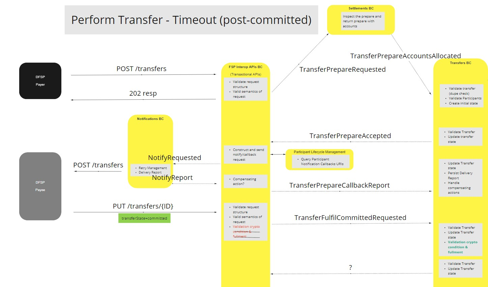

>

### Realizar transferencia - POST duplicado (sin coincidencias)

#### Descripción

La solicitud POST Transfers [^9] (POST /transfers) ya se ha procesado y se devuelve un informe de estado al Payer FSP mediante la recepción de una solicitud PUT Transfer error [^25] (PUT /transfers/{ID}/error).

#### Diagrama de flujo

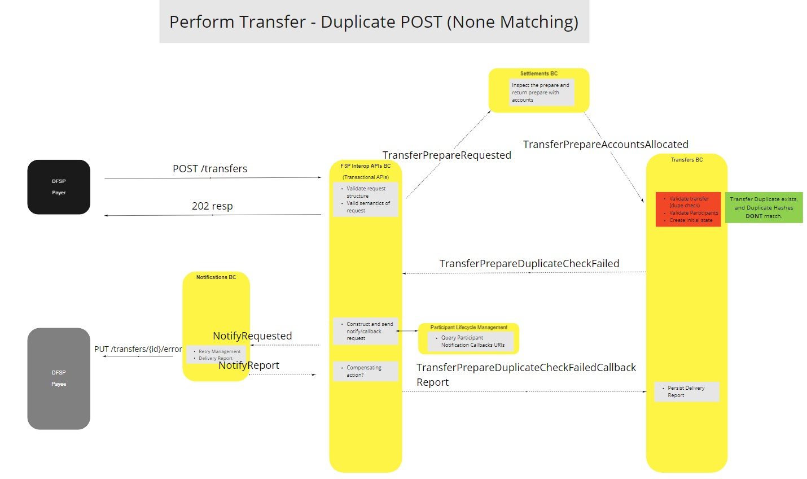

>

### Realizar transferencia - Liquidez insuficiente del Payer FSP

#### Descripción

El Payer FSP envía una solicitud POST Transfers [^9] (POST /transfers) a la FSP IOP API. La FSP IOP API envía entonces un evento al contexto delimitado Settlements [^21]. La FSP IOP API espera un evento del contexto delimitado Transfers [^22] que indique que la transferencia se ha preparado, pero recibe un fallo en la comprobación de liquidez del Payer FSP. La FSP OIP API envía entonces una solicitud PUT [^25] transfers error al Payer FSP para notificar el error.

#### Diagrama de flujo

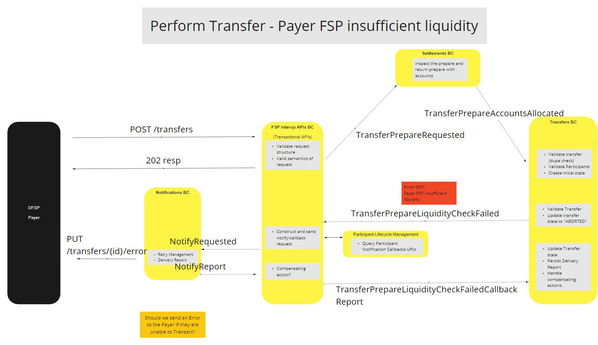

>

### Realizar transferencia - Preparación de la transferencia rechazada

#### Descripción

El Payer FSP envía una solicitud POST Transfers [^9] (POST /transfers) a la FSP IOP API. La API prepara entonces la transferencia y envía la solicitud POST al Payee FSP. El Payee FSP rechaza entonces la transferencia enviando una solicitud PUT Transfer error [^25] (PUT /transfers/{ID}/error) a la FSP IOP API. La FSP IOP API notifica entonces al contexto delimitado Transfers [^22] que la transferencia se ha rechazado y envía una solicitud PUT Transfer error [^25] (PUT /transfers/{ID}/error) al Payer FSP.

#### Diagrama de flujo

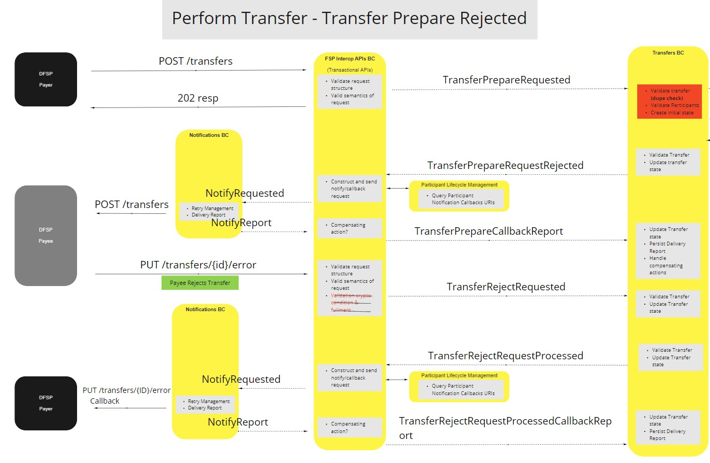

>

### Realizar transferencia - Fallo de validación en la preparación de la transferencia (participante pagador no válido)

#### Descripción

El Payer FSP envía una solicitud POST Transfers [^9] (POST /transfers) a la FSP IOP API. El contexto delimitado Transfers [^22] notifica a la FSP IOP API que el Payer FSP no es válido. Según el motivo por el que el Payer FSP no sea válido, la FSP IOP API enviará una solicitud PUT Transfer error [^25] (PUT /transfers/{ID}/error) al Payer FSP.

#### Diagrama de flujo

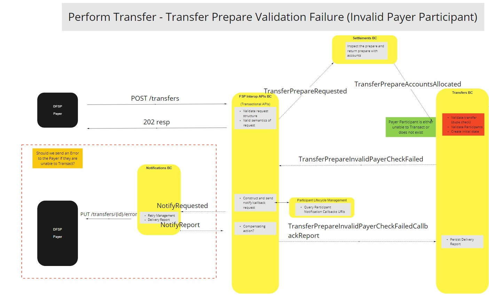

>

### Realizar transferencia - Fallo de validación en la preparación de la transferencia (participante beneficiario no válido)

#### Descripción

El Payer FSP envía una solicitud POST Transfers [^9] (POST /transfers) a la FSP IOP API. El contexto delimitado Transfers [^22] notifica a la FSP IOP API que el Payee FSP no es válido. La FSP IOP API enviará una solicitud PUT Transfer error [^25] (PUT /transfers/{ID}/error) al Payer FSP para notificar el fallo.

#### Diagrama de flujo

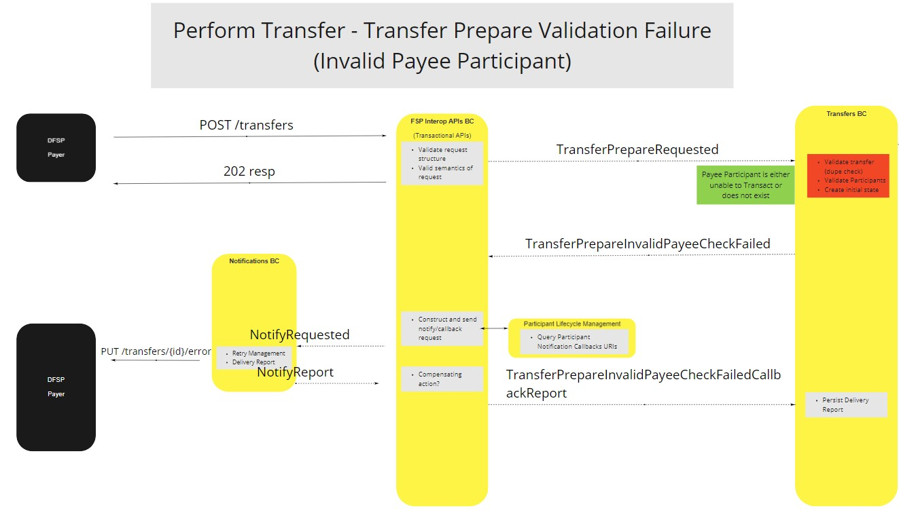

>

## Notas

### Validación de la estructura en los eventos internos

Muchos casos de uso estipulan que la estructura y la semántica de la solicitud deben validarse al recibir un evento de un contexto delimitado interno. Esto no sucede solicitud por solicitud, sino que es un requisito que debe cumplirse cuando se emprenda la fase de construcción de la arquitectura de referencia. Lo que se pretende indicar con ello es que, internamente, todos los eventos y los recursos disponibles deben estar normalizados y verificados.

[^1]: [Mojaloop Common Interface List](../../commonInterfaces.md)
[^2]: [Open API for FSP Interoperability Specification Documentation](https://docs.mojaloop.io/mojaloop-specification/)
[^3]: [Post Quote - Definition](https://docs.mojaloop.io/mojaloop-specification/fspiop-api/documents/API%20Definition%20v1.1.html#6532-post-quotes)
[^4]: [Get Quote - Definition](https://docs.mojaloop.io/mojaloop-specification/fspiop-api/documents/API%20Definition%20v1.1.html#6531-get-quotesid)
[^5]: [Post Participant - Definition](https://docs.mojaloop.io/mojaloop-specification/fspiop-api/documents/API%20Definition%20v1.1.html#6233-post-participantstypeid)
[^6]: [Delete Participant - Definition](https://docs.mojaloop.io/mojaloop-specification/fspiop-api/documents/API%20Definition%20v1.1.html#6234-delete-participantstypeid)
[^7]: [Get Participant - Definition](https://docs.mojaloop.io/mojaloop-specification/fspiop-api/documents/API%20Definition%20v1.1.html#6231-get-participantstypeid)
[^8]: [Get Parties - Definition](https://docs.mojaloop.io/mojaloop-specification/fspiop-api/documents/API%20Definition%20v1.1.html#6331-get-partiestypeid)
[^9]: [Post Transfers - Definition](https://docs.mojaloop.io/mojaloop-specification/fspiop-api/documents/API%20Definition%20v1.1.html#6732-post-transfers)
[^10]: [Commit Notification - Definition](https://docs.mojaloop.io/mojaloop-specification/fspiop-api/documents/API%20Definition%20v1.1.html#6726-commit-notification)
[^11]: [Get Transfers - Definition](https://docs.mojaloop.io/mojaloop-specification/fspiop-api/documents/API%20Definition%20v1.1.html#6731-get-transfersid)
[^12]: [Transaction Irrevocability - Definition](https://docs.mojaloop.io/mojaloop-specification/fspiop-api/documents/API%20Definition%20v1.1.#6722-transaction-irrevocability)
[^13]: [Transfers Timeout and Expiry - Definition](https://docs.mojaloop.io/mojaloop-specification/fspiop-api/documents/API%20Definition%20v1.1.html#6724-timeout-and-expiry)
[^14]: [Account Lookup and Discovery Bounded Context](../accountLookupAndDiscovery/index.md)
[^15]: [Put Participant - Definition](https://docs.mojaloop.io/mojaloop-specification/fspiop-api/documents/API%20Definition%20v1.1.html#6242-put-participantsid)
[^17]: [Put Party- Definition](https://docs.mojaloop.io/mojaloop-specification/fspiop-api/documents/API%20Definition%20v1.1.html#6341-put-partiestypeid)
[^18]: [Put Quote - Definition](https://docs.mojaloop.io/mojaloop-specification/fspiop-api/documents/API%20Definition%20v1.1.html#6541-put-quotesid)
[^19]: [Quoting\Agreement Bounded Context](../quotingAgreement/index.md)
[^20]: [Put Quote Error - Definition](https://docs.mojmojaloop.io/mojaloop-specification/fspiop-api/documents/API%20Definition%20v1.1.html#6551-put-quotesiderror)
[^21]: [Settlements Bounded Context](../settlements/index.md)
[^22]: [Transfers Bounded Context](../transfers/index.md)
[^23]: [Put Transfers - Definition](https://docs.mojaloop.io/mojaloop-specification/fspiop-api/documents/API%20Definition%20v1.1.html#6741-put-transfersid)
[^24]: [Patch Transfers - Definition](https://docs.mojaloop.io/mojaloop-specification/fspiop-api/documents/API%20Definition%20v1.1.html#6733-patch-transfersid)
[^25]: [Put Transfers Error - Definition](https://docs.mojaloop.io/mojaloop-specification/fspiop-api/documents/API%20Definition%20v1.1.html#6751-put-transfersiderror)
[^26]: [Participant Lifecycle Management Bounded Context](../participantLifecycleManagement/index.md)
[^27]: [Notification and Alerts Bounded Context](../notificationsAndAlerts/index.md)
