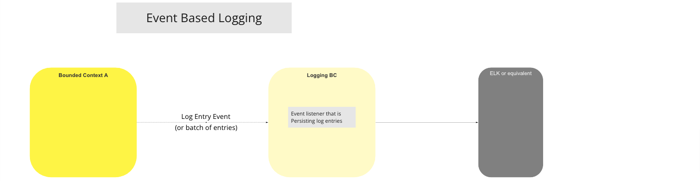

# La explotación forestal en Columbia Británica

El contexto delimitado de registro se utiliza para almacenar información técnica que facilite la depuración, la detección de fallos y la resolución de problemas. Los registros se recogen desde cualquier otro contexto delimitado [^1] y se almacenan para su consulta y la elaboración de informes. La información de registro se almacena como «datos técnicos» y, en caso de que se produjera alguna pérdida de datos, la única consecuencia debería ser la pérdida de la capacidad técnica para comprender el comportamiento del sistema. Todas las actividades del sistema se registran y se conservan de forma permanente para permitir que el contexto delimitado de auditoría [^2] realice consultas sobre los datos de registro.

Los contextos delimitados deben publicar los eventos en un formato definido y utilizando cualquier mecanismo que esté disponible en el contexto delimitado de registro. La estructura incorpora implícitamente una capa de abstracción en el evento recibido por el contexto delimitado de registro, que a su vez se utiliza para almacenar los datos de registro.

## Caso de uso

### Registro basado en eventos

#### Diagrama de flujo

>Diagrama de flujo de trabajo de UC: Registro basado en eventos

<!-- Footnotes themselves at the bottom. -->
## Notes

[^1]: [Mojaloop
Lista de interfaces comunes](../../refarch/commonInterfaces.md)
[^2]: [Auditoría del contexto delimitado](../auditing/index.md)
