# Gestión del ciclo de vida de los participantes BC

El contexto delimitado «Ciclo de vida del participante» se centra principalmente en todo lo relacionado con la gestión de un participante dentro del entorno «Mojaloop». A la hora de definir el contexto delimitado «Gestión del ciclo de vida del participante», hay algunos conceptos clave que deben definirse con claridad.

#### Proceso «Maker/checker»
El proceso «Maker/checker» establece la verificación de seis ojos y garantiza que no se realice ninguna acción de escritura sin que haya sido validada por alguien con los permisos adecuados. Estos permisos los define el contexto delimitado de gestión del ciclo de vida de los participantes, pero son configurables y asignables según sea necesario mediante las Reglas del Esquema de pagos. Se recomienda que los usuarios o roles que reciban los permisos de «creador» no reciban los permisos de «verificador», y que estos últimos se asignen a usuarios o roles distintos. Seguirá siendo posible asignar ambas responsabilidades a los mismos usuarios o roles, pero ello anulará la seguridad que proporciona el proceso «Maker/checker», para cuyo soporte se diseñó el Sistema.

#### Estados participantes
La gestión del estado de los participantes permite a los operadores administradores controlar los permisos de un participante concreto en función de su estado. Durante la fase de configuración de la Plataforma, el contexto delimitado «Gestión del ciclo de vida de los participantes» prevé que se definan y configuren los estados de los participantes con Rol o permisos. A continuación, los estados de los participantes pueden asignarse a un participante concreto mediante el proceso de «Gestión del estado de los participantes».

## Términos

Términos con un significado específico y comúnmente aceptado dentro del contexto delimitado en el que se utilizan.

| Término        | Descripción  |
| ----------- | ------------ |
| **Participante** | Proveedores de servicios financieros que se registren en el ecosistema «Mojaloop». De este modo, dichos «FSP» podrán realizar transacciones con otros participantes. |
| **Fabricante**       | Representante encargado de crear estructuras de datos mediante el uso de solicitudes.   |
| **Checker**     | Representante encargado de aprobar y aceptar los datos cuya creación se haya solicitado. |

## Descripción general de las funciones

Le rogamos que consulte la página de interfaces comunes para ver cómo se producen estas interacciones. [^1]

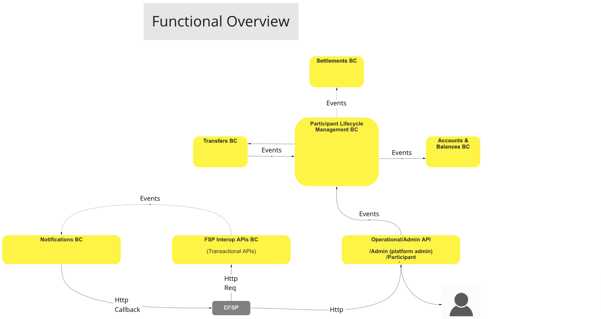
>Diagrama de flujo de trabajo de BC: Descripción general funcional

## Caso de uso

### Crear Participante (Registro en un solo paso)

#### Descripción

El flujo de trabajo que ofrece esta UC permite al BC aplicar un proceso mediante el cual crear un Participante en el ecosistema «Mojaloop», lo que suele requerir toda la información relativa al Participante y las cuentas iniciales necesarias.

#### Diagrama de flujo

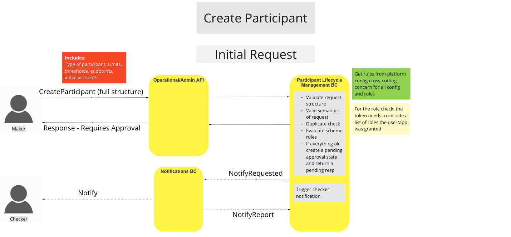
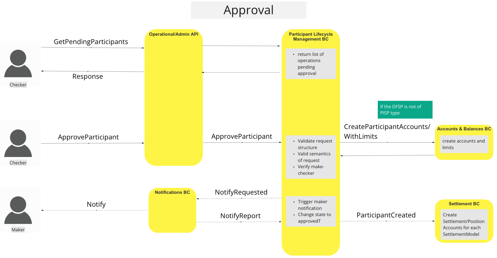
>Diagrama de flujo de trabajo de la UC: Crear Participante

### Gestionar fondos

#### Descripción

El flujo de trabajo que ofrece esta UC permite a la BC aplicar un proceso mediante el cual se pueden retirar o ingresar fondos en la(s) cuenta(s) del Participante.

#### Diagrama de flujo

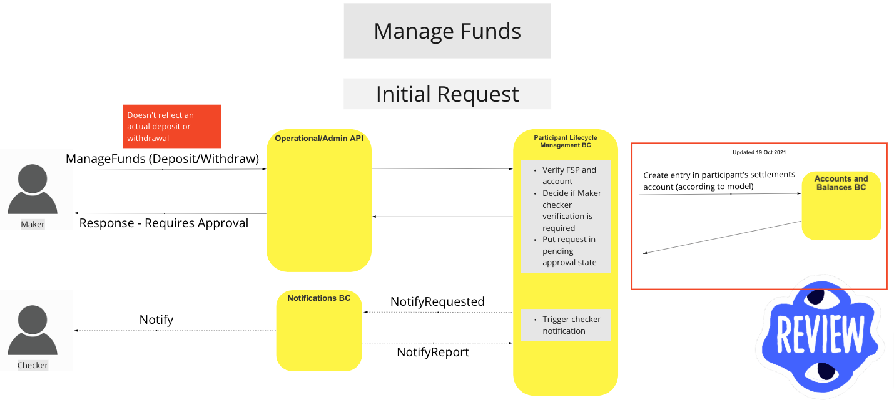
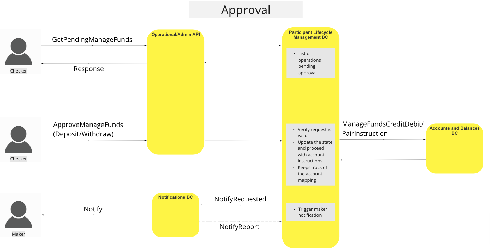
>Diagrama de flujo de trabajo de la UC: Gestión de fondos

### Actualizar Endpoints

#### Descripción

El flujo de trabajo que ofrece esta UC permite al BC aplicar un proceso mediante el cual se actualiza el Endpoint de un Participante determinado. Una vez aprobada la solicitud, se establecerá una conexión con el Endpoint a través de una ruta de mantenimiento de conexión para garantizar la conectividad.

#### Diagrama de flujo

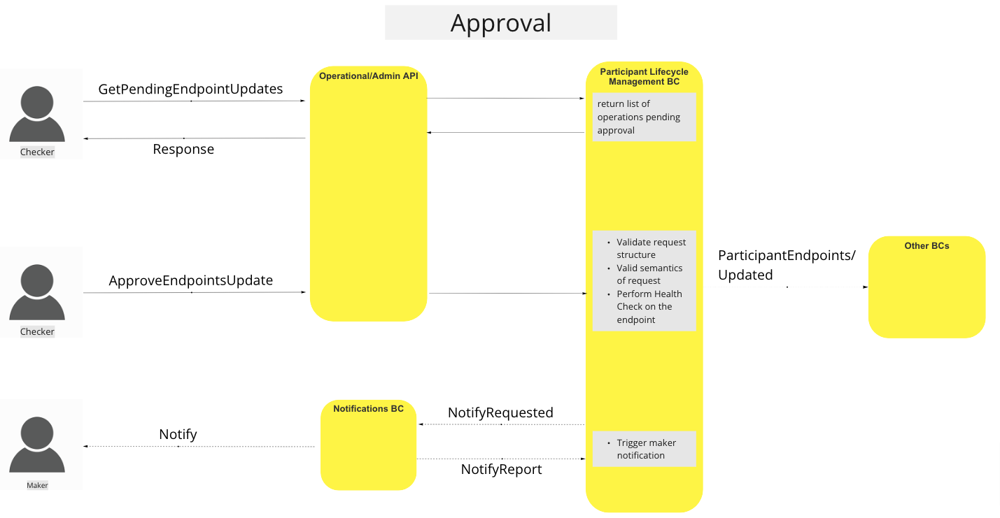
>Diagrama de flujo de trabajo de UC: Actualización de Endpoints

### Actualizar el estado de los participantes

#### Descripción

El flujo de trabajo que ofrece esta UC permite al BC aplicar un proceso mediante el cual se puede modificar el estado de un participante determinado con el fin de hacer cumplir diferentes roles o reglas del esquema de pagos respecto a dicho participante.

#### Diagrama de flujo

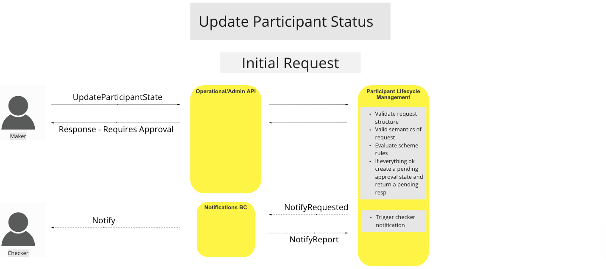
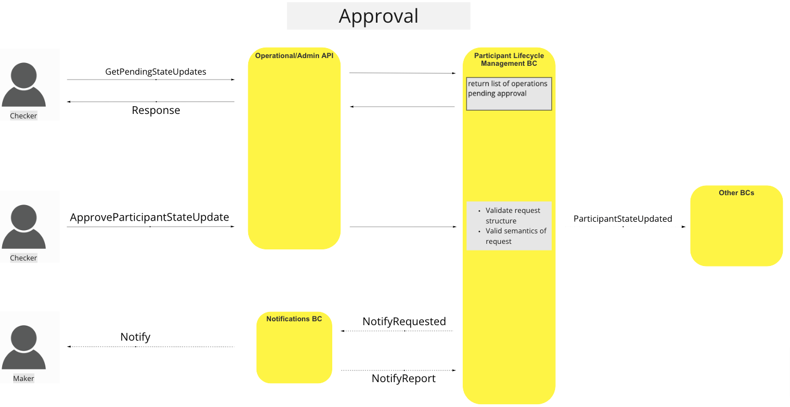
>Diagrama de flujo de trabajo de la UC: Actualización del estado de los participantes

### Obtener participante

#### Descripción

El flujo de trabajo que ofrece esta UC permite al BC aplicar un proceso mediante el cual obtener información sobre un participante concreto.

#### Diagrama de flujo

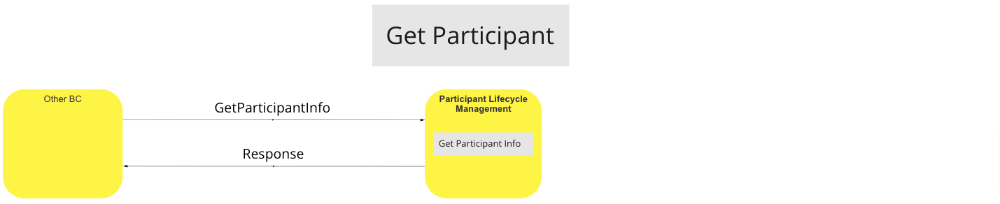
>Diagrama de flujo de UC: Obtener participante

### Añadir cuentas de participantes

#### Descripción

El flujo de trabajo que ofrece esta UC permite a la BC aplicar un proceso mediante el cual controlar diferentes aspectos de las cuentas de los Participantes, desde la creación de una cuenta hasta la activación o desactivación y la actualización de los límites y las alertas de umbral de una cuenta.

- Añadir cuenta de participante
- Actualizar el estado de la cuenta del participante (activar/desactivar)
- Actualizar los límites de liquidez y los umbrales de alerta

#### Diagrama de flujo

<!-- Warning Note to Developers & Editors!!: The following two images are being rendered to the Accounts & Balances BC. -->

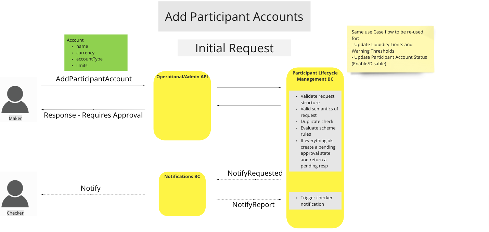
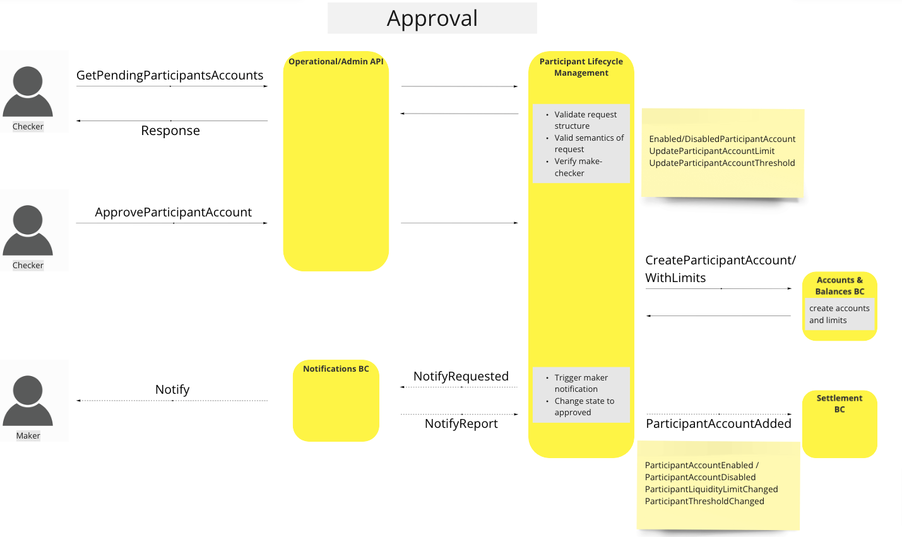
>Diagrama de flujo de trabajo de la UC: Añadir cuentas de participantes

### Reserva de cobertura de liquidez

#### Descripción

El flujo de trabajo que ofrece este UC permite al BC aplicar un proceso mediante el cual se realiza la reserva de cobertura de liquidez para un Participante y se notifica al BC de Cuentas y Saldos dicha actualización.

#### Diagrama de flujo

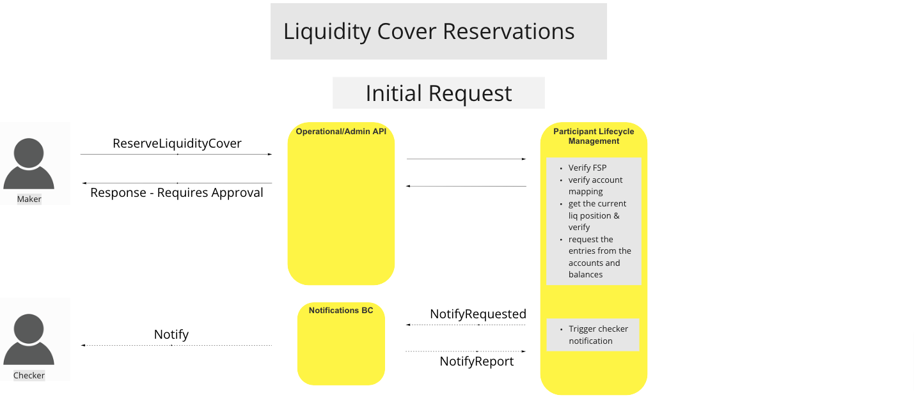
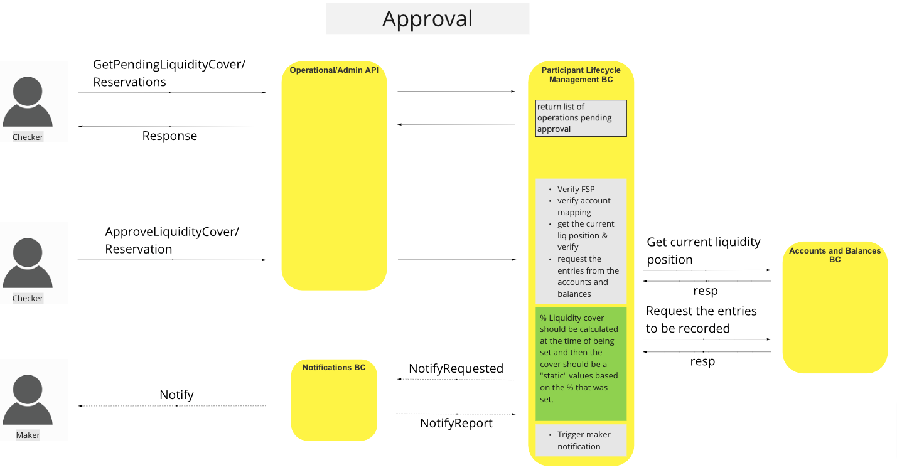
>Diagrama de flujo de la UC: Reserva de cobertura de liquidez

### Se ha superado el umbral de liquidez

#### Descripción

El flujo de trabajo que ofrece esta UC permite a la BC aplicar un proceso mediante el cual se notifica al Participante que se ha alcanzado un umbral de liquidez preestablecido y que podría ser necesario tomar medidas.

#### Diagrama de flujo

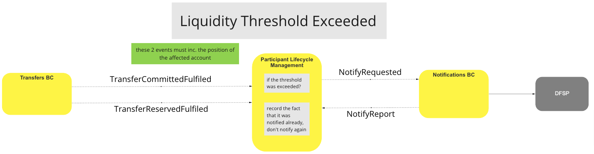
>Diagrama de flujo de UC: Se ha superado el umbral de liquidez

### Se ha superado el límite de liquidez

#### Descripción

El flujo de trabajo que ofrece este UC permite al BC aplicar un proceso mediante el cual se notifica al Participante cuando ha alcanzado el límite de liquidez preestablecido de una cuenta.

#### Diagrama de flujo

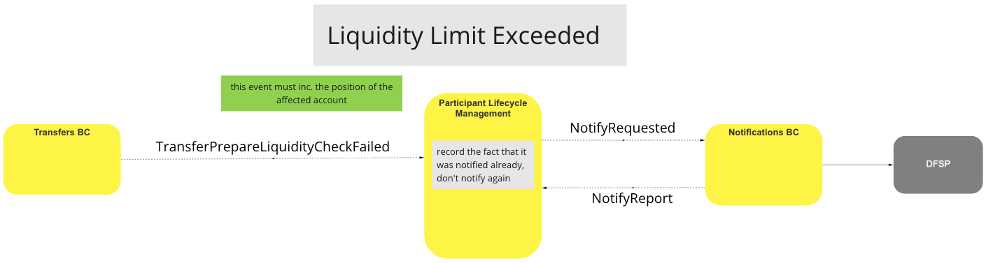
>Diagrama de flujo de UC: Se ha superado el límite de liquidez

### Umbral de liquidez y restablecimiento de límites

#### Descripción

El flujo de trabajo que ofrece esta UC permite al BC aplicar un proceso mediante el cual se restablecen los controles de notificación de límites o umbrales de liquidez cuando se han ejecutado transferencias con éxito y la posición de la cuenta del participante se encuentra en estado positivo.

#### Diagrama de flujo

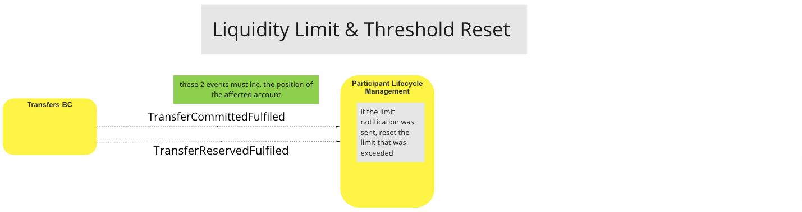
>Diagrama de flujo de UC: Umbral de liquidez y restablecimiento de límites

### Consulta sobre la cobertura de liquidez

#### Descripción

El flujo de trabajo que ofrece esta UC permite al BC aplicar un proceso mediante el cual consultar la liquidez actual de la cuenta de un participante, junto con operaciones de lectura adicionales relacionadas con la liquidez de dicho participante.

#### Diagrama de flujo

<!-- Warning Note to Developers & Editors!!: The following two images are being rendered to the Accounts & Balances BC. -->

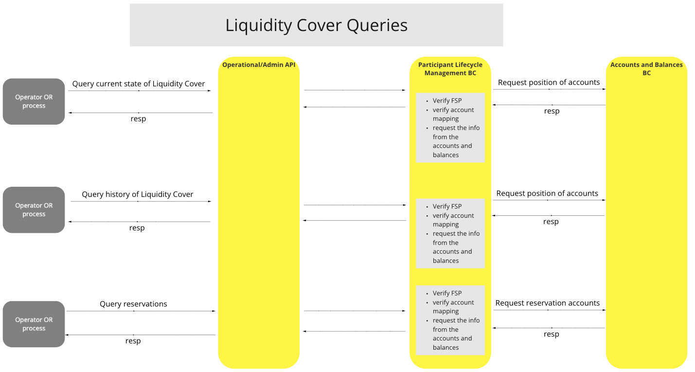
>Diagrama de flujo de UC: Consultas sobre la cobertura de liquidez

## Modelo canónico

-   Participante
    -   id
    -   alias del participante
    -   endpointURL
    -   estado
    -   Cuentas[]
        -   ID de cuenta
        -   tipo de cuenta contable
        -   moneda de la cuenta
        -   isActive
        -   umbral de advertencia
        -   límite
            -   tipo
            -   valor

## Comentarios finales

**Cuentas de los participantes:** Los participantes solo pueden tener una cuenta por cada divisa permitida.
**Caso de uso «Actualizar posición»:** Se ha cambiado por el caso de uso «Gestionar fondos».
**Operaciones de «Maker/checker»:** El recuento de reintentos no influye en la forma en que procesamos o volvemos a procesar las solicitudes.

<!-- Footnotes themselves at the bottom. -->

## Notas

[^1]: Interfaces comunes: [Mojaloop Lista de interfaces comunes](../../boundedContexts/commonInterfaces.md)
