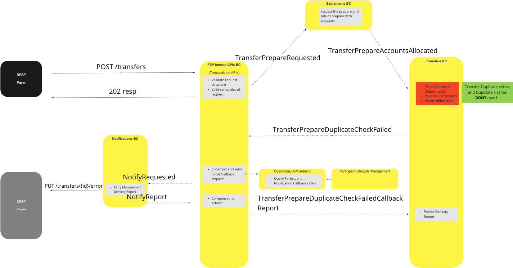

# {nombre} a. C.

{descripción general}

## Términos

Términos con un significado específico y comúnmente aceptado dentro del contexto delimitado en el que se utilizan.

| Término | Descripción |
|---|---|
| Término 1 | Descripción 1 |

## Caso de uso

### Realizar transferencia (modo universal)

> imagen de ejemplo - sustituir

<!-- Footnotes themselves at the bottom. -->
## Notes

[^1]: Interfaces comunes: [Mojaloop Lista de interfaces comunes](../../commonInterfaces.md)
