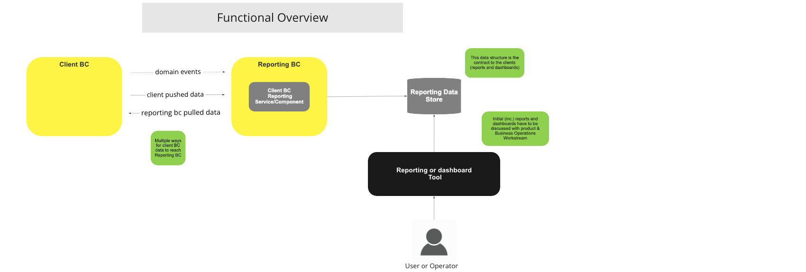
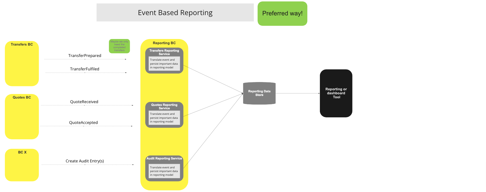
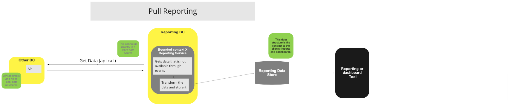
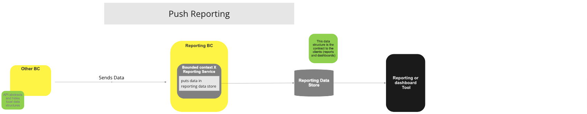

# Informes de BC

## Descripción general

### Estrategia y reglas

La estrategia de generación de informes de esta arquitectura de referencia consiste en describir los mecanismos genéricos mediante los cuales los datos de las entidades de negocio (BC) clientes pueden almacenarse de forma permanente y mantenerse actualizados en un almacén de datos de informes, de modo que los usuarios y los sistemas puedan posteriormente utilizar dichos datos directamente desde dicho almacén o a través de cualquier herramienta de generación de informes y/o de tableros conectada al mismo.  

- Este almacén de datos de informes debe ser de solo escritura desde el punto de vista del Switch y de solo lectura para los componentes externos.
- Los modelos de datos del almacén de datos de informes pueden diferir de los modelos de datos operativos internos que utiliza el Switch; cuando sea pertinente, por motivos de rendimiento u otras razones, se pueden poner a disposición en el almacén de datos de informes varios modelos de los mismos datos, de forma similar a lo que ocurriría con múltiples proyecciones o vistas.
- Un componente de generación de informes de BC del cliente, proporcionado por el Switch, se encargará de traducir los eventos internos y los modelos de datos internos a los modelos del almacén de datos externo. Este componente puede sustituirse o, incluso, pueden existir varios de ellos para un único BC del cliente.
- Dicho componente debe existir en el BC de informes para cualquier BC de cliente cuyos datos estén disponibles en el almacén de datos de informes.
- Cualquier envío o recuperación directa de datos desde el cliente BC de origen, o desde sus almacenes de datos internos, hacia el almacén de datos de informes, constituye una violación del principio de desacoplamiento y afectará negativamente a la mantenibilidad del sistema debido a su estrecho acoplamiento.

### Estrategias de presentación de informes:

- Basado en eventos — Método preferido — En el BC de generación de informes se encuentra un componente (gestor de eventos) que detecta los eventos relevantes procedentes de su BC correspondiente y los transforma en entradas del almacén de datos de informes; puede haber varios de estos componentes por cada BC de cliente; sin embargo, cada uno de ellos debe ser el único responsable de escribir un subconjunto de los datos de informes.
- Push: el BC cliente llamará al componente de información del BC cliente correspondiente (API) para enviar datos; este API se encargará de transformar los datos y almacenarlos en el repositorio de informes ([^1] con el BC de origen; es decir, debería haber un API por cada BC de origen).
- Extracción: en el BC de generación de informes se encuentra un componente de generación de informes del BC del cliente (basado en un temporizador) que realiza una llamada «API» al BC de origen para recuperar sus datos, los cuales se almacenan posteriormente de forma persistente en el almacén de informes ([^1] junto con el BC de origen).

**En el caso de los BC en los que el rendimiento es fundamental, siempre debemos intentar utilizar la estrategia de generación de informes basada en eventos.**

### Reglas mínimas que deben respetarse:

- Solo se podrá utilizar el almacén de datos de informes para la elaboración de informes y tableros. Se prohíbe a los sistemas externos el acceso directo a los propios almacenes de datos de los contextos delimitados. El acceso operativo para los sistemas externos estará disponible a través de las API operativas o [Interop APIs](/refarch/boundedContexts/fspInteropApi/).
- Los datos de origen internos del cliente BC no pueden «transmitirse» directamente al almacén de datos de informes: debe realizarse una conversión entre la estructura de los datos de origen y la estructura de los datos de informes, incluso si no se producen cambios en la estructura. El objetivo es que, en el ámbito de los informes, no exista ninguna dependencia respecto a la estructura de los datos de origen de BC.

### Tareas pendientes

- Decida qué informes iniciales y tableros deben incluirse como parte de la funcionalidad básica de generación de informes
- Elija una herramienta de Código abierto para la elaboración de informes y la creación de tableros con el fin de ofrecer esta funcionalidad básica.
- Informes de cumplimiento y verificación: defina algunos de estos informes básicos (KYC, AML)
- Analice el tema «Monitoreo de procesos (y SLA)» y determine si esto puede llevarse a cabo sobre la capa de generación de informes (la definición de las cifras clave, los SLI y los SLO se realiza mediante la configuración de la Plataforma).
- Añada el enlace al «API BC» en la sección de reglas anterior

## Términos

Términos con un significado específico y comúnmente aceptado dentro del contexto delimitado en el que se utilizan.

| Término | Descripción |
|---|---|
| **Cliente BC** | Contexto delimitado de origen (o propietario) de los datos que se almacenan de forma permanente en el almacén de datos de informes |
| **Almacén de datos de informes** | Almacenes de datos externos (pueden ser varios) en los que se almacenan y mantienen actualizados los datos de informes generados por los componentes de generación de informes BC del cliente |
| **Componente de generación de informes de BC para clientes** | Este componente, que puede adoptar la forma de un servicio, se encargará de la conversión del modelo interno al modelo o modelos externos almacenados en el almacén de datos de informes. |
| **Herramienta de generación de informes o de tableros**  | Herramientas externas que utilizan los datos del almacén de datos de informes como fuente para generar informes, tableros o realizar cualquier otra tarea relacionada con la elaboración de informes |

## Descripción general de las funciones

> Diagrama de funciones de BC: Descripción general funcional

## Caso de uso

### Informes basados en eventos (método recomendado)

#### Descripción

Estrategia para alimentar el almacén de datos de informes mediante el componente de informes BC del cliente, que se encarga de detectar los eventos internos y almacenar los datos de informes correspondientes.

#### Diagrama de flujo

> Diagrama de flujo de trabajo de la UC: Informes basados en eventos (método recomendado)

### Informes basados en el sistema «pull»

#### Descripción

Estrategia para alimentar el almacén de datos de informes haciendo que el componente de informes de BC del cliente obtenga los datos del BC API del cliente.

#### Diagrama de flujo

> Diagrama de flujo de trabajo de la UC: Informes de extracción

### Informes basados en notificaciones push

#### Descripción

Estrategia para alimentar el almacén de datos de informes mediante el envío, por parte del BC del cliente, de los datos que deben comunicarse al Componente de Informes API del BC del cliente, y la conversión y almacenamiento de dichos datos por parte de dicho componente.

#### Diagrama de flujo

> Diagrama de flujo de trabajo de la UC: Generación de informes

### Informe de usuarios y consumo del Tablero

#### Descripción

Ejemplo de cómo un usuario puede consultar informes y tableros

#### Diagrama de flujo

> Diagrama de flujo de trabajo de la UC: Tablero de control de informes y consumo de los usuarios

<!-- Footnotes themselves at the bottom. -->
## Notes

[^1]: Interfaces comunes: [Mojaloop Lista de interfaces comunes](../../refarch/commonInterfaces.md)
