# Transferencias BC

El Centro de Operaciones de Transferencias (Transfers BC) se encarga de coordinar las solicitudes de transferencia. Trabaja en colaboración con otros centros de operaciones, entre los que destacan el de Liquidación, el de Programación, el de Gestión del ciclo de vida de los participantes, el de Cuentas y saldos y el FSPIOP.

## Términos

En este BC, también conocido como dominio, se utilizan los siguientes términos.

| Término | Descripción |
|---|---|
| **Cuentas** | Se refiere a las cuentas utilizadas en todas las operaciones de transferencia. Se emplean para registrar posiciones de abono y de cargo, ya sea de forma temporal —en el caso de las cuentas destinadas a fines de transferencia— o de forma permanente —en el caso de las actualizaciones finales de las transferencias en las cuentas de los participantes—. |
| **Participante/Actor** | Normalmente se refiere a DFSP partes (Pagador/Beneficiario) que utilizan Mojaloop. |
| **IGS** | Método de liquidación de transferencias: liquidación bruta inmediata. Este proceso se utiliza habitualmente en entornos de gran volumen, como el comercio minorista, y se aplica tanto a cuentas individuales como a cuentas compartidas. En entornos de cuentas compartidas, el sistema es capaz de actualizar los saldos de los participantes mediante la actualización del valor proporcional de la participación de cada uno de ellos en el total de fondos disponibles en la cuenta. |
| **DNS** | Método de liquidación de transferencias: Liquidación neta diferida. Este proceso se utiliza con frecuencia en entornos en los que una parte de los Participantes realiza una única transferencia que requiere la liquidación a todos los Participantes. Un ejemplo típico podría ser un caso en el que el participante A venda materias primas al participante B para que este las transforme en un producto acabado, que posteriormente el participante B vuelve a vender al participante A. El Switch calcula el valor proporcional que corresponde a cada participante en la transacción y liquida dicho importe cuando se cierra la ventana de liquidación. |

## Descripción general de las funciones - Transferencias - En bloque

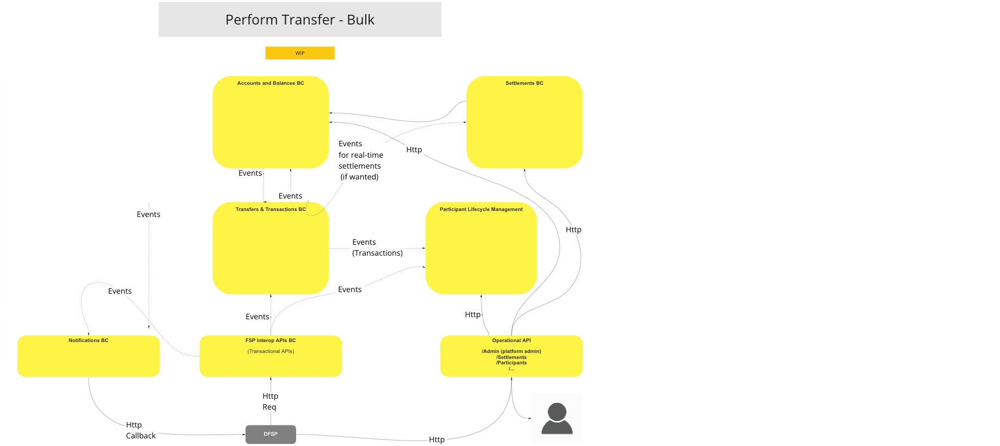
>Diagrama de flujo de trabajo de la UC: Descripción general funcional - Transferencias - En bloque

## Caso de uso

### Realizar transferencia (modo universal)

#### Descripción

El flujo de trabajo que ofrece esta UC permite al BC realizar una Transferencia mediante un método que excluye la intervención de un actor.

#### Diagrama de flujo

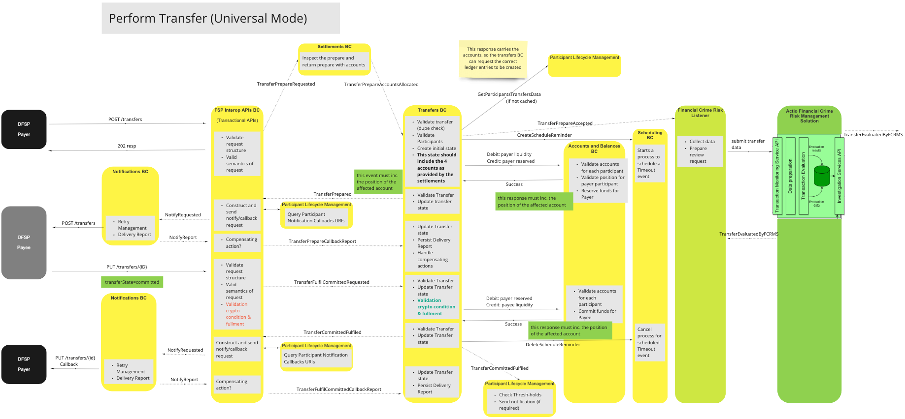
>Diagrama de flujo de UC: Realizar una transferencia (modo universal)

### Realizar una transferencia con confirmación del beneficiario

#### Descripción

El flujo de trabajo que ofrece esta UC permite al BC realizar una Transferencia mediante un método que incluye la intervención de un actor.

#### Diagrama de flujo

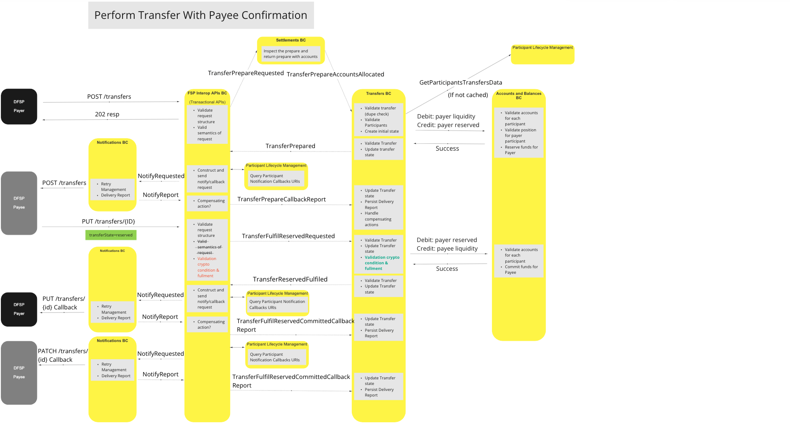
>Diagrama de flujo de UC: Realizar una transferencia con confirmación del Beneficiario

### Transferencia de consulta (GET)

#### Descripción

El flujo de trabajo que ofrece esta UC permite al BC aplicar un método mediante el cual se puede completar una consulta sobre el informe de situación de un Participante.

#### Diagrama de flujo

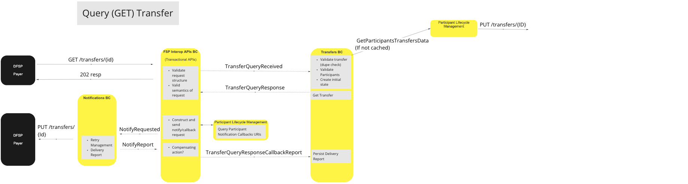
>Diagrama de flujo de UC: Transferencia de consultas (GET)

### Realizar transferencia: duplicar el envío (reenviar)

#### Descripción

El flujo de trabajo que ofrece este UC permite al BC aplicar un procedimiento mediante el cual se tramita una solicitud de transferencia duplicada.

#### Diagrama de flujo

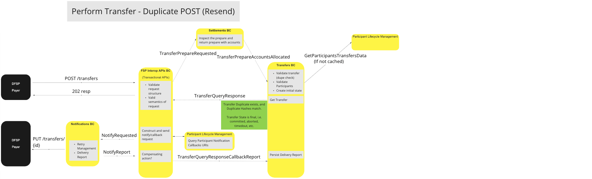
>Diagrama de flujo de UC: Realizar transferencia - Duplicar POST (reenviar)

### Realizar transferencia - POST duplicado (Ignorar)

#### Descripción

El flujo de trabajo que ofrece esta UC permite al BC aplicar un método mediante el cual se puede ignorar una solicitud de transferencia duplicada.

#### Diagrama de flujo

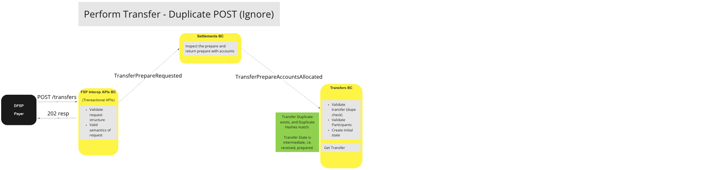
>Diagrama de flujo de UC: Realizar transferencia - Duplicar POST (Ignorar)

## Variaciones de los casos de uso que se desvían de la ruta ideal

### Realizar transferencia: el FSP del beneficiario rechaza la transferencia

#### Descripción

El flujo de trabajo que ofrece esta UC permite al BC aplicar un procedimiento mediante el cual se cancela una solicitud de transferencia rechazada por el Beneficiario.

#### Diagrama de flujo

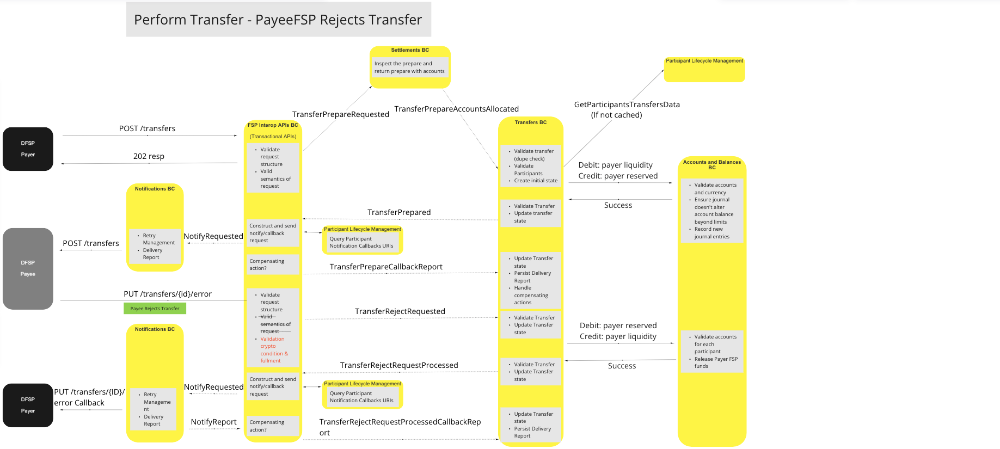
>Diagrama de flujo de la UC: Realizar transferencia — El FSP del beneficiario rechaza la transferencia

### Realizar transferencia - Tiempo de espera (Preparación)

#### Descripción

El flujo de trabajo que ofrece esta UC permite al BC aplicar un método para cancelar una solicitud de «Transfer Prepare» cuando se supera el umbral de tiempo de espera.

#### Diagrama de flujo

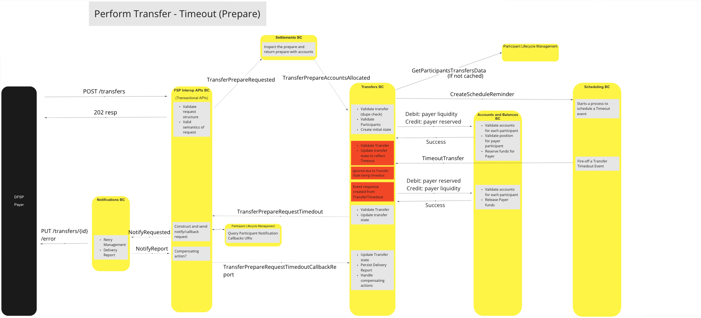
>Diagrama de flujo de UC: Realizar transferencia - Tiempo de espera (Preparación)

### Realizar transferencia: tiempo de espera agotado (preconfirmada)

#### Descripción

El flujo de trabajo que ofrece esta UC permite al BC aplicar un método mediante el cual se pueda cancelar una solicitud de transferencia precomprometida cuando se supere un umbral de tiempo de espera.

#### Diagrama de flujo

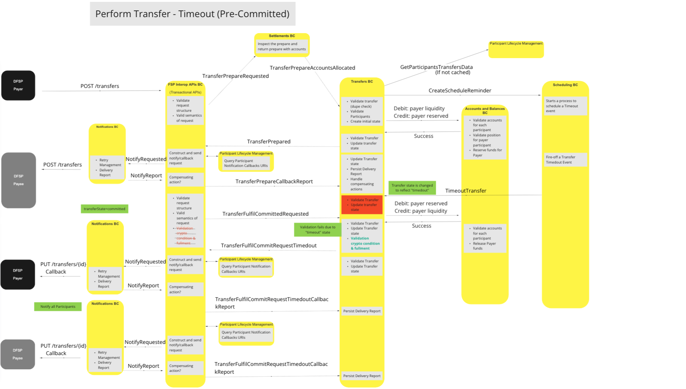
>Diagrama de flujo de UC: Realizar transferencia - Tiempo de espera (precompromiso)

### Realizar transferencia: tiempo de espera agotado (tras la confirmación)

#### Descripción

El flujo de trabajo que ofrece esta UC permite al BC aplicar un método mediante el cual se pueda cancelar una solicitud de transferencia «Post-Committed» cuando se supere el tiempo de espera.

#### Diagrama de flujo

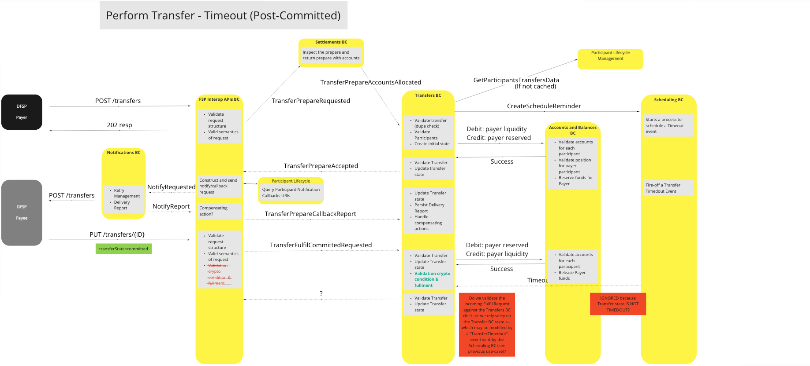
>Diagrama de flujo de UC: Realizar transferencia — Tiempo de espera (tras la Confirmación (commit))

### Realizar transferencia - Duplicado en POST (sin coincidencias)

#### Descripción

El flujo de trabajo que ofrece esta UC permite al BC aplicar un método mediante el cual se pueda dar por concluida una solicitud de transferencia de duplicados no coincidentes cuando se supere el tiempo de espera.

#### Diagrama de flujo

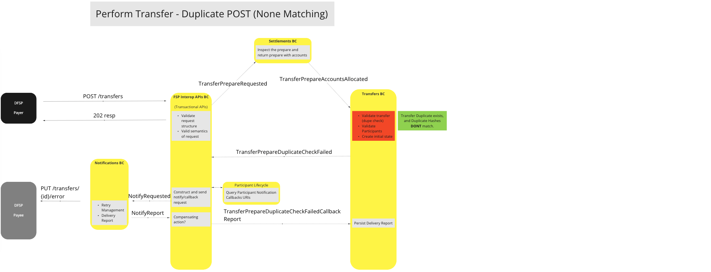
>Diagrama de flujo de UC: Realizar transferencia - Duplicar POST (sin coincidencias)

### Realizar transferencia - Pagador FSP: Liquidez insuficiente

#### Descripción

El flujo de trabajo que ofrece esta UC permite al BC aplicar un procedimiento mediante el cual se pueda cancelar una solicitud de transferencia que haya fracasado debido a que el pagador no dispone de liquidez suficiente para cubrir íntegramente la transacción.

#### Diagrama de flujo

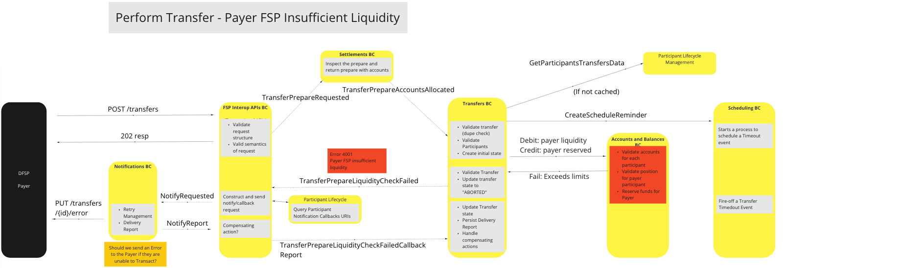
>Diagrama de flujo de UC: Realizar transferencia — Pagador FSP: Liquidez insuficiente

### Realizar transferencia - Error de validación durante la preparación de la transferencia (participante del pagador no válido)

#### Descripción

El flujo de trabajo que ofrece esta UC permite al BC aplicar un procedimiento mediante el cual se pueda cancelar una solicitud de «Transfer Prepare» cuando la validación de la transacción falle debido a que el Pagador no es válido o no existe.

#### Diagrama de flujo

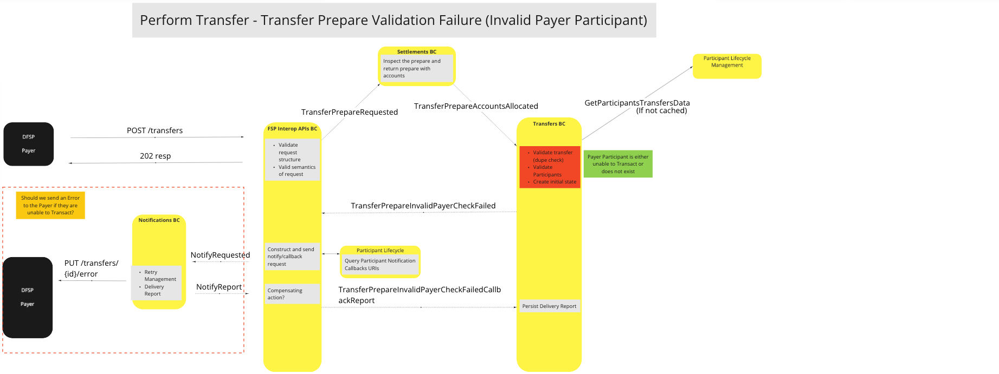
>Diagrama de flujo de trabajo de UC: Realizar transferencia - Fallo en la validación de la preparación de la transferencia (Participante del Pagador no válido)

### Realizar transferencia - Error de validación durante la preparación de la transferencia (participante beneficiario no válido)

#### Descripción

El flujo de trabajo que ofrece esta UC permite al BC aplicar un procedimiento mediante el cual se pueda cancelar una solicitud de «Transfer Prepare» cuando la validación de la transacción falle debido a que el Beneficiario no es válido o no existe.

#### Diagrama de flujo

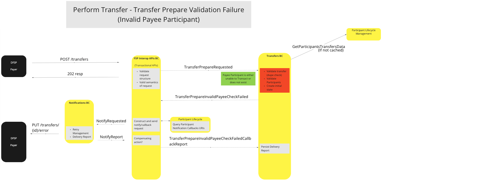
>Diagrama de flujo de UC: Realizar transferencia - Error en la validación de la preparación de la transferencia (Participante no válido)

### Transferencia de consulta (GET) - Error de validación (Participante pagador no válido)

#### Descripción

El flujo de trabajo que ofrece esta UC permite al BC aplicar un método mediante el cual se pueda dar por concluida una consulta sobre el estado de una Transferencia cuando la validación falle debido a que el Pagador no es válido o no existe.

<!--#### Flow Diagram

> Diagrama de la UC (por confirmar) -->

### Transferencia de consulta (GET): error de validación (participante beneficiario no válido)

#### Descripción

El flujo de trabajo que ofrece esta UC permite al BC aplicar un método mediante el cual se pueda dar por concluida una consulta sobre el estado de una transferencia cuando la validación falle debido a que el Beneficiario no es válido o no existe.

<!--#### Flow Diagram

 
> Diagrama de la UC (por confirmar) -->

### Transferencia de consulta (GET) - Error de validación (no se ha encontrado el identificador de transferencia)

#### Descripción

El flujo de trabajo que ofrece esta UC permite al BC aplicar un método mediante el cual se pueda dar por concluida una consulta sobre el estado de una transferencia cuando la validación falle debido a que no se haya encontrado el token identificativo de la transferencia.

<!--#### Flow Diagram

 
> Diagrama de la UC (por confirmar) -->

## Modelo canónico

Mojaloop utiliza dos modelos canónicos para gestionar las transferencias de fondos: uno para las transferencias no masivas y otro para las transferencias masivas.

### Modelo canónico estándar

* Transferencia
  * transferId
  * transferType
  * quoteld (opcional)
  * settlementModelId
  * Participantes
    * Pagador
      * identificador del participante
      * Cuentas
        * Débito
          * accountId
          * tipo de cuenta
          * moneda
        * Créditos
          * accountId
          * tipo de cuenta
          * moneda
    * Beneficiario
      * Identificador del participante
      * Cuentas
        * Débito
          * accountId
          * tipo de cuenta
          * moneda
        * Créditos
          * accountId
          * tipo de cuenta
          * moneda
  * Importe (Importe de la transferencia)
    * valor (número)
    * divisa (código ISO de la divisa)
  * fecha de caducidad (ISO dateTime)
  * ilpPacket
  * Extensiones

### Modelo canónico global

* Transferencias
  * bulkId
  * bulkQuoteId
  * Transferencias[]
    * Transferencia* (véase más arriba)

## Comentarios finales

* No se debe permitir que el pagador FSP anule unilateralmente una transferencia por tiempo de espera (independientemente de su fecha de vencimiento), sino que debe respetar las decisiones del Switch en materia de tiempo de espera.
* La validación de las condiciones criptográficas y su cumplimiento correrían a cargo del BC de transferencias, ya que se trata de un componente fundamental del proceso de «transferencia» (es decir: esta función no es específica del lenguaje «FSPIOP»).
* El BC de transferencias aplicará el mismo patrón de validación que el BC de cotizaciones y contrapartes para validar a los participantes, determinar la capacidad de una cuenta para realizar transacciones o comprobar si un participante está configurado como mutuamente excluyente.
* El sistema «Transfers BC» es la única «Fuente de verdad definitiva» para todas las transferencias y, por lo tanto, es responsable de conservar el estado o los estados de las mismas.
* La desactivación de participantes que ya se encuentren en estado «preparado» no debería obstaculizar el procesamiento de las transferencias en curso; sin embargo, las nuevas instrucciones de transferencia recibidas por Transfers BC a través de los eventos «TransferPrepareAccountAllocated» deberían rechazarse.

<!-- Footnotes themselves at the bottom. -->
<!--## Notes -->

[^1]: Interfaces comunes: [Mojaloop Lista de interfaces comunes](../../commonInterfaces.md)
