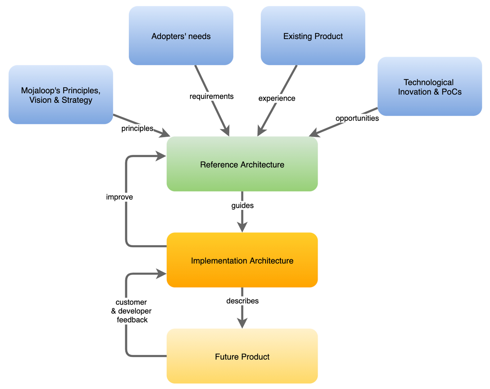

# Introducción

## ¿Qué es una arquitectura de referencia?

En un sistema de software, la arquitectura de referencia es un conjunto de documentos de diseño de software que recogen la esencia del producto y sirven de guía para su evolución técnica.

Este concepto puede simplificarse aún más:

_**La arquitectura de referencia es la visión arquitectónica del diseño perfecto.**_

En condiciones normales, ese diseño perfecto nunca se alcanza, en parte porque no se dispone ni del tiempo ni de los recursos suficientes para implementarlo en su totalidad, y en parte porque dicho diseño puede evolucionar y mejorarse más rápidamente de lo que se tarda en implementarlo.
Es propio de una arquitectura de referencia ser un documento vivo que se actualiza y mejora continuamente.

## ¿Cuáles son los objetivos de la arquitectura de referencia?

Los principales objetivos de la arquitectura de referencia son los siguientes:

* Identificar abstracciones, interfaces y oportunidades de estandarización
* Proponer soluciones y patrones para problemas habituales
* Ayuda a garantizar el cumplimiento de los principios de diseño técnico
* Proporcionar orientación sobre las arquitecturas de implementación
* Fomentar la innovación y la participación, definiendo qué se puede hacer y cómo hacerlo

## ¿Cuáles son las ventajas de contar con una arquitectura de referencia?

La primera ventaja es que constituye la base perfecta para una hoja de ruta técnica. Al tener una visión de futuro clara, se puede elaborar fácilmente a partir de ella una hoja de ruta técnica por fases, lo que garantiza que los recursos y la atención se centren en el valor a largo plazo.

Otra ventaja importante es la orientación que ofrece a la hora de tomar decisiones sobre la elección de tecnologías y las estrategias de implementación.
Teniendo en cuenta la arquitectura de referencia, podemos clasificar cualquier decisión de desarrollo como táctica o estratégica:

* Táctico: algo que se necesita de inmediato y que puede presentar excepciones respecto a la arquitectura de referencia para satisfacer una necesidad urgente de gran importancia. Estas excepciones deben documentarse como deuda técnica que podrá ser dirigida en el futuro.
* Lo estratégico —es decir, aquello que tiene carácter duradero y debe implementarse de acuerdo con la arquitectura de referencia— debería acercar la implementación a dicha arquitectura.

Por último, pero no por ello menos importante, garantiza la coherencia entre la visión técnica y la visión del producto, que es la más importante (véase más adelante la información sobre el proceso y las formas de trabajar).

## Proceso de creación y mantenimiento de la arquitectura de referencia

Durante la elaboración de la versión inicial de la arquitectura de referencia, el equipo siguió los siguientes pasos:

1. Mapeo del espacio de problemas: documente los distintos ámbitos y subámbitos de problemas, así como la forma en que se clasifican según su importancia
2. Mapeo del contexto del espacio de soluciones: agrupar problemas similares en función de su finalidad y contexto
3. Mapeo de casos de uso individuales: analizar y documentar los casos de uso en detalle, teniendo en cuenta la solución en su conjunto

## Cómo mantener actualizada una arquitectura de referencia

El siguiente diagrama muestra el lugar que ocupa una arquitectura de referencia en relación con otros procesos de la Plataforma Mojaloop; lo que debe incorporar y tener en cuenta, no solo la visión y los principios, sino también los requisitos, la experiencia previa e incluso la innovación técnica de Forster.

> Introducción (Arquitectura de referencia Mojaloop 2.0): Cómo mantener actualizada la arquitectura de referencia

## Principios que rigen esta arquitectura

El diseño de la arquitectura de referencia «Mojaloop 2.0» se ha basado en los principios del «Diseño orientado al dominio» [^1] y se ha inspirado en los principios de programación orientada a objetos SOLID [^2] para el desarrollo de aplicaciones de software, especialmente en el principio de responsabilidad única (SRP).

Para facilitar la comprensión de la interpretación de la arquitectura realizada por Mojaloop, incluimos una breve descripción general de la arquitectura «Domain Driven Design».

### Descripción general de la arquitectura inspirada en DDD

La implementación de la arquitectura inspirada en DDD para la versión Mojaloop incluye los siguientes conceptos:

* **Espacio del problema**: por lo general, la arquitectura DDD considera que los requisitos de negocio pertenecen a dominios distintos. Por ejemplo, un sistema de comercio electrónico se considera un **_Dominio_**.  Sin embargo, un sistema de comercio electrónico cuenta con varios componentes para su funcionamiento, tales como el inventario, el carrito de la compra, la caja, etc. Cada componente se clasifica como un **_subdominio_** que aporta valor al dominio, que es el sistema de comercio electrónico. El Mojaloop utiliza un único dominio: es un Switch.

  El «Espacio de problemas» es uno de los dos contenedores en los que se recogen todos los problemas empresariales identificados (mejoras o Servicios) que es necesario resolver.  En función de la complejidad del problema empresarial (mejora) o, de hecho, de la magnitud de los problemas que hay que resolver, es posible dividir la estructura inicial de subdominios en subdominios adicionales.  A cada problema se le asigna su propio subdominio. No obstante, se debe tener cuidado para garantizar que cada subdominio sea absolutamente necesario y se centre en aportar valor al dominio, con el fin de evitar una proliferación innecesaria y confusa de subdominios que saturen el Espacio de problemas.

  Cada mejora o servicio, al estar incluido en un subdominio independiente, permite que distintos equipos desarrollen partes manejables del sistema, lo cual resulta más eficiente y conlleva menos riesgos que construir todo el sistema en una única estructura. Una ventaja considerable de este enfoque es que todo el proceso de desarrollo puede centrarse en mejorar y aportar valor a la Plataforma, y no solo en añadir funcionalidades.

  Por lo general, el «espacio del problema» incluye tres contenedores que indican, a grandes rasgos, cómo o qué se va a utilizar para resolver un problema concreto, a los que se ha añadido un cuarto contenedor para los requisitos no funcionales (NFR):

  * Core: soluciones cuya finalización depende de compilaciones internas.
  * Soluciones de apoyo —que pueden implementarse utilizando productos ya disponibles en el mercado—, como, por ejemplo, el inicio de sesión seguro.
  * Genéricas: soluciones que pueden utilizar productos ya disponibles en el mercado, pero cuya implementación requiere programación adicional, no solo integración; por ejemplo, la generación de informes y la Autenticación.
  * Requisitos no funcionales (NFR): soluciones necesarias para el direccionamiento de necesidades comunes, pero que no contribuyen directamente al valor del producto

* **Espacio de soluciones**: un segundo componente fundamental de la arquitectura DDD es el espacio de soluciones. Se diferencia del espacio de problemas en que no se centra en qué hay que resolver, sino en cómo se va a resolver un problema (mejora o servicio) y en cómo se relacionan entre sí las distintas soluciones. Por lo tanto, el Espacio de Soluciones incluye necesariamente más información técnica y detalles sobre cómo deben resolverse los problemas.

  * El «Espacio de soluciones» introduce una serie de elementos destinados a facilitar y armonizar las iniciativas de desarrollo en materia de resolución de problemas

  * Los «contextos delimitados» se introdujeron para agrupar conjuntos cohesionados de soluciones con su lenguaje específico.

  A menudo, la correspondencia entre contextos delimitados y subdominios no será de uno a uno.  Dado que los subdominios pertenecen al espacio del problema y los contextos delimitados al espacio de la solución, es muy posible que se den situaciones en las que un subdominio sea resuelto por más de un contexto delimitado, o en las que un contexto delimitado pueda resolver varios subdominios.

  Por lo general, y sin duda en el entorno «Mojaloop», las soluciones se diseñan e implementan sin conocer las dependencias específicas de la infraestructura ni otros aspectos internos de otros contextos delimitados. Este enfoque contribuye a la seguridad, entre otras cosas, al garantizar que cada contexto delimitado solo tenga conocimiento de su propio entorno y de sus interfaces.  Las comunicaciones entre contextos delimitados se realizan íntegramente a través de API y mensajería segura.  Entre los ejemplos de contextos delimitados (BC) del entorno «Mojaloop» se incluyen «Cuentas y saldos», «Transferencias y Transacciones», etc.

* **_Lenguaje ubicuo_** es un enfoque destinado a fomentar un lenguaje explícito y de comprensión común que todos utilicen a la hora de describir problemas y soluciones, desde los usuarios finales hasta los desarrolladores. El lenguaje ubicuo tiene dos objetivos principales:

  1. Garantiza que se identifiquen los términos únicos y que todas las partes dentro de su contexto delimitado los interpreten con un único significado. Un ejemplo podría ser la palabra «cuenta», que una parte podría entender como un perfil de cuenta, mientras que otra podría interpretarla como una referencia a una cuenta del sistema contable. No se trata de una recomendación para buscar un conjunto universal de términos inequívocos —algo imposible— que abarque todo el proyecto o toda la empresa; en cambio, garantiza que cada contexto delimitado cuente con su propio conjunto de términos.
  2. Garantiza que los términos del «lenguaje ubicuo» estén presentes desde la interfaz de usuario hasta la documentación, pasando por otros materiales relacionados con el proyecto, e incluso en el código. El uso ubicuo de los mismos términos en todas partes, incluido el código, garantiza que todos tengan la misma comprensión de los problemas y las soluciones que se describen y resuelven.

* **_Cuestiones transversales_**[^3] son aspectos de una solución de software que deben resolverse mediante varios contextos delimitados (o funciones/módulos) e incluyen elementos como la auditoría, la seguridad, la Autenticación y la gestión de la configuración de la Plataforma (tanto empresarial como técnica). Nuestro enfoque respecto a estas preocupaciones transversales consistió en separarlas de los contextos delimitados. La mayoría de las preocupaciones transversales tienen un carácter distribuido en este diseño, con componentes centrales y bibliotecas de cliente. En esta documentación se representan como equivalentes a los contextos delimitados.

### Principios SOLID

Además de la arquitectura DDD, el enfoque arquitectónico de «Mojaloop» también se ha inspirado en los principios SOLID:

* El principio de responsabilidad única y las interfaces internas permiten implementar dominios adicionales, como el de la ISO, sin necesidad de modificar la arquitectura central
* Las entidades de software deben ampliarse, pero nunca modificarse. La regla es no alterar nunca el núcleo, sino ampliarlo siempre mediante módulos o nodos complementarios.
* Las funciones que utilizan referencias a clases base deberían poder utilizar objetos de clases derivadas sin ser conscientes de ello
* Es preferible disponer de varias interfaces específicas para cada cliente que de una única interfaz polivalente
* Basen sus dependencias en abstracciones, no en concretizaciones

<!-- Footnotes themselves at the bottom. -->
### Notes

[^1]: Lecturas recomendadas: [Diseño orientado al dominio. De Wikipedia, la enciclopedia libre](https://en.wikipedia.org/wiki/Domain-driven_design)

[^2]: Lecturas recomendadas: [SOLID, de Wikipedia, la enciclopedia libre](https://en.wikipedia.org/wiki/SOLID)

[^3]: Lecturas recomendadas: [Tema transversal](https://en.wikipedia.org/wiki/Cross-cutting_concern#:~:text=Cross%2Dcutting%20concerns%20are%20parts,oriented%20programming%20or%20procedural%20programming.) - Editor: Wikipedia, la enciclopedia libre
