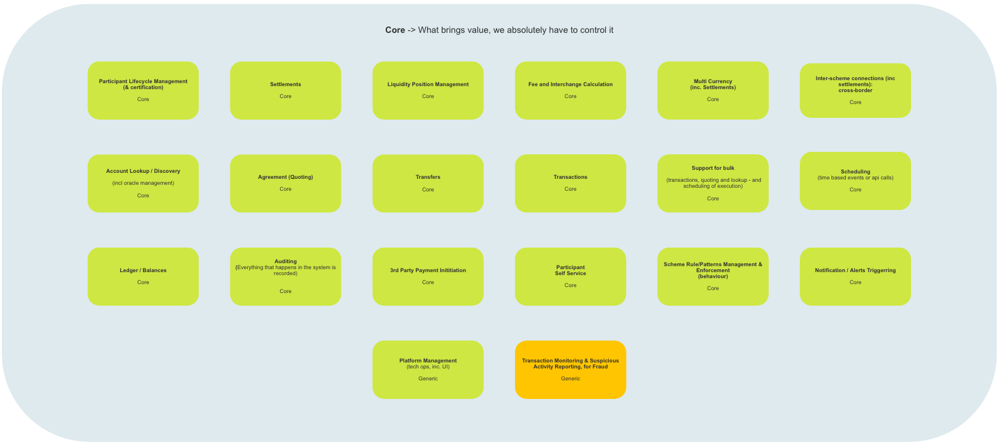
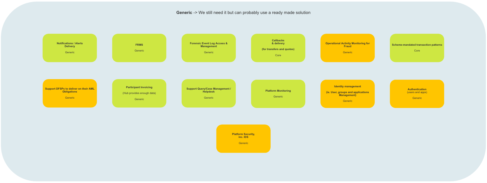
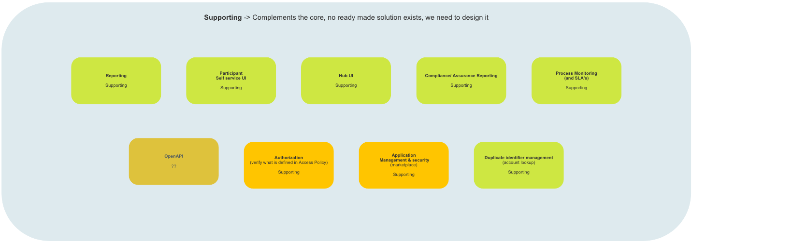
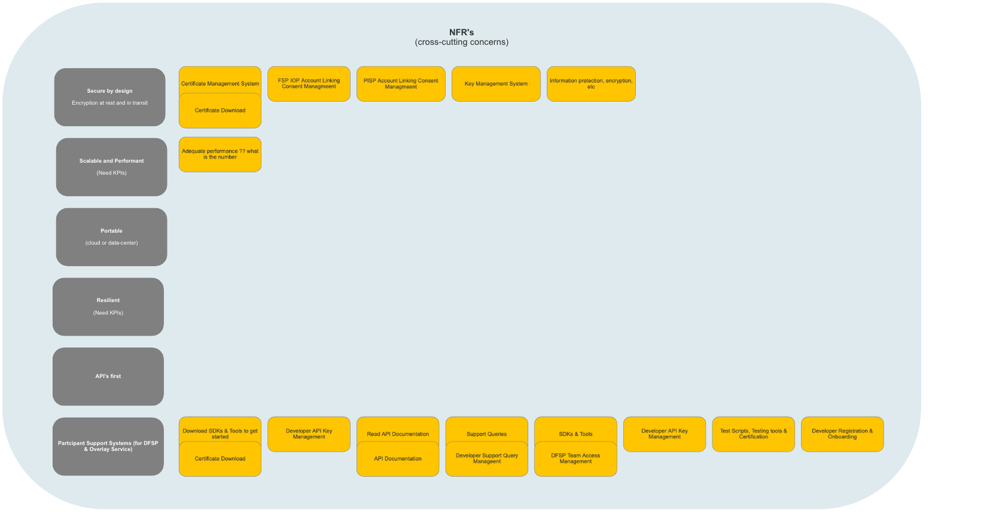
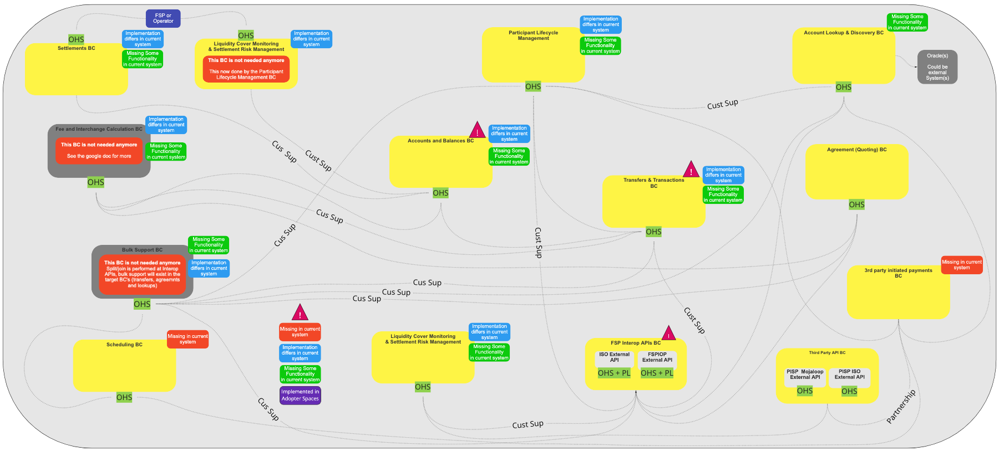

# Mojaloop. Descripción general de la arquitectura de referencia

## Ámbito del problema (_Identificación y descripción del ámbito del problema_)

Tal y como se señala en la descripción general de la arquitectura DDD, el «espacio de problemas» contiene una serie de contenedores orientados a soluciones, identificados por el equipo de arquitectos del sistema, que se utilizan para clasificar los subdominios en los que se han identificado problemas (o posibilidades de mejora).

### Problemas fundamentales

#### Descripción

El departamento de la Empresa, los desarrolladores o ambos han identificado una serie de problemas fundamentales (mejoras). Para implementar dichas mejoras, se encargará a los equipos de desarrollo «internos» que elaboren las soluciones necesarias.  Por lo general, los subdominios así identificados generan un valor significativo para el sistema «Mojaloop», por lo que se presta especial atención a garantizar que los servicios que prestan no se vean comprometidos. Entre los ejemplos de subdominios de problemas fundamentales se incluyen: la gestión del ciclo de vida de los participantes, las liquidaciones y la programación.

#### Mapa general

> Arquitectura de referencia (Mojaloop): Problemas fundamentales

### Problemas generales

#### Descripción

El departamento de la empresa, los desarrolladores o ambos han identificado una serie de problemas genéricos (mejoras).  Para llevar a cabo estas mejoras, se implementarán soluciones ya disponibles que no requieran ninguna personalización adicional.  Será necesario integrarlas con el Mojaloop.  Entre los subdominios de problemas genéricos se incluyen la Autenticación, el FRMS y el Monitoreo de la Plataforma.

#### Mapa general

> Arquitectura de referencia (Mojaloop): Problemas generales

### Problemas relacionados

#### Descripción

El departamento de la empresa, los desarrolladores o ambos han identificado una serie de problemas relacionados con el sistema (mejoras).  Para llevar a cabo las mejoras, se implementarán soluciones ya disponibles en el mercado; sin embargo, con el fin de integrarlas plenamente con el sistema «Mojaloop» y dar respuesta a los problemas identificados (mejoras), será necesario realizar una personalización adicional para cada una de las soluciones integradas.  Entre los subdominios de los problemas de apoyo se incluyen la gestión de políticas de acceso, la elaboración de informes y la Autorización (verificación del contenido de las políticas de acceso).

#### Mapa general

> Arquitectura de referencia (Mojaloop): Problemas relacionados

### Requisitos no funcionales

#### Descripción

Se han identificado una serie de requisitos no funcionales por parte de (el departamento comercial, los desarrolladores o ambos). Aunque no aportan un valor directo a «Mojaloop», son necesarios para resolver una serie de problemas relacionados con la Empresa (mejoras).  Entre los ejemplos de requisitos no funcionales se incluye la seguridad que no ocupa un subdominio propio. Todos los subdominios del sistema deberán incluir elementos de código relacionados con la seguridad para cumplir este requisito de Fulfilment; alternativamente, se implementará un servicio central de gestión de la seguridad que incluya perfiles de seguridad gestionados y creados de forma centralizada para cada subdominio del Sistema, los cuales se descargarán al incorporarse al dominio o al iniciarse el Sistema, y/o se les enviarán desde el servicio central cuando se produzcan actualizaciones.

#### Mapa general

> Arquitectura de referencia (Mojaloop): Requisitos no funcionales

### Nuevo y sin clasificar (sin dominio)

#### Descripción

Tanto la Empresa como los desarrolladores han identificado una serie de problemas nuevos y sin clasificar (ajenos al dominio). Una vez que la Empresa y los arquitectos de sistemas hayan determinado la solución necesaria para resolver el problema, este se clasificará en uno de los contenedores de problemas y se gestionará de acuerdo con los procesos correspondientes.

#### Mapa general

> Arquitectura de referencia (Mojaloop): Problemas nuevos y sin clasificar

## Espacio de soluciones (_Descripción general y mapa contextual_)

#### Descripción

El «espacio de soluciones» definido por la arquitectura DDD se centra en cómo se van a resolver los problemas empresariales (mejoras) identificados en el «espacio de problemas».  Por consiguiente, contiene necesariamente más información y detalles técnicos que el «espacio de problemas».  Incluye elementos como el lenguaje ubicuo, los contextos delimitados y las preocupaciones transversales.

#### Mapa general

> Arquitectura de referencia (Mojaloop): Espacio de soluciones

### Lenguaje ubicuo

#### Descripción

Uno de los retos a los que se enfrentan la mayoría de los equipos es mantener una comprensión clara de los términos que pueden no ser exclusivos de un dominio concreto. Un ejemplo clásico de término no exclusivo es «cuenta»: este término podría referirse a un conjunto de cuentas financieras, al perfil de una entidad o a un nombre de usuario.

Tal y como se ha señalado en la descripción general, el lenguaje ubicuo se utiliza para ayudar a eliminar la confusión y los malentendidos entre los equipos empresariales y técnicos que trabajan para resolver un problema empresarial o un conjunto de problemas empresariales.  Si bien es posible que cada dominio o subdominio contenga términos que no sean únicos —tal y como se ha señalado anteriormente— dentro de un contexto concreto y, en el caso de la arquitectura DDD, dentro de lo que se denomina un «contexto delimitado», es importante garantizar que todos los términos sean únicos, que todos los participantes los comprendan con claridad y que se apliquen correctamente.

Para obtener información detallada y una descripción de cada uno de los términos lingüísticos específicos utilizados en el Dominio Mojaloop, consulte el [Glosario](../glossary/README.md) adjunto a este documento.

### Contextos delimitados

Se han identificado e implementado los siguientes contextos delimitados en la versión Mojaloop:

> Esta es una descripción general de cada uno de los contextos delimitados que se han identificado e incluido en la Arquitectura de Referencia Mojaloop. A continuación se ofrece una visión más detallada en la sección [Contextos delimitados](../boundedContexts/index.md) de este documento.

| Contexto delimitado            | Objetivo                                                                                                                                                                         | Contexto delimitado                                       | Objetivo                                                                                                                                                    |
| -------------------------- | ------------------------------------------------------------------------------------------------------------------------------------------------------------------------------- | ----------------------------------------------------- | ---------------------------------------------------------------------------------------------------------------------------------------------------------- |
| Asentamientos                | Realiza liquidaciones Settlements . Configura modelos de liquidación models . Calcula liquidaciones                                                                                               | Gestión del ciclo de vida de los participantes                      | Onboarding  Management del ciclo de vida de los participantes  Self-service para participantes  Interfaz de usuario del self-service para participantes                                |
| Búsqueda de cuenta y localización de cuentas | Núcleo interno de Oracle core . Búsqueda de cuenta discovery . Transacciones masivas transactions . Gestión de identificadores duplicados management . Conexiones entre esquemas de pagos (incluidas las liquidaciones transfronterizas) | Cuentas y saldos                                   | Sistema de registro de la actividad financiera y el saldo deDFSP Participante                                                                                          |
| Transferencias y transacciones   | Tramitación de transferencias: processing . Comprobación de liquidez para cada transferencia: transfer . Transacciones masivas: transactions . Multidivisa, incluidas las transacciones con múltiples pasos                                              | Acuerdo (Cotización)                                   | Acuerdo /cita (básico)  . Transacciones masivas  . Multidivisa, incluidas las transacciones con múltiples saltos  . La aplicación de las normas y patrones del Esquema de pagos se lleva a cabo en cada cadena de bloques |
| Planificación                 | Programación de eventos basados en el tiempo con API llamadas (Core)                                                                                                                                | Notificaciones y alertas                                | Estado de las notificaciones: tiene en cuenta la prioridad y el SLA (Básico)   Gestión de activadores y alertas (Básico)   Envío de notificaciones: tiene en cuenta la prioridad y el SLA (Genérico)     |
| FSP API de interoperabilidad           | ISO Externo API (A granel; API, activación de devoluciones de llamada (solo transferencias; no aparece en la situación actual)                                                                                            | Pagos iniciados por terceros                        | PISP. Vinculación de cuentas  . Management del consentimiento  . Iniciación de pagos por terceros (Core)                                                                      |
| TercerosAPI            |                                                                                                                                                                                 | PISP Mojaloop Externo API  PISP ISO Externo API |                                                                                                                                                            |

### Cuestiones transversales

En el añoMojaloop se han identificado las siguientes cuestiones transversales:

| Cuestión transversal BC                 | Objetivo                                                                                                                                                                                                                                                                                                                                                                                                                                   |
| ---------------------------------------- | ----------------------------------------------------------------------------------------------------------------------------------------------------------------------------------------------------------------------------------------------------------------------------------------------------------------------------------------------------------------------------------------------------------------------------------------- |
| Autenticación y autorización (AuthZ y AuthN) y gestión de identidades BC | Gestión de todos los aspectos relacionados tanto con la autenticación (AuthN) como con la autorización (AuthZ) de usuarios y sistemas. Las soluciones previstas se encuadrarán en las categorías «Genéricas» y «De apoyo».                                                                                                                                                                                                                                                                        |
| BC criptográfico                         | Gestionar todos los servicios relacionados con la criptografía, incluidos los sistemas de gestión y almacenamiento de claves y certificados. Las soluciones previstas se enmarcarán en la categoría «Genérica».                                                                                                                                                                                                                                                                             |
| Informes y auditorías en Columbia Británica                | Gestionar todos los servicios de auditoría y generación de informes, incluidos los informes de cumplimiento y garantía, el registro forense de eventos y el sistema de gestión de claves (KMS), el acceso y la gestión forense de registros de eventos, el monitoreo de procesos y los acuerdos de nivel de servicio (SLA), así como la auditoría de sistemas. (Cada bloque de negocio (BC) incluirá capacidad de auditoría. El bloque de negocio de Informes y Auditoría conservará los registros de todos los bloques de negocio). Las soluciones previstas se encuadrarán en todas las categorías del «espacio de problemas»: básicas, de apoyo y genéricas.     |
| Configuración de la plataforma (Empresa) BC     | Gestionar el proceso de gestión de reglas y patrones del Esquema (Nota: la aplicación de las reglas y patrones del Esquema se mantiene en cada BC), los patrones de transacción exigidos por el Esquema, la gestión de aplicaciones y la seguridad, la gestión de identidades y accesos (incluida la gestión de usuarios y equipos), la gestión del consentimiento vinculado a las operaciones empresariales (API) y la gestión de políticas de acceso. Las soluciones previstas se encuadrarán en todas las categorías del «espacio de problemas»: «Básicas», «De apoyo» y «Genéricas». |
| Gestión de la plataforma técnica BC         | Gestión del monitoreo y la administración de la plataforma. Las soluciones previstas se incluirán en la categoría «Genérica».                                                                                                                                                                                                                                                                                                                                |

<!-- Footnotes themselves at the bottom. -->
<!--### Notes

[^?]: Aquí va la nota: «?» indica una referencia a una nota al pie-->