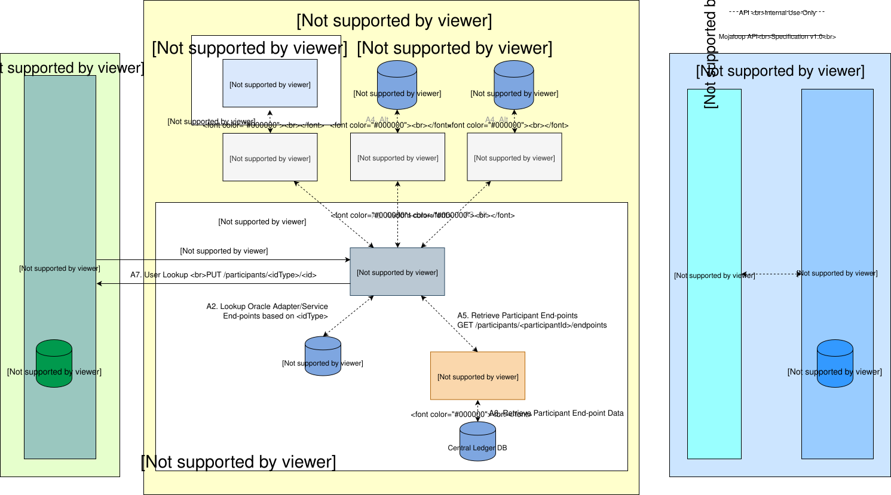
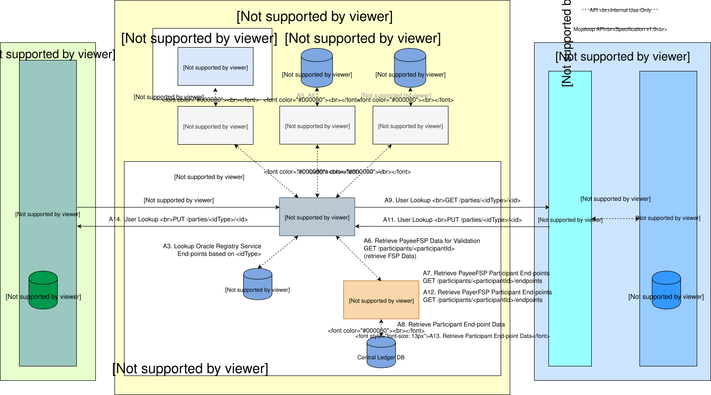
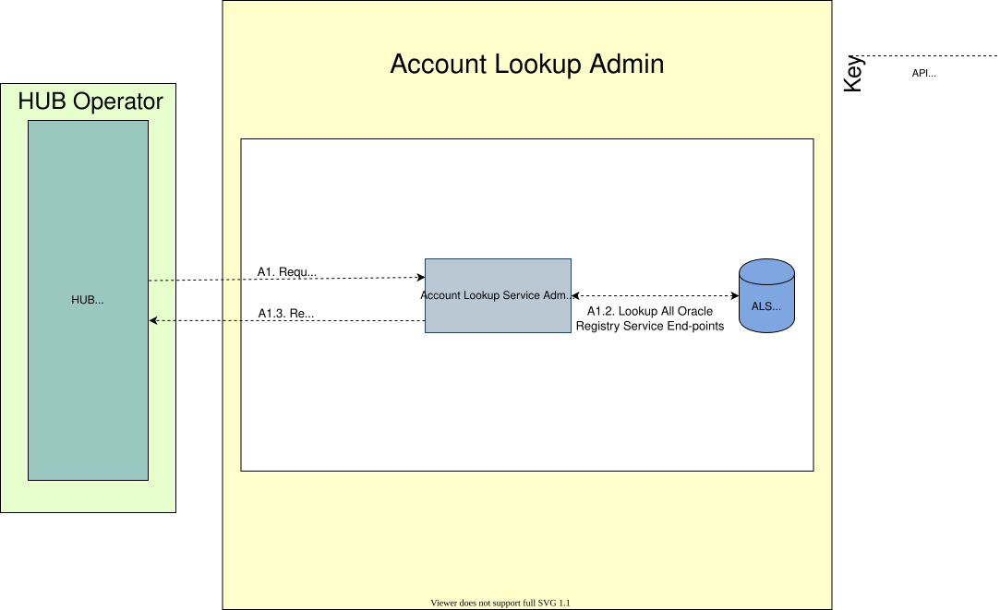
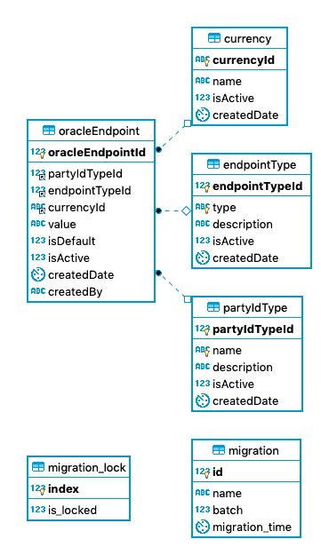

# Account Lookup Service (ALS)

El **Account Lookup Service** (**ALS**) _(véase la sección `6.2.1.2`)_, de conformidad con la [Mojaloop {{ $page.frontmatter.version }} Specification](/technical/api/), implementa los siguientes casos de uso:

* Búsqueda de participantes 
* Búsqueda de partes
* Gestionar la información del registro de participantes
    * Incorporación de la información del registro de participantes
    * Eliminación de la información del registro de participantes

Casos de uso que se han implementado además de los destinados al funcionamiento operativo del Hub: 
* Operaciones administrativas
    * Gestión de la información de enrutamiento de los puntos finales de Oracle
    * Gestión de la información de enrutamiento de los puntos finales de los Switch

## 1. Consideraciones de diseño

### 1.1. Account Lookup Service (ALS)
El diseño de ALS proporciona un componente genérico de servicio central como parte del núcleo Mojaloop. El objetivo de este componente es proporcionar enrutamiento y alineación con la especificación Mojaloop API. Este componente admitirá múltiples registros de consulta (Oracles). Este ALS proporcionará un «Admin» API para configurar el enrutamiento y la configuración de cada uno de los «Oracles», de forma similar al «Central-Service» API para la configuración de los puntos finales (end-point) en el enrutamiento DFSP mediante el «Notification-Handler» (componente adaptador ML-API). El ALS será, a todos los efectos, un Switch con un almacén persistente para el almacenamiento y la gestión de las reglas y la configuración de enrutamiento.

#### 1.1.1. Supuestos

* El diseño del ALS solo admitirá un único Switch por el momento.
* La compatibilidad con varios Switches utilizará el mismo mecanismo de resolución de DNS que se está desarrollando para el diseño Transfronterizo/Network.

#### 1.1.2. Enrutamiento

La configuración del enrutamiento se basará en lo siguiente:
* PartyIdType: véase la sección `7.5.6` de la Especificación Mojaloop
* Moneda: véase la sección `7.5.5` de la Especificación Mojaloop. El código de moneda se define en [ISO 4217](https://www.iso.org/iso-4217-currency-codes.html) como una cadena alfabética de tres letras. Este campo será opcional; no obstante, el indicador `isDefault` deberá establecerse en `true` si no se proporciona el `Currency`.
* isDefault: indicador de que un Oracle específico es el proveedor predeterminado para un PartyIdType concreto. Tenga en cuenta que puede haber varios Oracles predeterminados, pero solo puede haber un único Oracle predeterminado para un PartyIdType concreto. El Oracle predeterminado para un PartyIdType concreto solo se seleccionará si la solicitud de origen no incluye un filtro de moneda.

### 1.2. ALS Oracle
El Oracle de ALS, que se implementará como **Servicio** o **Adaptador** (la semántica depende del uso: mediación = adaptador; servicio = implementación), proporcionará un componente de registro de búsqueda con una funcionalidad similar a la de los recursos `/participants`, Mojaloop y API. No obstante, se basa de forma flexible en la especificación MLAPI, ya que su interfaz implementa un patrón de sincronización que reduce los requisitos de correlación y persistencia del patrón de devolución de llamada asíncrona implementado directamente por la especificación MLAPI. De este modo, se dotará a todos los servicios y adaptadores de ALS Oracle de una interfaz estándar que será mediada por el ALS en función de su configuración de Enrutamiento.  
Este componente (o los sistemas de back-end) también se encargará del almacenamiento y la configuración por defecto de los datos de los participantes.

## 2. Diseño del sistema de búsqueda de participantes

### 2.1. Descripción general de la arquitectura

_Nota: El caso de uso «Búsqueda de participantes» se aplica de forma similar a un caso de uso iniciado por el Beneficiario, como «solicitudes de transacción». La diferencia radica en que, en el diagrama anterior, es el Beneficiario quien inicia el proceso._

### 2.2. Diagramas de secuencia

#### 2.2.1. Participantes en el programa GET

- [Diagrama de secuencia para los participantes en GET](als-get-participants.md)

#### 2.2.2. Participantes en el programa POST

- [Diagrama de secuencia para los participantes en el POST Participants](als-post-participants.md)

#### 2.2.3. Participantes del programa POST (grupo)

- [Diagrama de secuencia para participantes en POST (por lotes)](als-post-participants-batch.md)

#### 2.2.4. Participantes en el DEL

- [Diagrama de secuencia para los participantes en DEL](als-del-participants.md)

## 3. Diseño del sistema de búsqueda de partes

### 3.1. Descripción general de la arquitectura

### 3.2. Diagrama de secuencias

#### 3.2.1. Partes del GET

- [Diagrama de secuencia para GET Parties](als-get-parties.md)

## 4. Diseño de la administración de ALS

### 4.1. Descripción general de la arquitectura

### 4.2. Diagrama de secuencia

#### 4.2.1 Oráculos GET

- [Diagrama de secuencia para GET Oracles](als-admin-get-oracles.md)

#### 4.2.2 POST Oracle

- [Diagrama de secuencia para POST Oracle](als-admin-post-oracles.md)

#### 4.2.3 PUT en Oracle

- [Diagrama de secuencia para PUT Oracle](als-admin-put-oracles.md)

#### 4.2.4 BORRAR Oracle

- [Diagrama de secuencia para DELETE en Oracle](als-admin-del-oracles.md)

#### 4.2.5 ELIMINAR la caché de Endpoint

- [Diagrama de secuencia para el Endpoint DELETE de la caché Cache](als-del-endpoint.md)

## 5. Diseño de bases de datos

### 5.1. Esquema de la base de datos ALS

#### Notas
- `partyIdType` - Actualmente, los valores se inicializan según lo establecido en la sección _`7.5.6`_ [Mojaloop {{ $page.frontmatter.version }} Especificación](/technical/api/).
- `currency` - Véase la sección `7.5.5` de la Especificación Mojaloop. El código de moneda se define en [ISO 4217](https://www.iso.org/iso-4217-currency-codes.html) como una cadena alfabética de tres letras. Este campo será opcional y deberá proporcionar una configuración «por defecto» si no se especifica ninguna moneda, o bien proporcionar un valor por defecto si se especifica la moneda, pero solo existe la configuración «por defecto» del punto final.
- `endPointType`: identificador de tipo para el punto final (p. ej., `URL`), lo que ofrece flexibilidad para la compatibilidad con futuros medios de transporte.
- `migration*`: Tablas de metadatos utilizadas por el motor de Knex Framework.
- El administrador API debe asociar un `centralSwitchEndpoint` al `OracleEndpoint` al insertar un nuevo registro `OracleEndpoint`. Si el `centralSwitchEndpoint` no se proporciona como parte de la API solicitud, se le debe asignar un valor por defecto. 

* [Servicio de búsqueda de cuentas DBeaver ERD](../../../../technical/technical/account-lookup-service/assets/entities/AccountLookupDB-schema-DBeaver.erd)]
* [Servicio de búsqueda de cuentas MySQL. Export](../../../../technical/technical/account-lookup-service/assets/entities/AccountLookup-ddl-MySQLWorkbench.sql)]

## 6. Diseño de Oracle para ALS

El diseño detallado de Oracle queda fuera del alcance del presente documento. El diseño y la implementación de Oracle se adaptan a los requisitos específicos de cada instancia de Oracle.

### 6.1. Especificación API

Consulte **ALS Oracle API** en la sección [API Especificaciones](../../../../technical/api/README.md#als-oracle-api)].
