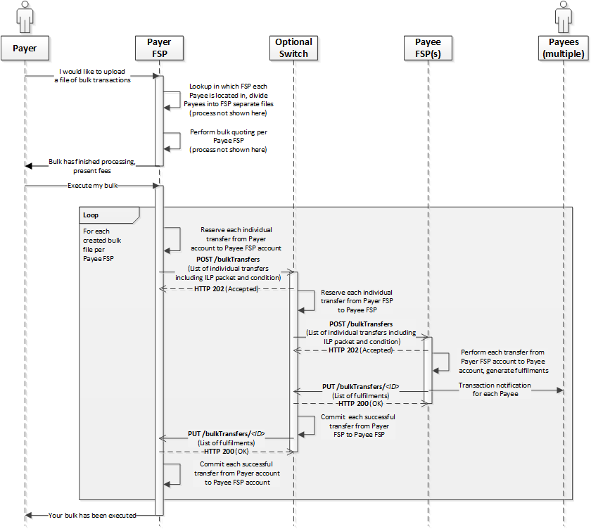
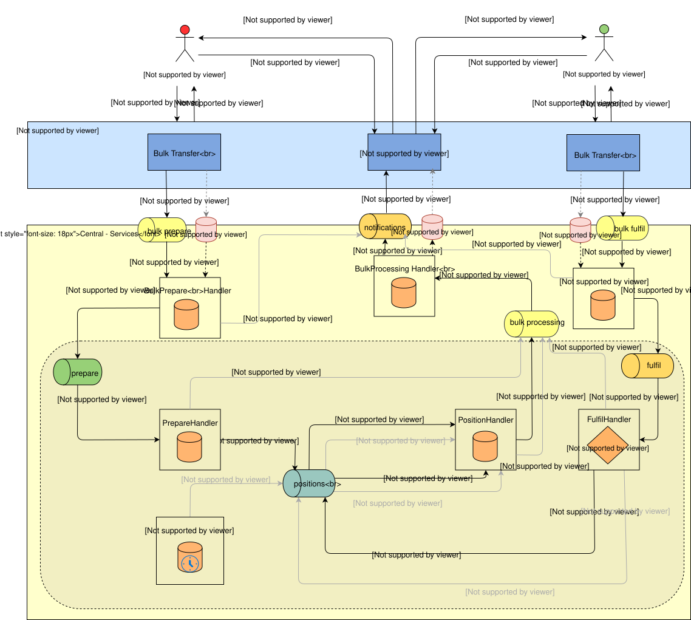

# Diseño de transferencias masivas

El escenario de «Transferencias masivas» se describe en el documento de definición API relativo al recurso /bulkTransfers. Para obtener más detalles, _(consulte la sección `6.10`)_ según la [Mojaloop Specification](https://github.com/mojaloop/mojaloop-specification/blob/master/API%20Definition%20v1.0.pdf)

1. [Introducción](introduction)
2. [Consideraciones de diseño](design-considerations)
3. [Pasos que componen la arquitectura de alto nivel](steps-involved-in-the-high-level-architecture)
4. [Notas](notes)
    1. [Temas de debate:](discussion-items)]
    2. [Nuevas tablas propuestas](proposed-new-tables)
    3. [Estados de transferencias masivas States](bulk-transfers-states)]
    4. [Notas adicionales](additional-notes)
5. [Temas de la hoja de ruta](roadmap-topics)

## 1. Introducción

El proceso de «Transferencias masivas» se describe en la sección 6.10 del documento «API Definición 1.0», que se muestra en la figura 60, de la que se incluye a continuación una captura de pantalla.

Los aspectos clave que se desprenden de la especificación en su versión actual 1.0 son los siguientes:

- La reserva de fondos se realiza para cada transferencia individual del pagador FSP al beneficiario FSP
- Aunque solo falle una única transferencia individual durante el proceso de preparación, se rechazará todo el lote.

## 2. Consideraciones de diseño

De acuerdo con la figura 60 de la especificación, a continuación se exponen algunas de las principales implicaciones de la misma.

1. El pagador n.º DFSP realiza por separado las consultas de los usuarios correspondientes a cada una de las partes implicadas en los pagos masivos
2. El pagador DFSP realiza cotizaciones en bloque por cada beneficiario DFSP
3. Corresponde al pagador DFSP preparar las transferencias masivas en función de los proveedores de servicios financieros (FSP) de los beneficiarios y enviar una solicitud de transferencia masiva a un único beneficiario FSP
4. Parece tratarse de un proceso de «todo o nada», en el que, si no se consigue reservar una sola transferencia individual, hay que rechazar todo el lote, ya que no se puede enviar tal cual al Beneficiario si hay una transferencia individual para la que no se han podido reservar los fondos.
5. A la luz de lo anterior, la propuesta que se plantea en estos momentos consiste en habilitar el Switch (es necesario actualizar la especificación) para que envíe la solicitud POST /bulkTransfers con la lista de transferencias individuales para las que se han podido reservar fondos en el Switch.
6. Esto implica que el Switch agrupa las confirmaciones y los fallos del Beneficiario FSP para la transferencia masiva y envía una única llamada PUT a /bulkTransfers/{ID} al Pagador FSP, que incluye la lista completa de transferencias, entre las que se encuentran las transferencias individuales que han fallado tanto en el Switch como en el Beneficiario FSP
7. Por ejemplo: si hay 1 000 transferencias individuales en una transferencia masiva y si el Switch es capaz de reservar fondos para 900 de esas transferencias individuales, se envía una solicitud de preparación de transferencia masiva al Beneficiario n.º DFSP, junto con la lista de esas 900 transferencias individuales. Una vez que el beneficiario FSP envía la solicitud de ejecución masiva para esas 900 transferencias —de las cuales, supongamos, 800 pueden tener confirmación (commit) y 100 se cancelan—, el Switch procesa dichas transferencias individuales en consecuencia y envía la llamada de retorno PUT (PUT /bulkTransfers/{ID}) Notificación al Pagador FSP con las 1.000 transferencias individuales, de las cuales 800 han sido confirmadas y 200 se han cancelado.
8. Habrá repercusiones en aspectos como la firma, el Cifrado, PKI y otros aspectos de seguridad que será necesario abordar.
9. El esquema de pagos también debe tener en cuenta el orden de las transferencias individuales. Uno de los objetivos de la implementación en los mercados emergentes es maximizar el número de transacciones implicadas, por lo que un esquema de pagos bien diseñado podría reordenar las transferencias individuales por orden ascendente según la cuantía de los importes y, a continuación, procesarlas. No obstante, esto puede ser una cuestión que deba valorarse en el marco del esquema de pagos.
10. No obstante, una regla recomendada del Esquema de pagos es que no se permita a los proveedores de servicios financieros (FSP) de los Beneficiarios reordenar las transferencias individuales dentro de un lote, con el fin de evitar cualquier sesgo a favor de los Beneficiarios.
11. En el caso de las liquidaciones con transferencias masivas en las que intervienen pagos del Gobierno por importes elevados, es necesario debatir la posibilidad de permitir que dichas transferencias se realicen sin estar sujetas a reglas estrictas de liquidez.

## 3. Pasos que componen la arquitectura de alto nivel

A continuación se describen, a grandes rasgos, los pasos que hay que seguir para realizar transferencias masivas.

1. [1.0, 1.1, 1.2] Una solicitud de transferencia masiva entrante (POST /bulkTransfers) en el bulk-api-adapter se almacena en un almacén de objetos y se envía una notificación con una referencia al mensaje real a través del tema de Kafka «bulk-prepare», además de enviarse un código de estado 202 al Pagador FSP
2. [1.3] El controlador «Bulk Prepare» procesa la solicitud y registra el estado como «RECEIVED»

    a. El controlador «Bulk Prepare» valida el proceso masivo y cambia el estado a «PENDING» si la validación se realiza con éxito

    b. Otra regla de validación que se propone, además, consiste en rechazar un lote si en él se utilizan identificadores de transferencia duplicados.

    c. [1.4] Si la validación falla, el gestor de preparación masiva cambia el «bulkTransferState» a «PENDING_INVALID» (un estado interno) y envía un mensaje al tema de procesamiento masivo
        i. A continuación, el gestor de procesamiento masivo actualiza el «bulkTransferState» a «REJECTED» y envía una Notificación al Pagador

3. [1.4] [Continuación de 2.a] El controlador «Bulk Prepare» divide el lote en transferencias individuales y envía cada una de ellas al tema «prepare»

    a. En este contexto, a cada transferencia se le asigna individualmente la «hora de caducidad» de la propia transferencia masiva (así como otros campos necesarios para las transferencias individuales)

4. [1.5, 1.6, 1.7] Se han rediseñado los controladores «Prepare handler» y «Position handler» para gestionar transferencias individuales de forma masiva, utilizando indicadores como el tipo, la acción, el estado, etc.

    a. Reserva de fondos --> Esto se deja en manos de cada gestor individual y, posteriormente, el total se agrega en el gestor de procesamiento masivo.

5. [1.8] El «Position Handler» genera mensajes correspondientes a transferencias individuales que forman parte de un tema de procesamiento de «bulk to bulk»
6. [1.9] Por cada mensaje consumido del tema de procesamiento masivo, se realiza una comprobación en el gestor de procesamiento masivo para determinar si se trata de la última transferencia individual de un lote para esa fase de procesamiento.
7. [1.10, 1.11, 1.12] Si se trata de la última transferencia, sume el estado de todas las transferencias individuales y

    a. Si todas ellas se encuentran en estado «reservado» --> Envíe una solicitud POST a /bulkTransfers al Beneficiario (generando un mensaje en el tema de notificaciones, que posteriormente será procesado por el gestor de notificaciones)

    b. Una vez enviada la solicitud de preparación de la transferencia masiva al Beneficiario, cambie el estado a «ACEPTADO»

8. En un caso de éxito de «Prepare» —cuando se recibe el mensaje PUT del Beneficiario FSP para «bulkFulfil»—, se publica una Notificación en el tema «bulk fulfil» con una referencia al mensaje «Fulfil» real que se almacena en un almacén de objetos.
9. Esto debe ser procesado por el «bulkFulfilHandler», que a continuación cambia su estado a «PROCESSING».
10. El gestor de tramitación masiva desglosa la operación masiva en transferencias individuales y envía cada una de ellas a través de los gestores de tramitación y posición rediseñados para realizar la confirmación (commit) o cancelación de cada una de ellas en función del mensaje PUT /bulkTransfers/{ID} enviado por el Beneficiario, y para realizar la confirmación o liberación de los fondos en el Switch.
11. A continuación, el gestor de procesamiento masivo deberá agregar todos los resultados de las transferencias individuales y cambiar el estado de «bulkTransfer» a «COMPLETED» o «REJECTED» en función de si se ha completado con éxito o ha fallado.

    a. Si el Beneficiario envía «COMMITED» incluso para una sola de las transferencias individuales, se propone cambiar el estado del lote a «COMPLETED».

    b. No obstante, en el paso 8, o si el Beneficiario envía «REJECTED» como «bulkTransferState», el estado final en Switch deberá ser «REJECTED».

12. Enviar notificaciones tanto al pagador como al beneficiario (de forma similar a las transferencias individuales, aunque difiere de la Especificación 1.0). El FSP pagador recibe la notificación, que incluye una lista exhaustiva de las transferencias individuales, igual que la lista que figura en la solicitud de preparación enviada por el pagador. El FSP beneficiario recibe una notificación únicamente para un subconjunto de transferencias, que le fueron enviadas desde el Switch como solicitud de preparación masiva (y que pudieron reservarse en el Switch).

## 4. Detalles de la implementación

### 4.1 Estados de transferencia masiva

A continuación se indican los estados de una transferencia masiva según la especificación MojaloopAPI

1. RECIBIDO
2. PENDENTE
3. ACEPTADO
4. PROCESAMIENTO
5. FINALIZADO
6. RECHAZADO
7. Estado interno: PENDING_PREPARE (asignado a PENDING)
8. Estado interno: PENDING_INVALID (asignado a PENDING)
9. Estado interno: PENDING_FULFIL (asignado a PROCESSING)
10. Estado interno: EXPIRING (asignado a PROCESSING)
11. Estado interno: EXPIRADO (asignado a COMPLETADO)
12. Estado interno: INVALID (asignado a REJECTED)
13. Es posible añadir microestados adicionales para uso interno en el Switch.

### 4.2 Nuevas tablas propuestas

A continuación se muestran las tablas propuestas como parte del diseño de las transferencias masivas

- transferencia masiva
- bulkTransferStateChange
- bulkTransferError
- comprobación de duplicados en transferencias masivas
- gestión de transferencias masivas
- comprobación de duplicados en la gestión de transferencias masivas
- bulkTransferAssociation
- bulkTransferExtension
- bulkTransferState
- estado del procesamiento masivo

### 4.3 Combinaciones internas de tipo, acción y estado

#### 1. Transferencia masiva que supera la validación del esquema [ml-api-adapter -> bulk-prepare-handler]

  1. tipo: preparación en masa
  2. acción: preparación masiva
  3. Estado: correcto
  4. Resultado: bulkTransferState=RECEIVED, bulkProcessingState=RECEIVED

#### 2. Duplicar [gestor de preparación masiva → gestor de notificaciones]

  1. tipo: Notificación
  2. acción: preparación-masiva-de-duplicados
  3. Estado: correcto
  4. Resultado: bulkTransferState=N/A, bulkProcessingState=N/A

#### 3. Validación de un error en la transferencia de «Bulk Prepare» [bulk-prepare-handler → notification-handler]

  1. tipo: Notificación
  2. acción: bulk-abort
  3. Estado: error

#### 4. Para una transferencia de «Bulk Prepare» válida (desglosada y enviada como transferencias individuales) [bulk-prepare-handler → prepare-handler]

  1. tipo: preparar
  2. acción: preparación masiva
  3. Estado: correcto

#### 5. Duplicado de una transferencia individual que forma parte de una transferencia masiva [gestor de preparación → gestor de procesamiento masivo]

  1. tipo: procesamiento masivo
  2. acción: preparar-duplicado
  3. Estado: correcto
  4. Acción prevista: Añadir un mensaje de error que indique que se trata de un duplicado
  5. Resultado: bulkTransferState=PENDING_PREPARE/ACCEPTED (dependiendo de si se trata de la última), bulkProcessingState=RECEIVED_DUPLICATE

#### 6. Para la transferencia individual «Prepare», se trata de un duplicado válido en el gestor «prepare-handler» [prepare-handler → bulk-processing-handler]

  1. tipo: procesamiento masivo
  2. acción: preparar-duplicado
  3. Estado: error
  4. Resultado: bulkTransferState=PENDING_PREPARE/ACCEPTED (dependiendo de si se trata de la última), bulkProcessingState=RECEIVED_DUPLICATE

#### 7. Para una persona física válida, prepare una transferencia que forme parte de un proceso masivo [prepare-handler -> position-handler]

  1. tipo: cargo
  2. acción: preparación masiva
  3. Estado: correcto

#### 8. Para una transferencia individual que forma parte de un lote y que no ha superado la validación en el gestor de preparación [gestor de preparación → gestor de procesamiento por lotes]

  1. tipo: procesamiento masivo
  2. acción: preparación masiva
  3. Estado: error
  4. Resultado: bulkTransferState=PENDING_PREPARE/ACCEPTED (dependiendo de si se trata de la última), bulkProcessingState=RECEIVED_INVALID

#### 9. Para una persona física válida, prepare una transferencia que forme parte de un proceso masivo [gestor de posiciones -> gestor de procesamiento masivo]

  1. tipo: procesamiento masivo
  2. acción: preparación masiva
  3. Estado: correcto
  4. Resultado: bulkTransferState=PENDING_PREPARE/ACCEPTED (dependiendo de si se trata de la última), bulkProcessingState=ACCEPTED

#### 10. Para la transferencia individual «Prepare» que forma parte de un lote cuya validación ha fallado en el gestor de posiciones [gestor-de-posiciones → gestor-de-procesamiento-en-lote]

  1. tipo: procesamiento masivo
  2. acción: preparación masiva
  3. Estado: error
  4. Resultado: bulkTransferState=PENDING_PREPARE/ACCEPTED (dependiendo de si se trata de la última), bulkProcessingState=RECEIVED_INVALID

#### 11. Para una transferencia individual válida (para la Confirmación (commit)) que forme parte de un proceso masivo [gestor de posiciones -> gestor de procesamiento masivo]

  1. tipo: procesamiento masivo
  2. acción: bulk-commit
  3. Estado: correcto
  4. Resultado: bulkTransferState=PENDING_FULFIL/COMPLETED (dependiendo de si se trata de la última), bulkProcessingState=COMPLETED

#### 12. Para la transferencia masiva: mensaje de Fulfilment que supera la validación [ml-api-adapter -> bulk-fulfil-handler]

  1. tipo: Fulfilment a granel
  2. acción: bulk-commit
  3. Estado: correcto

#### 13. Para que una transferencia individual válida forme parte de un lote que haya agotado el tiempo de espera en el gestor de posiciones [gestor-de-posiciones → gestor-de-procesamiento-por-lotes]

  1. tipo: procesamiento masivo
  2. acción: tiempo de espera reservado para operaciones masivas
  3. Estado: error
  4. Resultado: bulkTransferState=PENDING_FULFIL/COMPLETED (dependiendo de si se trata de la última), bulkProcessingState=FULFIL_INVALID

#### 14. Para una transferencia individual válida (en caso de rechazo) que forme parte de un proceso masivo [gestor de posiciones -> gestor de procesamiento masivo]

  1. tipo: procesamiento masivo
  2. acción: rechazar
  3. Estado: correcto
  4. Resultado: bulkTransferState=PENDING_FULFIL/COMPLETED (dependiendo de si se trata de la última), bulkProcessingState=REJECTED

#### 15. Duplicado no válido de una transferencia individual en un procesamiento masivo [gestor de ejecuciones → gestor de procesamiento masivo]

  1. tipo: procesamiento masivo
  2. acción: cumplir-duplicado
  3. Estado: error
  4. Resultado: bulkTransferState=PENDING_FULFIL/COMPLETED (dependiendo de si se trata de la última), bulkProcessingState=FULFIL_DUPLICATE

#### 16. Validar la duplicación de una transferencia individual en un procesamiento masivo [gestor de Fulfilment -> gestor de procesamiento masivo]

  1. tipo: procesamiento masivo
  2. acción: cumplir-duplicado
  3. Estado: correcto
  4. Resultado: bulkTransferState=PENDING_FULFIL/COMPLETED (dependiendo de si se trata de la última), bulkProcessingState=FULFIL_DUPLICATE

#### 17. Mensaje de «Fulfilment» válido correspondiente a una transferencia individual dentro de un proceso masivo [gestor de cumplimiento → gestor de posiciones]

  1. tipo: cargo
  2. acción: bulk-commit
  3. Estado: correcto

#### 18. Para una transferencia «Fulfilment» individual que forma parte de un lote cuya validación ha fallado en el gestor de cumplimiento [gestor de cumplimiento → gestor de procesamiento por lotes]

  1. tipo: procesamiento masivo
  2. acción: bulk-commit
  3. Estado: error
  4. Resultado: bulkTransferState=PENDING_FULFIL/COMPLETED (dependiendo de si se trata de la última), bulkProcessingState=FULFIL_INVALID

#### 19. Tramitar la solicitud de transferencia que forma parte de un lote que ha superado la validación [bulk-fulfil-handler → fulfil-handler]

  1. tipo: Fulfilment de pedidos a granel
  2. acción: bulk-commit
  3. Estado: correcto

#### 20. Para las transferencias masivas que no superan la validación en el nivel del gestor de cumplimiento masivo [gestor de cumplimiento masivo → gestor de notificaciones]

  1. tipo: Notificación
  2. acción: bulk-abort
  3. Estado: error

#### 21. Para las notificaciones de transferencias masivas a los proveedores de servicios financieros [gestor de procesamiento masivo → gestor de notificaciones]

  1. tipo: Notificación
  2. acción: preparación masiva / confirmación masiva
  3. Estado: correcto

#### 22. Para la notificación de tiempo de espera [gestor de tiempo de espera → gestor de procesamiento masivo]

  1. tipo: procesamiento masivo
  2. acción: tiempo de espera de recepción masiva
  3. Estado: error
  4. Resultado: bulkTransferState=COMPLETED (para la última), bulkProcessingState=EXPIRED

#### 23. Para la notificación de tiempo de espera [gestor de tiempo de espera -> gestor de posición]

  1. tipo: cargo
  2. acción: tiempo de espera reservado para operaciones masivas
  3. Estado: error

#### 24. Para la notificación de tiempo de espera tras el ajuste de posición [gestor de posiciones → gestor de procesamiento masivo]

  1. tipo: procesamiento masivo
  2. acción: tiempo de espera reservado para operaciones masivas
  3. Estado: error
  4. Resultado: bulkTransferState=COMPLETED (para la última), bulkProcessingState=EXPIRED

### 4.4 Notas adicionales

1. Documento GET /bulkTransfers para indicar la diferencia entre las respuestas que reciben el FSP pagador y el FSP beneficiario en las transferencias masivas
2. Se utilizó un servicio independiente: bulk-api-adapter para dar soporte a los puntos finales de transferencias masivas (lo que incluye la persistencia, tal y como se ha comentado anteriormente)

## 5. Temas de la hoja de ruta

1. Reevalúe la necesidad de admitir múltiples proveedores de servicios financieros (FSP) como Beneficiarios en el marco de una operación masiva, así como los cambios que sea necesario introducir en la especificación.
2. Los problemas y las conclusiones extraídas de la prueba de concepto (PoC) que se han documentado se abordan por orden de prioridad.
3. Se ha detectado la necesidad de implementar una función similar a la de «Creación masiva de recursos» (/bulkMake?), en la que el Switch acepte un lote completo tal cual y se encargue posteriormente de las tres fases: búsqueda, cotización y transferencia.
4. ¿Se puede limitar la velocidad de las transferencias individuales en un proceso masivo?
5. El aspecto relativo al orden de las transacciones en bloque: el orden de procesamiento en el Switch y en los proveedores de servicios financieros (PSF). Se recomienda al Esquema de pagos que incorpore una regla que obligue a todos los PSF a procesar las transacciones en bloque siguiendo el orden existente y a no aplicar un procesamiento preferencial. Actualmente, el Switch mantiene la neutralidad en cuanto al orden, pero la mejor práctica consiste en ordenar las transacciones por importe ascendente y procesarlas.
6. En el caso de las liquidaciones con transferencias masivas en las que intervienen pagos del Gobierno por importes elevados, es necesario debatir la posibilidad de permitir que dichas transferencias se realicen sin estar sujetas a reglas estrictas de liquidez.
7. Implemente GET /bulkTransfers
8. Implemente notificaciones y registros para todos los escenarios negativos masivos
9. Cobertura de código de las pruebas unitarias completas
10. Pruebas de integración de una transferencia masiva correcta (ruta principal)
11. Pruebas de regresión, incluidos los escenarios negativos
