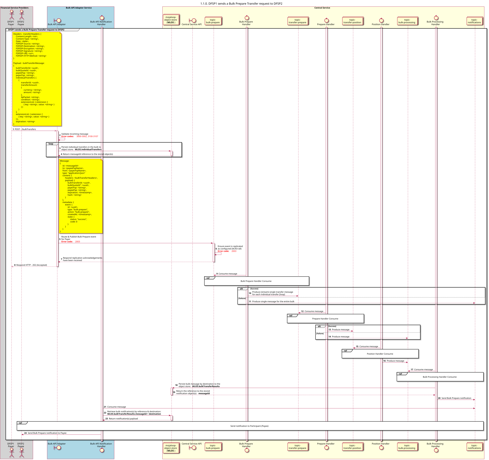

# Preparación masiva de solicitudes de transferencia [Descripción general] [incluye transferencias individuales en un proceso masivo]

Diagrama de diseño de secuencias para el proceso «Preparar solicitud de transferencia».

## Referencias en el diagrama de secuencia

* [Manejo de preparación masiva (1.1.1)](1.1.1-bulk-prepare-handler-consume.md)
* [Preparar el controlador «Consume» (1.2.1)](1.2.1-prepare-handler-consume-for-bulk.md)
* [Manejador de posiciones «Consume» (1.3.0)](1.3.0-position-handler-consume-overview.md)
* [Manejador de procesamiento masivo: Consumo (1.4.1)](1.4.1-bulk-processing-handler.md)
* [Enviar notificación al Participante (1.1.4.a)](1.1.4.a-send-notification-to-participant.md)

## Diagrama de secuencia

