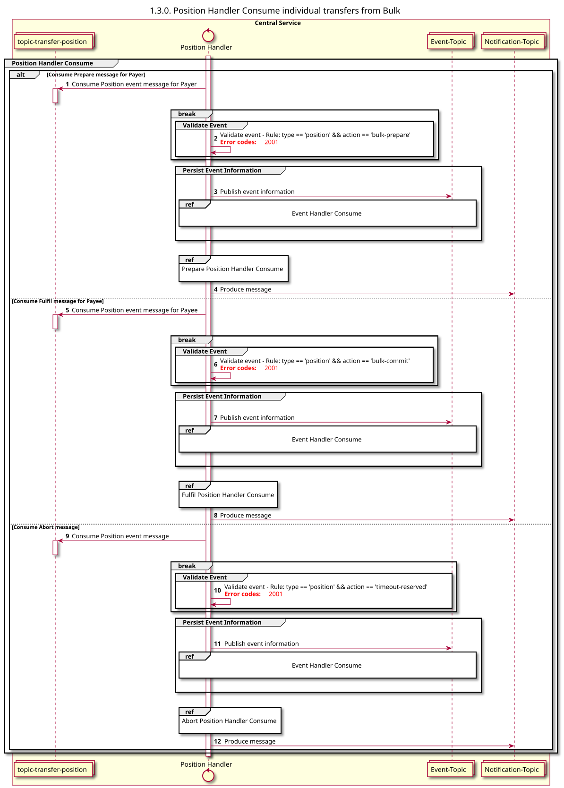

# Gestor de posiciones: Consumo [lo que incluye transferencias individuales en un lote]

Diagrama de diseño de secuencias para el proceso «Consume» del gestor de posiciones

## Referencias en el diagrama de secuencia

* [Manejador de eventos «Consume» (9.1.0)](../../central-event-processor/9.1.0-event-handler-placeholder.md)
* [Preparar el controlador de posición «Consume» (1.3.1)](1.3.1-prepare-position-handler-consume.md)
* [Consumo del gestor de posiciones Fufil (2.2.1)](2.2.1-fulfil-commit-for-bulk.md)
* [Manejo de la interrupción de la posición de consumo (2.2.2)](2.2.2-fulfil-abort-for-bulk.md)

## Diagrama de secuencia

