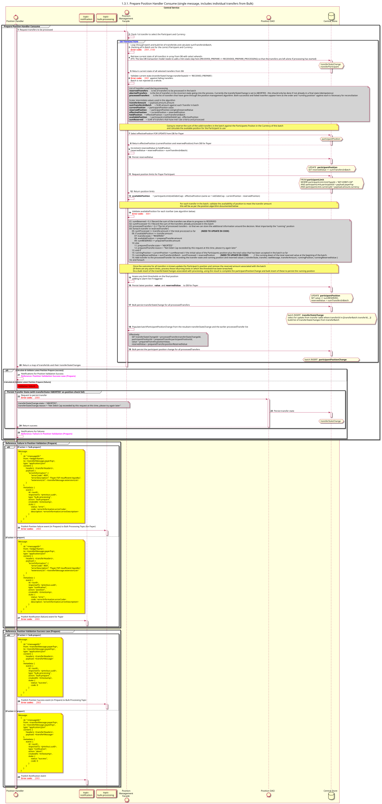

# Preparar el gestor de posiciones: procesar [lo que incluye transferencias individuales en un lote]

Diagrama de diseño de secuencias para el proceso «Preparar, Posicionar, Gestionar, Consumir»

## Diagrama de secuencia

