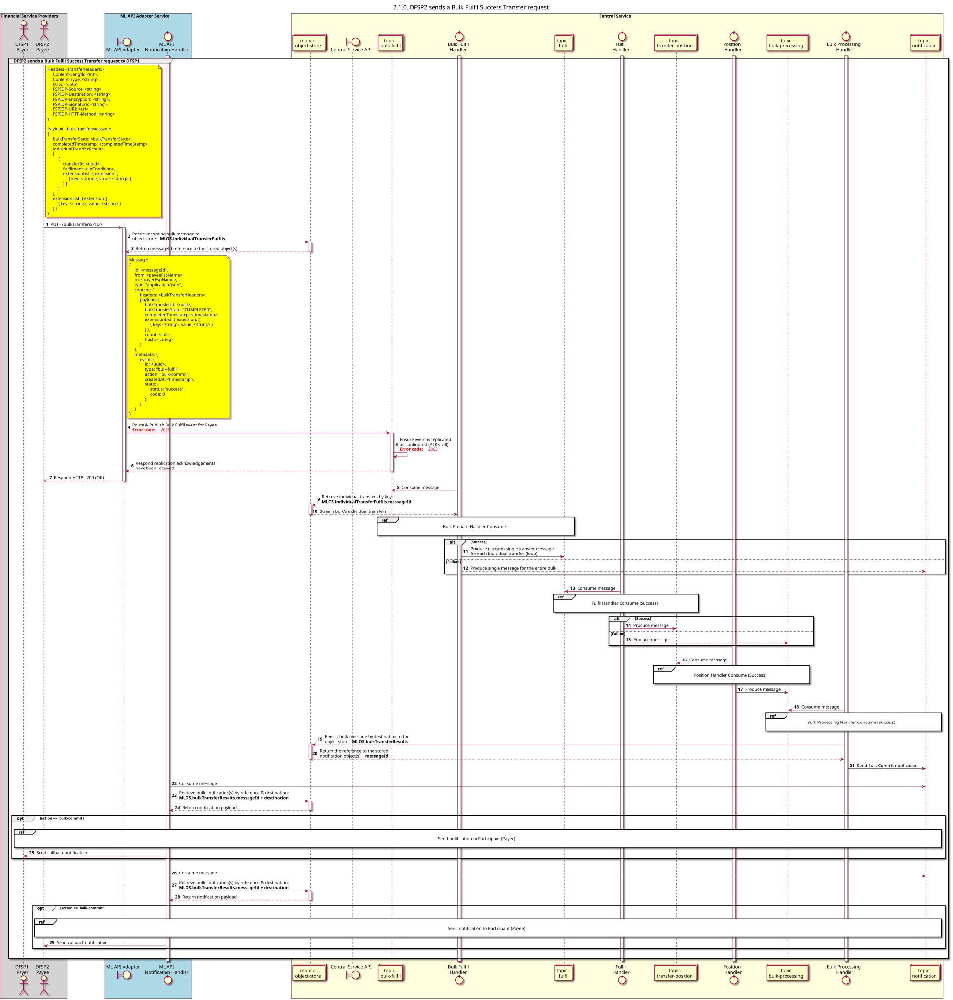

# Descripción general de la solicitud de transferencia de pedidos en bloque

Diagrama de diseño de la secuencia para la solicitud de transferencia de cumplimiento masivo

## Referencias en el diagrama de secuencia

* [Fulfilment of mass orders: consumption (Success) (2.1.1)](2.1.1-bulk-fulfil-handler-consume.md)
* [Fulfilment: Consumo (Éxito) (2.2.1)](2.2.1-fulfil-commit-for-bulk.md)
* [Manejador de posición: Consumo (Éxito) (2.3.1)](2.3.1-fulfil-position-handler-consume.md)
* [Manejador de procesamiento masivo: Consumo (1.4.1)](1.4.1-bulk-processing-handler.md)
* [Enviar Notificación al Participante (1.1.4.a)](1.1.4.a-send-notification-to-participant.md)

## Diagrama de secuencia

