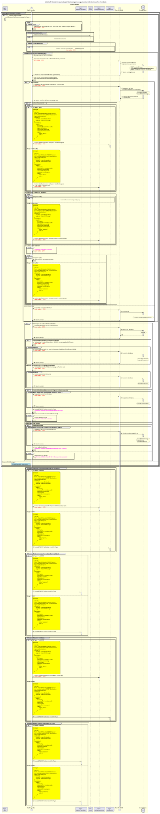

# El beneficiario envía una solicitud de transferencia en bloque; la transferencia en bloque se desglosa en transferencias individuales

Diagrama de diseño de secuencias para el proceso «Fulfilment, Gestionar, Consumir, Rechazar/Anular»

## Referencias en el diagrama de secuencia

* [Manejador de eventos «Consume» (9.1.0)](../../central-event-processor/9.1.0-event-handler-placeholder.md)
* [validación de la firma de secuencia](../../central-event-processor/signature-validation.md)
* [Enviar notificación al Participante (1.1.4.a)](1.1.4.a-send-notification-to-participant.md)

## Diagrama de secuencia

