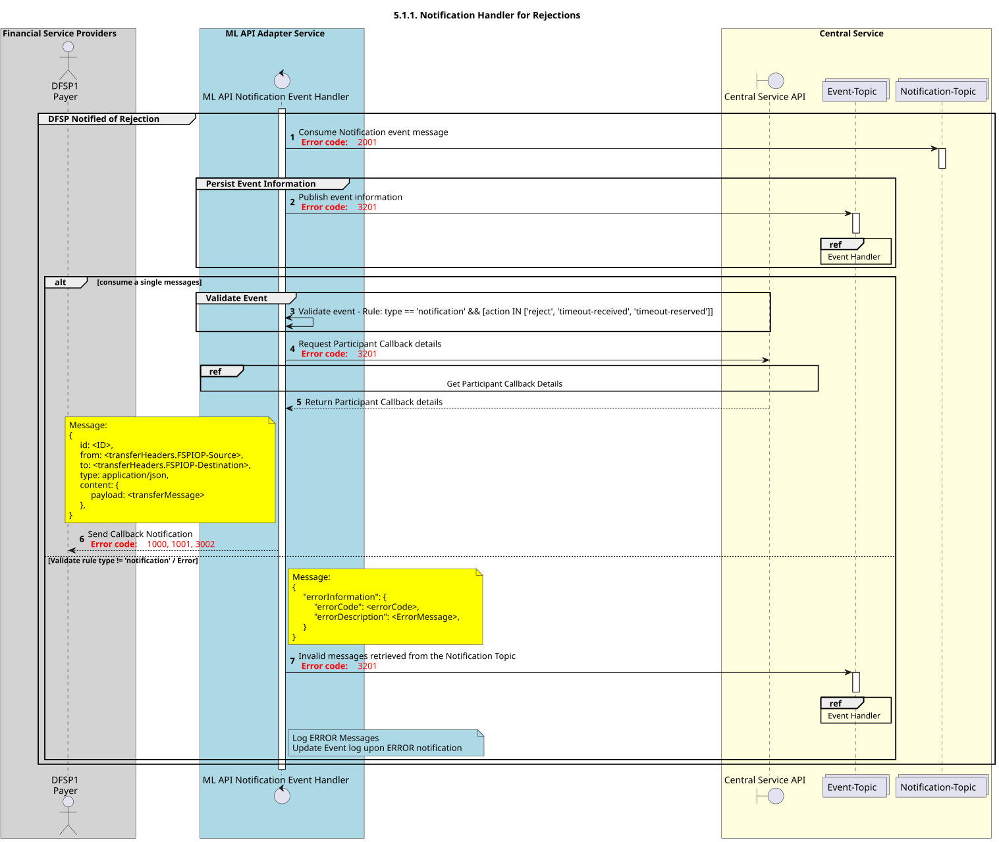

# Gestor de notificaciones para los rechazos

Diagrama de diseño de secuencias para el proceso «Gestor de notificaciones de rechazos».

## Referencias en el diagrama de secuencia

* [Manejador de eventos «Consume» (9.1.0)](9.1.0-event-handler-placeholder.md)
* [Obtener detalles de la devolución de llamada del participante (3.1.0)](../central-ledger/admin-operations/3.1.0-post-participant-callback-details.md)

## Diagrama de secuencia

