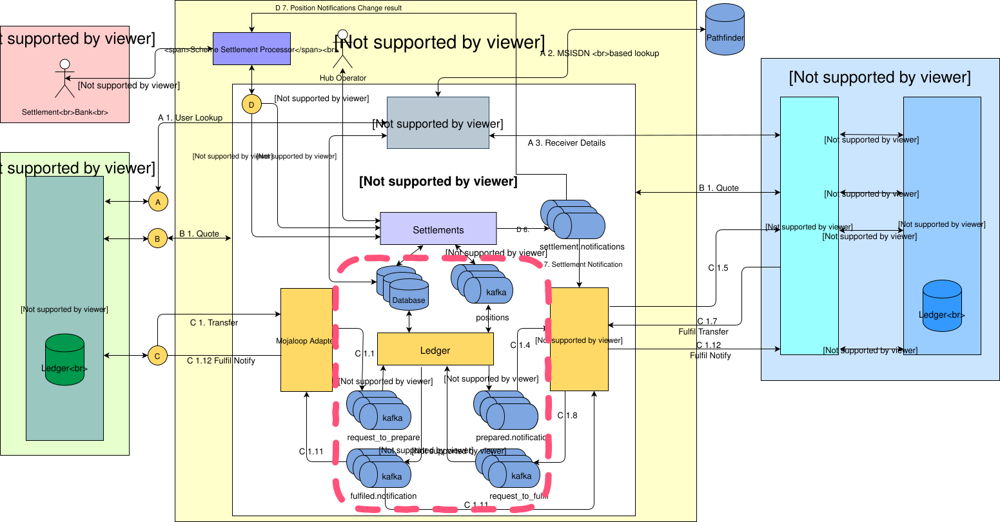
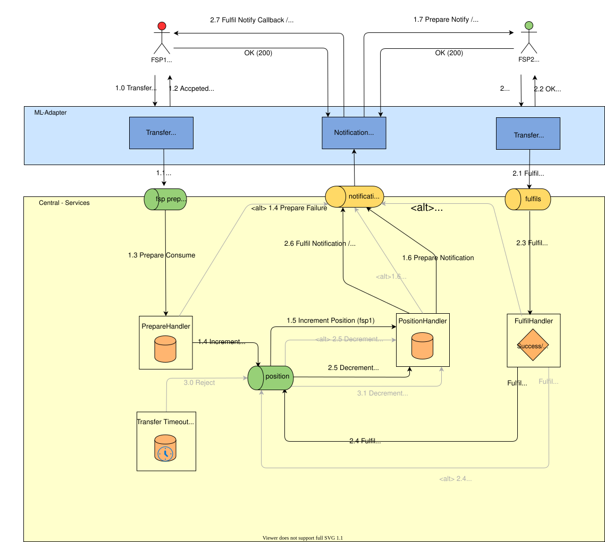
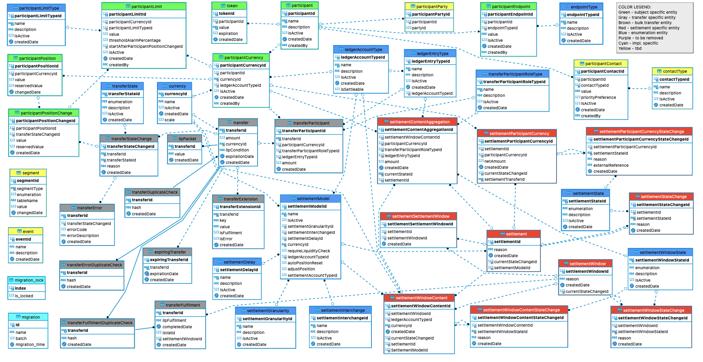

# Servicios de libro mayor centralizado

El libro mayor central es un conjunto de servicios que facilitan la compensación y la liquidación de las transferencias entre los proveedores de servicios financieros (DFSP), e incluye las siguientes funciones:

* Intermediación en la transmisión de mensajes en tiempo real para la compensación de fondos
* Mantenimiento de posiciones netas para una liquidación neta diferida
* Aplicación de tarifas a nivel de esquema de pagos y fuera de la transferencia

## 1. Diseño del proceso del Libro mayor central

### 1.1 Descripción general de la arquitectura

## 2. Arquitectura de transferencias de extremo a extremo

### 2.1 Arquitectura de transferencias de extremo a extremo para la versión 1.1

### 2.2 Arquitectura de transferencias de extremo a extremo para la versión 1.0

## 3. Diseño de bases de datos

### Nota

Las tablas en color gris corresponden específicamente al proceso de transferencia. Las tablas en color azul y verde se utilizan como referencia durante el proceso de transferencia.

Resumen de las tablas específicas del proceso de transferencia;

- `transfer`: almacena los datos relacionados con la transferencia;
- `transferDuplicateCheck`: se utiliza para identificar duplicidades durante el proceso de solicitud de transferencias;
- `transferError`: almacena información sobre los errores de transferencia que se han producido durante el proceso de transferencia;
- `transferErrorDuplicateCheck`: se utiliza para identificar errores de duplicación en los procesos de transferencia;
- `transferExtensions`: almacena información sobre los datos de la extensión de transferencia;
- `transferFulfilment`: almacena los datos de las transferencias que han completado el proceso de preparación de la transferencia;
- `transferFulfilmentDuplicateCheck`: se utiliza para identificar solicitudes duplicadas de Fulfilment de transferencias;
- `transferParticipant`: información sobre los participantes relacionada con el proceso de transferencia;
- `transferStateChange`: se utiliza para realizar un seguimiento de los cambios de estado de cada transferencia individual, creando así un registro de auditoría para una solicitud de transferencia concreta;
- `transferTimeout`: almacena la información de las transferencias en las que se produjo una excepción de tiempo de espera durante el proceso;
- `ilpPacket`: almacena el paquete ILP para la transferencia;

Las tablas restantes del diagrama ERD que figura a continuación son tablas de referencia (azules) o específicas de la Liquidación (rojas), y se incluyen como dependencias directas o indirectas para representar la relación entre las entidades específicas de la Transferencia y las tablas de Transferencia.

La definición del esquema de la base de datos del **Libro Mayor Central** [Definición del esquema de la base de datos del Libro Mayor Central](../../../../technical/technical/central-ledger/assets/database/central-ledger-ddl-MySQLWorkbench.sql).

## 4. Especificaciones del API

Consulte el **Libro mayor central API** en la sección [API Specifications](../../../../technical/api/README.md#central-ledger-api)].
