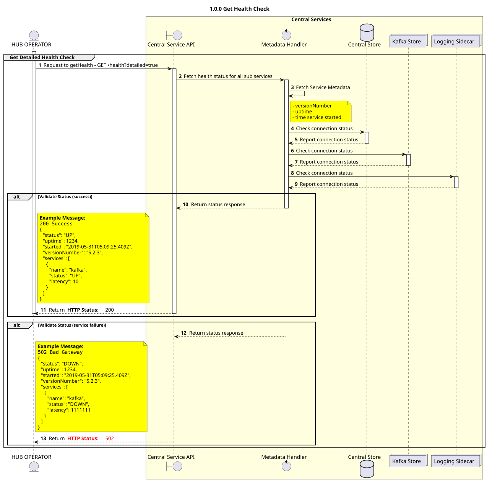

# Realice una revisión de salud de GET

Debate sobre el diseño de la nueva implementación de «Health Check».


## Objetivos

El objetivo de este diseño es implementar una nueva comprobación de estado para los servicios de Mojaloop Switch que permita un mayor nivel de detalle.

Características:
- Borrar los estados «HTTP» (no es necesario examinar la respuesta para saber que no hay problemas)
- ~Compatibilidad con versiones anteriores de las comprobaciones de estado existentes~ - Ya no es un requisito. Véase [esta discusión](https://github.com/mojaloop/project/issues/796#issuecomment-498350828).
- Información sobre la versión del API y el tiempo que lleva en funcionamiento
- Información sobre las conexiones de los servicios secundarios (Kafka, sidecar de registro y MySQL)

## Formato de la solicitud
`/health`

Utiliza la comprobación de estado recientemente implementada. Tal y como se ha comentado [aquí](https://github.com/mojaloop/project/issues/796#issuecomment-498350828), dado que no habrá ninguna sobrecarga adicional en la conexión (por ejemplo, enviar un ping a una base de datos) como parte de la implementación de la comprobación de estado, no es necesario complicar las cosas con una versión sencilla y detallada.

Códigos de respuesta:
- `200`: Éxito. El API está en funcionamiento y se ha conectado correctamente a los Servicios necesarios.
- `502` - Error de Gateway. El API está en funcionamiento, pero el API no puede conectarse al servicio necesario (p. ej., `kafka`).
- `503` - Servicio no disponible. Esta respuesta no está implementada en este diseño, pero será la predeterminada si la API no está en funcionamiento.

## Formato de respuesta

| Nombre  | Tipo | Descripción | Ejemplo |
| --- | --- | --- | --- |
| `status`        | `statusEnum`                       | El estado del servicio. Las opciones son `OK` y `DOWN`. _Véase el punto `statusEnum` más abajo_. | `"OK"`   | 
| `uptime`        | `number`                           | Cuánto tiempo (en segundos) lleva en funcionamiento el servicio.  | `123456`                     |
| `started`       | `string` (fecha y hora en formato ISO) | Fecha y hora de inicio de los servicios (UTC)                     | `"2019-05-31T05:09:25.409Z"` | 
| `versionNumber` | `string` (semver)                  | La versión actual de los servicios.                    | `"5.2.5"`                    |
| `services`      | `Array<serviceHealth>`             | Una lista de los servicios de los que depende este servicio, así como su estado de conexión | _véase más abajo_ |

### servicio de salud

| Nombre  | Tipo | Descripción | Ejemplo |
| --- | --- | --- | --- |
| `name`    | `subServiceEnum`   | El nombre del subservicio. _Véase el punto `subServiceEnum` más abajo_.       | `"broker"` | 
| `status`  | `enum`             | El estado del servicio. Las opciones son `OK` y `DOWN`    | `"OK"`     | 

### subServiceEnum

La enumeración «subServiceEnum» describe el nombre de un subservicio:

Opciones:
- `datastore` -> La base de datos de este servicio (normalmente, la base de datos MySQL).
- `broker`    -> El intermediario de mensajes de este servicio (normalmente, el Kafka).
- `sidecar`   -> El subservicio de registro tipo «sidecar» al que se conecta este servicio.
- `cache` -> El subservicio de almacenamiento en caché al que se acopla este servicio.


### statusEnum

La enumeración de estados representa el estado del sistema o del subservicio.

Dispone de dos opciones:
- `OK`    -> El servicio o subservicio funciona correctamente.
- `DOWN`  -> El servicio o subservicio no funciona correctamente.

Cuando un servicio tiene un valor de `OK`: se considera que el API está en buen estado, y que todos los subservicios también lo están.

Si cualquier subservicio tiene el valor `DOWN`, la comprobación de estado fallará en su totalidad y el API se considerará `DOWN`.

## Definición del estado de un subservicio

No basta con realizar simplemente una prueba de ping a un subservicio para saber si funciona correctamente; queremos ir un paso más allá. Estos criterios variarán en función de cada subservicio.

### `datastore`

Para el valor `datastore`, un estado de `OK` significa:
- Que existe una conexión con la base de datos
- Que la base de datos no está vacía (contiene más de una tabla)


### `broker`

Para el valor «`broker`», un estado de «`OK`» significa:
- Existe una conexión con el broker de Kafka
- Existen los temas necesarios. Esto variará en función del servicio para el que se esté ejecutando la comprobación de estado.

Por ejemplo, para que el servicio «`central-ledger`» se considere en buen estado, deben detectarse los siguientes elementos:
```
topic-admin-transfer
topic-transfer-prepare
topic-transfer-position
topic-transfer-fulfil
```

### `sidecar`

Para el valor «`sidecar`», un estado de «`OK`» significa:
- Que existe una conexión con el sidecar


### `cache`

Para el valor `cache`, un estado de `OK` significa:
- Que existe una conexión con la Caché


## Definición de «swagger» 

>_Nota: Se añadirán a las definiciones Swagger existentes para los siguientes servicios:_
> - `ml-api-adapter`
> - `central-ledger`
> - `central-settlement`
> - `central-event-processor`
> - `email-notifier`

```json
{
  /// . . . 
  "/health": {
    "get": {
      "operationId": "getHealth",
      "tags": [
        "health"
      ],
      "responses": {
        "default": {
          "schema": {
              "$ref": "#/definitions/health"
          },
          "description": "Successful"
        }
      }
    }
  },
  // . . .
  "definitions": {
    "health": {
      "type": "object",
      "properties": {
        "status": {
          "type": "string",
          "enum": [
            "OK",
            "DOWN"
          ]
        },
        "uptime": {
          "description": "How long (in seconds) the service has been alive for.",
          "type": "number",
        },
        "started": {
          "description": "When the service was started (UTC)",
          "type": "string",
          "format": "date-time"
        },
        "versionNumber": {
          "description": "The current version of the service.",
          "type": "string",
          "example": "5.2.3",
        },
        "services": {
          "description": "A list of services this service depends on, and their connection status",
          "type": "array",
          "items": {
            "$ref": "#/definitions/serviceHealth"
          }
        },
      },
    },
    "serviceHealth": {
      "type": "object",
      "properties": {
        "name": {
          "description": "The sub-service name.",
          "type": "string",
          "enum": [
            "datastore",
            "broker",
            "sidecar",
            "cache"
          ]
        },
        "status": {
          "description": "The connection status with the service.",
          "type": "string",
          "enum": [
            "OK",
            "DOWN"
          ]
        }
      }
    }
  }
}
```


### Ejemplos de solicitudes y respuestas:

__Revisión de estado de Legacy completada con éxito:__

```bash
GET /health HTTP/1.1
Content-Type: application/json

200 SUCCESS
{
  "status": "OK"
}
```


__Nueva revisión médica realizada con éxito:__

```
GET /health?detailed=true HTTP/1.1
Content-Type: application/json

200 SUCCESS
{
  "status": "OK",
  "uptime": 0,
  "started": "2019-05-31T05:09:25.409Z",
  "versionNumber": "5.2.3",
  "services": [
    {
      "name": "broker",
      "status": "OK",
    }
  ]
}
```

__Comprobación de estado fallida, pero el API está activo:__

```
GET /health?detailed=true HTTP/1.1
Content-Type: application/json

502 BAD GATEWAY
{
  "status": "DOWN",
  "uptime": 0,
  "started": "2019-05-31T05:09:25.409Z",
  "versionNumber": "5.2.3",
  "services": [
    {
      "name": "broker",
      "status": "DOWN",
    }
  ]
}
```

__Comprobación de estado fallida:__

```
GET /health?detailed=true HTTP/1.1
Content-Type: application/json

503 SERVICE UNAVAILABLE
```


## Diagrama de secuencia

Diagrama de diseño de secuencias para GET Health


