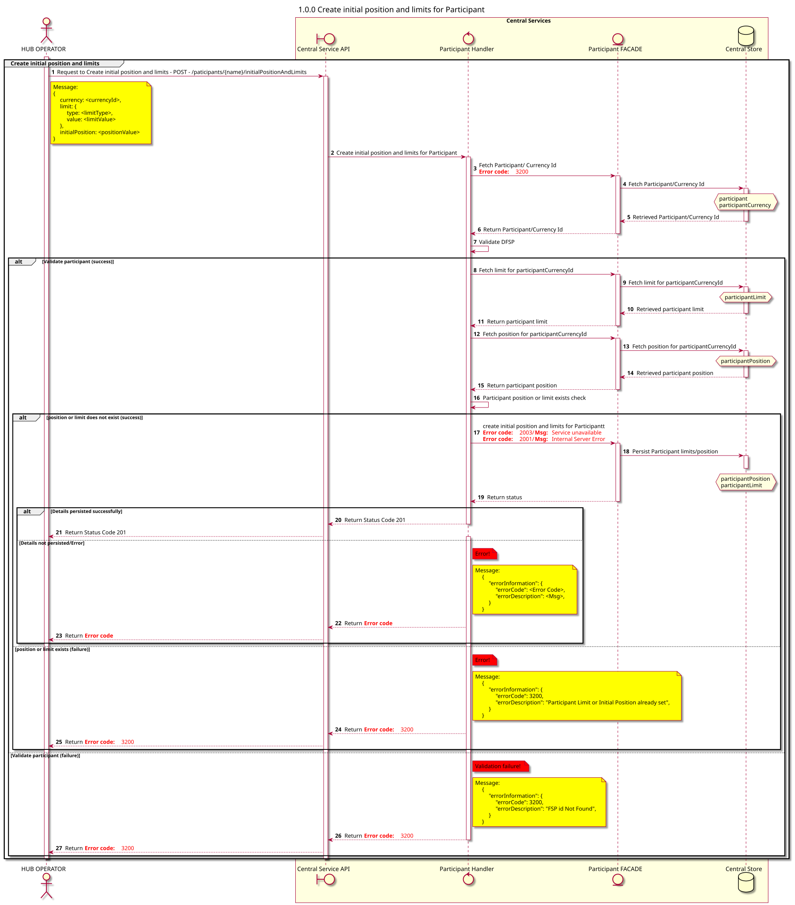

# Crear la posición inicial y los límites para el Participante

Diagrama de diseño de secuencias para el proceso POST (creación) de la posición inicial y el límite del Participante.

## Diagrama de secuencia

