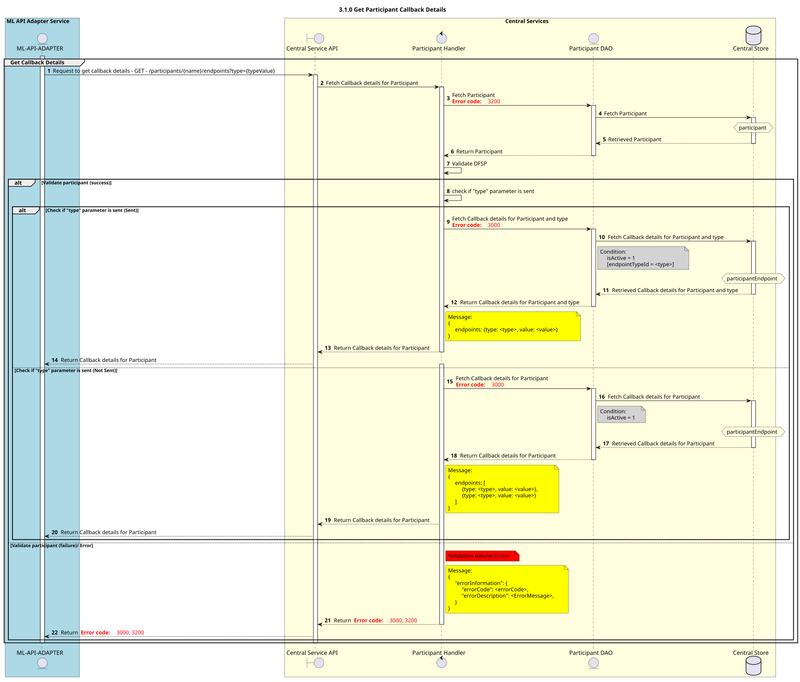

# 3.1.0 Obtener los datos de contacto de los participantes

Diagrama de diseño de secuencias para el proceso «Detalles de la llamada de respuesta al participante de GET».

## Diagrama de secuencia

