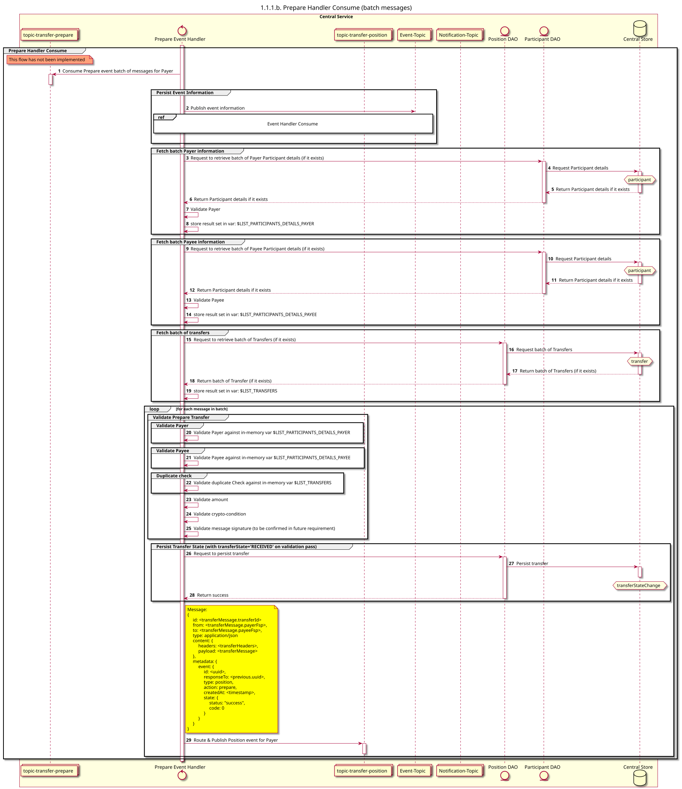

# Preparar el consumo del controlador

Diagrama de diseño de secuencias para el proceso «Prepare Handler Consume».

## Referencias en el diagrama de secuencia

* [Manejador de eventos «Consume» (9.1.0)](../../central-event-processor/9.1.0-event-handler-placeholder.md)

## Diagrama de secuencia

