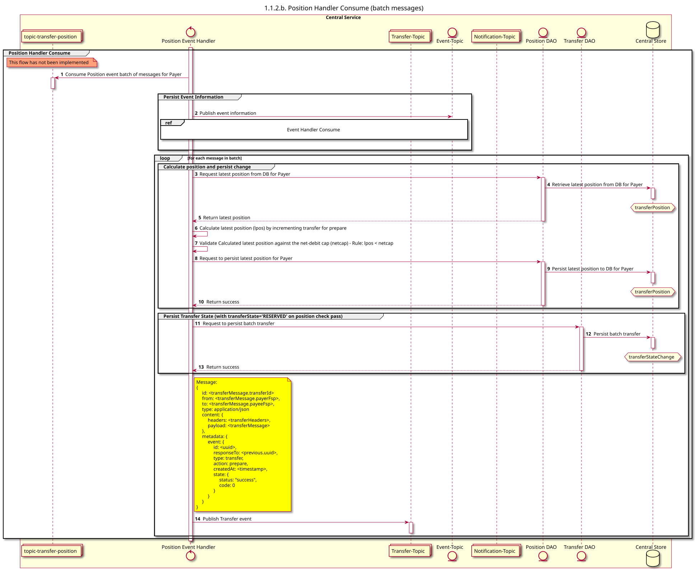

# El gestor de posiciones consume

Diagrama de diseño de secuencias para el proceso «Consume» del «Position Handler».

## Referencias en el diagrama de secuencia

* [Manejador de eventos «Consume» (9.1.0)](../../central-event-processor/9.1.0-event-handler-placeholder.md)

## Diagrama de secuencia

