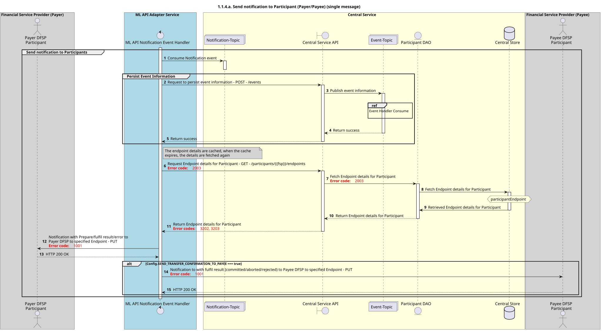

# Enviar una notificación al participante

Diagrama de diseño de secuencia para la solicitud «Enviar Notificación al Participante».

## Referencias en el diagrama de secuencia

* [9.1.0-gestor-de-eventos-consumir](../../central-event-processor/9.1.0-event-handler-placeholder.md)

## Diagrama de secuencia

