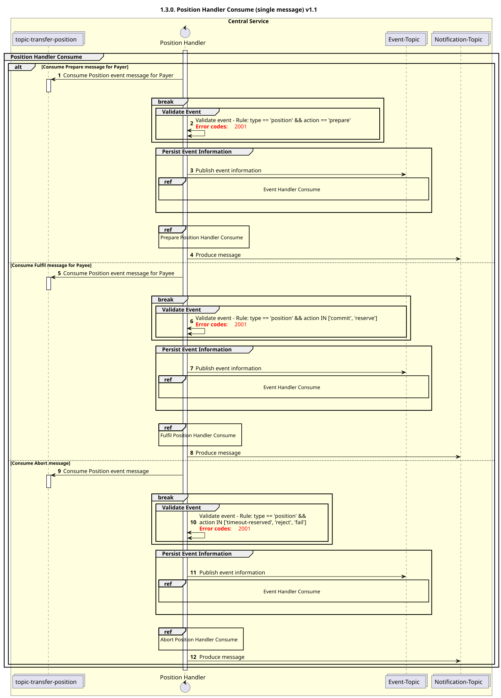

# Manejador de posiciones «Consume» v1.1

Diagrama de diseño de secuencias para el proceso «Consume» del «Position Handler».

## Referencias en el diagrama de secuencia

* [Manejador de eventos «Consume» (9.1.0)](../../central-event-processor/9.1.0-event-handler-placeholder.md)
* [Preparar el controlador de posición «Consume» (1.3.1)](1.3.1-prepare-position-handler-consume.md)
* [Consumo del gestor de posiciones Fufil (1.3.2)](1.3.2-fulfil-position-handler-consume-v1.1.md)
* [Manejo de la interrupción de la posición «Consume» (1.3.3)](1.3.3-abort-position-handler-consume.md)

## Diagrama de secuencia

