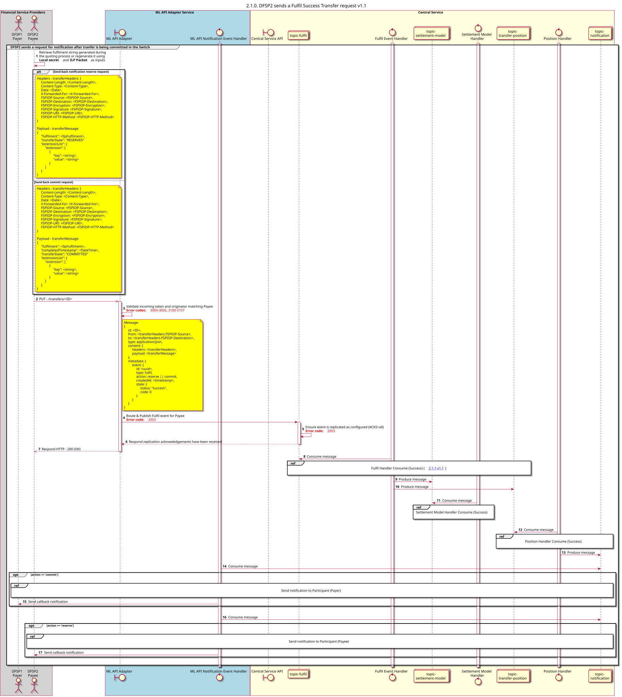

# Solicitud de transferencia completada con éxito v1.1

Diagrama de diseño de la secuencia para la solicitud de transferencia «Fulfil Success».

## Referencias en el diagrama de secuencia

* [Fulfilment: Consumo (Éxito) (2.1.1)](2.1.1-fulfil-handler-consume-v1.1.md)
* [Manejador de posiciones: Consumo (Éxito) (1.3.2)](1.3.2-fulfil-position-handler-consume-v1.1.md)
* [Enviar notificación al Participante (1.1.4.a)](1.1.4.a-send-notification-to-participant-v1.1-v1.1.md)

## Diagrama de secuencia

