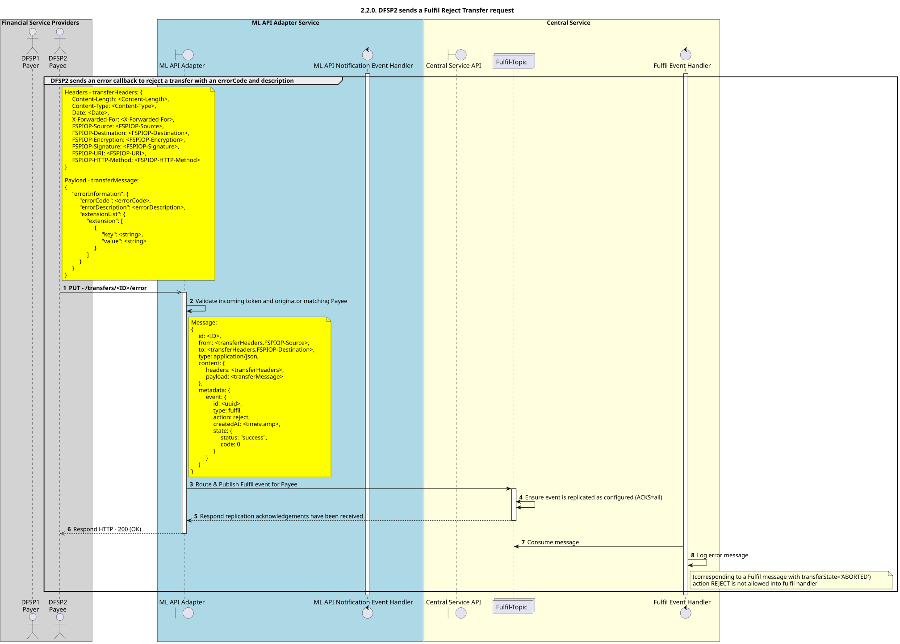

# El beneficiario envía una solicitud de cancelación de transferencia «Fulfil Abort» v1.1

Diagrama de diseño de secuencias para el proceso «Fulfilment, rechazo y Transferencia» de la versión 1.1. del API.

## Diagrama de secuencia

