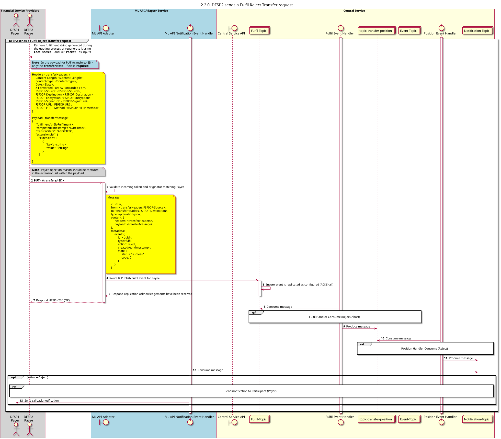

# [Obsoleto] El beneficiario envía una solicitud de «Ejecutar transferencia rechazada»

Diagrama de diseño de secuencias para el proceso de «Aceptación, Rechazo y Transferencia».

## Referencias en el diagrama de secuencia

* [Fulfilment handler: Consumir (Rechazar/Abortar) (2.2.1)](2.2.1-fulfil-reject-handler.md)
* [Manejo de posiciones: Aceptar (Rechazar) (1.3.3)](1.3.3-abort-position-handler-consume.md)
* [Enviar notificación al participante (1.1.4.a)](1.1.4.a-send-notification-to-participant-v1.1.md)

## Diagrama de secuencia

