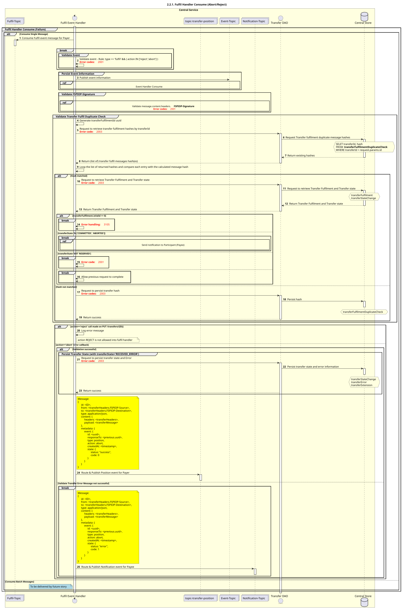

# Fulfilment, gestionar, consumir (rechazar/abortar)

Diagrama de diseño de secuencias para el proceso «Fulfilment Handler Consume Reject/Abort» de la versión 1.1. del API.

## Diagrama de secuencia

