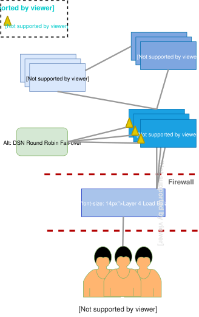

# Despliegue de Mojaloop

Este documento está dirigido a un público con conocimientos técnicos sólidos que desee preparar un entorno para el desarrollo, las pruebas y la contribución al proyecto Mojaloop.

## Infraestructura

Para obtener información sobre los requisitos de infraestructura local necesarios para operar Mojaloop en producción, consulte nuestra [Guía de infraestructura de producción](Production_Infrastructure_Guide.md).

## Despliegue y configuración

- [Despliegue de Mojaloop](#despliegue-de-mojaloop)
  - [Despliegue y configuración](#despliegue-y-configuracion)
    - [1. Requisitos previos](#_1-requisitos-previos)
    - [2. Recomendaciones de despliegue](#_2-recomendaciones-de-despliegue)
    - [3. Kubernetes](#_3-kubernetes)
      - [3.1. Controlador de Ingress de Kubernetes](#_3-1-controlador-de-ingress-de-kubernetes)
      - [3.2. Interfaces de administración de Kubernetes](#_3-2-interfaces-de-administracion-de-kubernetes-opcional)
    - [4. Helm](#_4-helm)
      - [4.1. Configuración de Helm](#_4-1-configuracion-de-helm)
    - [5. Mojaloop](#_5-mojaloop)
      - [5.1. Despliegue del backend con Helm](#_5-1-despliegue-previo-del-backend-con-helm)
      - [5.2. Despliegue de Mojaloop con Helm](#_5-2-despliegue-de-mojaloop-con-helm)
      - [5.3. Verificación de las reglas de Ingress](#_5-3-verificacion-de-las-reglas-de-ingress)
      - [5.4. Pruebas de Mojaloop](#_5-4-pruebas-de-mojaloop)
      - [5.5. Pruebas de Mojaloop con Postman](#_5-5-pruebas-de-mojaloop-con-postman)
    - [6. Servicios superpuestos/3PPI](#_6-servicios-superpuestos-3ppi)
      - [6.1 Configuración de un despliegue para la compatibilidad con la Third Party API](#_6-1-configuracion-de-un-despliegue-para-la-compatibilidad-con-la-third-party-api)
      - [6.2 Validación y pruebas de la Third Party API](#_6-2-validacion-y-pruebas-de-la-third-party-api)
        - [6.2.1 Despliegue de los simuladores](#_6-2-1-despliegue-de-los-simuladores)
        - [6.2.2 Aprovisionamiento del entorno](#_6-2-2-aprovisionamiento-del-entorno)
        - [6.2.3 Ejecución de la colección de pruebas de la Third Party API](#_6-2-3-ejecucion-de-la-coleccion-de-pruebas-de-la-third-party-api)

### 1. Requisitos previos

Preste especial atención al elegir las versiones del software, ya que una discordancia puede provocar problemas o incompatibilidades.

Lista del conjunto de herramientas necesarias como requisito previo para el despliegue de Mojaloop:

- **Kubernetes** Un sistema de código abierto para automatizar el despliegue, el escalado y la gestión de aplicaciones en contenedores. Más información sobre [Kubernetes](https://kubernetes.io).

  - **Versiones recomendadas**

  | Versión publicada del Mojaloop Helm Chart                              | Versión recomendada de Kubernetes |
  | ---------------------------------------------------------------- | -------------------------- |
  | [v16.0.0](https://github.com/mojaloop/helm/releases/tag/v16.0.0) | v1.29             |
  | [v15.0.0](https://github.com/mojaloop/helm/releases/tag/v15.0.0) | v1.24 - v1.25              |
  | [v14.1.1](https://github.com/mojaloop/helm/releases/tag/v14.1.1) | v1.20 - v1.24              |
  | [v14.0.0](https://github.com/mojaloop/helm/releases/tag/v14.0.0) | v1.20 - v1.21              |
  | [v13.x](https://github.com/mojaloop/helm/releases/tag/v13.1.1)   | v1.13 - v1.21              |
  | [v12.x](https://github.com/mojaloop/helm/releases/tag/v12.0.0)   | v1.13 - v1.20              |
  | [v11.x](https://github.com/mojaloop/helm/releases/tag/v11.0.0)   | v1.13 - v1.17              |
  | [v10.x](https://github.com/mojaloop/helm/releases/tag/v10.4.0)   | v1.13 - v1.15              |
  
  > NOTAS:
  >
  > - Los enlaces anteriores apuntan a la última versión principal (p. ej., v13.x --> v13.1.1).
  > - Consulte [https://github.com/mojaloop/helm/releases](https://github.com/mojaloop/helm/releases) para obtener información sobre las versiones intermedias.
  > - La columna `Recommend Kubernetes Version` indica las versiones de Kubernetes que se han probado y verificado para comprobar que funcionan según lo previsto con la columna `Mojaloop Helm Chart Release Version` correspondiente.

  - **kubectl** - Se requiere la CLI de Kubernetes para la gestión de Kubernetes. Más información sobre [kubectl](https://kubernetes.io/docs/reference/kubectl/overview/):
    - [Install-kubectl](https://kubernetes.io/docs/tasks/tools/install-kubectl/)

- **Helm** Un gestor de paquetes para Kubernetes. Más información sobre [Helm](https://helm.sh)

   **Versiones recomendadas**

  - [Helm v3](https://helm.sh/docs/intro/install)

  > NOTAS:
  >
  > - Consulte la guía [Migration from Helm v2 to v3](https://docs.mojaloop.io/legacy/deployment-guide/helm-legacy-migration.html) para migrar de Helm v2.x a v3.x.

### 2. Recomendaciones de despliegue

Aquí se ofrecen recomendaciones sobre los recursos del entorno, con una visión de la arquitectura de la infraestructura.

**Requisitos de recursos:**

- Plano de control (es decir, nodo maestro)

  [https://kubernetes.io/docs/setup/cluster-large/#size-of-master-and-master-components](https://kubernetes.io/docs/setup/cluster-large/#size-of-master-and-master-components)

  - 3 nodos maestros para el futuro escalado de nodos y la alta disponibilidad (HA)

- Plano de ETCd:

  [https://etcd.io/docs/latest/op-guide/hardware/](https://etcd.io/docs/latest/op-guide/hardware/)

  - 3 nodos de ETCd para la alta disponibilidad (HA)

- Plano de computación (es decir, nodo de trabajo):

  Se confirmará una vez concluidas las pruebas de carga. No obstante, el tamaño general recomendado actualmente es:

  - 3 nodos de trabajo, cada uno con:
    - 4 vCPU, 16 GB de RAM y 40 GB de almacenamiento

  **Tenga en cuenta** que esto también dependerá de su infraestructura subyacente y que NO incluye los requisitos de volúmenes ni de almacenamiento persistentes.



### 3. Kubernetes

Si instala Kubernetes usted mismo, le recomendamos utilizar una de las siguientes variantes de Kubernetes y asegurarse de instalar la versión correspondiente que desea, según se especifica en la sección [1. Requisitos previos](#_1-requisitos-previos):

- [k3s](https://docs.k3s.io/installation) - Distribución ligera y flexible de Kubernetes que puede utilizarse para casi cualquier cosa, desde entornos locales hasta entornos de nivel de producción.
- [Minikube](https://minikube.sigs.k8s.io/docs/start) - Distribución sencilla de Kubernetes de un solo nodo, independiente de la plataforma, útil para entornos locales o de desarrollo.
- [Microk8s](https://microk8s.io/docs/install-alternatives) - Distribución sencilla de Kubernetes, útil para entornos locales o de desarrollo.
- [Docker Desktop](https://docs.docker.com/desktop/kubernetes/) - Distribución sencilla de Kubernetes, útil para entornos locales o de desarrollo (asegúrese de instalar la versión aplicable que incluya la versión de Kubernetes que desea, consultando las [Docker Desktop release-notes](https://docs.docker.com/desktop/release-notes)).

No especificamos una distribución concreta de Kubernetes, sino que, al probar nuevas versiones de Mojaloop, debe seleccionarse cualquier distribución de Kubernetes que se ejecute sobre una distribución certificada por la [Cloud Native Computing Foundation (CNCF)](https://www.cncf.io/certification/software-conformance) o una solución gestionada (p. ej., Azure, AWS, GCP).

Si no conoce Kubernetes, se recomienda encarecidamente que se familiarice con él. [Kubernetes Concepts](https://kubernetes.io/docs/concepts/overview/) es un buen punto de partida y ofrece una visión general.

Asegúrese de que **kubectl** esté instalado. Dispone de un conjunto completo de instrucciones de instalación [aquí](https://kubernetes.io/docs/tasks/tools/install-kubectl/).

#### 3.1. Controlador de Ingress de Kubernetes

Instale el controlador de Ingress que prefiera para el equilibrio de carga y el acceso externo.

Consulte la siguiente documentación para instalar el controlador Nginx-Ingress utilizado en esta guía: <https://kubernetes.github.io/ingress-nginx/deploy/#using-helm>.

Lista de controladores de Ingress alternativos: <https://kubernetes.io/docs/concepts/services-networking/ingress-controllers/>.

Asegúrese de instalar una versión compatible del `Ingress Controller` que coincida con la versión de `Kubernetes` que desea.

> **RESOLUCIÓN DE PROBLEMAS DE DESPLIEGUE - Actualizado en marzo de 2023**
>
> - Si utiliza Mojaloop `v13.x` - `v14.0.x`, consulte [Deployment Troubleshooting - 1.1. Nginx-Ingress Controller support for Mojaloop Helm release v13.x - v14.0x.x support for Kubernetes v1.20 - v1.21](../../../../technical/technical/deployment-guide/deployment-troubleshooting.md#11-nginx-ingress-controller-support-for-mojaloop-helm-release-v13x---v140xx-support-for-kubernetes-v120---v121).
>
> - Si utiliza Mojaloop `v12.x`, consulte [Deployment Troubleshooting - 1.2. Nginx-Ingress Controller support for Mojaloop Helm release v12.x](../../../../technical/technical/deployment-guide/deployment-troubleshooting.md#12-nginx-ingress-controller-support-for-mojaloop-helm-release-v12x).
>
> - Si utiliza Mojaloop `v10.x`, consulte [Deployment Troubleshooting - 1.4.Mojaloop Helm release v10.x or less does not support Kubernetes v1.16 or greater](../../../../technical/technical/deployment-guide/deployment-troubleshooting.md#14-mojaloop-helm-release-v10x-or-less-does-not-support-kubernetes-v116-or-greater).
>

#### 3.2. Interfaces de administración de Kubernetes (opcional)

1. Kubernetes Dashboards

   La interfaz de administración oficial de la IU web de Kubernetes.

   Visite el siguiente enlace para ver las instrucciones de instalación (no es necesario si **MicroK8s** está instalado): [Web UI (Dashboard) Installation Instructions](https://kubernetes.io/docs/tasks/access-application-cluster/web-ui-dashboard/).

   **IMPORTANTE:** Asegúrese (no es necesario si **MicroK8s** está instalado) de configurar los roles de RBAC y de crear una cuenta de servicio asociada; consulte el siguiente ejemplo sobre cómo crear un usuario de muestra únicamente con fines de prueba: [Creating sample user](https://github.com/kubernetes/dashboard/blob/master/docs/user/access-control/creating-sample-user.md).

   Si ha instalado MicroK8s, **active el panel de MicroK8s**:

   ```bash
   microk8s.enable dashboard
   ```

   Consulte el siguiente enlace para obtener más información: [Add-on: dashboard](https://microk8s.io/docs/addon-dashboard).

   **Recuerde** anteponer **MicroK8s** a todos los comandos de **kubectl** si ha optado por no crear un alias.

2. k8sLens

   Una alternativa local a kubectl basada en una GUI de escritorio, fácil de instalar y configurar.

   Visite el siguiente enlace para obtener más información: <https://k8slens.dev/>.

### 4. Helm

Consulte [Mojaloop Helm Chart](../repositories/helm.md) para comprender las relaciones entre los Helm charts de Mojaloop desplegados.

Consulte la documentación oficial sobre cómo instalar la última versión de Helm: <https://helm.sh/docs/intro/install/>.

Consulte el siguiente documento si utiliza Helm v2: [Deployment with (Deprecated) Helm v2](https://docs.mojaloop.io/legacy/deployment-guide/helm-legacy-deployment.html).

Consulte la [Helm v2 to v3 Migration Guide](https://docs.mojaloop.io/legacy/deployment-guide/helm-legacy-migration.html) si desea migrar un despliegue existente de Helm v2 a v3.

#### 4.1. Configuración de Helm

1. Añada el repositorio de mojaloop a su configuración de Helm:

   ```bash
   helm repo add mojaloop https://mojaloop.io/helm/repo/
   ```

   Si el repositorio ya existe, sustituya 'add' por 'apply' en el comando anterior.

2. Actualice los repositorios de helm:

   ```bash
   helm repo update
   ```

### 5. Mojaloop

#### 5.1. Despliegue previo del backend con Helm

Mojaloop tiene varias dependencias externas de backend.

Recomendamos desplegar estas dependencias en un despliegue independiente con nombre propio.

Este chart de backend de ejemplo se ofrece únicamente a modo de ejemplo y solo debe utilizarse con fines de prueba de concepto, desarrollo y pruebas.

Puede encontrar más información [aquí](https://github.com/mojaloop/helm/blob/master/README.md#deploying-backend-dependencies).

1. Despliegue el backend

   ```bash
   helm --namespace demo install backend mojaloop/example-mojaloop-backend --create-namespace
   ```

#### 5.2. Despliegue de Mojaloop con Helm

1. Instale Mojaloop:

   1.1. Instalación de la última versión:

   ```bash
   helm --namespace demo install moja mojaloop/mojaloop --create-namespace
   ```

   O bien, si necesita una configuración personalizada:

   ```bash
   helm --namespace demo install moja mojaloop/mojaloop --create-namespace -f {custom-values.yaml}
   ```

   Puede encontrar más información [aquí](https://github.com/mojaloop/helm/blob/master/README.md#deploying-mojaloop-helm-charts).

   _Nota: Descargue y personalice el archivo [values.yaml](https://github.com/mojaloop/helm/blob/master/mojaloop/values.yaml). Asegúrese también de utilizar el archivo value.yaml (es decir, `https://github.com/mojaloop/helm/blob/v<SPECIFIC_VERSION>/mojaloop/values.yaml`) de la versión correcta, que puede consultarse en [Helm Releases](https://github.com/mojaloop/helm/releases). Puede confirmar la versión instalada con el siguiente comando: `helm --namespace demo list`. En la columna **CHART** debería ver algo similar a 'mojaloop-**{version}**', donde **{version}** es la versión desplegada._

   ```bash
    $ helm -n demo list
    NAME            NAMESPACE       REVISION        UPDATED                                 STATUS          CHART
    moja            demo            1               2021-06-11 15:06:04.533094 +0200 SAST   deployed        mojaloop-{version}
   ```

   _Nota: El indicador `--create-namespace` solo es necesario si el espacio de nombres `demo` no existe. También puede crearlo con el siguiente comando: `kubectl create namespace demo`._

   1.2. Instalación de una versión concreta:

   ```bash
   helm --namespace demo install moja mojaloop/mojaloop --create-namespace --version {version}
   ```

   1.3. Lista de versiones de Mojaloop:

   ```bash
    $ helm search repo mojaloop/mojaloop -l
    NAME                            CHART VERSION   APP VERSION                 DESCRIPTION
    mojaloop/mojaloop               {version}       {list of app-versions}      Mojaloop Helm chart for Kubernetes
    ...                             ...             ...                         ...
   ```

#### 5.3. Verificación de las reglas de Ingress

1. Actualice su archivo /etc/hosts para el despliegue local:

   _Nota: Esto solo es aplicable a los despliegues locales y no es necesario si se configuran reglas de DNS o de Ingress personalizadas en un archivo [values.yaml](https://github.com/mojaloop/helm/blob/master/mojaloop/values.yaml) personalizado_.

   ```bash
   vi /etc/hosts
   ```

   _En Windows, el archivo puede actualizarse con el bloc de notas, que debe abrirse con privilegios de administrador. Ubicación del archivo: `C:\Windows\System32\drivers\etc\hosts`_.

   Incluya las siguientes líneas (_o bien combínelas_) en la configuración del host.

   La configuración necesaria que figura a continuación es aplicable a las versiones de Helm >= 6.2.2 para los servicios de la Mojaloop API;

   ```bash
    # Mojaloop Demo
    127.0.0.1   ml-api-adapter.local central-ledger.local account-lookup-service.local account-lookup-service-admin.local quoting-service.local central-settlement-service.local transaction-request-service.local central-settlement.local bulk-api-adapter.local moja-simulator.local sim-payerfsp.local sim-payeefsp.local sim-testfsp1.local sim-testfsp2.local sim-testfsp3.local sim-testfsp4.local mojaloop-simulators.local finance-portal.local operator-settlement.local settlement-management.local testing-toolkit.local testing-toolkit-specapi.local
   ```

2. Pruebe el estado del sistema en su navegador después de la instalación. Esto solo funcionará si tiene un despliegue activo de un helm chart en ejecución.

   _Nota: Los ejemplos siguientes solo son aplicables a un despliegue local. Las entradas deben coincidir con los valores de DNS o las reglas de Ingress configuradas en el archivo [values.yaml](https://github.com/mojaloop/helm/blob/master/mojaloop/values.yaml) o, en su defecto, con cualquier regla de Ingress personalizada que se haya configurado_.

   Prueba de estado de **ml-api-adapter**: <http://ml-api-adapter.local/health>

   Prueba de estado de **central-ledger**: <http://central-ledger.local/health>

#### 5.4. Pruebas de Mojaloop

El [Mojaloop Testing Toolkit](../../documentation/mojaloop-technical-overview/ml-testing-toolkit/README.md) (**TTK**) se utiliza para probar los despliegues y se ha integrado en Helm, aprovechando su CLI para probar fácilmente cualquier despliegue de Mojaloop.

1. Validación de Mojaloop con Helm

   ```bash
   helm -n demo test moja
   ```

   O bien con los registros impresos en la consola

   ```bash
   helm -n demo test moja --logs
   ```

   Esto ejecutará automáticamente los siguientes [test cases](https://github.com/mojaloop/testing-toolkit-test-cases) utilizando la CLI del [Mojaloop Testing Toolkit](../../documentation/mojaloop-technical-overview/ml-testing-toolkit/README.md) (**TTK**):

   - [TTK Hub setup and Simulator Provisioning Collection](https://github.com/mojaloop/testing-toolkit-test-cases/tree/master/collections/hub/provisioning).

   Utilice el siguiente comando para ver los registros de la colección de aprovisionamiento:

   ```bash
   kubectl -n demo logs pod/moja-ml-ttk-test-setup
   ```

   - [TTK Golden Path Test Collection](https://github.com/mojaloop/testing-toolkit-test-cases/tree/master/collections/hub/golden_path).

   Utilice el siguiente comando para ver los registros de la Golden Path Collection:

   ```bash
    kubectl -n demo logs pod/moja-ml-ttk-test-validation
   ```

   Ejemplo del resumen final que se muestra en la salida del registro de la colección de pruebas Golden Path:

   ```bash
    Test Suite:GP Tests
    Environment:Development
    ┌───────────────────────────────────────────────────┐
    │                      SUMMARY                      │
    ├───────────────────┬───────────────────────────────┤
    │ Total assertions  │ 1557                          │
    ├───────────────────┼───────────────────────────────┤
    │ Passed assertions │ 1557                          │
    ├───────────────────┼───────────────────────────────┤
    │ Failed assertions │ 0                             │
    ├───────────────────┼───────────────────────────────┤
    │ Total requests    │ 297                           │
    ├───────────────────┼───────────────────────────────┤
    │ Total test cases  │ 61                            │
    ├───────────────────┼───────────────────────────────┤
    │ Passed percentage │ 100.00%                       │
    ├───────────────────┼───────────────────────────────┤
    │ Started time      │ Fri, 11 Jun 2021 15:45:53 GMT │
    ├───────────────────┼───────────────────────────────┤
    │ Completed time    │ Fri, 11 Jun 2021 15:47:25 GMT │
    ├───────────────────┼───────────────────────────────┤
    │ Runtime duration  │ 91934 ms                      │
    └───────────────────┴───────────────────────────────┘
    TTK-Assertion-Report-multi-2021-06-11T15:47:25.656Z.html was generated
   ```

2. Acceso a la IU del Mojaloop Testing Toolkit

   Abra el siguiente enlace en un navegador: <http://testing-toolkit.local>.

   Es posible cargar y ejecutar manualmente las colecciones del Testing Toolkit mediante la IU, lo que permite inspeccionar visualmente las solicitudes, las respuestas y las aserciones con mayor detalle. Esta es una magnífica manera de conocer mejor Mojaloop.

   Consulte la [Mojaloop Testing Toolkit Documentation](../../documentation/mojaloop-technical-overview/ml-testing-toolkit/README.md) para obtener más información y guías.

#### 5.5. Pruebas de Mojaloop con Postman

[Postman](https://www.postman.com/downloads) puede utilizarse como alternativa al [Mojaloop Testing Toolkit](../../documentation/mojaloop-technical-overview/ml-testing-toolkit/README.md). Consulte la [Guía de pruebas automatizadas](../contributors-guide/tools-and-technologies/automated-testing.md) para obtener más información.

Las [Mojaloop Postman Collections](https://github.com/mojaloop/postman) disponibles son similares a los [Mojaloop Testing Toolkit's Test Cases](https://github.com/mojaloop/testing-toolkit-test-cases), como se indica a continuación:

| Postman Collection | Mojaloop Testing Toolkit | Descripción |
|---------|----------|---------|
| [MojaloopHub_Setup Postman Collection](https://github.com/mojaloop/postman/blob/master/MojaloopHub_Setup.postman_collection.json) y [MojaloopSims_Onboarding](https://github.com/mojaloop/postman/blob/master/MojaloopSims_Onboarding.postman_collection.json) | [TTK Hub setup and Simulator Provisioning Collection](https://github.com/mojaloop/testing-toolkit-test-cases/tree/master/collections/hub/provisioning) | Configuración del Hub y aprovisionamiento de simuladores |
| [Golden_Path_Mojaloop](https://github.com/mojaloop/postman/blob/master/Golden_Path_Mojaloop.postman_collection.json) | [TTK Golden Path Test Collection](https://github.com/mojaloop/testing-toolkit-test-cases/tree/master/collections/hub/golden_path) | Pruebas Golden Path |

Requisitos previos:

- El siguiente archivo de entorno de postman debe importarse o personalizarse según sea necesario al ejecutar las colecciones de Postman indicadas anteriormente: [Mojaloop-Local-MojaSims.postman_environment.json](https://github.com/mojaloop/postman/blob/master/environments/Mojaloop-Local-MojaSims.postman_environment.json).
- Asegúrese de descargar la **última versión de parche** desde [Mojaloop Postman Git Repository Releases](https://github.com/mojaloop/postman/releases). Por ejemplo, si instala Mojaloop v12.0.**X**, asegúrese de tener la última versión de parche de la colección de Postman v12.0.**Y**.

### <a id='overlay-services'></a>6. Servicios superpuestos/3PPI

A partir de la [R.C. v13.1.0](https://github.com/mojaloop/helm/tree/release/v13.1.0) de Mojaloop, la Third Party API es compatible y se publicará con la versión oficial de Mojaloop v13.1.0,
lo que permite a los iniciadores de pagos por terceros (3PPI) solicitar la vinculación de una cuenta a un DFSP e iniciar
pagos en nombre de los usuarios.

> Más información sobre 3PPI:
> - La [Third Party API](https://github.com/mojaloop/mojaloop-specification/tree/master/thirdparty-api) de Mojaloop
> - Casos de uso de terceros:
>   - [3rd Party Account Linking](https://sandbox.mojaloop.io/usecases/3ppi-account-linking.html)
>   - [3rd Party Initiated Payments](https://sandbox.mojaloop.io/usecases/3ppi-transfer.html)


#### <a id='configuring-a-deployment'></a>6.1 Configuración de un despliegue para la compatibilidad con la Third Party API

La compatibilidad con la Third Party API está **desactivada** de forma predeterminada en el despliegue de Mojaloop. Puede activarla editando su archivo `values.yaml`
con los siguientes ajustes:

```yaml
...
account-lookup-service:
  account-lookup-service:
    config:
      featureEnableExtendedPartyIdType: true # allows the ALS to support newer THIRD_PARTY_LINK PartyIdType

  account-lookup-service-admin:
    config:
      featureEnableExtendedPartyIdType: true # allows the ALS to support newer THIRD_PARTY_LINK PartyIdType

...

thirdparty:
  enabled: true
...
```

Además, la Third Party API tiene una serie de dependencias que deben desplegarse manualmente para que los servicios thirdparty
funcionen. [mojaloop/helm/thirdparty](https://github.com/mojaloop/helm/tree/master/thirdparty) contiene información detallada sobre estas
dependencias y también proporciona archivos de configuración de k8s de ejemplo que las instalan por usted.

```bash
# install redis and mysql for the auth-service
kubectl apply --namespace demo -f https://raw.githubusercontent.com/mojaloop/helm/master/thirdparty/chart-auth-svc/example_dependencies.yaml
# install mysql for the consent oracle
kubectl apply --namespace demo -f https://raw.githubusercontent.com/mojaloop/helm/master/thirdparty/chart-consent-oracle/example_dependencies.yaml

# apply the above changes to your values.yaml file, and update your mojaloop installation to deploy thirdparty services:
helm upgrade --install --namespace demo moja mojaloop/mojaloop -f values.yaml
```

Una vez finalizada la actualización de helm, puede comprobar que los servicios de terceros están activos y en ejecución:

```bash
kubectl get po | grep tp-api
# tp-api-svc-b9bf78564-4g59d                                        1/1     Running   0          7m17s

kubectl get po | grep auth-svc
# auth-svc-b75c954d4-9vq7w                                          1/1     Running   0          8m5s

kubectl get po | grep consent-oracle
# consent-oracle-849cb69769-vq4rk                                   1/1     Running   0          8m31s


# and also make sure the ingress is exposed correctly
curl -H "Host: tp-api-svc.local" <ingress ip address>/health
# {"status":"OK","uptime":3545.77290063,"startTime":"2021-11-04T05:41:32.861Z","versionNumber":"11.21.0","services":[]}

curl -H "Host: auth-service.local" <ingress ip address>/health

# {"status":"OK","uptime":3682.48869561,"startTime":"2021-11-04T05:43:19.056Z","versionNumber":"11.10.1","services":[]}

curl -H "Host: consent-oracle.local" <ingress ip address>/health
# {"status":"OK","uptime":3721.520096665,"startTime":"2021-11-04T05:43:48.382Z","versionNumber":"0.0.8","services":[]}
```

> También puede añadir las siguientes entradas a su archivo `/etc/hosts` para facilitar la comunicación con los servicios thirdparty
>
> ```bash
> <ingress ip address> tp-api-svc.local auth-service.local consent-oracle.local
> ```

#### <a id='validating-and-testing'></a>6.2 Validación y pruebas de la Third Party API

Una vez desplegados los servicios de la Third Party API, debe desplegar algunos simuladores capaces de simular
los escenarios de terceros.

##### 6.2.1 Despliegue de los simuladores

De nuevo, puede hacerlo modificando su archivo `values.yaml`, esta vez en la entrada `mojaloop-simulator`:

```yaml
...

mojaloop-simulator:
  simulators:
  ...
    pisp:
      config:
        thirdpartysdk:
          enabled: true
    dfspa:
      config:
        thirdpartysdk:
          enabled: true
    dfspb: {}
...
```

La entrada anterior creará 3 nuevos conjuntos de simuladores de mojaloop:

1. `pisp` - un PISP
2. `dfspa` - un DFSP compatible con la Third Party API
3. `dfspb` - un simulador de DFSP normal que no es compatible con la Third Party API, pero que puede recibir pagos

##### 6.2.2 Aprovisionamiento del entorno

Una vez desplegados los simuladores anteriores y en ejecución, es el momento de configurar el Hub de Mojaloop
y los simuladores para poder probar la Third Party API.

Utilice la [Third Party Provisioning Collection](https://github.com/mojaloop/testing-toolkit-test-cases#third-party-provisioning-collection)
de mojaloop/testing-toolkit-test cases para aprovisionar el entorno de la Third Party API y los simuladores
que configuró en el paso anterior.

##### 6.2.3 Ejecución de la colección de pruebas de la Third Party API

Una vez completados los pasos de aprovisionamiento, puede ejecutar la [Third Party Test Collection](https://github.com/mojaloop/testing-toolkit-test-cases#third-party-test-collection)
para comprobar que los servicios de la Third Party API se han desplegado y configurado correctamente.
