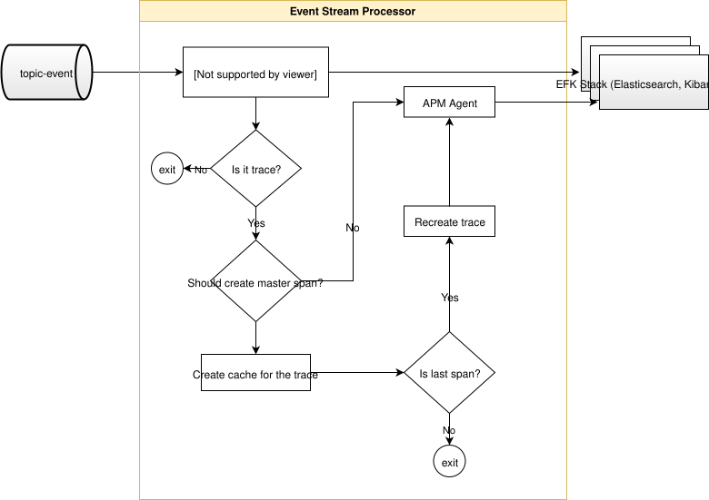
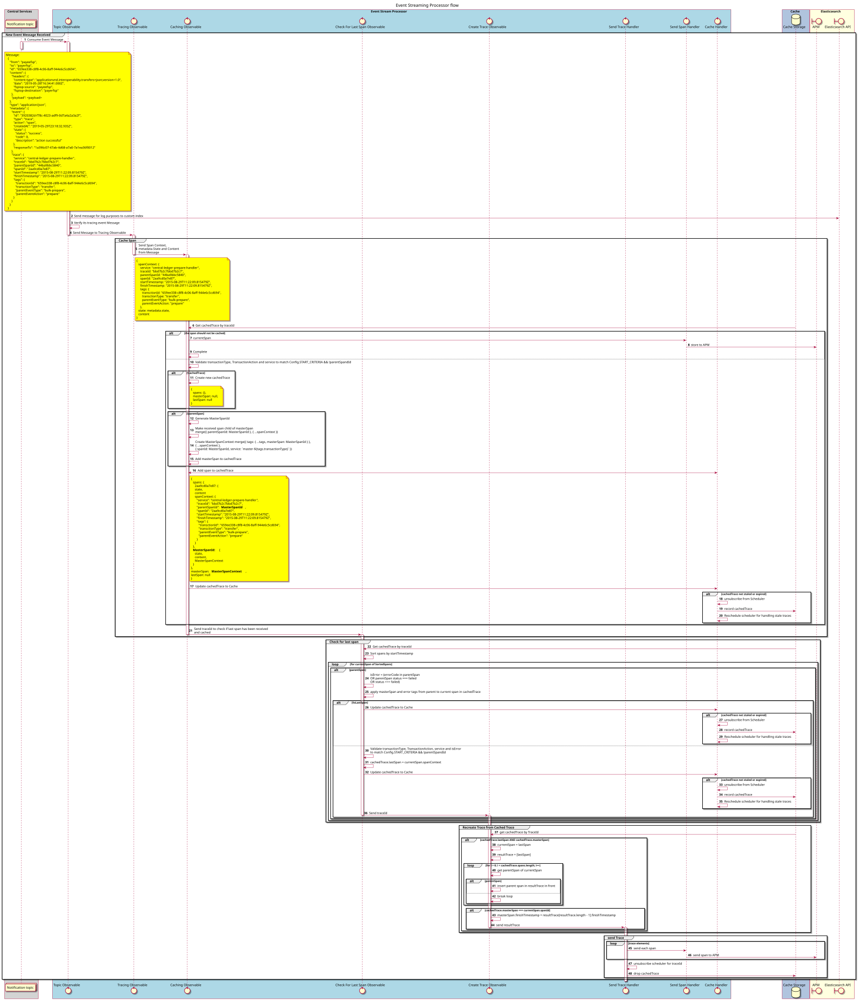

# Servicio de procesamiento de flujos de eventos

El Procesador de flujos de eventos (Event Stream Processor) recibe mensajes de eventos del tema `topic-events`, que proceden de los mensajes publicados por el servicio [event-sidecar](https://github.com/mojaloop/event-sidecar). Consulte [Framework](../event-framework/README.md) para obtener más información sobre la arquitectura general.

El servicio envía registros, incluidas las auditorías y los rastros, a la pila EFK con el complemento APM activado. En función del tipo de mensaje de evento, los mensajes se envían a distintos índices de Elasticsearch.

## 1. Requisitos previos

El servicio registra todos los eventos en una instancia de Elasticsearch con el complemento APM activado. Puede consultar un ejemplo de Docker Compose de la pila de Elastic [here](https://github.com/mojaloop/event-stream-processor/blob/master/test/util/scripts/docker-efk/docker-compose.yml). Los registros y las auditorías se crean en una plantilla de índice personalizada, mientras que los datos de rastreo se almacenan en el índice predeterminado `apm-*`.
Asegúrese de haber creado el `mojatemplate` tal y como se describe en la documentación del servicio [event-stream-processor](https://github.com/mojaloop/event-stream-processor#111-create-template).

## 2. Descripción general de la arquitectura

### 2.1. Descripción general del flujo

### 2.2 Diagrama de secuencia del flujo de procesamiento de trazas

