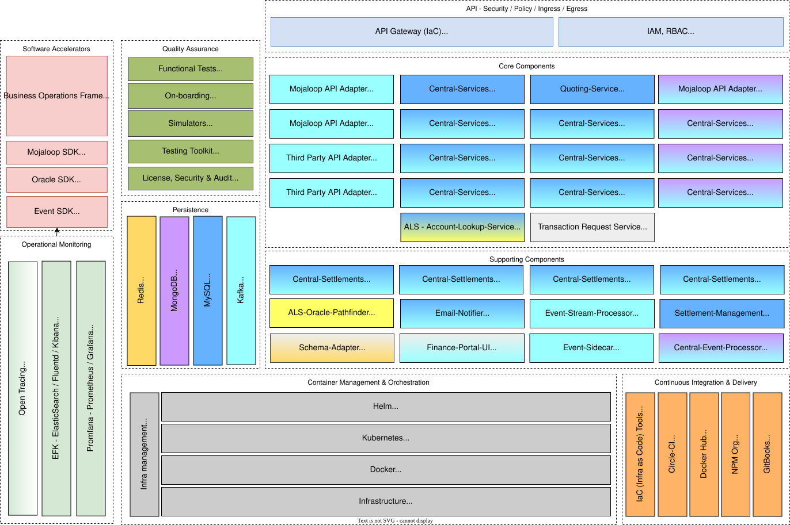

# Mojaloop Hub

Hay varios componentes que conforman el ecosistema «Mojaloop». El «Mojaloop Hub» es el contenedor principal y el punto de referencia que utilizamos para describir los componentes «Mojaloop» fundamentales.  

El siguiente diagrama de componentes muestra el desglose de los servicios «Mojaloop» y su arquitectura de microservicios:

_Nota: La codificación por colores indica la relación entre el almacén de datos y las interconexiones de transmisión de mensajes o adaptadores. Por ejemplo, el `Central-Services` utiliza el `MySQL` como almacén de datos y recurre al `Kafka` para la transmisión de mensajes_

Estos son los siguientes:

* Los **Mojaloop API Adapters** (**ML-API-Adapter**) proporcionan el conjunto estándar de interfaces que un DFSP puede implementar para conectarse al Sistema con el fin de realizar Transferencias. Un DFSP que desee conectarse puede adaptar nuestro código de ejemplo o implementar las interfaces estándar en su propio software. El objetivo es que a un «DFSP» le resulte lo más sencillo posible conectarse a la red de interoperabilidad.
* Los **Servicios Centrales** (**CS**) proporcionan el conjunto de componentes necesarios para transferir fondos de un DFSP a otro a través de los adaptadores Mojaloop API. Este proceso es similar al que se produce cuando el dinero circula a través de un banco central o una Cámara de compensación en los países desarrollados. Los Servicios Centrales contienen la lógica básica del Libro Mayor Central para transferir dinero, pero también se ampliarán para ofrecer gestión del fraude y garantizar el cumplimiento de las reglas del Esquema de pagos.
* El **Account Lookup Service (ALS)** ofrece un mecanismo para resolver la información de enrutamiento «FSP» a través del Participante API o coordinar una solicitud de una Parte basándose en una búsqueda interna de Participantes. La búsqueda interna de participantes se gestiona mediante una serie de adaptadores o servicios estándar de Oracle. Un ejemplo de adaptador o servicio de Oracle sería la búsqueda de información sobre participantes en Pathfinder o en un registro de comerciantes. Estos adaptadores o servicios de Oracle pueden añadirse fácilmente en función de los requisitos del esquema.
* El **Servicio de cotización** (**QA**) ofrece el proceso de cotización, que consiste en determinar las tarifas y comisiones necesarias para llevar a cabo una transacción financiera entre dos proveedores de servicios financieros (FSP). Siempre lo inicia el pagador FSP hacia el beneficiario FSP, lo que significa que la cotización se transmite de la misma forma que una transacción financiera.
* El **Simulador** (**SIM**) simula varias funciones de **DFSP** de la siguiente manera:
  * Puntos finales de Oracle para las operaciones CRUD de Oracle Participante mediante caché en memoria;
  * Parámetros de evaluación de los participantes para los Oracles que admiten «partyIdTypes» parametrizados;
  * Puntos finales de las partes para los proveedores de servicios financieros (FSP) del Pagador y del Beneficiario, con las respuestas de devolución de llamada asociadas;
  * Puntos finales de transferencia para los proveedores de servicios financieros (FSP) del pagador y del beneficiario, con las respuestas de devolución de llamada correspondientes; y
  * Consultar las API para verificar las transacciones (solicitudes, respuestas, llamadas de retorno, etc.) con el fin de facilitar las pruebas y la verificación de control de calidad.

A ambos lados del Hub Mojaloop hay ejemplos de código abierto que muestran cómo un DFSP puede enviar y recibir pagos, así como el cliente que un DFSP ya existente podría alojar para conectarse a la red.
