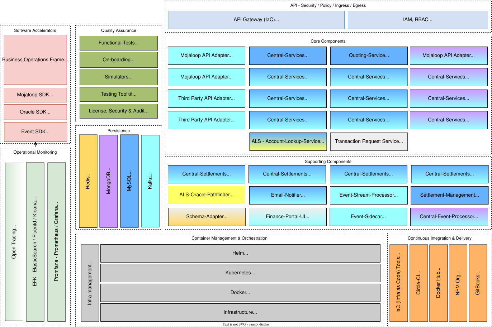

# Mojaloop Hub Current Components - PI18

El siguiente diagrama de componentes muestra el desglose de los servicios «Mojaloop» y su arquitectura de microservicios para la fase previa a PI18:

_Nota: La codificación por colores indica la relación entre el almacén de datos y las interconexiones de transmisión de mensajes o adaptadores. Por ejemplo, el `Central-Services` utiliza el `MySQL` como almacén de datos y recurre al `Kafka` para la transmisión de mensajes_
