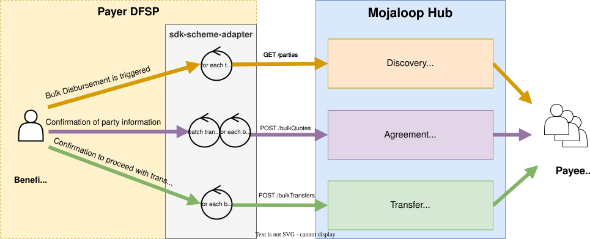
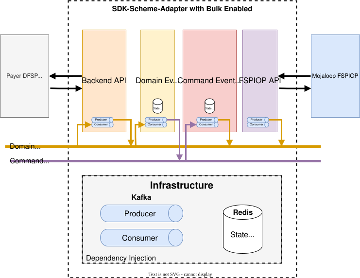
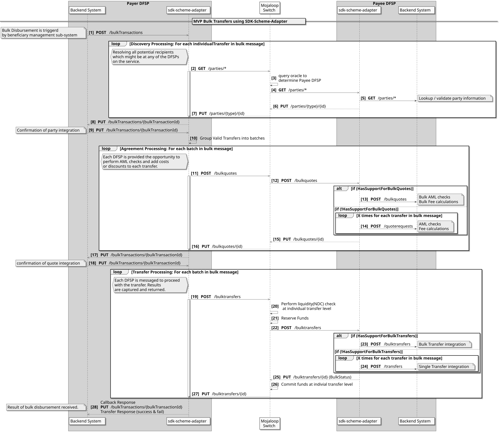

# SDK. Compatibilidad con transferencias masivas: Descripción general
El presente documento de diseño describe cómo se ha mejorado el adaptador Scheme «SDK» para que admita el caso de uso de las transferencias masivas.

## ¿Por qué? - Se han superado las limitaciones de transferencia masiva de Mojaloop
La implementación de transferencias masivas en la versión Mojaloop presenta las siguientes limitaciones, que esta mejora SDK está diseñada para superar.
1. Solo se podrán incluir en una llamada de cotizaciones masivas y transferencias masivas aquellas transferencias individuales dirigidas al mismo Pagador DFSP.
1. El número de cotizaciones y transferencias individuales en cada una de las funciones «bulkQuotes» y «bulkTransfers», respectivamente, está limitado a un máximo de 1 000.
1. Para permitir la funcionalidad de transferencias masivas, todos los proveedores de servicios financieros digitales (DFSP) de los beneficiarios deben implementar la compatibilidad con la integración para el envío masivo de mensajes. Es decir, si se introdujera el caso de uso de transferencias masivas en un esquema de pagos ya existente, todos los DFSP conectados tendrían que actualizar sus conexiones e integraciones con sus Sistemas de core bancario.
1. En estos momentos no hay ninguna convocatoria de presentación de pruebas en bloque.

## SDK: Requisitos de mejora masiva del adaptador de Esquema de pagos
Estas mejoras permiten:
1. Transferencias en las que aún no se ha convocado la fase de presentación de pruebas.
1. No hay límite en el número de transferencias (está limitado por la infraestructura y las capacidades de la red, pero es superior a las 1 000 que especifica el ML FSPIOP)
1. La compatibilidad con la integración de beneficiarios para el procesamiento masivo es opcional
1. Compatibilidad opcional 
   - una única llamada que lleva a cabo las fases de detección, acuerdo y Transferencia
   - que admita búsquedas de partes de forma independiente
   - aceptar cotizaciones de forma independiente
   - establecer un límite de tarifa para la aceptación automática de cotizaciones
   - el hecho de omitir la fase de descubrimiento
   - llevar a cabo únicamente la fase de descubrimiento
   - establecer una fecha de caducidad para el mensaje masivo
   - los identificadores de transacción internos, tanto para el mensaje masivo como para las transferencias individuales.
   - tanto las llamadas síncronas (API) como las asíncronas (API)

## Funcionalidades implementadas
La implementación actual no incluye todas las funcionalidades. Todas las funcionalidades que se han completado son operativas y pueden utilizarse. Se pueden añadir funcionalidades y mejoras adicionales a la funcionalidad existente según las prioridades establecidas por el producto «Mojaloop» y la comunidad. Esto se ajusta al concepto ágil de MVP (producto mínimo viable).
Estas son las funciones que se han implementado hasta la fecha:

| Característica | Estado de la implementación | Versión de lanzamiento |
|---|---|---|
| Modo asíncrono | publicado | v14.1.0 RC |
| Modo síncrono | no se ha iniciado | |
| Aceptación automática de la parte contraria | no se ha iniciado | |
| Aceptación automática de cotizaciones (con límite de comisión) | no se ha iniciado | |
| Validar únicamente la parte | no se ha iniciado | |
| Omitir la búsqueda de partes | no se ha iniciado | |
| Caducidad masiva | no se ha iniciado | |
| Beneficiario SDK: Desmultiplexación de cotizaciones masivas | no se ha iniciado | |
| Beneficiario SDK: Desmultiplexación de transferencias masivas | no se ha iniciado | |
| Mojaloop - Notificación de parches masivos | no se ha iniciado | |
| Beneficiario SDK: Desmultiplexación de la notificación de parches masivos | no se ha iniciado | |

### Diagrama funcional

## Esquema arquitectónico
La arquitectura de Event Sourcing ha dividido la implementación en cuatro componentes
1. **Backend API** : 
El backend API recibe API llamada y genera los eventos de dominio correspondientes, además de realizar el monitoreo de dichos eventos para generar API llamadas de retorno.
1. **Manejador de eventos de dominio**:
El gestor de eventos de dominio procesa los eventos de dominio y genera eventos de comando.
1. **Manejador de eventos de comando**:
El gestor de eventos de comando procesa los eventos de comando y genera eventos de dominio
1. **FSPIOP API**:
El FSPIOP API realiza el monitoreo de los eventos del dominio y genera las llamadas FSPIOP correspondientes, y realiza el monitoreo de las API devoluciones de llamada para generar los eventos del dominio correspondientes.

## Diagrama de descripción general de secuencia
A continuación se muestra un diagrama de secuencia que describe el Rol que desempeñará el adaptador «SDK Esquema de pagos» en una llamada masiva, tanto para el Pagador DFSP como para el Beneficiario DFSP.

