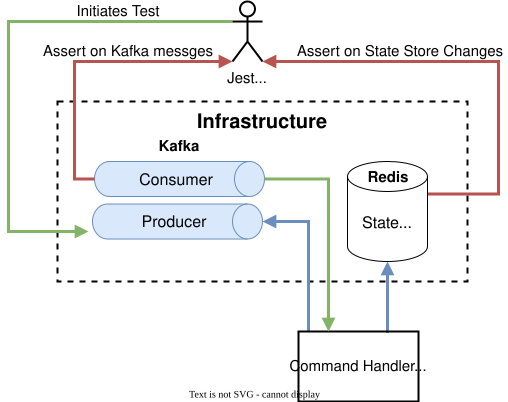
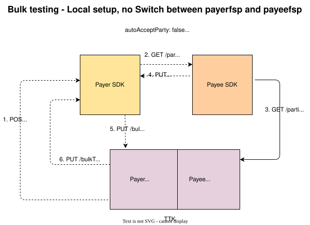

# SDK Compatibilidad con transferencias masivas: pruebas
## Estrategia de pruebas
La calidad de la solución entregada depende directamente de la calidad de las pruebas y de la estrategia de pruebas adoptada. El carácter distribuido de esta solución de «event sourcing» influyó en la estrategia de pruebas elegida. Se crearon varios tipos de pruebas, cada una de las cuales complementaba a las demás y estaba diseñada para detectar errores lo antes posible.

Tanto el gestor de eventos «Command» como el gestor de eventos de dominio cuentan con pruebas unitarias y pruebas de integración limitadas como base de las pruebas. Los componentes «FSPIOP API» y «backend API» solo cuentan con pruebas unitarias.
Se hizo especial hincapié en las pruebas funcionales, con las que se comprobó el funcionamiento conjunto de los cuatro componentes tanto en escenarios de caso de éxito como en escenarios de fallo.

### Pruebas de integración específicas
Estas pruebas se han redactado en tono jocoso y verifican, por ejemplo, el estado actualizado del almacén y los eventos generados a partir de un evento de comando.

**Banco de pruebas para la integración del gestor de comandos**

### El conjunto de pruebas funcionales
La prueba funcional utiliza el TTK, que simula los backends tanto del Pagador como del Beneficiario DFSP. 

:::tip Nota
Este conjunto de pruebas comprueba tanto al Pagador n.º SDK como al Beneficiario n.º SDK.
:::

:::tip Nota
Estas pruebas pueden ejecutarse en el monorepo local del que se ha realizado el check-out, se ejecutan en el proceso de integración continua (CI) y se incluyen en Helm como pruebas de Helm que se utilizan para confirmar el Despliegue.
:::

## Matriz de pruebas de integración del pagador DFSP

| Casos de prueba | C1 | C2 | C3 | C4 | C5 | C6 | C7 | C8 | C9 | C10 | C11 | C12 |
|---|---|---|---|---|---|---|---|---|---|---|---|---|
| INT D-1 |||| x |||||||||
| INT D-2 || x |||||||||||
| INT D-3 || x |||||||||||
| INT D-4 | x ||||||||||||
| INT D-5 ||| x ||||||||||
| INT D-6 ||| x ||||||||||
| INT A-1 |||||| x |||||||
| INT A-2 ||||| x ||||||||
| INT T-1 ||||||||||| x ||
| INT T-2 |||||||||| x |||
| INT T-3 ||||||||| x ||||
| INT T-4 ||||||||||| x ||
| INT T-5 ||||||| x ||||||
| INT T-6 |||||||||||| x |

## Matriz de pruebas funcionales del pagador DFSP

| Casos de prueba | B1 | B2 | B3 | B4 | B5 | F1 | F2 | F3 | F4 | F5 | F6 | F7 | F8 | F9 | D1 | D2 | D3 | D4 | D5 | D6 | D7 | D8 | D9 | D10 | D11 | D12 | D13 | D14 | D15 | D16 | D17 | D18 | D19 | D20 | C1 | C2 | C3 | C4 | C5 | C6 | C7 | C8 | C9 | C10 | C11 | C12 |
|---|---|---|---|---|---|---|---|---|---|---|---|---|---|---|---|---|---|---|---|---|---|---|---|---|---|---|---|---|---|---|---|---|---|---|---|---|---|---|---|---|---|---|---|---|---|---|
| FUNC 1 | x | x | x | x | x | x | x || x | x || x | x || x | x | x | x | x | x | x | x | x | x | x | x | x ||| x | x | x | x | x | x | x | x | x | x | x | x || x | x | x | x 
| FUNC 2 | x | x |||| x || x ||||||| x | x | x | x | x |||||||||||||||| x | x | x |||||||||
| FUNC 3 | x | x |||| x || x ||||||| x | x | x | x | x |||||||||||||||| x | x | x |||||||||
| FUNC 4 | x | x |||| x || x ||||||| x | x | x | x | x |||||||||||||||| x | x | x |||||||||
| FUNC 5 | x | x |||| x || x ||||||| x | x | x | x | x |||||||||||||||| x | x | x |||||||||
| FUNC 6 | x | x |||| x || x ||||||| x | x | x | x | x |||||||||||||||| x | x | x |||||||||
| TC-BQ1 | x | x | x ||| x | x || x || x |||| x | x | x | x | x | x | x | x | x | x ||||||||||| x | x | x | x | x | x ||||| x | x 
| TC-BQ2 | x | x | x ||| x | x || x | x ||||| x | x | x | x | x | x | x | x | x | x ||||||||||| x | x | x | x | x | x ||||| x | x 
| TC-BQ3 | x | x | x ||| x | x || x | x ||||| x | x | x | x | x | x | x | x | x | x | x |||||||||| x | x | x | x | x | x ||||||
| TC-BQ4 | x | x | x ||| x | x || x | x ||||| x | x | x | x | x | x | x | x | x | x | x |||||||||| x | x | x | x | x | x ||||||
| TC-BQ5 | x | x | x ||| x | x || x | x ||||| x | x | x | x | x | x | x | x | x | x | x |||||||||| x | x | x | x | x | x ||||||
| TC-BQ6 | x | x | x ||| x | x || x | x ||||| x | x | x | x | x | x | x | x | x | x | x |||||||||| x | x | x | x | x | x ||||||
| TC-BQ7 | x | x | x ||| x | x || x | x ||||| x | x | x | x | x | x | x | x | x | x | x |||||||||| x | x | x | x | x | x ||||||
| TC-BQ8 | x | x | x ||| x | x || x | x ||||| x | x | x | x | x | x | x | x | x | x | x |||||||||| x | x | x | x | x | x ||||||
| TC-BQ9 | x | x | x ||| x | x || x | x | x |||| x | x | x | x | x | x | x | x | x | x | x |||||||||| x | x | x | x | x | x ||||||
| TC-BQ10 | x | x | x ||| x | x || x || x |||| x | x | x | x | x | x | x | x | x | x ||||||||||| x | x | x | x | x | x ||||| x | x |
| TC-BQ11 | x | x | x ||| x | x || x | x ||||| x | x | x | x | x | x | x | x | x | x | x |||||||||| x | x | x | x | x | x |||||||
| TC-BQ13 | x | x | x ||| x | x || x | x ||||| x | x | x | x | x | x | x | x | x | x | x |||||||||| x | x | x | x | x | x |||||||
| TC-BT1 | x | x | x | x | x | x | x || x | x || x || x | x | x | x | x | x | x | x | x | x | x | x | x | x ||| x | x |||| x | x | x | x | x | x | x || x | x | x | x |
| TC-BT2 | x | x | x | x | x | x | x || x | x || x || x | x | x | x | x | x | x | x | x | x | x | x | x | x ||| x | x |||| x | x | x | x | x | x | x || x | x | x | x |
| TC-BT3 | x | x | x | x | x | x | x || x | x | x | x || x | x | x | x | x | x | x | x | x | x | x | x | x | x ||| x | x |||| x | x | x | x | x | x | x || x | x | x | x |
| TC-BT4 | x | x | x | x | x | x | x || x | x | x | x || x | x | x | x | x | x | x | x | x | x | x | x | x | x ||| x | x |||| x | x | x | x | x | x | x || x | x | x | x |
| TC-BT5 | x | x | x | x | x | x | x || x | x || x || x | x | x | x | x | x | x | x | x | x | x | x | x | x ||| x | x |||| x | x | x | x | x | x | x || x | x | x | x |
| TC-BT6 | x | x | x | x | x | x | x || x | x || x || x | x | x | x | x | x | x | x | x | x | x | x | x | x ||| x | x |||| x | x | x | x | x | x | x || x | x | x | x |
| TC-BT7 | x | x | x | x | x | x | x || x | x || x || x | x | x | x | x | x | x | x | x | x | x | x | x | x ||| x | x |||| x | x | x | x | x | x | x || x | x | x | x |
| TC-BT8 | x | x | x | x | x | x | x || x | x || x || x | x | x | x | x | x | x | x | x | x | x | x | x | x ||| x | x |||| x | x | x | x | x | x | x || x | x | x | x |

## Referencia de características del pagador DFSP
|#|Funcionalidades de salida|Detalles|
|---|---|---|
|B1|Backend API|POST /bulkTransactions SDKBulkRequest|
|B2|Backend API|Event SDKOutboundBulkAcceptPartyInfoRequested|
|B3|Backend API|PUT /bulkTransactions/{bulkTransactionId} Accept Parte|
|B4|Backend API|PUT /bulkTransactions/{bulkTransactionId} Aceptar cotización|
|B5|Backend API|Resultados de la solicitud PUT a /bulkTransactions/{bulkTransactionId}|
|F1|FSPIOP API|GET /parties|
|F2|FSPIOP API|PUT /parties/{Type}/{ID}|
|F3|FSPIOP API|PUT /parties/{Type}/{ID}/error|
|F4|FSPIOP API|POST /bulkQuotes|
|F5|FSPIOP API|PUT /bulkQuotes/{ID}|
|F6|FSPIOP API|PUT /bulkQuotes/{ID}/error|
|F7|FSPIOP API|POST /bulkTransfers|
|F8|FSPIOP API|PUT /bulkTransfers/{ID}|
|F9|FSPIOP API|PUT /bulkTransfers/{ID}/error|
|D1|Manejador de eventos de dominio|SDKOutboundBulkRequestReceived|
|D2|Manejador de eventos de dominio|SDKOutboundBulkPartyInfoRequested|
|D3|Manejador de eventos de dominio|PartyInfoCallbackReceived|
|D4|Manejador de eventos de dominio|PartyInfoCallbackProcessed|
|D5|Manejador de eventos de dominio|SDKOutboundBulkPartyInfoRequestProcessed|
|D6|Manejador de eventos de dominio|SDKOutboundBulkAcceptPartyInfoReceived|
|D7|Manejador de eventos de dominio|SDKOutboundBulkAutoAcceptPartyInfoRequested|
|D8|Manejador de eventos de dominio|SDKOutboundBulkAcceptPartyInfoProcessed|
|D9|Manejador de eventos de dominio|BulkQuotesCallbackReceived|
|D10|Manejador de eventos de dominio|BulkQuotesCallbackProcessed|
|D11|Manejador de eventos de dominio|SDKOutboundBulkQuotesRequestProcessed|
|D12|Manejador de eventos de dominio|SDKOutboundBulkAcceptQuoteReceived|
|D13|Manejador de eventos de dominio|SDKOutboundBulkAcceptQuoteProcessed|
|D14|Manejador de eventos de dominio|SDKOutboundBulkAutoAcceptQuoteRequested|
|D15|Manejador de eventos de dominio|SDKOutboundBulkAutoAcceptQuoteProcessed|
|D16|Manejador de eventos de dominio|BulkTransfersCallbackReceived|
|D17|Manejador de eventos de dominio|BulkTransfersCallbackProcessed|
|D18|Manejador de eventos de dominio|SDKOutboundBulkTransfersRequestProcessed|
|D19|Manejador de eventos de dominio|SDKOutboundBulkResponseSent|
|D20|Manejador de eventos de dominio|SDKOutboundBulkResponseSentProcessed|
|C1|Manejador de eventos de comando|ProcessSDKOutboundBulkRequest|
|C2|Manejador de eventos de comando|ProcessSDKOutboundBulkPartyInfoRequest|
|C3|Manejador de eventos de comando|ProcessPartyInfoCallback|
|C4|Manejador de eventos de comando|ProcessSDKOutboundBulkAcceptPartyInfo|
|C5|Manejador de eventos de comando|ProcessSDKOutboundBulkQuotesRequest|
|C6|Manejador de eventos de comando|ProcessBulkQuotesCallback|
|C7|Manejador de eventos de comando|ProcessSDKOutboundBulkAcceptQuote|
|C8|Manejador de eventos de comando|ProcessSDKOutboundBulkAutoAcceptQuote|
|C9|Manejador de eventos de comando|ProcessSDKOutboundBulkTransfersRequest|
|C10|Manejador de eventos de comando|ProcessBulkTransfersCallback|
|C11|Manejador de eventos de comando|PrepareSDKOutboundBulkResponse|
|C12|Manejador de eventos de comando|ProcessSDKOutboundBulkResponseSent|

## Referencia de casos de prueba

| Grupo | # caso de prueba | Tipo de prueba | Estado | Detalle |
|--- |--- |--- |--- |--- |
| **Discovery** - Pruebas de integración del gestor de comandos |||||
| (process_bulk_accept_party_info.test.ts) | INT D-1 | Integración | Pase | Si se recibe el evento de comando entrante «ProcessSDKOutboundBulkAcceptPartyInfo», la lógica debe recorrer cada una de las transferencias de la solicitud masiva y actualizar el estado de cada transferencia a «DISCOVERY_ACCEPTED» o «DISCOVERY_REJECTED» en función del valor del evento entrante, así como actualizar el estado global general a «DISCOVERY_ACCEPTANCE_COMPLETED. Además, se debe publicar el evento de salida «SDKOutboundBulkAcceptPartyInfoProcessed». |
| (process_bulk_party_info_request.test.ts) | INT D-2 | Integración | Pase | Siempre que aún no exista información sobre la parte para ninguna de las transferencias individuales. Y si no se omite la búsqueda de la parte al recibir el evento de comando entrante ProcessSDKOutboundBulkPartyInfoRequest, entonces el estado global deberá actualizarse a DISCOVERY_PROCESSING y deberá publicarse el evento de Kafka «PartyInfoRequested» para cada transferencia individual. Además, el estado de cada transferencia individual deberá actualizarse a DISCOVERY_PROCESSING. |
| (process_bulk_party_info_request.test.ts) | INT D-3 | Integración | Pase | Se dispone de información sobre las partes para las transferencias individuales. Y no se omite la búsqueda de partes cuando se recibe el evento de comando entrante ProcessSDKOutboundBulkPartyInfoRequest, entonces el estado global debe actualizarse a DISCOVERY_PROCESSING. Además, no debe publicarse el evento saliente PartyInfoRequested para cada transferencia individual. Y el estado de cada transferencia individual debe actualizarse a RECEIVED. |
| (process_bulk_request.test.ts) | INT D-4 | Integración | Pase | Cuando se reciba el evento de comando entrante «ProcessSDKOutboundBulkRequest», se deberá publicar el evento saliente «SDKOutboundBulkPartyInfoRequested» y se deberá actualizar el estado global a «RECEIVED». |
| (process_party_info_callback.test.ts) | INT D-5 | Integración | Pase | Dado que la información del destinatario no existe y la búsqueda del destinatario se ha realizado con éxito, cuando se reciba el evento de comando entrante `ProcessPartyInfoCallback`, se deberá actualizar el estado de las búsquedas individuales de destinatarios realizadas con éxito a `DISCOVERY_SUCCESS`. Asimismo, se deberán actualizar los datos en Redis correspondientes a la transferencia individual con la información del destinatario recibida. Se deberá publicar el evento saliente `PartyInfoCallbackProcessed` publicarse; y si todas las búsquedas están incompletas, no debe publicarse el evento de salida «ProcessSDKOutboundBulkPartyInfoRequestProcessed»; y tampoco deben publicarse los eventos de salida «SDKOutboundBulkAutoAcceptPartyInfoRequested»/«SDKOutboundBulkAutoAcceptPartyInfoRequested». |
| (process_party_info_callback.test.ts) | INT D-6 | Integración | Pase | Si la información del destinatario no existe y la búsqueda del destinatario se ha realizado correctamente, cuando se reciba el evento de comando entrante `ProcessPartyInfoCallback`, se deberá actualizar el estado de las búsquedas individuales de destinatarios que hayan tenido éxito a `DISCOVERY_SUCCESS`. Asimismo, se deberán actualizar los datos en Redis correspondientes a la transferencia individual con la información del destinatario recibida. Se deberá publicar el evento saliente `PartyInfoCallbackProcessed` publicarse. Y, si se han completado todas las búsquedas, deberá publicarse el evento de salida «ProcessSDKOutboundBulkPartyInfoRequestProcessed». Y, si la aceptación automática del destinatario es «false», deberá publicarse el evento de salida «SDKOutboundBulkAcceptPartyInfoRequested». |
| **Acuerdo** - Pruebas de integración del gestor de comandos |||||
| (process_bulk_quotes_callback.test.ts) | INT A-1 | Integración | Pase | Dada la transacción masiva (BulkTransaction) con las siguientes opciones: { synchronous: false, onlyValidateParty: true, skipPartyLookup: false, autoAcceptParty: false, autoAcceptQuote: false } Y la llamada de retorno para el lote de cotizaciones se ha realizado con éxito, y dicha llamada de retorno contiene una combinación de respuestas de éxito y de fallo para las cotizaciones individuales; cuando se reciba el evento de comando entrante «ProcessBulkQuotesCallback», la lógica deberá actualizar el estado individual del lote a «AGREEMENT_COMPLETED» o «AGREEMENT_FAILED»; y, para cada transferencia individual del lote, el estado podría ser AGREEMENT_SUCCESS o AGREEMENT_FAILED, según corresponda. Además, los datos de cada cotización en Redis deben actualizarse con la respuesta. El estado global de BulkTransaction debe ser AGREEMENT_ACCEPTANCE_PENDING. Se debe publicar el evento de dominio BulkQuotesCallbackProcessed. Y el evento de dominio SDKOutboundBulkQuotesRequestProcessed debe publicarse |
| (process_bulk_quotes_callback.test.ts) | INT A-2 | Integración | Pase | Cuando se reciba el evento de comando entrante «ProcessSDKOutboundBulkQuotesRequest», la lógica deberá actualizar el estado global a «AGREEMENT_PROCESSING», y crear lotes a partir de FSP que se encuentren en el estado DISCOVERY_ACCEPTED y que, además, cumplan con la configuración maxEntryConfigPerBatch; y publicar BulkQuotesRequested para cada lote; y actualizar el estado de cada lote a AGREEMENT_PROCESSING. |
| **Transferencias** - Pruebas de integración del gestor de comandos |||||
| (prepare_sdk_outbound_bulk_response.test.ts) | INT T-1 | Integración | Pase | Dada la transacción masiva (BulkTransaction) con las siguientes opciones: { synchronous: false, onlyValidateParty: true, skipPartyLookup: false, autoAcceptParty: false, autoAcceptQuote: false } Cuando se reciba el evento de comando entrante «PrepareSDKOutboundBulkResponseCmdEvt», se deberá publicar el evento «SDKOutboundBulkResponsePreparedDmEvt» para cada lote de transferencia y se deberá actualizar el estado global de la Transacción masiva a «RESPONSE_PROCESSING» |
| (process_bulk_transfers_callback.test.ts) | INT T-2 | Integración | Pase | Dada la transacción masiva (BulkTransaction) con las siguientes opciones: { synchronous: false, onlyValidateParty: true, skipPartyLookup: false, autoAcceptParty: false, autoAcceptQuote: false } Cuando se reciba el evento de comando entrante ProcessBulkTransfersCallbackCmdEvt, el estado del lote de transferencias deberá actualizarse a TRANSFERS_COMPLETED. Los estados de las cotizaciones fallidas deberán permanecer en AGREEMENT_FAILED. Además, la lógica deberá recorrer las transferencias individuales del lote y actualizar su estado a TRANSFER_SUCCESS o TRANSFER_FAILED. Además, se debe publicar el evento de dominio `BulkTransferProcessedDmEvt` para cada lote de transferencias. Asimismo, se debe publicar el evento de dominio `BulkQuotesCallbackProcessed`. Asimismo, se debe publicar el evento de dominio `SDKOutboundBulkQuotesRequestProcessed`. Asimismo, se debe publicar el evento de dominio `SDKOutboundBulkAutoAcceptQuoteProcessedDmEvt`. Y debería publicarse el evento de dominio «BulkTransfersRequestedDmEvt»; además, debería publicarse el evento de dominio «BulkTransfersCallbackProcessed»; y, por último, debería publicarse el evento de dominio «SDKOutboundBulkTransfersRequestProcessed». |
| (process_bulk_transfers_request.test.ts) | INT T-3 | Integración | Pase | Dada la transacción masiva (BulkTransaction) con las siguientes opciones: { synchronous: false, onlyValidateParty: true, skipPartyLookup: false, autoAcceptParty: false, autoAcceptQuote: false } y la llamada de retorno para el lote de cotizaciones se ha realizado con éxito, y la llamada de retorno contiene una combinación de respuestas de éxito y de fallo para las cotizaciones individuales; cuando se reciba el evento de comando entrante ProcessSDKOutboundBulkTransfersRequestCmdEvt, el estado global de la transacción masiva deberá actualizarse a TRANSFERS_PROCESSING, y el estado de cada lote individual deberá ser TRANSFERS_PROCESSING o TRANSFERS_FAILED. Además, para cada transferencia individual del lote, el estado debe ser AGREEMENT_ACCEPTED o AGREEMENT_REJECTED, dependiendo de si acceptQuotes = TRUE o FALSE, y, para cada transferencia individual que se encuentre en estado «AGREEMENT_FAILED», este no debe modificarse, y los datos de cada cotización en Redis deben actualizarse con la respuesta; además, debe publicarse el evento de dominio «BulkQuotesCallbackProcessed»; debe publicarse el evento de dominio «SDKOutboundBulkQuotesRequestProcessed»; debe publicarse el evento de dominio «SDKOutboundBulkAutoAcceptQuoteProcessedDmEvt»; y debe publicarse el evento de dominio «BulkTransfersRequested»DmEvt debe publicarse |
| (process_prepare_bulk_response.test.ts) | INT T-4 | Integración | Pase | Cuando se reciba el evento de comando entrante «PrepareSDKOutboundBulkResponseCmdEvt», se deberá publicar el evento «SDKOutboundBulkResponsePreparedDmEvnt» |
| (process_sdk_outbound_bulk_accept_quote.test.ts) | INT T-5 | Integración | Pase | Dada la transacción masiva (BulkTransaction) con las siguientes opciones: { synchronous: false, onlyValidateParty: true, skipPartyLookup: false, autoAcceptParty: false, autoAcceptQuote: false } y la llamada de retorno para el lote de cotizaciones se ha realizado con éxito, y la llamada de retorno contiene una combinación de respuestas de éxito y de fallo para las cotizaciones individuales; cuando se reciba el evento de comando entrante ProcessSDKOutboundBulkAcceptQuote, el estado global de la Transacción masiva deberá actualizarse a AGREEMENT_ACCEPTANCE_COMPLETED, y el estado individual del lote deberá ser AGREEMENT_COMPLETED o AGREEMENT_FAILED, y para cada transferencia individual del lote, el estado debe ser AGREEMENT_ACCEPTED o AGREEMENT_REJECTED, dependiendo de si acceptQuotes = TRUE/FALSE, y los datos individuales de la cotización en Redis deben actualizarse con la respuesta; además, debe publicarse el evento de dominio «BulkQuotesCallbackProcessed»; debe publicarse el evento de dominio «SDKOutboundBulkQuotesRequestProcessed»; debe publicarse el evento de dominio «SDKOutboundBulkAutoAcceptQuoteProcessedDmEvt»; y debe publicarse el evento de dominio «BulkTransfersRequested»DmEvt debe publicarse |
| (process_sdk_outbound_bulk_response_sent.test.ts)# | INT T-6 | Integración | Pase | Dada la transacción masiva (BulkTransaction) con las siguientes opciones: { synchronous: false, onlyValidateParty: true, skipPartyLookup: false, autoAcceptParty: false, autoAcceptQuote: false } Cuando se reciba el evento de comando entrante ProcessSDKOutboundBulkResponseSentCmdEvt, y se deberá publicar el evento SDKOutboundBulkResponseSentProcessedDmEvt para cada lote de transferencia, y se deberá actualizar el estado global de la Transacción masiva a RESPONSE_SENT |
| **Ruta normal:** (bulk-happy-path.json) |||||
| - 1 transferencia con los parámetros «acceptParty» y «acceptQuote» establecidos en «true» |||||
|| TC-BHP1 | Funcional | Pase | 4 transferencias a 2 DFSP, con «acceptParty» y «acceptQuote» establecidas en «true» |
|| TC-BHP2 | Validación | Pase | Transacción masiva con un error de formato |
| **Errores relacionados con las partes:** (bulk-parties-error-cases.json) |||||
| - 1 transferencia incluida en la solicitud |||||
|| TC-BP1 | Funcional | Pase | El receptor envía un mensaje de error ante la respuesta de la parte contraria |
|| TC-BP2 | Funcional | Pase | Tiempo de espera del receptor |
|| TC-BP3 | Funcional | Pase | skipPartyLookup es «false» y la información del destinatario figura en la solicitud. |
| - 2 transferencias incluidas en la solicitud |||||
|| TC-BP4 | Funcional | Pase | El receptor envía una respuesta de error para una de las transferencias |
|| TC-BP5 | Funcional | Pase | El receptor agota el tiempo de espera al enviar la respuesta a la solicitud de transferencia de una de las transferencias |
|| TC-BP6 | Funcional | Pase | No se ha recibido ninguna respuesta del destinatario en ninguna de las dos transferencias |
| **Errores en las comillas:** (bulk-quotes-error-cases.json) |||||
| - 2 transferencias con el mismo identificador FSP del destinatario |||||
| - «acceptParty» para todas las transferencias |||||
|| TC-BQ1 | Funcional | Pase | El receptor FSP rechaza todo el lote |
|| TC-BQ2 | Funcional | Pase | El receptor FSP agota el tiempo de espera de todo el lote |
|| TC-BQ3 | Funcional | Pase | El receptor FSP envía solo una respuesta y omite la otra |
|| TC-BQ4 | Funcional | Fuera del ámbito de aplicación del MVP | El receptor FSP envía una respuesta de éxito y una de error (No implementado - Incidencia 3015) |
| - acceptParty variable |||||
|| TC-BQ5 | Funcional | Pase | Una verdadera, una falsa |
|| TC-BQ6 | Funcional | Fuera del ámbito de aplicación del MVP | Aceptar «parte» como falso para todas las respuestas; en ese caso, solo se mostrarán los datos de la parte y no se mostrará la respuesta a la solicitud de cotización, y el estado final será «COMPLETADO» (No implementado — Incidencia 3015) |
|| TC-BQ7 | Funcional | Fuera del ámbito de aplicación del MVP | Solo se envía «True» para una cotización en PUT /bulkTxn acceptParty, ignorándose la segunda (No implementado - Incidencia 3015) |
|| TC-BQ8 | Funcional | Fuera del ámbito de aplicación del MVP | Solo se envía «false» para una cotización en PUT /bulkTxn acceptParty, ignorándose la segunda — (Sin implementar — Incidencia 3015) |
| - 2 transferencias con ID de FSP de destinatario diferentes - «acceptParty» para todas las transferencias |||||
|| TC-BQ9 | Funcional | Pase | Un lote genera un error |
|| TC-BQ10 | Funcional | Pase | Ambos lotes dan error |
|| TC-BQ11 | Funcional | Pase | Se agota el tiempo de espera de un lote |
| - 3 transferencias, de las cuales 2 tienen un ID de destinatario FSP y la otra tiene uno diferente |||||
|| TC-BQ12 | Funcional | Fuera del ámbito de aplicación del MVP | - El lote con dos transferencias envía únicamente una respuesta a la solicitud de transferencia, mientras que el otro lote envía la respuesta de éxito (sin implementar —incidencia n.º 3015—) |
|| TC-BQ13 | Funcional | Fuera del ámbito de aplicación del MVP | Error en el Switch debido a una moneda no admitida - (problema - |
| **Errores en las transferencias:** (bulk-transfer-errors.json) |||||
| - Una operación «bulkTransfer» con 2 transferencias |||||
| - «acceptQuote» para todas las transferencias |||||
|| TC-BT1 | Funcional | Pase | El receptor rechaza todo el lote |
|| TC-BT2 | Funcional | Pase | El receptor agota el tiempo de espera para todo el lote |
|| TC-BT3 | Funcional | Fuera del ámbito de aplicación del MVP | El receptor FSP envía solo una respuesta y omite la otra (No implementado - Incidencia 3015) |
|| TC-BT4 | Funcional | Fallos intermitentes | El receptor FSP envía una respuesta de éxito y otra de error - (Incidencia: 3019) |
| - acceptQuote variable |||||
|| TC-BT5 | Funcional | Fuera del ámbito de aplicación del MVP | Una verdadera, una falsa - TC2 - Error 2958 |
|| TC-BT6 | Funcional | Fuera del ámbito de aplicación del MVP | Aceptar cotización - Todo falso (No implementado - Incidencia 3015) |
|| TC-BT7 | Funcional | Fuera del ámbito de aplicación del MVP | El valor «True» solo se envía para una transferencia en PUT /bulkTxn acceptParty, ignorándose la segunda — (Sin implementar — Incidencia 3015) |
|| TC-BT8 | Funcional | Fuera del ámbito de aplicación del MVP | Solo se envía «false» para una transferencia en «PUT /bulkTxn acceptParty», ignorándose la segunda — (Sin implementar — Incidencia 3015) |

