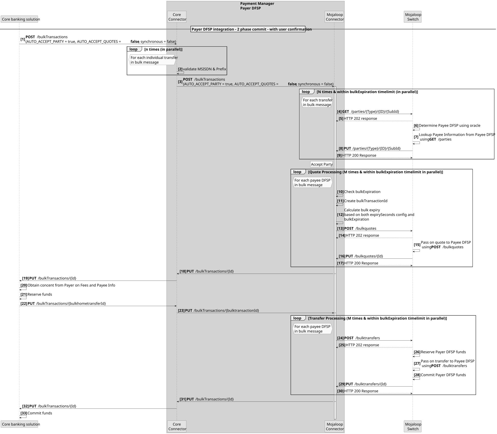
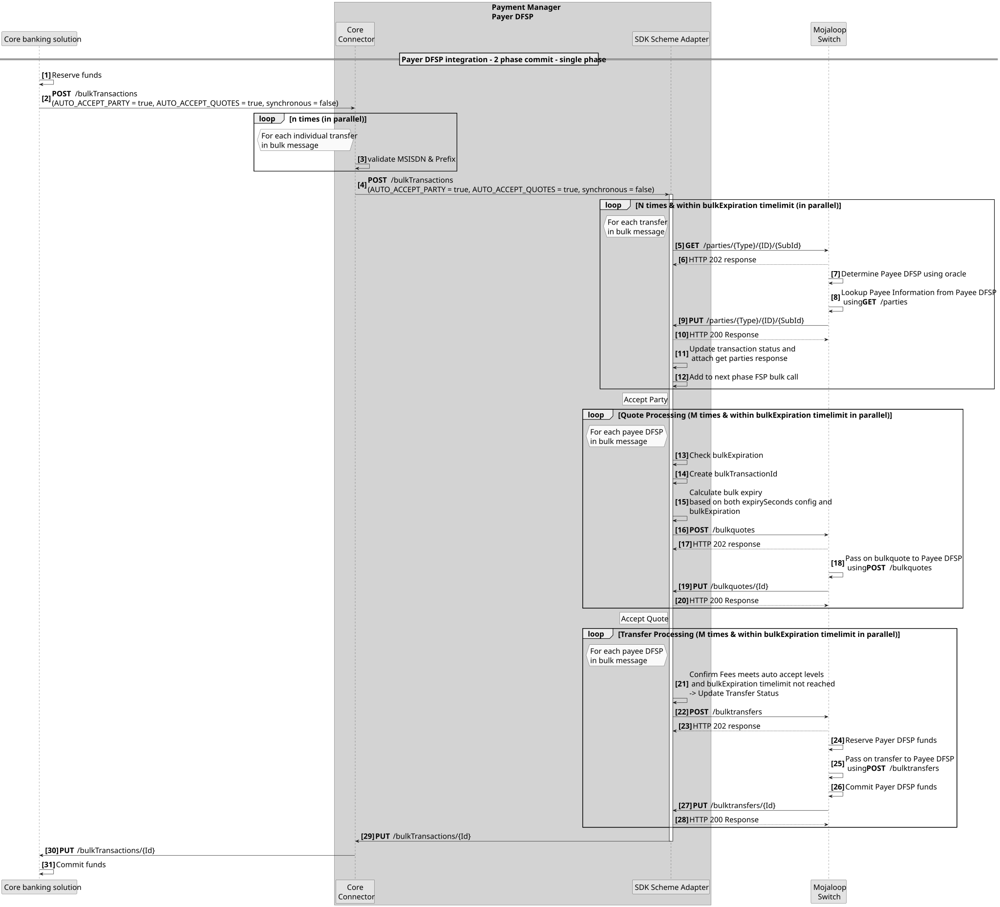
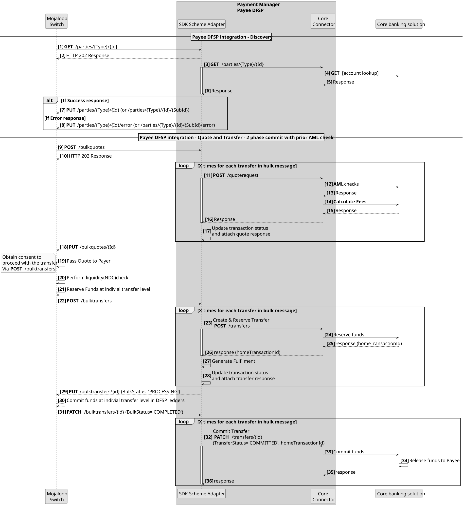
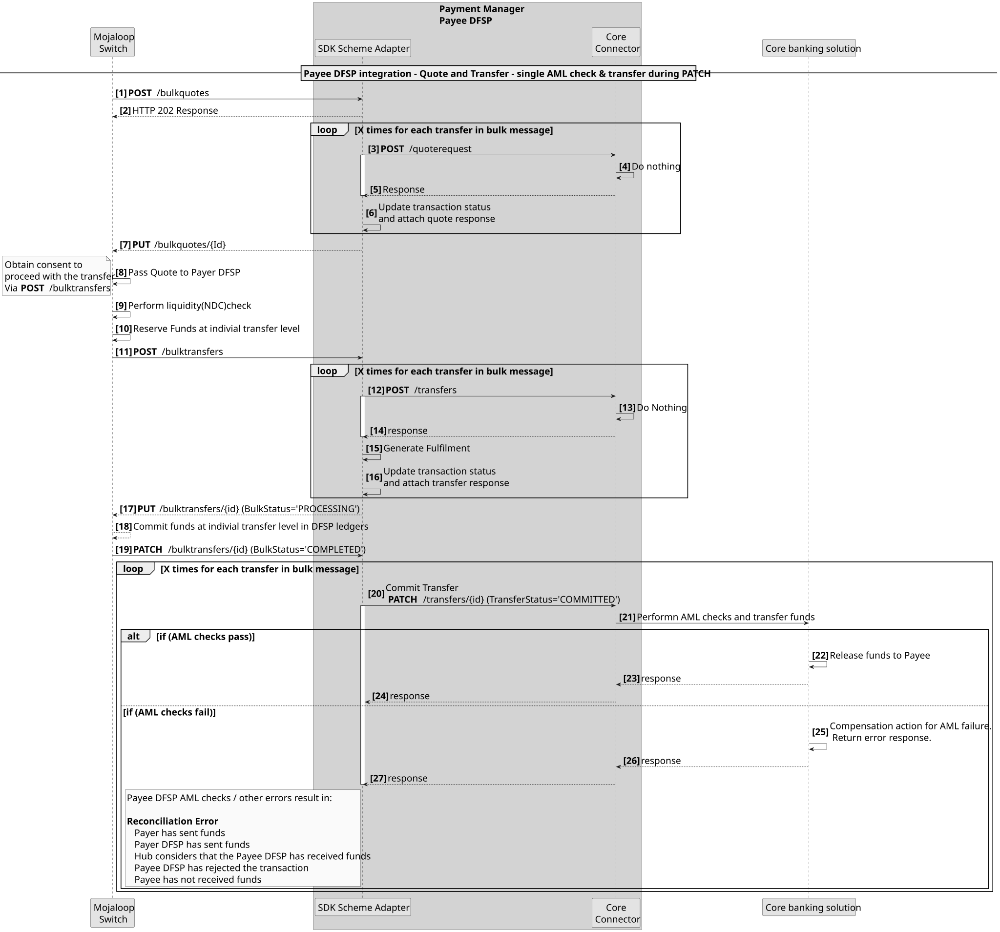

# Integración de sistemas de core bancario mediante transferencias masivas
Existen tres patrones que se pueden utilizar a la hora de desarrollar las integraciones del Pagador DFSP para transferencias masivas.
1. Integración de la transferencia en **tres fases**. Esto se ajusta a las tres fases de la transacción Mojaloop. Es decir: Fase de descubrimiento, Fase de acuerdo y Fase de transferencia.
1. **Integración «Double API»**. Este patrón se describe detalladamente en el diagrama de secuencia que figura a continuación. Consiste en combinar las fases de «Descubrimiento» y «Acuerdo» como primera fase; a continuación, los resultados se presentan al Pagador para su confirmación; tras lo cual se ejecuta la fase de «Transferencia» como segunda fase.

1. **Integración «API» única**. Este patrón se describe detalladamente en el diagrama de secuencia que figura a continuación. En este caso, las tres fases se combinan para generar una única llamada de transferencia síncrona.

::: tip Confirmación en dos fases
Todos los patrones de integración de DFSP admiten una confirmación en dos fases (fase de reserva y fase de confirmación).
:::

## Requisitos para el beneficiario n.º DFSP
Las actualizaciones del adaptador del esquema SDK garantizarán que DFSP, que han integrado el esquema Mojaloop, no tengan que realizar ningún cambio para poder gestionar la recepción de transferencias masivas. Es decir, el adaptador del esquema SDK recibirá los mensajes de transferencia masiva y los convertirá en mensajes de transferencia individuales.
Si un beneficiario DFSP desea hacer uso del mensaje de transferencia masiva, la integración para mensajes masivos podrá implementarse cuando resulte conveniente hacerlo para cada beneficiario DFSP.

## Modelo de flujo ideal para la integración de beneficiarios

En este caso, las comprobaciones de AML y las tarifas se calculan en la fase de acuerdo, y la fase de transferencia se lleva a cabo en dos etapas: la fase de reserva y la fase de confirmación (commit).

## El proveedor API solo admite una llamada «Single API»
Si los sistemas de core bancario solo admiten una única llamada «API» para llevar a cabo todas las comprobaciones y fases relacionadas con las transferencias, este es el patrón que se suele admitir con mayor frecuencia.
### Transferencia de llamada en la notificación de conexión

Cualquier fallo que se produzca en cualquier momento tras la Notificación PATCH **[Paso 19]** dará lugar a un error de Conciliación. Esto puede solucionarse incorporando métodos de compensación. Por ejemplo, iniciar una Transferencia de Reembolso si se produce un error después del paso 19.
