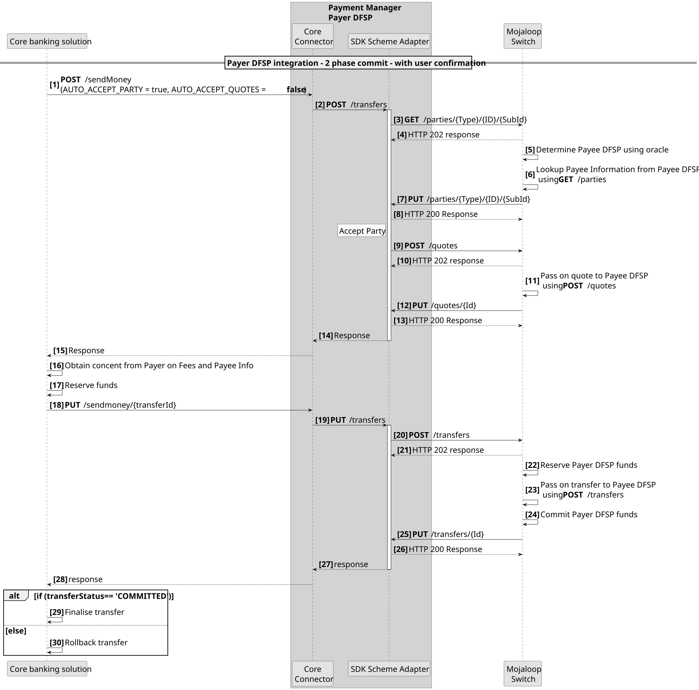
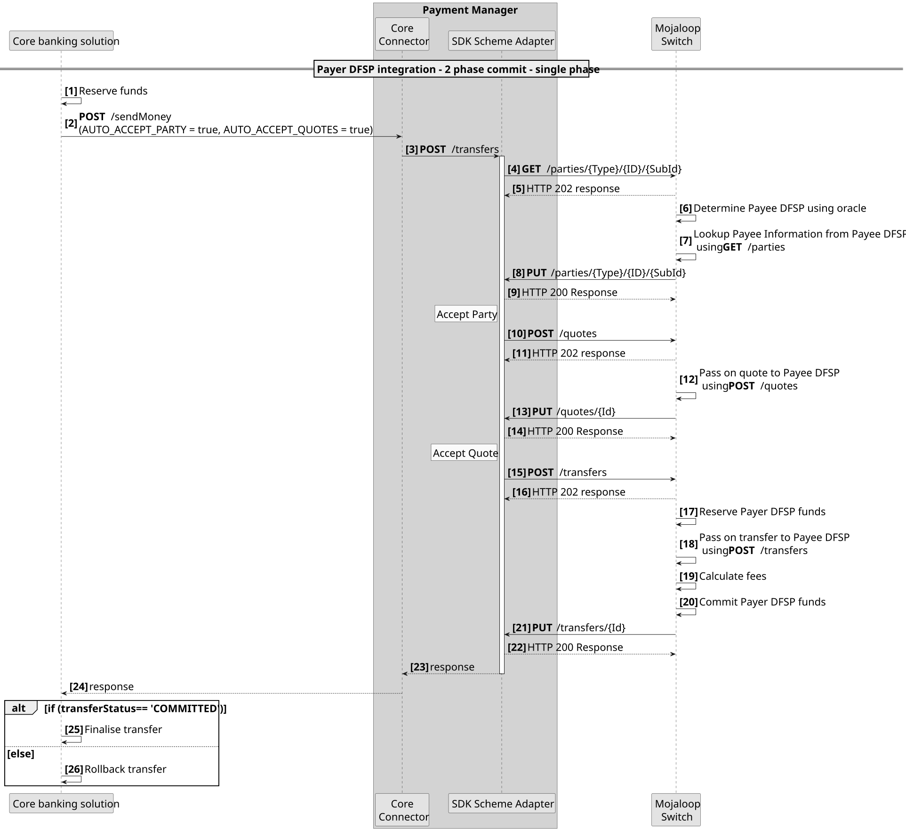
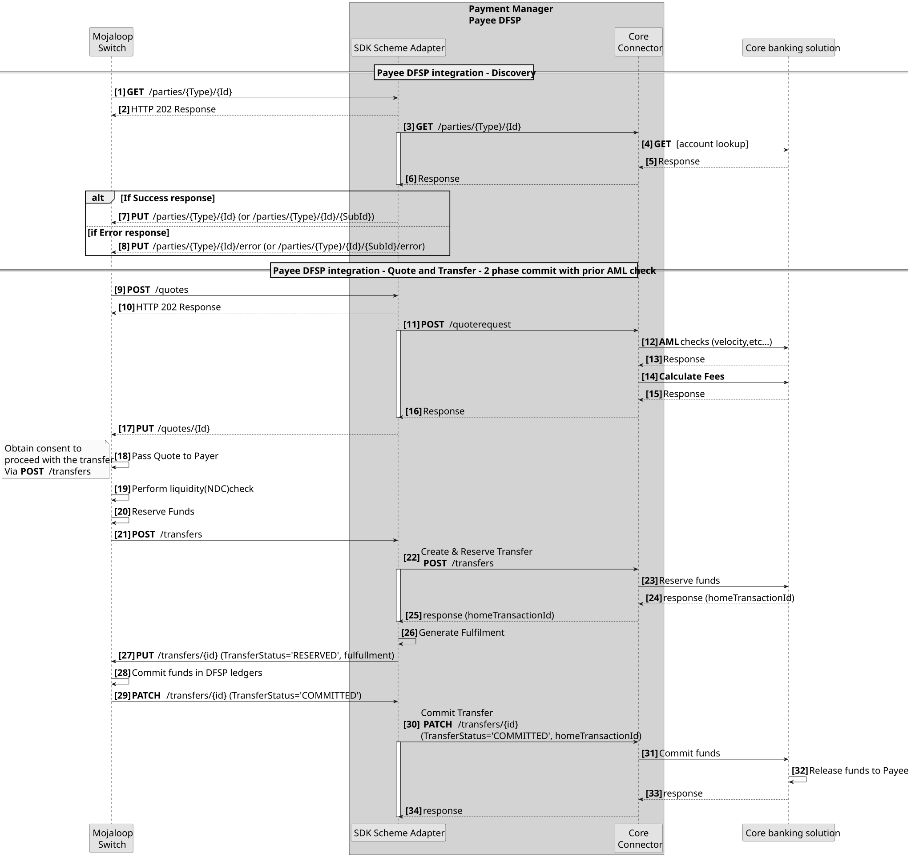
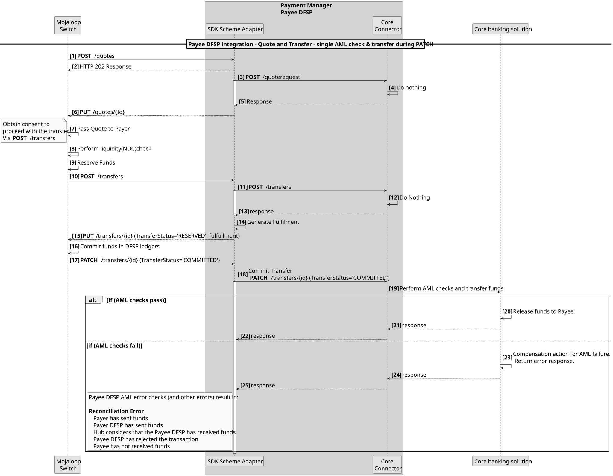
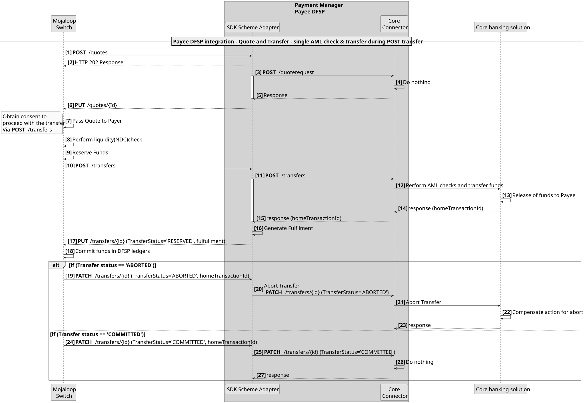

# Integración de los sistemas de core bancario con los patrones «Mojaloop»

La integración de un Sistema de core bancario en un flujo de transacciones moderno, en tiempo real y basado en notificaciones push puede plantear algunos retos. Estos dependen en gran medida de las API de integración que ofrezcan los proveedores. En este documento se analiza cómo debería ser una integración ideal, algunas de las limitaciones típicas que se observan en las soluciones del proveedor nAPI, así como los patrones de flujo que se utilizan para superar algunas de estas limitaciones y un análisis de los riesgos.

## Patrones de integración del Pagador DFSP

Existen tres patrones que pueden utilizarse a la hora de desarrollar las integraciones de Pagador DFSP
1. Integración de transferencia **en tres fases**. Esto se ajusta a las tres fases de la transacción Mojaloop: Descubrimiento, Acuerdo y Transferencia.
1. **Integración doble API**. Este patrón se describe detalladamente en el diagrama de secuencia que figura a continuación. Consiste en combinar las fases de descubrimiento y acuerdo como primera fase; a continuación, se presentan los resultados al Pagador para su confirmación; tras lo cual se ejecuta la Fase de transferencia como segunda fase.

1. **Integración única API**. Este patrón se describe detalladamente en el diagrama de secuencia que figura a continuación. En este caso, las tres fases se combinan para generar una única llamada de transferencia sincrónica.

::: tip Confirmación en dos fases
Todos los patrones de integración de DFSP admiten una confirmación en dos fases (fase de reserva y fase de confirmación).
:::

## Beneficiario DFSP: modelo de integración ideal
Lo ideal es que los «API» de un proveedor ofrezcan lo siguiente.
1. Para poder realizar comprobaciones en materia de prevención del blanqueo de capitales antes de la transferencia y con total independencia de esta.
1. Poder calcular las tarifas de una transferencia con antelación y con independencia de la propia transferencia.
1. Para poder realizar la transferencia en dos fases. Es decir, una fase de reserva y, a continuación, una fase de confirmación.

Si estos están disponibles en el «API» del proveedor, se puede crear una integración óptima que reduzca los errores de Conciliación cuando se produzcan errores inesperados y que suponga el menor riesgo posible para el «DFSP».

### Modelo de flujo ideal para la integración de beneficiarios

En este caso, las comprobaciones de AML y las tarifas se calculan en la Fase de acuerdo, y la Fase de transferencia se lleva a cabo en dos etapas: la fase de reserva y la fase de confirmación (commit).

::: warning Limitación habitual
Una limitación habitual en el proveedor n.º API es que todas estas funciones se combinan en una única llamada de fase única API para realizar una transferencia.
:::

## El proveedor API solo admite una llamada «Single API»
Si el Sistema de core bancario solo admite una única llamada al método `API` para llevar a cabo todas las comprobaciones y fases relacionadas con las transferencias, hay dos patrones que deben tenerse en cuenta.
1. Transferencia de llamada en la Notificación de conexión

Cualquier fallo que se produzca en cualquier momento tras la Notificación PATCH **[Paso 17]** dará lugar a un error de Conciliación. Esto puede solucionarse incorporando métodos de compensación. Por ejemplo, iniciar una Transferencia de Reembolso si se produce un error después del paso 17.
1. Transferencia de llamada en la fase de transferencia.

Por lo general, no se recomienda este procedimiento, ya que normalmente no es posible cancelar una transferencia. Sin embargo, si la transferencia se realiza a una cuenta interna —por ejemplo, para el reembolso de un préstamo—, este procedimiento resulta conveniente.
