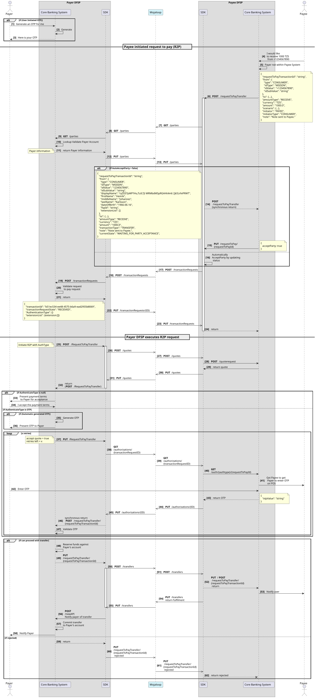

# Solicitud de pago (R2P): compatibilidad con casos de uso

Esta documentación describe cómo el adaptador de esquema SDK admite el caso de uso «solicitud de pago». El caso de uso «solicitud de pago» constituye la base de todas las transferencias iniciadas por el Beneficiario. La compatibilidad con este caso de uso requiere que cada DFSP de un Mojaloop procese automáticamente una transferencia una vez que se haya recibido y validado una solicitud para realizarla. Es importante que el adaptador SDK-scheme-adapter admita este caso de uso, ya que minimiza el esfuerzo de desarrollo que cada «DFSP» debe realizar si un esquema de pagos exige a los participantes que admitan este caso de uso. Este caso de uso resulta especialmente interesante desde el punto de vista de las pruebas, ya que permite realizar pruebas remotas tanto como Pagador «DFSP» como Beneficiario «DFSP».

> Importante:
>
> 1. No todas las funciones se han probado por completo ni se han adaptado a la Especificación FSPIOP; consulte la siguiente épica para conocer el estado de avance al respecto: [#3344 - Mejorar el adaptador del Esquema de pagos SDK para que admita el caso de uso «Solicitud de pago» case](https://github.com/mojaloop/project/issues/3344)];
> 2. Actualmente no existen pruebas de extremo a extremo que verifiquen la funcionalidad completa, incluida la Autenticación mediante OTP. Consulte la siguiente [colección de casos de prueba del Kit de herramientas de pruebas, versión release](https://github.com/mojaloop/testing-toolkit-test-cases/releases), para conocer lo que se prueba actualmente: [testing-toolkit-test-cases@v15.0.1](https://github.com/mojaloop/testing-toolkit-test-cases/releases/tag/v15.0.1); y
> 3. Es posible que no todos los casos de fallo se hayan implementado por completo. Consulte de nuevo la épica [#3344](https://github.com/mojaloop/project/issues/3344)].
>

## Diagrama de secuencia

1. El beneficiario DFSP inicia el caso de uso R2P mediante la llamada **POST** /RequestToPay API. 
2. El Beneficiario DFSP puede, si lo desea, validar al Pagador. 
3. El pagador DFSP ejecuta la solicitud R2P mediante una llamada **POST** /requestToPayTransfer API. Si no se especifica el tipo de autenticación en esta llamada, el flujo da por hecho que el Pagador confirmará la transferencia y las condiciones mediante una llamada **PUT** /requestToPayTransfer; de lo contrario, se ejecutará el flujo de autenticación correspondiente. 

El siguiente diagrama resume este proceso.

## Diagrama de secuencia detallado

A continuación se muestra un diagrama de secuencia más detallado del caso de uso «Solicitud de pago» y de las llamadas que realiza el adaptador de esquema de pagos «SDK» API.

