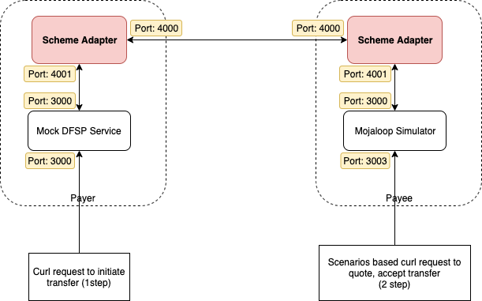
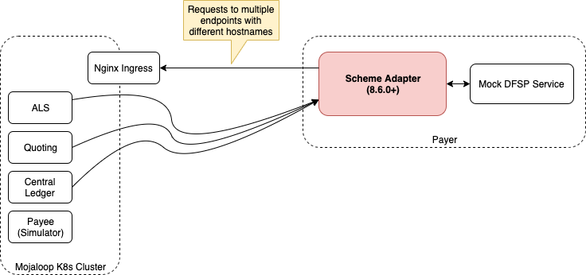
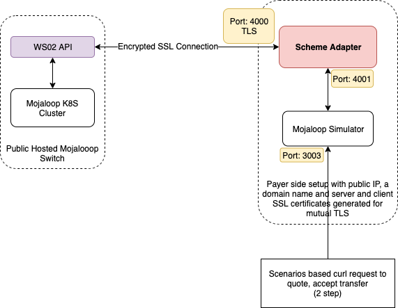

# Descripción general de los SDK escenarios de uso probados
Un adaptador de esquema es un servicio que actúa como interfaz entre un conmutador compatible con Mojaloop API y una plataforma de fondo DFSP que no implementa de forma nativa el Mojaloop API.

El API entre el adaptador de esquema y el backend DFSP es síncrono HTTP, mientras que la interfaz entre el adaptador de esquema y el Switch es la nativa Mojaloop API.

En este documento se describen diferentes configuraciones que un «DFSP» puede probar utilizando el adaptador de Esquema de pagos.

# Escenarios
Existen varios escenarios que hemos probado y documentado tal y como se indica a continuación.

* [[Adaptador Esquema de pagos + Backend simulado DFSP] -> [Adaptador Esquema de pagos + Simulador Mojaloop]](./scheme-adapter-to-scheme-adapter/README.md)
* [[Adaptador Scheme + Backend simulado DFSP] -> [Clúster local de K8S]](./scheme-adapter-and-local-k8s/README.md)
* [[Adaptador Scheme + Simulador Mojaloop] -> [Mojaloop Switch habilitado para WSO2 alojado en un servidor público]](./scheme-adapter-and-wso2-api-gateway/README.md)

## [Adaptador de esquema de pagos + backend simulado DFSP] -> [Adaptador de esquema de pagos + simulador Mojaloop]

El adaptador de esquema de pagos se puede utilizar junto con los backends simulados ya implementados: «Mock DFSP Backend» y «Mojaloop Simulator». A continuación se incluyen los enlaces a los repositorios.

https://github.com/mojaloop/sdk-mock-dfsp-backend.git

https://github.com/mojaloop/mojaloop-simulator.git

La idea consiste en combinar el adaptador Esquema de pagos con un backend simulado «DFSP» por un lado y con el simulador de Mojaloop por otro. Supongamos que, por un lado, se encuentra el DFSP pagador y, por otro, el DFSP beneficiario. Siguiendo este ejemplo, podrá enviar y recibir fondos de uno DFSP a otro.

Por favor, [haga clic aquí](./scheme-adapter-to-scheme-adapter/README.md)] para consultar la documentación.

## [Adaptador Scheme + Backend simulado DFSP] -> [Clúster local de K8S]

Si, por lo tanto, deseamos incluir un Switch entre los DFSP, podemos simular ese entorno utilizando un clúster local de K8S. Le rogamos que siga la documentación de incorporación del clúster local de K8S que encontrará aquí (https://mojaloop.io/documentation/deployment-guide/).

Por favor, [haga clic aquí](./scheme-adapter-and-local-k8s/README.md)] para consultar la documentación.

## [Adaptador Scheme + Simulador Mojaloop] -> [Mojaloop Switch alojado públicamente y compatible con WSO2]

Si dispone de acceso a WSO2 Mojaloop API, puede comprobarlo siguiendo la documentación que se indica a continuación. En los dos casos anteriores, no utilizamos la autenticación mediante token ni las funciones de cifrado SSL del adaptador de esquema. En esta sección vamos a utilizar dichas funciones.

Por favor, [haga clic aquí](./scheme-adapter-and-wso2-api-gateway/README.md)] para consultar la documentación.

