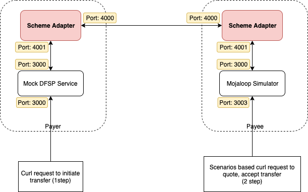

# Pruebas entre adaptadores Scheme

Una documentación detallada dirigida a los dfsps que deseen probar la transferencia de fondos de un adaptador de esquema de pagos a otro utilizando directamente los servicios de backend simulado y el simulador de Mojaloop.



## Requisito previo

* Simulador Mojaloop
* DFSP: servicio de backend simulado
* El adaptador de Esquema de pagos ya está incluido en ambos scripts de Docker Compose mencionados anteriormente

## Configuración e inicio de servicios

La idea consiste en ejecutar dos scripts de `docker-compose` en paralelo a partir de los dos Servicios mencionados anteriormente. Para evitar conflictos, debemos editar los archivos `docker-compose.yml` y especificar los nombres de los contenedores.

### Mojaloop Servicio de simulador

Le rogamos que descargue el repositorio del simulador «Mojaloop»
```
git clone https://github.com/mojaloop/mojaloop-simulator.git
```
* Edite el archivo «src/docker-compose.yml» y añada los nombres de todos los contenedores. Consulte las siguientes líneas

```
version: '3'
services:
  redis1:
    image: "redis:5.0.4-alpine"
    container_name: redis1
  sim:
    image: "mojaloop-simulator-backend"
    build: ../
    env_file: ./sim-backend.env
    container_name: ml_sim1
    ports:
      - "13000:3000"
      - "3001:3001"
      - "3003:3003"
    depends_on:
      - scheme-adapter
  scheme-adapter:
    image: "mojaloop/sdk-scheme-adapter:latest"
    env_file: ./scheme-adapter.env
    container_name: sa_sim1
    ports:
      - "13500:3000"
      - "14000:4000"
    depends_on:
      - redis1
```

* Edite el archivo «src/sim-backend.env» y modifique en él el nombre del contenedor del adaptador de Esquema de pagos. Consulte las siguientes líneas.

```
OUTBOUND_ENDPOINT=http://sa_sim1:4001
```

* Edite el archivo «src/scheme-adapter.env» y modifique los nombres de los contenedores del otro adaptador de esquema y del simulador de Mojaloop. Consulte las siguientes líneas

```
DFSP_ID=payeefsp
CACHE_HOST=redis1
PEER_ENDPOINT=sa_sim2:4000
BACKEND_ENDPOINT=ml_sim1:3000
AUTO_ACCEPT_PARTY=true
AUTO_ACCEPT_QUOTES=true
VALIDATE_INBOUND_JWS=false
VALIDATE_INBOUND_PUT_PARTIES_JWS=false
JWS_SIGN=true
JWS_SIGN_PUT_PARTIES=true

```

A continuación, intente ejecutar el siguiente comando para poner en marcha los Servicios
```
cd src/
docker-compose up -d
```

Ahora podemos acceder a la API de prueba del simulador de Mojaloop en el puerto 3003.

Se debe añadir una nueva parte al simulador mediante el siguiente comando. No dude en modificar los datos que desee.
```
curl -X POST "http://localhost:3003/repository/parties" -H "accept: */*" -H "Content-Type: application/json" -d "{\"displayName\":\"Test Payee1\",\"firstName\":\"Test\",\"middleName\":\"\",\"lastName\":\"Payee1\",\"dateOfBirth\":\"1970-01-01\",\"idType\":\"MSISDN\",\"idValue\":\"9876543210\"}"
```

A continuación, intente ejecutar el siguiente comando para comprobar que se ha añadido la nueva parte.
```
curl -X GET "http://localhost:3003/repository/parties" -H "accept: */*"
```

Pasemos ahora a configurar otra instancia del adaptador del Esquema de pagos con un backend simulado DFSP.

### DFSP Servicio de backend simulado

El backend de simulación «DFSP» es una implementación mínima del ejemplo «DFSP». Por el momento, solo admite funciones básicas.

Le rogamos que descargue el siguiente repositorio
```
git clone https://github.com/mojaloop/sdk-mock-dfsp-backend.git
```

Edite los archivos src/docker-compose.yml, src/backend.env y src/scheme-adapter.env y añada los nombres de todos los contenedores. Consulte los siguientes archivos.
docker-compose.yml
```
version: '3'
services:
  redis2:
    image: "redis:5.0.4-alpine"
    container_name: redis2
  backend:
    image: "mojaloop/sdk-mock-dfsp-backend"
    env_file: ./backend.env
    container_name: dfsp_mock_backend2
    ports:
      - "23000:3000"
    depends_on:
      - scheme-adapter2

  scheme-adapter2:
    image: "mojaloop/sdk-scheme-adapter:latest"
    env_file: ./scheme-adapter.env
    container_name: sa_sim2
    depends_on:
      - redis2
```
scheme-adapter.env
```
DFSP_ID=payerfsp
CACHE_HOST=redis2
PEER_ENDPOINT=sa_sim1:4000
BACKEND_ENDPOINT=dfsp_mock_backend2:3000
AUTO_ACCEPT_PARTY=true
AUTO_ACCEPT_QUOTES=true
VALIDATE_INBOUND_JWS=false
VALIDATE_INBOUND_PUT_PARTIES_JWS=false
JWS_SIGN=true
JWS_SIGN_PUT_PARTIES=true

```

backend.env
```
OUTBOUND_ENDPOINT=http://sa_sim2:4001
```

A continuación, intente ejecutar el siguiente comando para poner en marcha los Servicios
```
cd src/
docker-compose up -d
```

## Intente enviar dinero
Intente enviar fondos desde «payerfsp» (Mock DFSP) a un MSISDN que se encuentre en «payeefsp» (Simulador Mojaloop) a través del adaptador de Esquema de pagos.
Ejecute el siguiente comando «curl» para enviar un comando al servicio Mock DFSP.
```
curl -X POST \
  http://localhost:23000/send \
  -H 'Content-Type: application/json' \
  -d '{
    "from": {
        "displayName": "John Doe",
        "idType": "MSISDN",
        "idValue": "123456789"
    },
    "to": {
        "idType": "MSISDN",
        "idValue": "9876543210"
    },
    "amountType": "SEND",
    "currency": "USD",
    "amount": "100",
    "transactionType": "TRANSFER",
    "note": "test payment",
    "homeTransactionId": "123ABC"
}'
```

Debería recibir una respuesta con el estado actual «COMPLETED».
