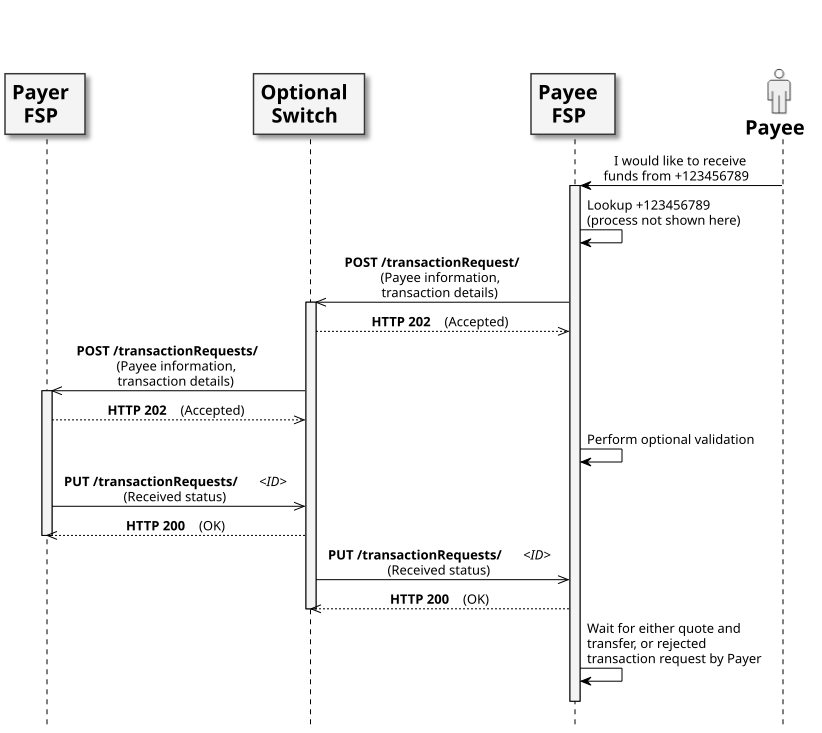

# Servicio de solicitudes de transacciones

## Diagrama de secuencia

* El transaction-requests-service es un servicio Mojaloop que permite casos de uso iniciados por el Beneficiario, como la «Solicitud de pago por parte del comercio».
* Se trata de un servicio de tramitación que también incluye autorizaciones.
