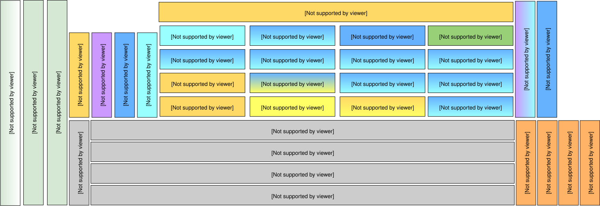

# Composants hérités du Hub Mojaloop — PI5

Le schéma de composants suivant présente la décomposition des services Mojaloop et leur architecture microservices pour PI5 :

_Note : le code couleur indique les relations entre le stockage de données, la messagerie en flux et les interconnexions d’adaptateurs. Par exemple, les `Central-Services` utilisent `MySQL` comme base de données et s’appuient sur `Kafka` pour la messagerie._
