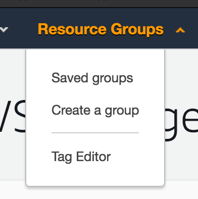
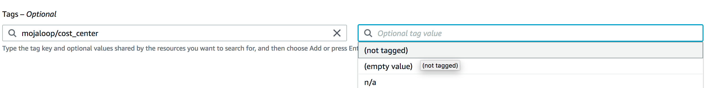
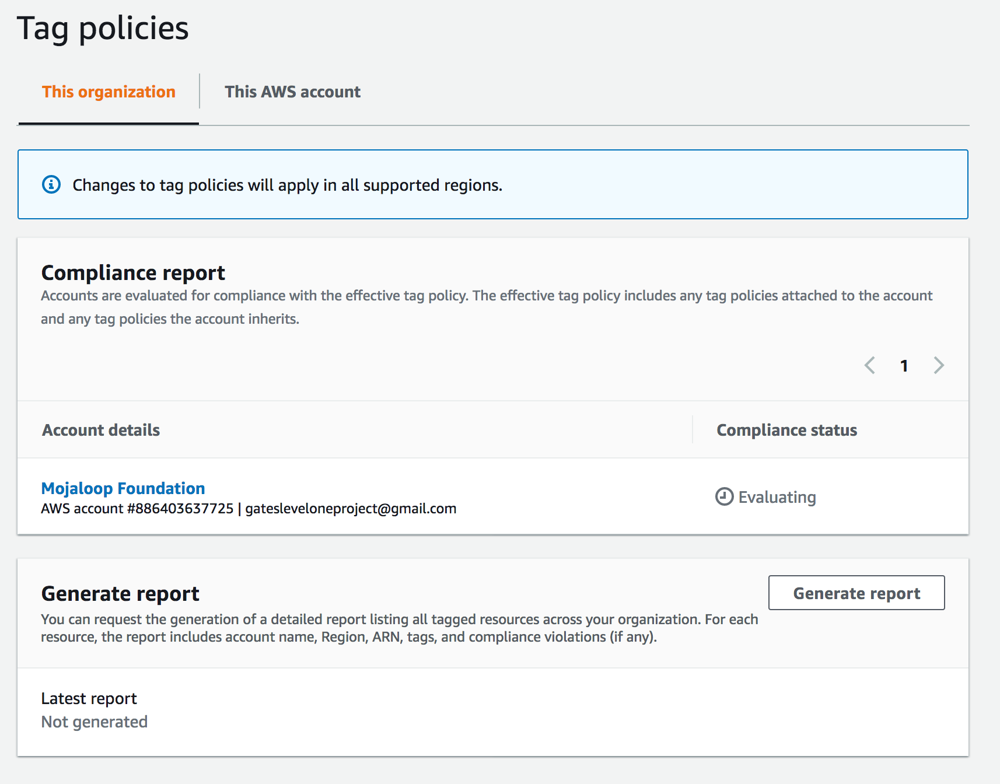
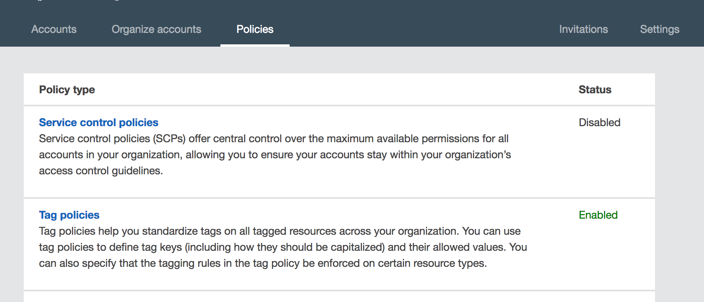
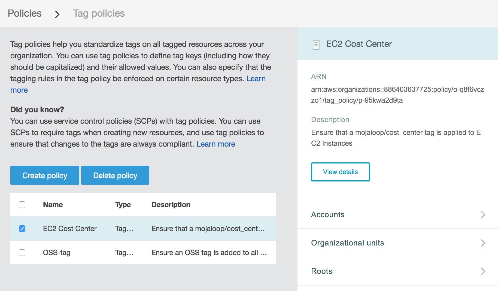
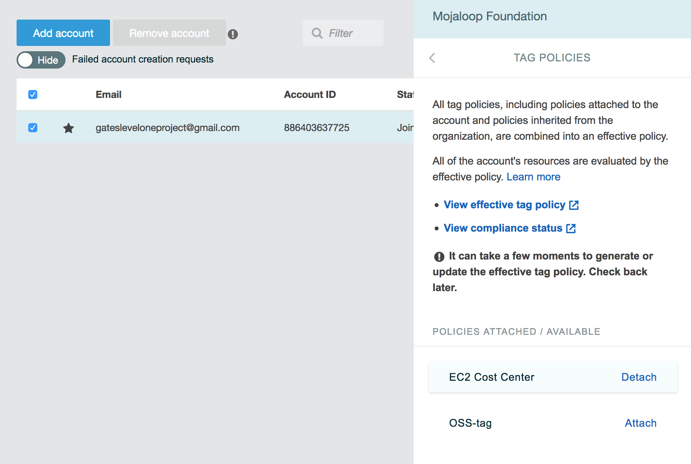

# Orientações e políticas de tagging na AWS

> **Nota:** Estas orientações são específicas do ambiente AWS da Comunidade Mojaloop para testar e validar instalações do Mojaloop e destinam-se sobretudo a fins internos. Podem, no entanto, ser uma referência útil para quem pretenda implementar estratégias de tagging semelhantes nas suas próprias organizações.

Para gerir e compreender melhor a nossa utilização e os nossos gastos com a AWS, estamos a implementar as orientações de tagging seguintes.

## Conteúdo
- [Tags propostas e os seus significados](#tags-propostas-e-os-seus-significados)
    - [mojaloop/cost_center](#mojaloop-cost-center)
    - [mojaloop/owner](#mojaloop-owner)
- [Tagging manual](#tagging-manual)
- [Tagging automatizado](#tagging-automatizado)
- [Políticas de tagging da AWS](#politicas-de-tagging-da-aws)
    - [Ver relatórios de tags e conformidade](#ver-relatorios-de-tags-e-conformidade)
    - [Editar políticas de tags](#editar-politicas-de-tags)
    - [Associar/desassociar políticas de tags](#associar-desassociar-politicas-de-tags)

## Tags propostas e os seus significados

Propomos as 2 _chaves_ de tag seguintes:

- `mojaloop/cost_center`
- `mojaloop/owner`

### `mojaloop/cost_center`

`mojaloop/cost_center` é uma decomposição dos diferentes recursos na AWS pelo workstream ou projeto que incorre nos custos associados.

Segue de forma aproximada o formato `<account>-<purpose>[-subpurpose]`, em que account é algo como `oss`, `tips` ou `woccu`.
> Nota: é provável que a maioria dos recursos fique sob a «conta» `oss`, mas consegui encontrar alguns recursos mais antigos que se enquadram nas categorias `tips` e `woccu`. Queremos também planear para tipos de recursos que possam vir a ser lançados no futuro.

Alguns valores possíveis para `mojaloop/cost_center` são:

- `oss-qa`: trabalho de QA de código aberto, como os ambientes dev1 e dev2 existentes
- `oss-perf`: trabalho de desempenho de código aberto, como o workstream de desempenho em curso
- `oss-perf-poc`: POC de desempenho/arquitetura

Reservamos também alguns valores especiais:
- `unknown`: este recurso foi avaliado (talvez manualmente, talvez por uma ferramenta automatizada) e não foi possível determinar um `cost_center` adequado.
  - Isto permitirá filtrar facilmente as tags `mojaloop/cost_center:unknown` e produzir um relatório
- `n/a`: este recurso não incorre em custos, pelo que não nos preocupa realmente atribuir-lhe um `cost_center`
  - Isto pode ser útil para aplicar tags em massa a recursos cuja pertença é difícil de determinar, como os Security Groups do EC2

### `mojaloop/owner`

`mojaloop/owner` é a pessoa responsável pela gestão e pelo encerramento de um dado recurso.

O objetivo desta tag é evitar recursos de longa duração que todos julgam que _mais alguém_ conhece, mas de que já não precisamos. Ao aplicar esta tag, passaremos a ter uma lista de _a quem recorrer_ para colocar questões sobre o recurso.

O valor pode ser simplesmente o nome de uma pessoa, todo em minúsculas:
- `lewis`
- `miguel`
- etc.

Mais uma vez, reservaremos os valores seguintes:
- `unknown`: este recurso foi avaliado (talvez manualmente, talvez por uma ferramenta automatizada) e não foi possível determinar um `cost_center` adequado.
  - Isto permitirá filtrar facilmente as tags `mojaloop/owner:unknown` e ver que recursos estão «órfãos»

## Tagging manual

Podemos utilizar o «Tag Editor» na consola da AWS para procurar recursos sem tags.

1. Inicie sessão na consola da AWS
2. Em Resource Groups, selecione «Tag Editor»

3. No editor de tags, selecione uma Region (normalmente, utilizo «All regions») e um Resource Type (normalmente, utilizo também «All resource types»)
4. Agora selecione «Search Resources» e aguarde que os recursos apareçam

Também é possível pesquisar por tags, ou pela ausência de tags, para ver que recursos ainda não têm tags.

5. Assim que tiver a lista dos recursos, pode selecionar e editar as tags de muitos recursos de uma só vez!
6. Também é possível exportar um ficheiro `.csv` dos recursos encontrados na pesquisa

## Tagging automatizado

Atualmente, automatizamos o tagging no seguinte

À medida que formos consolidando as nossas orientações de tagging, temos de as introduzir nas nossas ferramentas, para que todo o trabalho pesado do tagging manual.

Neste momento, isto passará por introduzir tags em:
1. Rancher - que gere atualmente os nossos clusters Kubernetes, tanto para QA como para desempenho
2. IAC - o futuro código de IAC que acabará por executar os nossos ambientes de desenvolvimento

## Políticas de tagging da AWS

Desde 3 de agosto de 2020, começámos a introduzir [políticas de tagging da AWS](https://docs.aws.amazon.com/organizations/latest/userguide/orgs_manage_policies_tag-policies.html) para impor melhor as tags e monitorizar os nossos recursos (sobretudo no que toca a custos).

### Ver relatórios de tags e conformidade

1. Inicie sessão na consola da AWS
2. «Resource Groups» > «Tag Editor»
3. Na barra lateral esquerda, selecione «Tag Policies»

A partir daqui, é possível ver o «compliance report» das políticas de tags

### Editar políticas de tags

> Nota: poderão ser necessários privilégios especiais de administrador para aceder a estas páginas

1. Inicie sessão na consola da AWS
2. Selecione «username@mojaloop» no canto superior direito > «My Organization»
3. Selecione «Policies» > «Tag Policies»

4. A partir daqui, é possível ver as políticas de tags atuais

5. Na barra lateral, pode clicar em «View details» > «Edit policy» para editar a política

### Associar/desassociar políticas de tags

1. Aceda à página «My Organization»
2. Selecione a conta relevante > «Tag policies» na barra lateral
3. A partir daqui, é possível associar e desassociar políticas de tags

