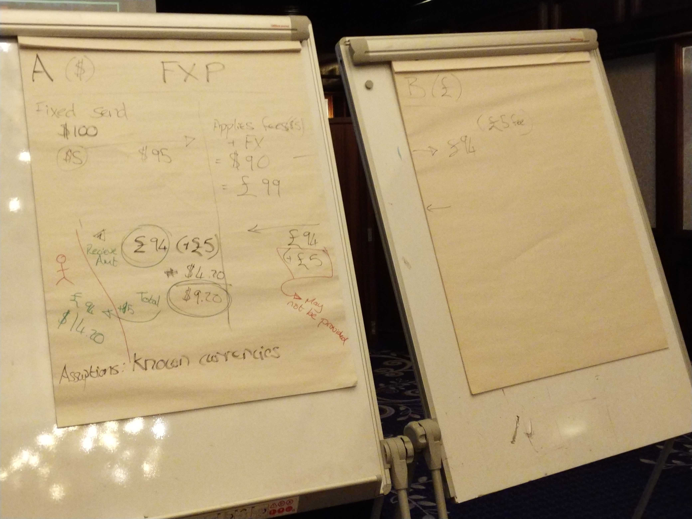
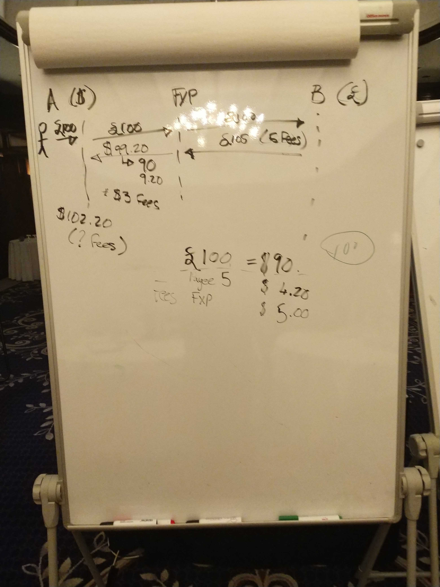

# Discussão sobre transfronteiriços, dia 1

>**Ligações**
>- [Notas do dia 2](./cross_border_day_2.md)
>- [Issue relevante no quadro da DA](https://github.com/mojaloop/design-authority/issues/32)
>- [Pull request da especificação do Mojaloop](https://github.com/mojaloop/mojaloop-specification/pull/22)

## Participantes:

Presencialmente
- Lewis, Crosslake
- Adrian, Coil
- Nico, MB
- Sam, MB
- Miguel, MB
- Carol Benson, Glenbrook
- Michael Richards, MB
- Henrik Karlsson, Ericsson
- Rob Reeve, MB
- Vanburn, Terra Pay
- Razin, Terra Pay
- Ram, Terra Pay
- JJ, Google
- Matt Bohan, Gates Foundation
- David Power, EY
- James Bush, MB
- Warren, MB
- Judit, MB
- Bart-Jan e Bruno, da GSMA  - dia #2

Por telefone
- Kim Walters, Crosslake
- Istvan Molnar, DPC
- Innocent Ephraim, MB

## Sessão 1

**Objetivo: atualizar as definições da API**

- Privacidade:
  - Posso enviar USD? _sim/não_
  - O que posso enviar? _lista de moedas_

Acordos de negócio: há algumas formas de isto acontecer
- Scheme global, composto por acordos entre schemes
- acordos bilaterais de scheme
- de scheme para scheme
- região

Definições:
- Gateway FSP: um FSP que faz a «ponte» entre 2 redes,
por exemplo, o Mowali
  - 2 redes lógicas (USD, XOF?)
  - uma única rede mojaloop

- Cross Network Provider (CNP)
  - FXP, a mesma coisa?

Michael:
- há uma razão para esse pressuposto
- outras implicações legais aqui...

- entidade única, legalmente em 2 jurisdições diferentes
  - uma analogia próxima de um scheme sem jurisdição

- participante: 
  - tem uma conta de tx que pode ser debitada ou creditada
  - banco, fxp, etc.

>P: Podemos ter um participante que não liquida? Ou isso seria coberto por um CNP que é uma parte
>por exemplo, a Visa nem sempre liquida num dado mercado, mas detém uma conta

- Residente face a não residente
  - os requisitos de reporte são diferentes

- quais são os requisitos técnicos para quem reporta?

- liquidação
  - não muito preocupante nesta fase (o nosso foco está nas alterações à API)
  - assumimos que a liquidação é possível, mas é preciso primeiro estreitar o âmbito com a api

- Não apenas mojaloop
  - é preciso permitir transferências de não mojaloop -> mojaloop e vice-versa (tanto de entrada como de saída)
  - tem de continuar a ser interoperável

- quem fornece o encaminhamento?
  - o switch?
  - o ALS?
  - o CNP?

>*Seguimento:* é necessária uma definição formal das funções de FXP e de CNP, juntamente com os requisitos e as responsabilidades

Ao nível do scheme
  - deveria o scheme manter uma lista dos outros schemes a que permite que os seus FSPs se liguem?
  - ou deveria o CNP tratar disto?

- não de scheme -> scheme, mas como parte do processo de onboarding do CNP
- mas o scheme pode/deveria continuar a manter regras

- como funcionará a cotação? Deveria um FSP enviar várias cotações, uma dirigida a cada CNP? Ou deveria o switch ter algum motor de regras que o ajude a determinar a quem enviar as cotações?

James: queremos ser flexíveis. Vejo casos em que quereríamos que ambas as coisas acontecessem, pelo que não deveríamos assumir demasiado nesta fase.

Opção mais simples: o switch fala com o ALS, determina que uma transferência não está na nossa rede e encontra depois uma lista de CNP

CNP + FXP -> essencialmente a mesma coisa
- são *funções*, e um DFSP pode assumir mais do que 1 função
- os fxp também podem existir em mais do que uma zona (por exemplo, o caso do Mowali)
  - um fxp de rede única é apenas um fxp,
  - um fxp multirrede é provavelmente também um CNP

## Sessão 2 

- debate sobre consultas únicas ou múltiplas
  - nunca deveríamos devolver «resultado vazio»

- as carteiras são endereçáveis por MSISDN?
  - de momento, apenas 1 conta
  - mas isto é interno ao switch
  - a função do oracle é converter MSIDN -> endereço Mojaloop

- no futuro: MSISDN + contas estarão menos relacionados
  - este tema está adjacentemente relacionado com o endereçamento

- «sair para fora» do mojaloop com o endereçamento será um pouco complicado
- Normalizar o endereçamento?
  - não é algo que queiramos fazer

Ram: existem ferramentas já disponíveis (não é preciso reinventar a roda), fora do scheme mojaloop

- enviar para uma moeda desconhecida
  - atualmente: 1 resposta da tabela de encaminhamento
  - no futuro: várias respostas

- privacidade:
  - não há verdadeira necessidade de regras rígidas neste momento (pelo menos, não ao nível da API; as regras vêm com os schemes)
  - precisamos de um método para mediar a informação que um switch exige de outro (e para rejeitar cotações caso esses pré-requisitos não sejam cumpridos)

---
- Doméstico face a transfronteiriço: o utilizador tem/precisa de informação diferente
  - por exemplo, queremos permitir a descoberta apenas no caso doméstico?
---

Adrian: muito disto é específico das regras de negócio e do scheme
- mantém o espaço concorrencial
- Quanta informação está:
  - na consulta?
  - na cotação?

---
- Proposta: a consulta de endereços -> devolve várias respostas?
- MSISDN -> ID, não um endereço. Alguém, não uma conta

- deveria haver apenas 1 resposta do ALS
- Michael discorda

- é preciso separar o *endereçamento* do *encaminhamento*

- temos de pensar nos efeitos a jusante que isto terá nos testes
  - é preciso encontrar uma forma clara de testar estas consultas

Por exemplo, a questão do UPI da airtel (em que os MSIDSN existentes foram substituídos quando os clientes móveis transitaram para clientes de dinheiro móvel)
  - temos de evitar uma situação dessas

---

Voltar aos primeiros princípios (L1P) 
- as transferências deveriam ser compensadas imediatamente
- não existe tal coisa como um futuro

- No caso doméstico: conseguimos garantir a entrega, mas o transfronteiriço é muito mais difícil
- é preciso manter o requisito de transparência sobre os CNP
  - isto resume-se às regras de negócio

- Tx reversíveis ou regras sobre problemas a jusante
  - o ILP trata da *maior parte* disto por nós

- no caso do TIPS: 1 ID corresponde a 1 conta
- como sempre, tem de haver um compromisso entre privacidade e funcionalidades (e não há problema nisso!)

---

No final de uma cotação:
- ValueDate
- quanto será recebido
- quais são as comissões? (decompostas, por passo e por moeda)

---

Como suportamos protocolos que não permitem cotações (esta é uma questão para sistemas moja para não moja)

Risco: CNP: é ele que detém o risco neste tipo de transação

O CNP como participante?
 - detém uma conta junto de um participante
 - abordagem direta face a indireta
 - isto não afeta os requisitos técnicos (por isso, fora do âmbito desta discussão)

---

- valor fixo a enviar e a receber:
  - Em que direção é que os dados têm de ser acrescentados à cotação? Depende de ser valor fixo a receber ou valor fixo a enviar

- Ou: `A envia 20 USD a B` OU `B recebe 1000 PHP`

- traduzir as comissões de volta para o utilizador: o FXP __tem de__ aplicar a mesma taxa às comissões que aplica à transferência principal

- Da perspetiva do L1P: __o objetivo é a transparência__

- e quanto às cotações fora do Mojaloop?
  - o CNP deveria tratar disto - é o último bastião de «mojaloopice»

---

- Objeto Participant
  - Associado às cotações, uma entrada por salto?
  - Assim, as cotações multissalto contêm _n_ objetos participant, em que _n_ = número de saltos + 1

No âmbito disto, precisamos de:
- partes de dados interoperáveis (definições comuns)
- scheme para a encriptação
- um sítio onde colocar os dados (no objeto quotes)

Devemos preocupar-nos com a encriptação por agora?
- talvez não, mas deveríamos continuar a prevê-la na API

A encriptação acrescenta um desafio adicional de integração
- qual é a necessidade de obter os dados em claro?
  - de uma perspetiva técnica: basta utilizar uma chave de encriptação em branco

Precisamos de encriptar para garantir que o(s) switch(es) não conseguem ver os dados?
  - talvez não nesta fase

>### Decisão:
>- Sem encriptação por agora
>- no pedido de cotação de saída: ter uma lista de requisitos de dados
>- no pedido de cotação de entrada: os participantes preenchem esses requisitos
>- se os requisitos não forem cumpridos: abortar a cotação
>- Não codificar os requisitos de dados de forma fixa, deveríamos utilizar normas existentes

- é preciso especificar se os campos _foram_ ou não verificados
  - articula-se com os processos de KYC por escalões

- é necessário um dicionário comum dos dados que podem/deveriam ser pedidos

## Quadros:

_quadro 1: fluxos de valor fixo a enviar_

_quadro 2: fluxos de valor fixo a receber_

