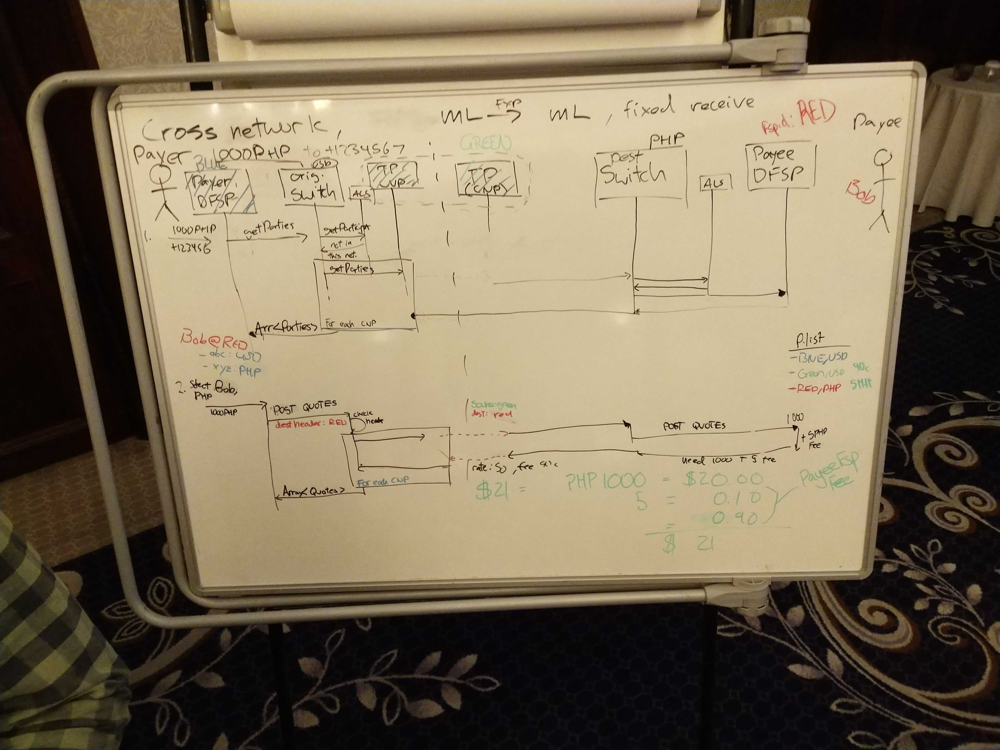

# Discussão sobre transfronteiriços, dia 2

>**Ligações**
>- [Notas do dia 1](./cross_border_day_1.md)
>- [Issue relevante no quadro da DA](https://github.com/mojaloop/design-authority/issues/32)
>- [Pull request da especificação do Mojaloop](https://github.com/mojaloop/mojaloop-specification/pull/22)

## Passos seguintes:

- Atualizadas as APIs da proposta
- Apresentar a alteração consolidada ao CCB por escrito
- Algumas semanas para preparar as alterações (Michael/Adrian a dividir o trabalho)
- Chamada do CCB em meados de novembro
 

## Sessão 1

Questões sem resposta:
- endereçamento
  - decompor?
  - cross-mojaloop
  - o que faz um PayerFSP com um endereço?

- ALS + encaminhamento
  - que otimizações é que a API precisa de fazer/permitir?

- ids de DFSP locais face a remotos

- Falhas a jusante
  - Quando o pagamento é efetivamente compensado, o pagador recebe uma notificação (sobretudo em pagamentos «diferidos» que possam interagir com sistemas não Mojaloop)
  - Pode um CNP enviar um `PATCH` da tx para atualizar de alguma forma o Beneficiário?

---

- várias cotações e respostas de rotas:
  - como apresentá-las ao utilizador?
  - Temos de estabelecer regras para filtrar rotas
    - difícil de fazer: por exemplo, colocar um switch numa blacklist? ou exprimir uma preferência por determinadas rotas

- como descobrirá o DFSP Remetente as regras de scheme de um recetor?
- precisa o DFSP Remetente de «conhecer» o switch final? Ou pode apenas «conhecer» o seguinte?

---

A esbarrar em pressupostos ML + não ML
- significa isto que o CNP precisa de fazer mais trabalho ao ligar-se a sistemas não ML?
  - por exemplo, conhecer o scheme/switch resultante?
    - porquê? Tratamento de falhas
    - com base na decisão de ontem: deveria o CNP fazer este trabalho?

- Retirar uma lição da SWIFT:
  - o banco não sabe para onde vai o dinheiro
  - podemos evitar isto no ML?

---

CNP: o objetivo é «agir como» um membro normal da rede
  - Isto minimiza as responsabilidades que o scheme assume

Quando é a TX considerada concluída?
  - Pode haver casos em que o scheme a considera terminada, mas em que não está tecnicamente concluída de ponta a ponta

Como lidamos com a deterioração do serviço?
  - Regras de scheme

---

De volta às cotações:

- como exprimir a informação da cotação?
  - as cotações e as rotas são separadas? Presumivelmente, sim

- A cotação é o passo mais dispendioso
  - Podemos fornecer aqui informação de QOS como parte da consulta?

Endereçamento:
- Necessidade de um endereço único a nível global
  - Permitir um espaço de endereços para DFSP e pessoas/contas únicas
- o scheme diz «isto não está no meu espaço»
- o CNP descobre as rotas para chegar a esse espaço

---

### A tangente do Michael:

- teremos feito os pressupostos errados sobre o CNP?

**switch:** conhece os CNP + FXP
**CNP:** detém a tabela de encaminhamento e a consulta

- se o remetente ou o recetor for um FXP, então a tx *não* é uma tx multimoeda

--- 

## Sessão 2

*Decisão:*
- o valor do cabeçalho é o id do CNP
- o objeto partId é o FSP final

valueDate
- está implícito que se espera que os fundos sejam compensados antes da valueDate
- é possível manter tempos de expiração curtos na tx

- CNP:
  - devolve um conjunto ofuscado de comissões
  - enquadra-se no nosso modelo atual

- condição:
  - objeto existente criptograficamente ligado ao objeto tx
    - mas, no caso de múltiplos saltos, não conhecemos apenas este
    - o valor fixo a receber torna isto mais complicado (que é o que os echo data pretendem resolver)

  - Queremos **apenas 1 condição para todos os saltos**
  - a ideia de uma condição múltipla é uma «perversão» (segundo alguns)

## Quadros:

_quadro 3: fluxo de consulta e de cotações entre redes, valor fixo a receber de 1000 PHP a partir de USD_

